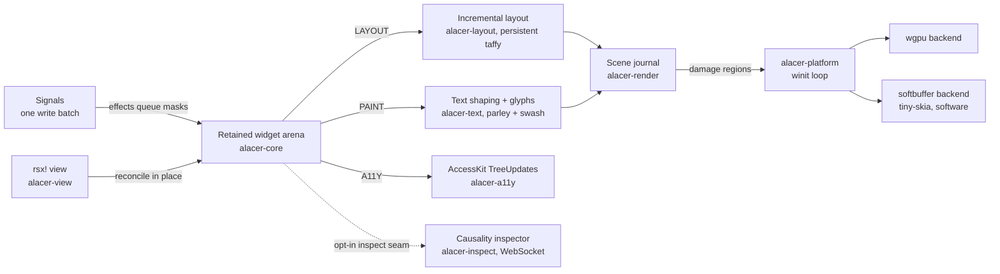

<div align="center">
  
  <p>
    <strong>A retained-mode Rust GUI toolkit where reactivity, layout, paint, and accessibility share one invalidation currency.</strong><br/>
    Widgets live in a retained arena, <code>rsx!</code> views compile into cheap trees that reconcile in place, and every write queues per-node <code>Change</code> masks that each subsystem — layout, paint, accessibility, devtools — consumes independently. It is built for Rust developers who need accessibility, headless CI, and idle-cheap windows without giving up fine-grained reactivity; proven cores (reactive_graph, taffy, parley, accesskit, winit, wgpu) are adopted as-is and the composition is what this workspace owns. In the published baseline, incremental relayout of 10,000 nodes under 10% style churn measured 14.01× faster than a full rebuild — a contract CI enforces on every run.
  </p>
  <p>
    <a href="https://github.com/elcoosp/alacer/blob/main/Cargo.toml"></a>
    <a href="https://github.com/elcoosp/alacer/blob/main/LICENSE-MIT"></a>
    <a href="https://github.com/elcoosp/alacer/blob/main/rust-toolchain.toml"></a>
    <a href="https://github.com/elcoosp/alacer/actions/workflows/ci.yml"></a>
    <a href="https://github.com/elcoosp/alacer/blob/main/crates/alacer-platform"></a>
    <a href="https://github.com/elcoosp/alacer/blob/main/crates/alacer-a11y"></a>
    <a href="https://github.com/elcoosp/alacer/blob/main/crates/alacer/src/hot.rs"></a>
  </p>
</div>

<p align="center">
  <a href="#quickstart">Quickstart</a> • <a href="#features">Features</a> • <a href="#how-it-works">How it works</a> • <a href="#usage">Usage</a> • <a href="#status">Status</a> • <a href="#learn-more">Learn more</a>
</p>

## Quickstart

Prerequisites: Rust 1.99 or newer (`rust-toolchain.toml` pins the exact workspace toolchain); a GPU driver for the wgpu path, or none at all with `ALACER_SOFTWARE=1`.

```sh
git clone https://github.com/elcoosp/alacer
cd alacer
cargo run -p alacer --example counter
```

A 360×200 window titled "Alacer counter" opens with a label reading `Clicked 0 times` and an `Increment` button. Each click is one write batch, and the scheduling contract collapses every batch into exactly one layout and paint cycle — nothing else in the tree pays for it.

More entry points, straight from the catalog:

```sh
cargo run -p alacer --example gallery                           # the whole widget vocabulary in one window
cargo run -p alacer --example counter_view                      # the same counter as an rsx! view
ALACER_SOFTWARE=1 cargo run -p alacer --example scrolling_list  # software backend: VMs, CI, no-GPU machines
cargo run -p alacer --example inspector_demo                    # counter + Causality inspector (prints a URL)
cargo test --workspace                                          # headless: the real pipeline, software raster
```

> [!TIP]
> On machines without a GPU, set `ALACER_SOFTWARE=1` to present through softbuffer. CI and the headless tests already run this path — no mock renderer, no mock event loop.

## Features

- **One invalidation currency.** Every consumer reads the same per-node `Change` masks (`STRUCTURE | LAYOUT | PAINT | A11Y | FOCUS`, `crates/alacer-core/src/mask.rs`). Effects queue masks and never mutate widgets, so a feature that cannot express itself as a mask is redesigned or rejected (architecture axiom A1).
- **Incremental layout over a persistent tree.** The Taffy tree is built once and never cleared (`crates/alacer-layout`); relayout is bounded by the dirty set's root candidate, scrolling composes as translation-only updates with zero measure calls, and the ≥ 2× incremental-vs-full gate is test-enforced (`crates/alacer-layout/tests/w1_gate.rs`) — measured at 14.01× in the published baseline.
- **Two backends from one scene journal.** The paint pass records per-node layers (`crates/alacer-render`); wgpu rasterizes rounded-rect SDFs and glyphs from a CPU coverage atlas, while tiny-skia + softbuffer blends the same bitmaps headlessly. Both implement identical damage semantics, and an equivalence fuzz pins partial repaints pixel-equal to full renders across clicks, typing, and IME composition.
- **Accessibility by construction.** `role()` and `label()` are required `Widget` trait methods, so an unnamed widget does not compile; updates ship as incremental AccessKit `TreeUpdate`s, and tests query the accessibility tree rather than widget internals (`crates/alacer-a11y`, `crates/alacer-testing`).
- **Hot reload with state intact.** The `hot-reload` feature wraps the view generation in `subsecond::call`; a binary patch swaps code, never state, and the loop answers with exactly one scoped re-render — pinned by a dedicated CI hot-patch suite (`crates/alacer/src/hot.rs`, `crates/alacer/tests/hot_reload_subsecond.rs`).
- **The Causality inspector.** An opt-in seam records edge activations, provenance-tagged signal writes, per-frame pass ledgers, and a dirty-node mask heatmap, streamed over a documented WebSocket protocol to an embedded client (`crates/alacer-inspect`, `docs/inspector-protocol.md`).
- **Performance budgets as contracts.** All 43 criterion cases are published with their environment in `benchmarks/baselines/baselines.json` and gated by `benchmarks/contracts.json`; the CI perf-contracts job fails on a same-host regression or an uncontracted benchmark.
- **The cross-framework beat, measured and reproducible (M7).** The declared rig (`benchmarks/rig.json`), the competitor harnesses (idiomatic egui and Masonry under `benchmarks/competitors/`), and the 5-run-median runner (`scripts/run_comparison.py`) publish `benchmarks/comparisons/results.json` — the §18 beat computed same-host, every row labeled with its scope: incremental relayout of a 10k-node churn frame measures 1.10 ms against egui's 20.7 ms full frame (18.8×) and Masonry's 4.6 ms full pass pipeline (4.2×).

## How it works

A frame starts with state: handlers write signals in one batch, and the flux bridge turns each write into masks on the affected nodes. The view layer (`alacer-view`) diffs the new `rsx!` tree against the old one and patches the retained arena in place — keyed children route through a longest-increasing-subsequence diff. The ten-pass pipeline then runs only what the masks demand: incremental layout over the persistent Taffy tree, text shaping through parley, paint into the scene journal, and incremental AccessKit updates. The platform layer (`alacer-platform`) presents through wgpu or softbuffer and parks in `ControlFlow::Wait` between interactions, so an idle window costs zero CPU.



The public API lives in the `alacer` facade; the twelve crates form a layered DAG that `scripts/check_dag.py` enforces in CI.

## Usage

### Views

The `rsx!` DSL compiles element trees into `ViewNode` builders — elements, interpolated text, `key:`, `for`, and `if`/`else` (`crates/alacer-macro`, exercised in `crates/alacer/tests/rsx.rs`):

```rust
use alacer::prelude::*;
use reactive_graph::traits::{Get, Set};

fn counter_view(count: alacer_core::FluxRwSignal<i32>) -> ViewNode {
    rsx! {
        column { gap: 8.0, padding: 12.0,
            label { text: "Clicked {count.get()} times" }
            button { text: "Increment", on_click: move || count.set(count.get() + 1) }
        }
    }
}
```

The full wiring — `pipeline_default()`, `mount_view(&counter_view(count), &mut pipeline)`, `run_window(...)` — is `crates/alacer/examples/counter_view.rs`. Widgets can also be assembled directly without the DSL; `crates/alacer/examples/counter.rs` shows that form.

### Widgets

The shipped vocabulary covers `Label`, `Button`, `TextInput`, `Column`, `Row`, `Spacer`, `List`, and `Panel` (`crates/alacer-widgets`), each carrying its required role and label and reading shared theme constants. Handlers write signals in one batch; reactive text lands through `RenderBinding`s.

### Examples

| Example | Demonstrates |
|---|---|
| `counter` | one signal, one bound label, one button — masks end to end |
| `counter_view` | the same app as an `rsx!` view with keyed reconciliation |
| `gallery` | the whole widget vocabulary in one window |
| `scrolling_list` | panels in a clipped viewport; translation-only scrolling |
| `text_input` | caret editing, secure mode, Tab focus cycling, IME preedit and commit |
| `hot_reload` | swaps the view generation live; state survives |
| `inspector_demo` | the counter with the Causality inspector riding on it, served at `127.0.0.1:9217` |

`docs/examples.md` is the complete catalog, including the contract each example exercises.

### Testing

```sh
cargo test --workspace                     # headless: real pipeline + software rasterizer
ALACER_BLESS=1 cargo test -p alacer-testing  # re-bless PNG snapshots after an intentional visual change
```

Snapshot scenarios live in `crates/alacer-testing/blessed/`; accessibility tests query the a11y tree (`query(role).named(..)`, `press`, `find_all`) through the harness in `crates/alacer-testing`.

## Status

> [!NOTE]
> Alacer is at 0.7.0, pre-1.0: milestones M0 through M7 of `docs/architecture.md` are complete and released, but the API still moves between minor versions. Linux is the primary CI platform — fmt, clippy (pedantic, warnings denied), headless tests, docs, the crate-DAG check, the hot-patch suite, cargo-deny, benches, and perf contracts — while Windows is smoke-tested on a subset of crates; macOS is expected to work through winit and wgpu but is not exercised in CI. The MSRV is 1.99 with the 2024 edition.

## Learn more

- [Architecture](https://github.com/elcoosp/alacer/blob/main/docs/architecture.md) — the full system document: design axioms, the ten-pass contract, rendering, accessibility, DX and performance architecture, roadmap and kill criteria
- [ADRs](https://github.com/elcoosp/alacer/blob/main/docs/adr/) — thirteen decision records, from workspace discipline to the M7 scope
- [Examples catalog](https://github.com/elcoosp/alacer/blob/main/docs/examples.md) — every example with the contract it exercises
- [Migrating from Iced](https://github.com/elcoosp/alacer/blob/main/docs/migration/from-iced.md) and [from egui](https://github.com/elcoosp/alacer/blob/main/docs/migration/from-egui.md) — mental-model mappings with interop limits stated plainly
- [Inspector protocol](https://github.com/elcoosp/alacer/blob/main/docs/inspector-protocol.md) — the versioned WebSocket contract behind `alacer-inspect`
- [Performance dashboard](https://github.com/elcoosp/alacer/blob/main/benchmarks/dashboard/index.html) — published baselines and budget contracts, regenerated by CI
