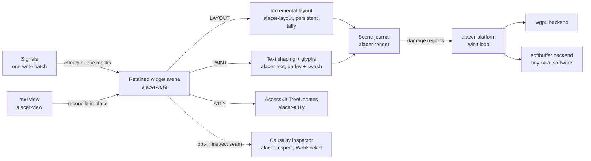

<div align="center">
  
  <p>
    <strong>A retained-mode Rust GUI toolkit where reactivity, layout, paint, and accessibility
    share one invalidation currency.</strong><br/>
    Widgets live in a retained arena; <code>rsx!</code> views reconcile in place; every write queues
    per-node <code>Change</code> masks that layout, paint, accessibility and devtools each consume
    independently. Proven cores — reactive_graph, taffy, parley, accesskit, winit, wgpu — adopted
    as-is; the composition is what this workspace owns. Built for accessibility, headless CI and
    idle-cheap windows, without giving up fine-grained reactivity.
  </p>
  <p>
    <a href="https://github.com/elcoosp/alacer/blob/main/Cargo.toml"></a>
    <a href="https://github.com/elcoosp/alacer/blob/main/LICENSE-MIT"></a>
    <a href="https://github.com/elcoosp/alacer/blob/main/rust-toolchain.toml"></a>
    <a href="https://github.com/elcoosp/alacer/actions/workflows/ci.yml"></a>
    <a href="https://github.com/elcoosp/alacer/blob/main/crates/alacer-platform"></a>
    <a href="https://github.com/elcoosp/alacer/blob/main/crates/alacer-a11y"></a>
    <a href="https://github.com/elcoosp/alacer/blob/main/crates/alacer/src/hot.rs"></a>
  </p>
</div>

<p align="center">
  <a href="#highlights">Highlights</a> • <a href="#quickstart">Quickstart</a> • <a href="#how-it-works">How it works</a> • <a href="#accessibility">Accessibility</a> • <a href="#the-causality-inspector">Inspector</a> • <a href="#examples">Examples</a> • <a href="#status">Status</a> • <a href="#learn-more">Learn more</a>
</p>

---

## Highlights

|                                   |                                                                                                                                                                                                                |
| --------------------------------- | -------------------------------------------------------------------------------------------------------------------------------------------------------------------------------------------------------------- |
| 🎯 **One invalidation currency**  | Per-node `Change` masks (`STRUCTURE \| LAYOUT \| PAINT \| A11Y \| FOCUS`). Effects queue masks and never mutate widgets — a feature that cannot express itself as a mask is redesigned or rejected (axiom A1). |
| ⚡ **Incremental everything**     | The Taffy tree is built once and never cleared; relayout is bounded by the dirty set; scrolling is translation-only, zero measure calls.                                                                       |
| ♿ **Accessible by construction** | `role()` and `label()` are required trait methods — an unnamed widget does not compile. Updates ship as incremental AccessKit deltas; tests query the a11y tree, not internals.                                |
| 🖥️ **Two backends, one journal**  | wgpu and tiny-skia/softbuffer render the same scene journal; an equivalence fuzz pins partial repaints pixel-equal to full renders. True cargo features, honest refusals.                                      |
| 🔭 **The Causality inspector**    | Every focus move, edit, shortcut, clipboard trip, value write, gesture, scroll, AT text write, boundary drop, a11y echo, activation, frame refusal, view patch, theme swap and OS setting flip answers as _named data_ on an opt-in WebSocket trail.                                                                        |
| 🔥 **Hot reload, state intact**   | A subsecond binary patch swaps code, never state — exactly one scoped re-render, pinned by a CI hot-patch suite.                                                                                               |
| 💤 **Idle-cheap**                 | The winit loop parks in `ControlFlow::Wait` between interactions — an idle window costs zero CPU.                                                                                                              |

**Measured, gated, published:**

| Contract                                              | Baseline                                        | Enforced by                                                                                            |
| ----------------------------------------------------- | ----------------------------------------------- | ------------------------------------------------------------------------------------------------------ |
| Incremental relayout, 10 000 nodes @ 10 % style churn | **14.44×** vs full rebuild                      | ≥ 2× gate, `alacer-layout/tests/w1_gate.rs`                                                            |
| 50-event pointer storm                                | **1** coalesced dispatch (**40.08×**)           | `input_storm_batching` budget                                                                          |
| 10k-node churn frame vs egui, same host               | 1.10 ms vs 20.7 ms full frame (**18.8×**)       | 5-run medians, declared rig (`benchmarks/rig.json`)                                                    |
| …vs Masonry                                           | 1.10 ms vs 4.6 ms full pass pipeline (**4.2×**) | same rig, `scripts/run_comparison.py`                                                                  |
| All 144 criterion cases                                | `benchmarks/baselines/baselines.json`           | `contracts.json` + the CI perf-contracts job: fails on a same-host regression or an uncontracted bench |

_Competitor rows compare Alacer's incremental frame against their full frame/pass — every row in
`benchmarks/comparisons/results.json` is labeled with its scope._

> [!IMPORTANT]
> **The contracts the whole tree keeps.** Every rider — pointer, keyboard, screen reader, app
> code — lands the _same_ funnel. Every refusal is a _named species_, never a munged action or a
> collapsed `false`. A write that lands where the value already is queues **no masks** (an idle
> frame). Every causal trail is bounded, silent when nobody listens (the A7 idle contract), and
> never carries a payload that could be a secret.

## Quickstart

Rust **1.99+** (`rust-toolchain.toml` pins the workspace toolchain); a GPU driver for wgpu, or
none at all with `ALACER_SOFTWARE=1`.

```sh
git clone https://github.com/elcoosp/alacer
cd alacer
cargo run -p alacer --example counter
```

A 360×200 window opens with a label and an _Increment_ button. Each click is one write batch,
and the scheduling contract collapses it into exactly one layout and paint cycle — nothing else
in the tree pays for it.

```sh
cargo run -p alacer --example gallery                           # the whole widget vocabulary
cargo run -p alacer --example counter_view                      # the same counter as an rsx! view
ALACER_SOFTWARE=1 cargo run -p alacer --example scrolling_list  # software backend: VMs, CI, no GPU
cargo run -p alacer --example input_storm                       # frame-batched input, demonstrated
cargo run -p alacer --example inspector_demo                    # counter + Causality inspector
cargo test --workspace                                          # headless: real pipeline, software raster
```

> [!TIP]
> `ALACER_SOFTWARE=1` presents through softbuffer — the platform honors it at startup
> (`BackendPreference::software_env`) whichever backend the app asked for; any other value is
> refused with a named warning, never guessed. CI and the headless tests already run this path:
> no mock renderer, no mock event loop. The full 121-example catalog lives in
> [docs/examples.md](https://github.com/elcoosp/alacer/blob/main/docs/examples.md).

## How it works

A frame starts with state: handlers write signals in one batch, and the flux bridge turns each
write into masks on the affected nodes. The view layer diffs the new `rsx!` tree against the old
one and patches the retained arena in place — keyed children ride a longest-increasing-subsequence
diff. The ten-pass pipeline then runs only what the masks demand: incremental layout over the
persistent Taffy tree, parley text shaping, paint into the scene journal, incremental AccessKit
updates. The platform presents through wgpu or softbuffer and parks between interactions.



Twelve crates, one layered DAG — `scripts/check_dag.py` enforces it in CI:

| Crate             | Role                                                                                                                                                |
| ----------------- | --------------------------------------------------------------------------------------------------------------------------------------------------- |
| `alacer`          | the public facade: prelude, `pipeline_default()`, `mount_view()`, `run_window()`, the hot-reload seam                                               |
| `alacer-core`     | arena, `Change` masks, flux bridge, ten-pass pipeline, input coalescer, history, keymap, gesture/scroll/value/clipboard seams, the inspect recorder |
| `alacer-view`     | `rsx!` tree reconciliation in place; keyed LIS diff                                                                                                 |
| `alacer-macro`    | the `rsx!` DSL                                                                                                                                      |
| `alacer-layout`   | the persistent Taffy tree; incremental relayout; translation-only scrolling                                                                         |
| `alacer-text`     | parley shaping, swash glyphs, ICU-backed UAX #29 segmentation                                                                                       |
| `alacer-render`   | the scene journal: per-node layers, damage, the frame ledger                                                                                        |
| `alacer-platform` | the winit loop; wgpu + softbuffer present paths; the arboard clipboard engine                                                                       |
| `alacer-a11y`     | the AccessKit sink: incremental `TreeUpdate`s                                                                                                       |
| `alacer-widgets`  | the widget vocabulary                                                                                                                               |
| `alacer-inspect`  | the WebSocket server + embedded client                                                                                                              |
| `alacer-testing`  | the headless harness: snapshots, a11y-tree queries                                                                                                  |

**Backends are true features (M34).** `backend-wgpu` and `backend-softbuffer` compile their own
present paths; single-backend and pipeline-only builds are supported shapes, warning-free under
`-D warnings`; a preference whose backend the build compiled out refuses honestly at startup
(`PlatformError::BackendUnavailable`, ADR-0040) — the feature matrix is CI-enforced. wgpu
rasterizes rounded-rect SDFs and glyphs from a CPU coverage atlas; softbuffer blends the same
bitmaps through tiny-skia. Both implement identical damage semantics. Two more features complete the set: `hot-reload` links the `subsecond` patching runtime (ADR-7), and `ci-bundle` is every non-default shape at once — both backends beside the hot-reload wiring — the one-word matrix `--features ci-bundle` covers instead of `--all-features`.

**The frame ledger.** Since M23 the frame carries a public ledger: the journal reports its own
commits, drops and live layers through `PassPipeline::journal_stats` — one write batch ⇒ one
layer re-commit, the static layers replay untouched (`frame_ledger` example).

## Accessibility

Accessibility is not a layer bolted on — it is the tree's own vocabulary:

- **Required naming**: `role()` and `label()` are `Widget` trait methods; an unnamed widget does
  not compile.
- **Deltas, not rebuilds**: dirty nodes only; adapter activation answers with the sink's full
  tree, the steady state is the delta (ADR-0015). The full M6 vocabulary — values, toggle state,
  grid slots — rides the same delta.
- **Tests read the tree**: the harness queries roles and names (`alacer-testing`), never widget
  internals.

| Tier                   | What ships                                                                                                                                                                                                                                          | ADR       |
| ---------------------- | --------------------------------------------------------------------------------------------------------------------------------------------------------------------------------------------------------------------------------------------------- | --------- |
| **Actions** (M10)      | Faithful routing: a screen reader scrolls the list canon, an increment is never munged into a press, a focused button answers Space/Enter like a click                                                                                              | 0016      |
| **Selection** (M11)    | Anchor + caret in UTF-16 units on the focused input; `SetValue` / `ReplaceSelectedText` / `SetTextSelection` carry their payload or refuse honestly; the report drops while an IME composes                                                         | 0017      |
| **Any modality** (M12) | Click places the caret at the hit point, drag extends from its anchor, the AT reads the drag's direction — one tree vocabulary whichever input wrote it                                                                                             | 0018      |
| **Words** (M13)        | Alt/Ctrl+arrows hop word runs, word chords delete exactly the span, double-click selects the word (or collapses on a separator); UAX #29 is ICU-backed in `alacer-text`, never widget tables                                                        | 0019      |
| **Clipboard** (M14)    | Ctrl/Cmd+C/X/V; paste collapses line breaks to spaces; the seam has no default (the OS clipboard is a platform fact — arboard in `alacer-platform`); a refused write never deletes                                                                  | 0020      |
| **Undo/redo** (M15)    | A typed run undoes as one step, every step restores the selection it consumed, a whole-value replace resets the bounded journal — core's own vocabulary (`history.rs`)                                                                              | 0021      |
| **Live speech** (M18)  | `announce` ships state changes that own no widget through a reserved live-region node: polite or assertive, present from the first frame, last write wins, refusals honest                                                                          | 0024      |
| **Values** (M20/M21)   | `Slider` is writable through one funnel — drag, arrows, AT `SetValue`/`Increment`/`Decrement` — clamped and snapped inside the widget; `Progress` is read-only: the app writes it, every AT action refuses (no write door)                          | 0026/0027 |
| **Availability** (M22) | One `enabled` truth on the trait: unavailable controls are never Tab stops, focus is evicted, every door refuses (pointer wall, keyboard/IME silence, AT refusal), AccessKit reads `disabled` before it tries, the muted paint tells the same truth | 0028      |
| **Description** (M95)  | The help text beside the name: `description()` on the trait, `Button`/`Checkbox`/`TextInput` carrying it, AccessKit's `Description` property mapped in the same snapshot; the `description:` word patches the tree's truth with exactly `A11Y` — the pixels never pay for a fact the painter did not write | 0099      |
| **Placeholder** (M96)  | The hint an empty field announces: the painted hint rides the tree (`Placeholder` property), an empty placeholder the honest absence; the `placeholder:` word patch pays both masks — the paint beside the re-announcement — and the write that lands where the hint is queues nothing | 0100      |
| **Range** (M97)        | The declared span every value-tier write funnels through: `value_range()` on the trait, `Slider`/`Progress` carrying it, AccessKit's `MinNumericValue`/`MaxNumericValue` beside the step mapped in the same snapshot — the AT reads "42 of 0..100, step 5", not a bare number; `None` the honest absence | 0101      |
| **Orientation** (M98)  | The declared axis a scroll container's scrolls ride: `scroll_orientation()` on the trait, `List` carrying the constructor's word, AccessKit's `Orientation` property mapped in the same snapshot — the AT reads "vertical" before the arrows ride, the two-axis answer the honest absence ARIA spells `undefined`; `None` the honest absence | 0102      |
| **Numeric** (M99)      | The number behind the value's spoken word: `numeric_value()` on the trait, `Slider`/`Progress` carrying the scalar their funnel holds, AccessKit's `NumericValue` property mapped in the same snapshot — the AT reads 40 (`aria-valuenow`) beside "40" (`aria-valuetext`), a prose value never parsed into a guessed number; `None` the honest absence | 0103      |
| **Secure** (M100)      | The field's declared secret entry: `secure_entry()` on the trait, `TextInput` carrying the constructor's word, AccessKit's `PasswordInput` role mapped in the same snapshot — the AT announces "secure text entry", the value the tree resolves the mask (one masking character per code point, never the secret); `false` the honest absence | 0104      |
| **Scroll position** (M101) | Where the container *is* on the track it declared: `scroll_position()` on the trait, `List` producing the offset the doors landed beside the wall they clamp to, AccessKit's `ScrollY`/`ScrollYMin`/`ScrollYMax` (the `ScrollX` halves beside them on a two-axis container) mapped in the same snapshot — the AT announces "scrolled 200 of 0..600", an empty span the same wall every scroll door answers `no_scrollable_content` with; `None` the honest absence | 0105      |
| **Reveal** (M102)       | The toggle behind the mask: `secure_revealed()` on the trait beside `secure_entry()`, `TextInput` carrying the constructor word and the `set_revealed` door, AccessKit's own contract naming the mapping (`Role::TextInput` once revealed) in the same snapshot — the mask yielding to the revealed state, the value the pixels show the value the tree says; `false` the honest absence on every field that declared no secret entry | 0106      |
| **Read-only** (M105)   | The field whose value is the app's: `read_only()` on the trait, `TextInput` carrying the constructor word and the `set_read_only` door, the walls the doors' own named species (`KeyEditRefusal::ReadOnly` on the typing door and the IME's commit, `TextWriteRefusal::ReadOnly` on the AT's write door) while the read doors answer beside them (focus, caret, selection, copy), AccessKit's `ReadOnly` flag mapped in the same snapshot; `false` the honest absence | 0109      |
| **Required** (M106)    | The form's ask before the submit fires: `required()` on the trait, `TextInput` carrying the constructor word and the `set_required` door, `Slider`/`Checkbox` joining without a seam change, AccessKit's `Required` flag mapped in the same snapshot — the AT reading "required" before it asks (required is not a wall, the empty submit the app's own contract); `false` the honest absence | 0110      |
| **Invalid** (M107)      | The rejection behind the form's ask: `invalid()` on the trait carrying the kind (`InvalidKind` — ARIA's own three values: `true`, `grammar`, `spelling`), `TextInput` carrying the constructor word and the `set_invalid` door, `Slider`/`Checkbox` joining without a seam change, AccessKit's `Invalid` property mapped in the same snapshot — the AT reading "invalid" while the user edits, the doors answering exactly as they always did (invalid is not a wall); `None` the honest absence | 0111      |
| **Selected** (M108)    | The collection's pick: `selected()` on the trait answering the honest trio (`None` the member of no selection collection — the absence ARIA spells `undefined`, never a guessed `false`; `Some(false)` the member standing unpicked; `Some(true)` the pick), `TableRow`/`TableCell` carrying the constructor word and the `set_selected` door, AccessKit's `Selected` property mapped in the same snapshot — the word names state, it walls nothing | 0112      |
| **Multiselectable** (M109) | The collection's capacity: `multiselectable()` on the trait, `Table` carrying the constructor word and the `set_multiselectable` door, AccessKit's `Multiselectable` property mapped in the same snapshot — the AT reads "you can pick more than one" before it reaches the rows (the word names capacity, it walls nothing); `false` the honest absence | 0113      |
| **Expanded** (M110)    | The collection member's disclosure: `expanded()` on the trait answering the honest trio (`None` the member that opens and closes not — the absence ARIA spells `undefined`, never a guessed `false`; `Some(false)` the member standing collapsed; `Some(true)` the member standing open), `TableRow` carrying the constructor word and the `set_expanded` door, AccessKit's `Expanded` property mapped in the same snapshot — the word names state, it walls nothing, the open and close routes the widget's own | 0114      |
| **Auto-complete** (M111) | The field's suggestion contract: `auto_complete()` on the trait carrying the kind (`AutoCompleteKind` — AccessKit's own three values: `inline`, `list`, `both`; ARIA's `none` the absence the `Option` spells, never a guessed mode), `TextInput` carrying the constructor word and the `set_auto_complete` door, AccessKit's `AutoComplete` property mapped in the same snapshot — the AT reading "completions available" while the user types, the field staying editable exactly as it always did (the word names a contract, it walls nothing); `None` the honest absence | 0115      |
| **Sort direction** (M112) | The sorted column's order: `sort_direction()` on the trait carrying the kind (`SortDirection` — AccessKit's own three values: `ascending`, `descending`, `other`; ARIA's `none` the absence the `Option` spells, never a guessed direction), `ColumnHeader` carrying the constructor word and the `set_sort` door, AccessKit's `SortDirection` property mapped in the same snapshot — the AT reading "sorted descending" while it walks the rows, the column's press and focus routes the widget's own (the word names an order, it walls nothing); `None` the honest absence | 0116      |
| **Level** (M113)      | The nested member's depth: `level()` on the trait answering the zero-based count (AccessKit's own base, the contract naming it verbatim beside ARIA's one-based `aria-level` — one branch with no translation), `TableRow` carrying the constructor word and the `set_level` door, AccessKit's `Level` property mapped in the same snapshot — the AT reading "level 2" while it walks the rows, the member's press and focus routes the widget's own (the word names a depth, it walls nothing); `None` the honest absence, the flat row never a guessed `0` | 0117      |
| **Current** (M114)    | The set's current item: `current()` on the trait carrying the kind (`CurrentKind` — AccessKit's own six values: `true`, `page`, `step`, `location`, `date`, `time`; ARIA's `false`, the attribute's absent default, the absence the `Option` spells, never a guessed flavor), `Button` carrying the constructor word and the `set_current` door, AccessKit's `AriaCurrent` property mapped in the same snapshot — the AT reading "current page" while it walks the nav, the item's press and focus routes the widget's own (the word names a currency, it walls nothing); `None` the honest absence | 0118      |
| **Has-popup** (M115)   | The opener's target: `has_popup()` on the trait carrying the kind (`HasPopupKind` — AccessKit's own five values: `menu`, `listbox`, `tree`, `grid`, `dialog`; the attribute's unset state the absence the `Option` spells, never a guessed target), `Button` carrying the constructor word and the `set_has_popup` door, AccessKit's `HasPopup` property mapped in the same snapshot — the AT reading "opens a menu" while it walks the toolbar, the opener's press and focus routes the widget's own (the word names a target, it walls nothing); `None` the honest absence | 0119      |
| **Role-description** (M116) | The role a custom control is *read as*: `role_description()` on the trait answering the single word beside the generic role (no kind enum — AccessKit's `RoleDescription` is a string property, the description precedent at the string tier, one branch with no translation), `Button` carrying the constructor word and the `set_role_description` door with `Slider` joining by the M107 rule, AccessKit's `RoleDescription` property mapped in the same snapshot — the AT reading "star rating" while it walks the form, the control's press and focus routes the widget's own (the word names a read-as role, it walls nothing); `None` the honest absence, the generic role the control already was, never a guessed specialization | 0120      |
| **Busy** (M117)        | The subtree's updating fact: `busy()` on the trait answering a plain bool (`false` the honest absence — a container that declared nothing announces nothing, never a guessed "updating"; the declared counterpart of the announcement machinery §11.6 reserves — the app says *which* region is settling, the AT holds what it would announce while it is), `List`/`Table` carrying the constructor word and the `set_busy` door, AccessKit's `Busy` property mapped in the same snapshot — the word naming the updating fact and walling nothing (the AT defers its own speech, it is never the tree's to silence); `false` the honest absence | 0121      |
| **Set** (M119)          | The collection's place and span: `position_in_set()` on the trait answering the member's zero-based index (AccessKit's own base, the contract naming it verbatim beside ARIA's one-based `aria-posinset` — one branch with no translation) and `size_of_set()` answering the collection's declared span (AccessKit's own placement — the size on the *container*, where ARIA sets `aria-setsize` on each item), `TableRow` carrying the place word and `Table` the size word with their doors, AccessKit's `PositionInSet`/`SizeOfSet` properties mapped in the same snapshot — the AT reading "row 3 of 500" while it walks the collection, the words naming facts and walling nothing; `None` the honest absence, never a guessed `0` | 0123      |
| **Live** (M120)         | The region the app declares live: `live()` on the trait carrying the politeness the announcement seam's own vocabulary (`Politeness` — the ADR-0022 pair: `polite` the AT waits its turn, `assertive` it interrupts; the unset attribute the absence the `Option` spells, never a guessed watch), `List`/`Table` carrying the constructor word and the `set_live` door, AccessKit's `Live` property mapped in the same snapshot — the declared counterpart of the reserved region §11.6 reserves (the imperative half the framework owns, the declarative half the app says), a declared container keeping the role it already was; `None` the honest absence | 0124      |
| **Shortcut** (M121)     | The chord the keymap rides, said by the tree: `keyboard_shortcut()` on the trait answering the string the app declared (the spellings the app's own vocabulary — no kind enum, AccessKit's `KeyboardShortcut` is a string property, the description precedent at the string tier, one branch with no translation), `Button` carrying the constructor word and the `set_keyboard_shortcut` door, AccessKit's `KeyboardShortcut` property (ARIA's `aria-keyshortcuts`) mapped in the same snapshot — the AT announcing "Save — Control+S" beside the name while the keymap's dispatch stays the dispatch it always was (the word says the chord the app named, it never binds a key — the word names a fact, it walls nothing); `None` the honest absence, never a guessed binding | 0125      |
| **Multiline** (M122)    | The field's line capacity, said by the tree: `multiline()` on the trait answering a plain bool (`false` the honest absence — a field that declared no capacity announces none, never a guessed "multiline"; the ADR-0113 flag shape at the tier), `TextInput` carrying the constructor word and the `set_multiline` door, AccessKit's `MultilineTextInput` role resolved in the same snapshot (ARIA's `aria-multiline` beside the `textbox` role — the capacity word the vocabulary carries, there being no separate property to mirror; the secure tier's `PasswordInput` branch winning the role it has carried since M100) — the AT reading "edit text, multiline" before it types while the field's typing, caret, selection and submit routes stay the widget's own (the word names a capacity, it walls nothing); `false` the honest absence | 0126      |
| **Language** (M123)     | The text's language, said by the tree: `language()` on the trait answering the string the app declared (the BCP 47 tag the AT voices the text with — no kind enum, AccessKit's `Language` is a string property, the description precedent at the string tier, one branch with no translation), `Label` carrying the constructor word and the `set_language` door, AccessKit's `Language` property mapped in the same snapshot — the AT voicing the text with the declared tag while the text's read stays the widget's own (the word says the text's language, it never translates the text — the word names a fact, it walls nothing); `None` the honest absence, never a guessed tag | 0127      |
| **Radio** (M124)        | The one-of-N control and the group it reads as: `Role::Radio` carrying the selection the `toggled` contract announces (never the mixed summary — a radio has no third bit), `Role::RadioGroup` the named container the set words ride (`Radio::position_in_set` the member's place, `RadioGroup::size_of_set` the span — ADR-0123's vocabulary, never a second tier), `Radio`/`RadioGroup` in the widgets crate with the registry doors, AccessKit's `RadioButton` beside its `RadioGroup` mapped in the same snapshot — the user's doors selecting and never deselecting (the redundant ask the M21 idle frame, the one deselect door the programmatic write), the exclusivity the app's wiring; both roles join the required-name set | 0128      |
| **Link** (M125)         | The hyperlink control and its activation verb: `Role::Link` carrying the "opens something" fact AccessKit's own `Link` role spells (not a button wearing styled text), `Link::on_open` the open act the app's navigation rides (the tree says "opens", never where — the name and the description the app's words), the click opening on release (the GTK rule) and the keyboard's verb the link's own (Enter opens, Space handed on — the M10 parity at the link tier), the Enter-open streaming the `Keyboard` rider (M70), AccessKit's `Link` role mapped in the same snapshot; the role joins the required-name set | 0129      |
| **Heading** (M126)      | The section title the document outline walks, said by the tree: `Role::Heading` carrying the "names a section" fact AccessKit's own `Heading` role spells (not a bold label wearing bigger glyphs), the depth riding the level word the M113 tier published (`Widget::level` — the heading's natural carrier, never a second depth vocabulary), `Heading` in the widgets crate with the registry door (`set_level` beside `set_name`, the honest absence the flat title — never a guessed level), AccessKit's `Heading` role mapped in the same snapshot — a heading holds no focus and answers no activation: the word names structure, it walls nothing; the role joins the required-name set | 0130      |
| **Tab** (M127)          | The page selector and the named strip it reads as, said by the tree: `Role::Tab` carrying the "selects a page" fact AccessKit's own `Tab` role spells, the selection riding the selected word the M108 tier published (never a second selection vocabulary), `Role::TabList` the named strip the AT announces before it walks the pages (the radio tier's own member-and-container shape, ADR-0128, re-proved), `Tab`/`TabList` in the widgets crate with the registry doors, AccessKit's `Tab` beside its `TabList` mapped in the same snapshot — the user's doors selecting and never deselecting (the redundant ask the M21 idle frame, the one deselect door the programmatic write), the exclusivity the app's wiring; both roles join the required-name set | 0131      |
| **SpinButton** (M128)   | The bounded number field the AT walks by arrows, said by the tree: `Role::SpinButton` carrying the "writes one bounded number" fact AccessKit's own `SpinButton` role spells (not a slider wearing text — a slider's write is the continuous drag the pointer speaks, a spin button's the discrete step the arrows speak), the numbers riding the value tier's own words (the M3 value, the M97 range with the step beside the walls, the M99 numeric beside the spoken one — never a second value language), `SpinButton` in the widgets crate with the registry door, AccessKit's `SpinButton` mapped in the same snapshot — four doors one funnel (the arrows, Home/End the M47 named jumps, the stepper clicks, the AT's `SetValue`/`Increment`/`Decrement` parsed then snapped like every write), the value log the slider's own discipline (the M45 ride and the M49 wall), the wall-held arrow the M21 idle frame; the role joins the required-name set | 0132      |
| **Toolbar** (M129)     | The named strip a set of tools reads as, said by the tree: `Role::Toolbar` carrying the "reads as a set of tools" fact AccessKit's own `Toolbar` role spells (not a bare row wearing no name — the set the AT cannot name is a set it cannot walk — and not a tab strip wearing the wrong word: a tab strip selects pages, a toolbar offers tools), `Toolbar` in the widgets crate with the registry door, AccessKit's `Toolbar` mapped in the same snapshot — the strip the tools' layout, never a second channel to them (the tools keeping their roles, their labels, and their doors), the role joining the required-name set and never the focusable set (a toolbar is not a control — it holds no focus and answers no activation: the word names the set the tools read as, it walls nothing) | 0133      |
| **Search field** (M132) | The field whose purpose is search, said by the tree: `Widget::search_field` carrying the "takes search criteria" fact AccessKit's own `SearchInput` role spells (ARIA's `role="searchbox"` — the purpose the platform's find conventions key off, the AT announcing "search, edit text" beside the name), `TextInput::search_field` the builder word and `set_search_field` the one write reporting the move (the M21 idle-frame property at the purpose tier), the `search` prop joining the text-input element beside the M100 `secure` word's door, the sink re-rolling the field in the same snapshot every other property rides — one role per node: the masked contract first (a secured field keeps the `PasswordInput` word M100 mapped, the reveal yielding it per M102), the capacity word claiming a field that declared both (a multiline search box keeps the `MultilineTextInput` word M122 mapped — the ADR pre-registers the re-open rule), the doors answering unchanged beside the word | 0136 |
| **Meter** (M133)       | The gauge whose reading is a measurement, said by the tree: `Role::Meter` carrying the "reads as a gauge" fact AccessKit's own `Meter` role spells (not a progress bar wearing the wrong word — a progress bar's value is *task progress*, how far some task has come toward done; a meter's value is a *measurement* on a scale the app declares — how much of something there is, ARIA's `role="meter"` beside its `role="progressbar"`), `Meter` in the widgets crate with the registry door, the reading riding the value tier's own words (the M3 `value()` spoken word, the M97 range word, the M99 numeric word — never a second value language), AccessKit's `Meter` mapped in the same snapshot, the gauge holding no focus and answering no activation (the M126 rule at the value tier's read half), the AT tier read-only by construction (the M21 progress rule, at the meter tier), the role joining the required-name set | 0137 |
| **Dialog** (M134)      | The window the modal vocabulary speaks as "this is a dialog", said by the tree: `Role::Dialog` carrying the "reads as a modal window" fact AccessKit's own `Dialog` role spells (not a bare panel wearing no name — the ADR-5 rule the named roles carry — and not a second tab panel wearing the wrong word: a tab panel names *the selected page's content*, a dialog names *the window the conversation lives in*), `Dialog` in the widgets crate with the registry door, the children riding the arena exactly as a tab panel's (each child keeping its role, its label, and its doors), the window holding no focus and answering no activation (the M126/M129 container rule, at the modal tier), the modal *semantics* riding the focus scope the M25 tier published (`focus_move_in`, ADR-0031 — the word names the window, the walk bounds it), the role joining the required-name set | 0138 |
| **Tree** (M135)        | The hierarchical collection the AT walks by disclosure and depth, said by the tree: `Role::Tree` beside `Role::TreeItem` carrying the collection word and the member word AccessKit's own roles spell (not the table's grid wearing the wrong geometry — a grid's geometry is rows × columns, a tree's is parentage — and not a bare list whose members cannot say what branches they stand in), `Tree`/`TreeItem` in the widgets crate with the registry doors, the hierarchy the arena's own nesting — a member's children riding under it exactly a row's cells do — and every word the members say a tier the tree already published (the M108 pick, the M110 disclosure, the M113 depth, the M119 place; on the container the M119 span, the M109 capacity, the M117 updating word, the M120 declared region), both roles joining the required-name set and neither the focusable set (the M126/M129 container rule, at the tree tier) | 0139 |
| **Tooltip** (M136)    | The named help bubble the pointer pair summons, said by the tree: `Role::Tooltip` carrying the "reads as a hover-help bubble" fact AccessKit's own `Tooltip` role spells (not a description wearing a role — the M95 description tier is the help text *beside a name*, always on; a tooltip is *the bubble itself*, present exactly while the app mounts it — and not a dialog wearing one word: a dialog is a modal window the walk bounds itself into, a tooltip is a transient bubble the pointer pair summons), `Tooltip` in the widgets crate with the registry door, the children riding the arena exactly as a tab panel's (each child keeping its role, its label, and its doors), the bubble holding no focus and answering no activation (the M126/M129 container rule, at the hover tier), the role joining the required-name set | 0140      |
| **Tab panel** (M131)    | The named pane the selected page's content lives in, said by the tree: `Role::TabPanel` carrying the "holds the selected page's content" fact AccessKit's own `TabPanel` role spells (not a bare box wearing no name — the ADR-5 rule the named roles carry — and not a second tab list wearing the wrong word: a tab list names the pages' strip, a tab panel names the page's content), the member-and-container shape (ADR-0128) grown to its third word — member, strip, pane — `TabPanel` in the widgets crate with the registry door, AccessKit's `TabPanel` mapped in the same snapshot, the children keeping the roles and labels they already carry, the pane holding no focus and answering no activation (the M126/M129 container rule), the role joining the required-name set | 0135 |
| **Switch** (M130)      | The instant on/off control, said by the tree: `Role::Switch` carrying the "writes one on/off fact" fact AccessKit's own `Switch` role spells (not a checkbox wearing the wrong word — a checkbox's write resolves a *form contract*: checked, unchecked, the mixed summary the select-all parent needs; a switch's write is the instant on/off the settings vocabulary speaks — and not a button wearing no state at all), the binary pair riding the `toggled` contract (`On` or `Off`, never `Mixed` — a switch has no summary to hold), `Switch` in the widgets crate with the registry door, AccessKit's `Switch` mapped in the same snapshot beside the `Toggled` property the sink has mapped since M6 — three doors one funnel (the click, the Space key while focused, the AT's default action), the role joining the required-name set and the focusable set, the availability wall refusing every door on an unavailable control | 0134 |

Since M20 the value tier is a widget — the `Slider` answers drag, arrows and AT writes from one
funnel. Since M21 the value is reportable too — the read-only `Progress` names the door that has
no write. Since M22 the availability tier is widget vocabulary — one `enabled` truth every door
refuses behind, the AT reading the flag before it tries. Since M95 the tree carries the help text
too — `description()` beside the name it explains — and since M96 the placeholder the empty field
paints, and since M97 the range the value tier clamps into — `value_range()` beside the walls
every write lands inside, the AT reading the span, not a bare number — and since M98 the axis the
scrolls ride — `scroll_orientation()` beside the constructors that declared it, the AT reading the
track, not a guess — and since M99 the number behind the spoken word — `numeric_value()` beside
the text the tree already said, the AT reading 40 where the prose read "40" — and since M100 the
field's secret entry — `secure_entry()` beside the constructor that declared it, the tree saying
`PasswordInput` and carrying the mask, never the secret — and since M101 the position the scrolls
ride — `scroll_position()` beside the doors that landed it, the AT reading "200 of 0..600" where
the axis word named only the track — and since M102 the toggle behind the mask — `secure_revealed()`
beside the constructor word, the mask yielding to the revealed state, the pixels and the tree telling
one truth — and since M105 the field whose value is the app's — `read_only()` beside the walls the
doors' own named species, the read doors answering beside them — and since M106 the form's ask —
`required()` beside the fields and values it rides, the AT reading the declaration before it asks —
and since M107 the word behind the form's rejection — `invalid()` beside the ask the required tier
declared, the kind (`true`, `grammar`, `spelling`) riding beside the word, the AT
reading "invalid" while the user edits, every door answering exactly as it always did — and since
M108 the collection's pick and since M109 its capacity — `selected()` and `multiselectable()`
beside the rows and tables that declared them, the AT reading the pick and the capacity while it
walks the collection — and since M110 the member's disclosure — `expanded()` beside the row that
opens and closes, the trio the honest shape (`undefined` the absence, never a guessed `false`) —
and since M111 the field's suggestion contract — `auto_complete()` beside the field that offers
completions, the kind (`inline`, `list`, `both`) riding beside the word, ARIA's `none` the absence
the `Option` spells — and since M112 the sorted column's order — `sort_direction()` beside the
header that declares it, the kind (`ascending`, `descending`, `other`) riding beside the word —
and since M113 the nested member's depth — `level()` beside the row that stands in a nesting, the
zero-based count AccessKit's own base, the flat row the honest absence (`None`, never a guessed
`0`) — and since M114 the set's current item — `current()` beside the button that stands in a nav
or a wizard, the kind (`true`, `page`, `step`, `location`, `date`, `time`) riding beside the word,
ARIA's `false` the absence the `Option` spells — and since M115 the opener's target —
`has_popup()` beside the button that opens something, the kind (`menu`, `listbox`, `tree`,
`grid`, `dialog`) riding beside the word, the unset attribute the absence the `Option` spells —
and since M116 the role the control is read as — `role_description()` beside the control that
claims a specialization, the single word riding beside the generic role the `Role` already
spells (no kind, AccessKit's property a string), a control that claims none read as the
generic role it always was — the AT reading
all of it in the snapshot every other fact rides.

## Focus & shortcuts

One walk, many riders — the keyboard's Tab fallback and the app's code ride the same doors. Since M24 the focus walk is public vocabulary (`FocusMove`, the framework's own door). Since M25 the walk is bounded too (`focus_move_in` roots it in a subtree). Since M26 the walk reads the window too (arrows answer from geometry, not tree order):

| Capability                | What ships                                                                                                                                                              | ADR  |
| ------------------------- | ----------------------------------------------------------------------------------------------------------------------------------------------------------------------- | ---- |
| **The walk** (M24)        | `FocusMove` + `PassPipeline::focus_move`: skips unavailable controls, wraps at both ends, a refusal with no candidate queues no masks                                   | 0030 |
| **The trap** (M25)        | `focus_move_in` roots the walk in a subtree — the modal's scope; same candidates, same filter, same wrap; read doors still answer the whole tree                        | 0031 |
| **Direction** (M26)       | Arrows read the _geometry_: fully beyond the focused edge, nearest edge first, cross-axis misalignment breaks ties; space never wraps                                   | 0032 |
| **Outcome as data** (M27) | `FocusMoveOutcome`: a `FocusLanding` (endpoints, wrap) or a named `FocusRefusal` — empty list, dead scope, geometry-less focus, empty direction, single-candidate stall | 0033 |
| **The ring** (M29)        | A directional key the widget didn't answer — D-pad, TV remote — rides the walk at the same dispatch fallback Tab rides; the widget's own arrows always win              | 0035 |
| **Shortcuts** (M35)       | Window-level keymap: chords fire wherever focus sits, the focused widget keeps precedence, a rebind moves in place, the fall-through is honest                          | 0041 |
| **Names** (M37)           | `fired_name` is a provided method; the funnel captures it only under an observer (A7) — the fired binding's prose name rides the record                                 | 0043 |
| **Primary chords** (M38)  | `Chord::primary()` resolves at build time — Command on Apple platforms, Control elsewhere; one chord means "primary+S" everywhere, the exact-shape match untouched      | 0044 |

## The Causality inspector

An opt-in seam records edge activations, provenance-tagged signal writes, per-frame pass ledgers
and a dirty-node mask heatmap, streamed over a [documented WebSocket protocol](https://github.com/elcoosp/alacer/blob/main/docs/inspector-protocol.md)
to an embedded client (`inspector_demo` serves at `127.0.0.1:9217`). Every subsystem's facts join
the same trail — one record per _fact_, never per event:

| Record                      | One per…                                      | Carries                                                                                                                                                                                                                                                                                    | ADR                 |
| --------------------------- | --------------------------------------------- | ------------------------------------------------------------------------------------------------------------------------------------------------------------------------------------------------------------------------------------------------------------------------------------------ | ------------------- |
| **Focus** (M28/M30)         | door ride — Tab, ring, app alike              | the landing's endpoints + wrap, or the named refusal — plus the `FocusRider` who moved it                                                                                                                                                                                                  | 0034/0036           |
| **Edit** (M31/M66)          | undo / redo / reset / refused chord           | the depths, the refusal named, the **field** the journal serves (the M43 stamp — `null` on the app's direct rides)                                                                                                                                                                          | 0037/0072           |
| **Announce** (M33)          | answered speech act                           | politeness beside delivered / superseded / refused                                                                                                                                                                                                                                         | 0039                |
| **Key** (M36/M37)           | keymap consult                                | the chord + **three named answers** — fired (with its prose name), fall-through, uninstalled — never one collapsed `false`                                                                                                                                                                 | 0042/0043           |
| **Clipboard** (M39/M41/M42) | round trip                                    | the payload's _scalar count_ (never the payload — it can carry a secret); refusals split three ways: the field's (`no_selection`, `write_refused`), the engine's write species (`unnamed`/`unsupported`/`occupied`/`conversion`/`os_error`), the read's (`empty`/`non_text`/`unsupported`) | 0045/0047/0048      |
| **Value** (M40/M43/M47/M49) | AT-tier write                                 | the landed value + the **target control** (the funnel stamps the id); species `unavailable`/`invalid_payload`/`non_finite_value`/`no_write_door`; Home/End as `jump_to_min`/`jump_to_max`, never a munged `SetValue`; the **pinned bound** when the wall held a past ask                   | 0046/0049/0053/0055 |
| **Gesture** (M46/M48)       | _phase_ — `Started` / `Ended`, never per move | the value found and the value landed, the edge it pinned (`min`/`max`); 100 moves inside one gesture = exactly 2 records (the flood rule)                                                                                                                                                  | 0052/0054           |
| **Scroll** (M50–M54)        | ask — wheel, AT, app door                     | the landed offset, the wall the clamp pinned, the asker's **unit** (item/page — the step's page rides beside the step species too), the wheel's priced **run** (one line = 40 px); `no_scrollable_content` / `non_finite_ask` refused before corruption                                     | 0056/0058           |
| **Content clamp** (M51)     | resize that shrank content under the offset   | the wall it pinned — no ask (a resize is not an ask), no route; resizes the offset never felt queue nothing                                                                                                                                                                                | 0057                |
| **Text write** (M55/M56)    | write at a field's door — the AT's or the app's | the shape named by **lengths** (`replaced`/`inserted`, UTF-16 units — never the payload: a field's value can carry a secret), the landing selection, the ask beside the landing on the selection door, `unavailable` refused honestly, the **door** the write rode (`at_door`/`app_door`) | 0061/0062           |
| **Route drop** (M57/M65)    | ask the boundary dropped before any widget's door | the dropped action's stable tag beside the species (`unknown_action`/`no_payload`/`off_target_selection`/`unknown_target`/`no_focused_field`/`dead_focus`), the **rider** naming the route that refused (`boundary`/`funnel`/`ime_route`), and the aimed id, verbatim — never a munged widget-door fact; the dead focused node's drop prices apart from the never-focused one | 0063/0071           |
| **Action** (M69/M70)        | activation ask the action route aimed at a control — the AT's press, or the keyboard's Space/Enter | the landing beside the aim, or the named refusal — the availability wall's `unavailable` and the doorless `no_door` (the collapsed `false` split), the rider naming who pressed                                                                                                                                                                                            | 0075/0076           |
| **Frame refusal** (M71)     | frame that answered with no pixels — the layout stage, or the present ladder's stage             | the species naming the stage that refused (`layout_refused`/`render_failed`/`partial_repaint_failed`/`framebuffer_lost`/`present_failed`), the failing node beside it when a widget is the fact, one fact per refusal — the frames that painted stream none (the flood rule at the frame tier)                                                                             | 0077                |
| **View patch** (M72)       | re-render that asked the reconciler for a diff — the mount's build, and every update   | the four counts beside each other (`created`/`removed`/`patched`/`moved` — named by its lengths, the props never riding), one fact per patch that moved something — the frames that re-render nothing stream none, and the no-op re-render streams none too (the m32 canon's idle-frame property, the flood rule at the view tier) | 0078                |
| **Theme** (M73/M78)         | app swap that repainted the whole tree — the palette the widgets borrow | the installed palette's tag beside the door (`PassPipeline::set_theme`), and since M78 the broadcast's node count beside the tag (the lengths rule — the count names the swap's reach, the ids never riding), the colors never riding (the payload rule: the log names the palette, the paint pass resolves it), one fact per swap that landed, the no-op swap streaming none (the idle-frame property at the theme tier) | 0079/0084          |
| **Setting** (M74/M76/M77/M79) | OS flip that moved the facts the vocabulary consults — the platform adapter's push | the dark-mode fact beside the door (`PassPipeline::set_settings`), the bool *is* the fact, and since M76 the broadcast's node count rides beside it (the lengths rule — the count names the flip's reach, the ids never riding), and since M77 the reduced-motion fact beside the dark one, and since M79 the high-contrast fact beside the two (one seam, one record, never a second seam per fact), one fact per flip that landed, the no-op flip streaming none (the idle-frame property at the setting tier) | 0080/0082/0083/0085    |
| **Composition** (M75/M80) | the palette that follows the OS's facts — the app's composer | the composed palette mounted as the installed theme, tagged with the composer's own name, and since M80 resolving by all three facts beside `dark` (ADR-0086's signature growth — the pipeline handing the composition what it asks for, never the composer reaching into an adapter) | 0081/0086 |
| **Key edit** (M58)          | edit the typing door landed — the keyboard's keys, the IME's commit | the change's shape named by **lengths** (`replaced`/`inserted`, UTF-16 units — never the payload), the landing selection, the driver (`keyboard`/`ime`), the journal's fold — a coalesced typed run landing as **one** record (the flood rule), the clipboard chords riding their own trail | 0064                |

The trail's growth, milestone by milestone: Since M50 the scroll answers on the log too — the
wheel, the AT's unit scrolls and value steps, and the app's own door stream the landed offset
beside the ask. Since M51 the content clamp answers on the log too — the content's own resize
streams when it shrank the offset under it. Since M52 the AT's unit scrolls name their unit too.
Since M53 the wheel's coalesced runs name their line count too. Since M54 the value steps name their page too.
 Since M55 the AT's text writes name their door too — a screen reader's
`SetValue`, `ReplaceSelectedText` and `SetTextSelection` stream one `TextWrite` record the tick
after they resolve, the shape named by lengths (never the payload) and the landing selection
beside it. Since M56 the app's own text writes name their door too — the imperative `set_value` (the
door the view reconciliation's patches ride) streams the same record with `source: app_door`, so
the log answers "did the screen reader rewrite this field, or did the app" from one row. Since M57 the boundary's drops stream their fact too — the unknown action, the payloadless write, the
off-target selection and the unknown target ride one `RouteDrop` record each, the action's tag
beside the species and the aimed id, never a munged widget-door fact. Since M58 the typing door's
edits stream their fact too — a typed run, a backspace, a word chord, a committed composition ride
one `KeyEdit` record each, the shape named by lengths, the driver beside it, and the journal's own
fold bounding a typed run to one record (the flood rule: N keystrokes in one run = one row). Since M59 the route's other silence names its drop too — the IME event no live field held (a committed composition with nowhere to land) rides one `RouteDrop` record with the `no_focused_field` species, the event's tag beside it, the aim riding its honest absence.
 Widget-own doors stay off the value log until a consumer prices them (ADR-0046's
kill rule); every trail is bounded and silent when nobody listens. Since M63 the log carries a
provided reader — `TrailLog`, the bounded window the seam grows beside the trait (one installation
serving many readers, the drain the read's own window, the eviction named, never a silent loss;
the harness installs it in one call), and since M64 the single observer slot shares — the tee
fans the recorder's wire out beside the in-process reader, two doors behind one installation. Since M65 the drops name the route that dropped them too — the boundary's mapping arms, the dispatch funnel, and the IME route tellable apart on one record (the M30 rider rule at the route tier) — and the IME's silence splits: the committed composition whose focused field died mid-session names `dead_focus`, never the never-focused one the old collapse munged it into. Since M66 the journal's echo names its field too — the depths riding the M43 stamp, two fields tellable apart on one log, the app's direct rides carrying the honest absence. Since M67 the adapter's echo streams its fact too — the AT connected or reconnected and the sink answered with the whole resolved tree, the tree named by its node count, one fact per build, the log quiet between connects. Since M68 the payloadless chord names its read too — the copy or cut whose selection is empty answering `empty_selection` beside the round trip's own fact, one per trail. Since M69 the activation ask answers on the log too — the AT's press, the availability wall it met, and the doorless silence it found streaming one `Action` record each, the species beside the aim, the collapsed `false` split at last. Since M70 the activation names its rider too — the AT's action route and the keyboard's Space/Enter tellable apart on one record (the M30 rider rule at the activation tier), the key route's stamp riding the keyboard's facts. Since M71 the frame's refusals answer on the log too — the tick's layout stage and the present ladder's stages streaming one `FrameRefusal` record each, the species naming the stage that refused, the failing node beside it when a widget is the fact, so "why did nothing paint?" is answerable from the log alone. Since M72 the view's patches answer on the log too — the reconciler's mount and update streaming one `ViewPatch` record each, the four counts beside each other, and the no-op re-render streaming none (the idle-frame property, the m32 canon's own rule), so "what did my re-render change — and how much?" is answerable from the log alone. Since M73 the theme's swaps answer on the log too — the app's `set_theme` door streaming one `Theme` record each, the palette's tag beside it, the no-op swap streaming none — so "which palette is live now, and when did the whole window repaint?" is answerable from the log alone. Since M74 the OS's setting answers on the log too — the platform adapter's `set_settings` door streaming one `Setting` record each, the dark-mode fact beside it, the no-op flip streaming none — so "what does the vocabulary consult now, and when did the OS move it?" is answerable from the log alone. Since M75 the composition door's swaps answer on the theme trail too — the palette that follows the OS fact streaming one `Theme` record per composed swap, the composer's tag beside it, the no-op composition streaming none — so "when did the app's palette follow the OS, and which composer composed it?" is answerable from the log alone. Since M76 the flip names its reach too — the broadcast's node count riding beside the fact (the lengths rule, the ids never riding), so "how much did the OS flip repaint?" is answerable from the row alone. Since M77 the OS's motion fact rides the same seam — the reduced-motion answer beside the dark one on the same row (one seam, one door, never a second seam per fact), so "what does the vocabulary consult when motion is the question?" is answerable from the row alone. Since M78 the swap names its reach too — the theme record growing the broadcast's count beside the tag (the lengths rule at the theme tier, the composed swap naming the same reach the flip broadcast — one flip, one count), so "which palette is live now, and how much did it repaint?" is answerable from the row alone. Since M79 the OS's contrast fact rides the same seam — the high-contrast answer beside the facts on the same row (one seam, one door, never a second seam per fact), so "what does the vocabulary consult when contrast is the question?" is answerable from the row alone. Since M80 the composition follows the facts — the composer's signature grew beside `dark`, so a palette that calms when the OS asks for reduced motion re-resolves on the motion-only landing, the composed swap riding the flip's own broadcast. Since M88 the scroll tier answers the node-priced ask too — the app's bring-into-view door streaming one `Scroll` record under the `bring_into_view` species, the container it rode beside the node it was for (the additive `aimed` stamp), so "which row did the app bring into view — and where did the list land?" is answerable from the row alone. Since M89 the door grew the axis beside the ask: the wide reader's horizontal half prices itself on the same ledger read, the container's clamp answers each axis by its own declared span, the wheel's x run reaches the same walls, and the record grows the axis beside the action. Since M90 the app's own handle grew the x half — `scroll_to_x` beside `scroll_to`, the same named-wall record, the x story riding its horizontal half. Since M91 the AT's vocabulary grew the pair beside the unit scrolls — `ScrollLeft`/`ScrollRight` travel by the same unit contract on the x axis, the boundary's mapping carries them, and the record's species names the ask.

## Input & hot reload

- **Frame-batched input (M8).** Raw pointer events queue into `alacer_core::input::EventCoalescer`:
compatible moves merge, same-direction wheel deltas accumulate on both axes, the tick routes
one batch — a storm costs one frame of work, not N events (the 40.08× contract above).
- **Drag capture (M19).** A press implicitly captures its deepest accepting hit — moves and the
  release keep arriving past the widget's frame; the wheel still follows the hover; with no press
  in flight, routing is the hit test exactly as before (ADR-0025, `drag_capture` example). Since M19 the drag holds its target — the moves and the release keep arriving at the captured ancestor past the widget's own frame, and the wheel still follows the hover.
- **Hot reload with state intact.** The `hot-reload` feature wraps view generation in
  `subsecond::call`; a binary patch swaps code, never state, and the loop answers with exactly one
  scoped re-render — pinned by a dedicated CI hot-patch suite (`tests/hot_reload_subsecond.rs`).

## Views & widgets

The `rsx!` DSL compiles element trees into `ViewNode` builders — elements, interpolated text,
`key:`, `for`, `if`/`else`:

```rust
use alacer::prelude::*;
use reactive_graph::traits::{Get, Set};

fn counter_view(count: alacer_core::FluxRwSignal<i32>) -> ViewNode {
    rsx! {
        column { gap: 8.0, padding: 12.0,
            label { text: "Clicked {count.get()} times" }
            button { text: "Increment", on_click: move || count.set(count.get() + 1) }
        }
    }
}
```

Full wiring (`pipeline_default()`, `mount_view()`, `run_window()`) in
`crates/alacer/examples/counter_view.rs`; direct assembly without the DSL in `counter.rs`.

The shipped vocabulary: `Label` · `Button` · `TextInput` · `Checkbox` · `Slider` · `SpinButton` ·
`Progress` · `Radio` · `RadioGroup` · `Link` · `Heading` · `Tab` · `TabList` · `TabPanel` · `Toolbar` ·
`Switch` · `Meter` · `Dialog` · `Tree` · `TreeItem` · `Tooltip` ·
`Column` · `Row` · `Spacer` · `List` · `Table` · `Panel` · `Canvas` — each with its required role and label,
reading shared theme constants. Since M32 the value tier is view vocabulary too: `slider` and
`progress` are `rsx!` elements with the value-carrying `on_change` handler and the f32 `binding`
prop — the bridge still owns the value (ADR-0038). Handlers write signals in one batch; reactive
text lands through `RenderBinding`s.

## Examples

Run any of them with `cargo run -p alacer --example <name>`. Start here:

| Example                                              | Shows                                                                            |
| ---------------------------------------------------- | -------------------------------------------------------------------------------- |
| `counter` / `counter_view`                           | one signal → masks end to end; the same app as an `rsx!` view                    |
| `gallery`                                            | the whole widget vocabulary in one window                                        |
| `scrolling_list`                                     | clipped viewport, translation-only scrolling (try `ALACER_SOFTWARE=1`)           |
| `input_storm`                                        | a probe logs at most one routed pointer event per frame, wave as you like        |
| `text_input`                                         | the full editing canon: selection, words, clipboard, undo/redo, IME, secure mode |
| `slider` / `progress` / `value_view`                 | the value tier: drag, arrows and AT land in one funnel; `rsx!` elements          |
| `focus_traversal` / `focus_trap` / `focus_direction` | the walk: Tab, the modal's scope, the geometry's reading                         |
| `shortcut_map`                                       | window shortcuts that rebind live, wherever focus sits                           |
| `inspector_demo`                                     | the counter with the Causality inspector at `127.0.0.1:9217`                     |
| `theme_swap`                                         | one app, three palettes: the runtime theme seam swaps live, the log answers     |
| `dark_mode`                                          | the OS's dark-mode fact is a seam: the flip repaints the tree, the log names the fact and its reach |
| `reduced_motion`                                     | the OS's reduced-motion fact rides the same seam: the motion-only flip lands, the probe paints from the fact, the log names both facts |
| `high_contrast`                                      | the OS's high-contrast fact rides the same seam: the contrast-only flip lands, the probe paints from the fact, the log names all three facts |
| `follow_os`                                          | the palette follows the OS: one composer, the facts beside dark — the composition door swaps it on every flip and calms it when motion asks, the log answers |
| `accent_follow`                                      | the OS's accent fact rides the same seam: the accent-only flip lands, the composition tints the palette's accent roles from the fact, the log names all four facts |
| `todo` / `data_table`                                | the canons: a11y tree, record/replay, grid slots, keyboard navigation            |
| `tree`                                               | the tree tier: the named collection, its nested members, the words the published tiers already carried |

<details><summary><b>121 examples, grouped (recording, alloc_budget, input_budget, derive_widget, layout_probe, sort, level, current, has_popup, role_description, busy, key_routing, set, live, shortcut, multiline, language, switch, tab_panel, search_field, meter, dialog, tree, and tri_state live in the catalog)</b></summary>

**Start here**

| Example | Shows |
| ---------------- | ---------------------------------------------------------------- |
| `counter` | one signal, one bound label, one button — masks end to end |
| `counter_view` | the same app as an `rsx!` view, reconciled in place |
| `gallery` | the whole widget vocabulary in one window |
| `scrolling_list` | panels in a clipped viewport; translation-only scrolling |
| `todo` | the todo canon: text input, checkboxes, a11y tree, record/replay |
| `data_table` | the table canon: grid slots, headers, keyboard navigation |
| `hot_reload` | swaps the view generation live; state survives |
| `inspector_demo` | counter + Causality inspector, served at `127.0.0.1:9217` |
| `inspector_attach` | the same counter with the inspector attached in one call (`attach_inspector` before the first frame) |
| `canvas` | the app's own paint closure: a level bar that follows a slider, one signal write away |

**Input & the frame**

| Example | Shows |
| -------------- | ---------------------------------------------------------------------------------------- |
| `input_storm` | the frame-batched queue: a `StormPanel` probe records ≤ 1 routed event per frame |
| `drag_capture` | press and drag past the panel's edge — the log keeps counting; release rides back |
| `frame_ledger` | one write batch re-commits exactly one journal layer; the static layer replays untouched |
| `frame_refusals` | the M71 frame tier driven from the consumer side: the refusing layout engine's `Err` beside the streamed `FrameRefusal` record — the species beside the failing node, one fact per refused frame, the recovered frames streaming none |
| `theme_swap` | the M73 theme seam driven from the consumer side: the palette the widgets borrow swaps through the app's own door — *Canon*, *Midnight*, *High contrast* — the status line reading the palette's tag back, the *trail* label mirroring the streamed `Theme` record (the no-op swap's honest absence beside it, and since M78 the swap's reach beside the tag on every row) |
| `patch_trail` | the M72 view tier driven from the consumer side: the *Add row* button's keyed mount, the no-op re-render's honest silence (the idle frame on the log), and the *Remove row* press beside the streamed `ViewPatch` records — the four counts on each row, the *trail* label mirroring what the log streamed |
| `dark_mode` | the M74 OS setting seam driven from the consumer side: the simulated OS's flips ride the adapter's door — dark lands and repaints every node, the second ask is the honest no-op, light lands beside them — the fact probe painting from `ctx.dark()` (the fact never munging the palette), the *trail* label mirroring the streamed `Setting` records — the fact beside the broadcast count it repainted (ADR-0082) |
| `follow_os` | the M75 composition door driven from the consumer side: the *Duet* composition — canon for light, a duet dark beside it — installs over the canon default (the honest no-op), and the simulated OS's flips compose the palette through `PassPipeline::set_composer` — the role probe painting from `ctx.palette().accent` (the palette the widgets borrow moving when — and only when — the composition resolves it), the fact probe painting from `ctx.dark()` beside it, the *trail* label mirroring the streamed `Theme` records tagged `duet` (the manual `set_theme` door winning until the next flip); since M80 the motion-only flip composes the *calm* duet dark beside them (the palette that calms with the fact, ADR-0086) |
| `accent_follow` | the M81 accent fact driven from the consumer side: the OS reports an accent where the three bool facts are still — the landing the three-fact check swallowed — the accent-follow composition tinting the palette's accent roles from the fact (the role probe painting from `ctx.palette().accent`), the accent probe painting from `ctx.accent_color()` beside it (the fact riding its presence — the absence ink, never a guessed color), the *trail* label mirroring the streamed `Setting` records named by all four facts and the `Theme` records tagged `accent-follow` |
| `kiosk` | one palette, every fact, every flip: the lock the OS's dark flip and the operator's accent cannot move (`KioskComposer::locked`) — the lock installs over the canon default, the dark flip lands (one `Setting` record) and the theme tier streams none, the manual `set_theme` ask wins while it holds, and the next flip is where the lock wins it back (the record tagged `kiosk`, the probe's pixel the lock's own answer) |
| `shaped_lock` | the M86 shaped lock driven from the consumer side: the signage display whose surface follows the OS's dark fact while its brand accent never moves (`ShapedComposer::over`, `FactShape::FOLLOW_ALL.pin_accent`) — the lock installs over the app's own duet composition, the dark flip lands and the surface follows (one `Theme` record tagged `shaped` riding the flip's own broadcast), and the OS's accent flip lands and the accent does not move (the pinned fact the base never sees, the theme tier silent — the equality check's idle answer through the shape) |
| `reduced_motion` | the M77 motion fact driven from the consumer side: the OS asks for reduced motion where the dark fact is still — the landing the dark-only check swallowed — the motion probe painting from `ctx.reduced_motion()` (the animated bar it pins static), the second ask the honest no-op, the *trail* label mirroring the streamed `Setting` records named by both facts |
| `high_contrast` | the M79 contrast fact driven from the consumer side: the OS asks for high contrast where the dark and motion facts are still — the landing the two-fact check swallowed — the contrast probe painting from `ctx.high_contrast()` (the hairline the fact raises), the second ask the honest no-op, the *trail* label mirroring the streamed `Setting` records named by all three facts |

**Editing & speech**

| Example | Shows |
| ---------------- | ------------------------------------------------------------------------------------------------------------------------ |
| `text_input` | caret/selection by keyboard, pointer and word; clipboard chords; AT value tier; undo/redo; IME; secure mode |
| `undo_redo` | the journal driven directly: pure-append record, selection-restoring steps, app-write reset, honest refusal |
| `edit_trail` | the same journal with the observer riding — one `Edit` record per action, coalescing visible as a depth that never moves, the routed echo naming its field beside the direct rides' honest absence (the M66 stamps) |
| `at_text_writes` | the M55 AT text write driven from the consumer side: the selection ask beside its landing, the paste-shaped replacement priced by lengths, the whole-value rewrite with the journal reset beneath it, the locked field refusing honestly |
| `app_text_writes` | the M56 app door driven from the consumer side: the mutate seam's whole-value write beside the AT's ask on one log, the doors tellable apart by the record's `source`, the journal's reset streaming beneath the write |
| `route_drops` | the M57 boundary driven from the consumer side: the ask aimed at an unknown target names its drop (the species beside the aimed id), the delivered ask beside it streaming nothing — the honest absence, the committed composition no field held naming its own drop (the M59 beat), and the M65 beats beside them: every record names the route that refused it (`boundary`/`funnel`/`ime_route`), the composition whose field died mid-session naming `dead_focus` — the split silence |
| `key_edits` | the M58 typing door driven from the consumer side: the typed run named as one fact (the flood rule), the backspace's span, the word chord's species, the IME's commit named by its driver, the app door's write beside them streaming nothing — the honest absence |
| `paste_edits` | the M60 chords driven from the consumer side: the paste named by its driver and shape (the payload priced by lengths, never carried), the paste over a selection pricing both spans, the cut's span, the refused paste streaming nothing — the honest absence, the copy editing nothing beside it — and the M68 beat beside them: the payloadless copy naming its read (`empty_selection`, the wall grown beside the door's) |
| `preedit_trail` | the M61 composing door driven from the consumer side: one session composing in three frames riding one growing record (never an echo per frame), the cleared composition naming its own end, the commit landing beside it on the key-edit trail, the spurious clear streaming none |
| `edit_refusals` | the M62 wall driven from the consumer side: the routed edit key a held field ignored naming its ask behind the wall's species (the shape priced at nothing, the value untouched), the chords refusing behind their own actions while the engine never runs, the navigation keys riding no wall fact, the IME's commit refused with its own driver, the reopened door landing again |
| `announcements` | polite and assertive speech acts, the honest refusal, the status line mirroring the live region |
| `announce_trail` | one `Announce` record per answered act — superseded facts beside the survivor |
| `trail_reader` | the app reading its own log through the provided `TrailLog` (ADR-0069) — no hand-rolled collector; each *Read the log* press drains the window and names the tip |
| `a11y_echo` | the adapter's echo driven from the consumer side: the activation route rides — the erased sink downcast, the full-tree build — and the *trail* label mirrors what the log streamed ("the AT answered with the full tree (N nodes)"), the reconnect beat beside it streaming a second echo, one fact per build (the flood rule at a tier whose events are rare), the M64 tee carrying the label and the in-process reader behind one slot |
| `a11y_sink_custom` | a consumer-owned `A11ySink`: the tree deltas your backend receives, printed as they land — the seam the platform's AccessKit adapter rides, swapped for your own |
| `action_trail` | the M69 activation trail driven from the consumer side: the press that lands naming its control, the held-down button's wall naming itself (`unavailable`), the heading's doorless silence naming itself (`no_door`) — the collapsed `false` split — the slider's step between them streaming no action fact (one fact per trail), and the M70 beats beside them: the keyboard's Space activation naming its rider on the same log |
| `descriptions` | the M95 description tier driven from the consumer side: the described canon (button, checkbox, input) beside the honest absences, and the *Rewrite help* press — the description-only patch the pixels never pay for (the a11y-only prop class, exactly `A11Y`), the status line mirroring what the tree carries |
| `placeholders` | the M96 placeholder tier driven from the consumer side: the hinted field beside the bare one (the honest absence), and the *Swap hint* press paying both masks the tier costs — the paint beside the re-announcement (the a11y-*also* prop class) |
| `ranges` | the M97 range tier driven from the consumer side: the ranged slider beside the honest-absence report, and the *Snap to max* press landing on the wall the tree carries — the write the range constrains |
| `orientation` | the M98 orientation tier driven from the consumer side: the vertical list's declared axis beside the two-axis list's honest absence (both axes, ARIA's `undefined`), and the scrolls that move the offsets while the axis words stay — the declaration is the constructor's |
| `numeric` | the M99 numeric tier driven from the consumer side: the slider's and the report's numbers riding the funnel beside the text they answer (`aria-valuenow` beside the `aria-valuetext`), and the *Snap to max* write that moves both shapes of one answer together |
| `secure` | the M100 secure tier driven from the consumer side: the secured field's `PasswordInput` word beside the bare field's honest absence, the *Fill* write landing the mask the tree carries (the length, never the value), and the status line mirroring the word the tree says |
| `revealed` | the M102 reveal tier driven from the consumer side: the masked field beside the revealed one (the ordinary editable word, the value the pixels show), the *Reveal*/*Hide* beats walking the app's mutate-seam door, and the status line mirroring the words the tree says — the mask yielding, and yielding back |
| `invalid` | the M107 invalid tier driven from the consumer side: the misspelled card field (`spelling`), the out-of-contract amount slider (`true`) and the mismatched agree checkbox (`grammar`) beside the valid note, the AT's write landing on the invalid field untouched (invalid is not a wall), and the live door moving the word and its kind — the honest absence restored |

**Values & availability**

| Example | Shows |
| --------------- | ----------------------------------------------------------------------------------------------------------------------- |
| `slider` | drag, arrows and AT `SetValue`/`Increment`/`Decrement` in one funnel; the status line mirrors the a11y value |
| `progress` | the app writes through both doors — bridge and mutate seam; the AT reads, never writes |
| `value_view` | slider + progress as `rsx!` elements; one `on_change` fans out through signals |
| `disabled` | a send button held unavailable: the AT reads the flag before it tries the door |
| `value_trail` | one `Value` record per AT write — landings, no-ops, all four refusal species |
| `value_targets` | two sliders, one funnel — every record names its control |
| `bound_jumps` | Home/End as `jump_to_min`/`jump_to_max`, the bound the ask, never a munged `SetValue` |
| `pinned_writes` | asks past both walls — `asked 150, landed 100, pinned at the max`; the ask that _was_ the wall rides the honest absence |

**Focus**

| Example | Shows |
| ----------------- | ------------------------------------------------------------------------------------------------------ |
| `focus_traversal` | a four-control form walked one stop per beat; Tab rides the same funnel |
| `focus_trap` | the modal's subtree scope; the background control never becomes a stop |
| `focus_direction` | a 2×2 grid where tree order and geometry disagree; the corner refuses, `Next` still wraps |
| `focus_outcome` | the walk's answer as data: landings with endpoints, refusals with species |
| `focus_trail` | the same beats streamed as `FocusRecord`s the moment each door resolves |
| `focus_riders` | all three riders — app doors, keyboard Tab, ring arrows — attributed on every record |
| `dpad_navigation` | arrows walk the grid through the real dispatch; the focused slider's own arrows step its value instead |

**Shortcuts**

| Example | Shows |
| ---------------- | ------------------------------------------------------------------------------------------------------------------ |
| `shortcut_map` | Ctrl+Up/Down step the count anywhere; _Swap chords_ rebinds in place |
| `keymap_trail` | one `Key` record per consult — fired, fall-through, uninstalled |
| `shortcut_names` | every fired record carries the binding's prose name; the rebind moves the name with the chord |
| `primary_chords` | one `Chord::primary()` table — Command/Control resolved at build time, the physical shape binding over it in place |

**Clipboard**

| Example | Shows |
| ------------------ | ------------------------------------------------------------------------------------------------- |
| `clipboard_trail` | copy/cut/paste and every honest refusal, counted — the payload never rides the log |
| `clipboard_engine` | engines swapped between beats: `unsupported`, the bool-only `unnamed`, the delivered cut |
| `clipboard_read` | the read's species split: `empty`, `non_text`, `unsupported` — apart from the field's own refusal |

**Gestures & scrolling**

| Example | Shows |
| --------------- | ----------------------------------------------------------------------------------------------------- |
| `drag_gesture` | `Started` + thirty silent moves + `Ended` — two records per gesture, the flood rule by construction |
| `drag_bounds` | the release at max names the wall it pinned; mid-track rides the honest absence |
| `scroll_trail` | wheel, AT and app asks — landings, walls, `no_scrollable_content`, the NaN refused before it corrupts |
| `content_clamp` | the shrink that pins the offset names its wall; idle resizes queue nothing |
| `scroll_units` | the AT's item and page scrolls name their unit; the wheel's coalesced run rides none |
| `wheel_lines` | the M53 wheel's run priced from the consumer side: one notch prices one line, the trackpad's fractional run its honest 2.5, the slam past the wall naming the run it was beside the pin, the NaN run refusing with no count |
| `step_pages` | the M54 value step's page driven from the consumer side: the increments and the decrement name the page they stepped by, the wheel's run riding the count and no unit, the app door riding none |
| `scroll_into_view` | the M88 bring-into-view door driven from the consumer side: the visible ask's honest no-op, the straddling row's landed ask beside its `bring_into_view` record (the container it rode beside the node it was for), the scroll-back, and the dead id's typed refusal — every silence named |
| `horizontal_scroll` | the M89 two-axis door driven from the consumer side: the straddling row's ask landing on both axes, the wheel's x run reaching the same clamp, the vertical-only container refusing the x half honestly |
| `handle_scroll_x` | the M90 app handle's x door driven from the consumer side: `scroll_to_x` beside `scroll_to`, the record's horizontal half beside the vertical identity, the wall pinning a past run, the vertical-only refusal |
| `at_horizontal` | the M91 AT's horizontal vocabulary driven from the consumer side: `ScrollRight`/`ScrollLeft` by their unit (an item is one line, a page is the viewport's width), the record's species naming the ask, the value tier refusing the pair |
| `scroll_position` | the M101 scroll position tier driven from the consumer side: the scrolled list's landing beside the wall it clamps to (the AT reading "140 of 0..460"), the bare list's honest absence, and the AT's own page ask the status line reads back — the wheel paying the currency natively |
**The time seam & headless tooling**

| Example | Shows |
| --------------- | ----------------------------------------------------------------------------------------------------- |
| `time_seam` | the M103 clock seam driven from the consumer side: the app's only time read is one seam read (`TimeSeam` beside `MonotonicClock` and `ManualClock`), the deterministic label the advance names exactly (`1.500 s elapsed`, every run), the canon clock answering the same code and never going backwards |
| `frame_clock` | the M104 frame pricing driven from the consumer side: the fallback's two unequal totals (the wall clock's own honesty), the stepping clock's byte-identical pass ledger printed as a table, the frozen clock's deterministic zero — the timed frame as data the seam decides |
| `read_only` | the M105 read-only tier driven from the consumer side: the locked license field beside the editable draft, the unlock door moving the word live, the walls the doors' own vocabulary and the read doors answering beside them |
| `required` | the M106 required tier driven from the consumer side: the form contract's word beside the values it rides (the required field, slider, checkbox and the optional note), required not a wall — every door answering as it always did |
| `selected` | the M108 selected tier driven from the consumer side: the picked row beside the unpicked row and the wordless row, the word naming state and walling nothing — the live door moving the word, pick, unpick, clear |
| `multiselectable` | the M109 multiselectable tier driven from the consumer side: the multi-pick table beside the single-pick table, the capacity word naming state and walling nothing — the live door moving the word, declare, clear |
| `expanded` | the M110 expanded tier driven from the consumer side: the folder table whose rows say the disclosure — the open row beside the collapsed row and the wordless row, the word naming state and walling nothing — the live door moving the word, open, collapse, clear |
| `auto_complete` | the M111 auto-complete tier driven from the consumer side: the listing field beside the inline field and the plain field between them, the contract word naming suggestions and walling nothing — the live door moving the word, list, inline, clear |
| `a11y_queries` | the a11y query API as a runnable walkthrough: find by role and name, press through the AT's own `DefaultPress` door, click at the tree's own bounds, read the label's word back — the tree, never the internals |
| `radio` | the M124 radio tier driven from the consumer side: the named group the set reads as, the members mounting checked and cleared from the signal, the select handler writing the one write the exclusivity rides, the redundant ask the idle frame, the status line reading the selection back the way the tree carries it |
| `link` | the M125 link tier driven from the consumer side: the described link under the word, the plain link the honest absence beside it, every activation routing through the same door, the status line reading the destination back the way the app named it — the tree saying "opens", never where |
| `heading` | the M126 heading tier driven from the consumer side: the outline under the word — the root title the honest absence beside, the nested sections riding their zero-based depths, the deepening write the one mask the outline costs, the status line reading the moved depth back the way the tree carries it — the word naming structure, it walls nothing |
| `tab` | the M127 tab tier driven from the consumer side: the named strip the set reads as, the pages mounting selected and unselected from the signal, the select handler writing the one write the exclusivity rides, the redundant ask the idle frame, the status line reading the selection back the way the tree carries it |
| `spin_button` | the M128 spin-button tier driven from the consumer side: the named field the AT walks by arrows, the value mounted from the signal, every write — arrow, stepper click, AT act — landing through the funnel the constructor mounted, the wall-held arrow the idle frame, the status line reading the value back the way the tree carries it |
| `toolbar` | the M129 toolbar tier driven from the consumer side: the named strip the tools read as, the tools mounting their own roles and labels, the presses reading back through the signal the way the app wired them — the strip naming the set they read as, never a second channel to them |
| `tooltip` | the M136 tooltip tier driven from the consumer side: the named help bubble the pointer pair summons, the toggle mounting and unmounting the bubble (the reconciler's own shape, presence the app's wiring), the help text keeping the word it already carries — the bubble their layout, never a second channel to them, the status line reading the presence back the way the tree carries it |

</details>

[`docs/examples.md`](https://github.com/elcoosp/alacer/blob/main/docs/examples.md) is the complete
catalog, including the contract each example exercises.

## Testing

```sh
cargo test --workspace                       # headless: real pipeline + software rasterizer
ALACER_BLESS=1 cargo test -p alacer-testing    # re-bless PNG snapshots after an intentional change
```

Snapshot scenarios live in `crates/alacer-testing/blessed/`; accessibility tests query the a11y
tree (`query(role).named(..)`, `press`, `all`) — never widget internals; `examples/a11y_queries.rs`
is the query API as a runnable walkthrough.

## Status

> [!NOTE]
> Alacer is at **0.17.0**, pre-1.0: milestones M0 through M136 of `docs/architecture.md` are
> complete, but the API still moves between minor versions. MSRV **1.99**, edition **2024**.

| Platform            | CI coverage                                                                                                                                                           |
| ------------------- | --------------------------------------------------------------------------------------------------------------------------------------------------------------------- |
| **Linux** (primary) | fmt · clippy (pedantic, warnings denied) · headless tests · docs · crate-DAG check · hot-patch suite · backend feature matrix · cargo-deny · benches · perf contracts |
| **Windows**         | smoke-tested on a subset of crates                                                                                                                                    |
| **macOS**           | expected to work through winit/wgpu; not exercised in CI                                                                                                              |

## Learn more

- [Architecture](https://github.com/elcoosp/alacer/blob/main/docs/architecture.md) — design axioms, the ten-pass contract, rendering, accessibility, DX, performance, roadmap and kill criteria
- [ADRs](https://github.com/elcoosp/alacer/blob/main/docs/adr/) — a hundred and forty-one decision records, from workspace discipline to the M136 scope
- [Examples catalog](https://github.com/elcoosp/alacer/blob/main/docs/examples.md) — every example with the contract it exercises
- [Migrating from Iced](https://github.com/elcoosp/alacer/blob/main/docs/migration/from-iced.md) · [from egui](https://github.com/elcoosp/alacer/blob/main/docs/migration/from-egui.md) — mental-model mappings, interop limits stated plainly
- [Inspector protocol](https://github.com/elcoosp/alacer/blob/main/docs/inspector-protocol.md) — the versioned WebSocket contract behind `alacer-inspect`
- [Performance dashboard](https://github.com/elcoosp/alacer/blob/main/benchmarks/dashboard/index.html) — published baselines and budget contracts, regenerated by CI

---

<div align="center">
  <sub>Licensed under MIT OR Apache-2.0 · One invalidation currency · Named refusals, never silent drops · Idle windows cost zero</sub>
</div>
