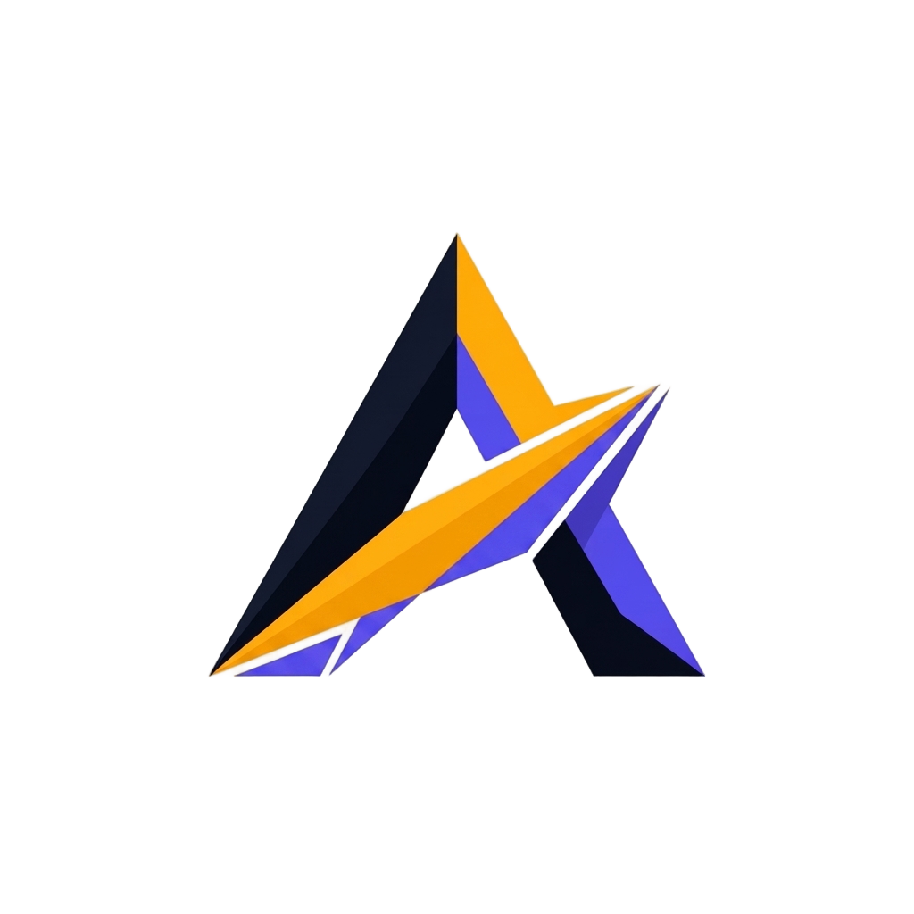

<div align="center">
  
  <p>
    <strong>A retained-mode Rust UI framework where reactivity, layout, paint, and accessibility consume one shared invalidation currency — engineered for best-in-class performance and developer experience, with zero-config accessibility.</strong><br/>
    <em>Alacer</em> (Latin for <em>swift, eager, lively</em>) implements a unified per-node change-mask pipeline, so every subsystem sees exactly what changed and nothing more. It combines winit, wgpu, reactive_graph, taffy, parley, and accesskit into a cohesive 11-crate workspace with snapshot testing, criterion benchmarks, and both GPU and software rendering backends.
  </p>
  <p>
    
    
    
    
    
    
    
    
    
  </p>
</div>

---

## Status: M0 + M1 + M2 exit criteria, all green

The repository implements milestone **M0** (the skeleton: winit + wgpu + reactive_graph + taffy + parley + accesskit on one window), milestone **M1** (the view DSL, the pass contract, and the test corpus), and milestone **M2** (the invalidation currency: masks + persistent Taffy + torin-style deltas + scene journal replay) of the architecture document in `docs/architecture.md`.

| Criterion | Evidence |
|---|---|
| **30 blessed snapshots green** | `alacer-testing/tests/m1_exit_criteria.rs` — 30 scenarios through the real pipeline + software raster |
| **A11y queries pass** | the query builder (`query(role).named(..)`), `press` through the AccessKit default action, `find_all`/`walk` |
| **Pass-system overhead < 15% on 10k-node churn** | the §7.2 kill criterion as a test (`pass_overhead_stays_under_the_15_percent_gate_on_10k_node_churn`) + `benches/pass_overhead.rs` |
| **W1 ≥ 2× vs full relayout (measured: ~14×)** | the M2 kill criterion as a test (`alacer-layout/tests/w1_gate.rs`) + the `w1_churn` criterion bench — 10k nodes, 10%/frame style churn |
| **Journal replay paths cached** | `FrameReport.scene` is an `Arc<SceneSnapshot>`: idle and replay-only frames share the last materialization; the paint order is cached between structural changes (`replay_frames_share_the_cached_scene_allocation`) |
| **Torin-style root candidate** | the closest common ancestor of the dirty set bounds each relayout; definite-sized candidates compute standalone, auto-sized ones under their arranger, with the upward walk when a box changes (ADR-0008) |
| **Region-bounded publish** | `publish_bounds` walks only the recomputed region; bounds outside it stay valid by construction |
| **The ten-pass contract, as code** | `PassKind` (§7.2), per-pass tracing spans, the frame ledger, capture→bubble routing (§10.1), focus passes over the `FOCUS` currency |
| **`rsx!` proc-macro** | `alacer-macro` (ADR-0000's M1 deferral, landed): elements, interpolated text, `key:`, `for`, `if/else` |
| **View reconciliation** | `ViewRoot`: patch-in-place, subtree replace, keyed peel→map→LIS with `apply(old, ops) == new` asserted per update |
| **Counter renders; masks flow end-to-end** | `alacer-testing/tests/m0_exit_criteria.rs` |
| **Scrolling list renders** | same suite, wheel-driven, blessed snapshot |
| **One write batch ⇒ at most one layout+paint cycle** | pipeline-level and E2E tests assert exactly 1 (ADR-6 kill-switch) |
| **Idle contract: 0% CPU between interactions** | idle-frame tests assert every pass skips (A7) |
| **Translation-only scrolling: zero measure calls** | `m0_scrolling_list_translates_without_re_measuring` (§8.2) |
| **Zero-config a11y: required role/label at the type level** | `Widget` trait; the CI walker fails unnamed inputs (ADR-5) |
| **Benchmarked** | criterion suites per crate; `cargo bench` (A6) |

## Quick start

```sh
cargo run -p alacer --example counter          # wgpu window
ALACER_SOFTWARE=1 cargo run -p alacer --example counter   # softbuffer window
cargo run -p alacer --example scrolling_list
cargo test --workspace                        # headless: real pipeline + software raster (A4)
cargo bench                                   # criterion suites (A6)
```

Headless machines (and CI) run the **same pipeline** through the software backend — no mock renderer, no mock event loop (axiom A4).

## The M0 design, in five points

1. **One currency of change (A1).** Every consumer — layout, paint, accessibility — reads the same per-node `Change { STRUCTURE | LAYOUT | PAINT | A11Y | FOCUS }` masks with a normative ancestor-propagation table. Effects never mutate widgets; they queue masks (the flux bridge, §5.2).
2. **The scheduling contract (ADR-6).** `reactive_graph` `ImmediateEffect` + `batch()`: N synchronous writes inside one batch coalesce into exactly one effect rerun, hence one frame. This is the falsifiable kill-switch, and it is test-enforced at both pipeline and E2E level.
3. **The persistent Taffy tree (ADR-3, §8).** The tree is created once and never cleared; `mark_dirty` + Taffy's per-node caches bound recomputation to the dirty path. Scrolling composes as *translation-only* updates — zero measure calls per scroll tick.
4. **One scene journal, two honest backends (A8, ADR-2).** The paint pass records per-node layers; clean subtrees replay from the journal. wgpu rasterizes quads as rounded-rect SDFs and glyphs from a CPU coverage atlas; tiny-skia + softbuffer blends the *same* bitmaps headlessly.
5. **Accessibility is a type-level contract (ADR-5, §11).** `role()` and `label()` are *required* `Widget` methods; AccessKit node ids are the id-path hashes (one identity with hit-testing, §6.3); updates are dirty-node-only; tests query the a11y tree — reachable, named, actionable.

## The crate DAG (ADR-9)

```text
alacer (facade)
┌──────────────┼──────────────┐
alacer-testing alacer-platform examples
│              │
alacer-widgets ── alacer-view
│              │
alacer-layout alacer-text alacer-render alacer-a11y
└──────────┴──────┬──────┴───────────┘
alacer-macro         alacer-core
(rsx!)               (Change masks · arena · pass system · flux bridge)
```

Layering is a DAG: no upward dependencies, no cycles (the build system makes cycles impossible; `scripts/check_dag.py` enforces the layer order in CI). Public API surface is confined to `alacer` + leaf crates.

## Repository map

| Path | What |
|---|---|
| `crates/alacer-core` | masks, identity, arena, widget trait, flux bridge, pass system |
| `crates/alacer-layout` | persistent Taffy host, root-candidate relayout, LRU measure cache, style mapping |
| `crates/alacer-text` | parley facade, font registry, zeno rasterizer, evicting caches |
| `crates/alacer-render` | scene journal, software rasterizer, batching |
| `crates/alacer-a11y` | AccessKit sink, incremental `TreeUpdates` |
| `crates/alacer-view` | keyed reconciliation (peel → key map → LIS) |
| `crates/alacer-widgets` | label, button, column/row/spacer, list, panel, the default element registry |
| `crates/alacer-platform` | winit loop, wgpu backend, softbuffer present, coalescing |
| `crates/alacer-testing` | headless harness, a11y queries, snapshots, M0 + M1 suites |
| `crates/alacer-macro` | the `rsx!` view DSL compiler (proc-macro leaf) |
| `crates/alacer` | facade: prelude, `rsx!` re-export, `mount_view`, window runner |
| `docs/` | architecture document, ADRs |
| `.github/workflows/` | CI + release automation |

## Engineering discipline

- **Lint regime**: clippy `pedantic` **denied** workspace-wide, plus `missing_docs` and `unsafe_code = forbid`. There is no `#[allow]` anywhere; the documented cast seams (`alacer-core/src/num.rs`, the `rsx!` number narrowing in `alacer-view`) carry the single `#[expect]`s with reasons.
- **TDD**: every module grew tests first; **187 tests** across the workspace (unit + integration + doctest), all green locally and in CI.
- **Benchmarks as contracts (A6)**: criterion suites for the flux batch drain, mask propagation, journal replay, incremental-vs-full relayout, the W1 churn workload, text layout, and the §7.2 pass-overhead churn gate.
- **CI/CD**: fmt + clippy + tests + doc + `cargo-deny` + DAG check on push/PR; `git-cliff`-generated changelogs; GitHub Releases on tags (`v*`).
