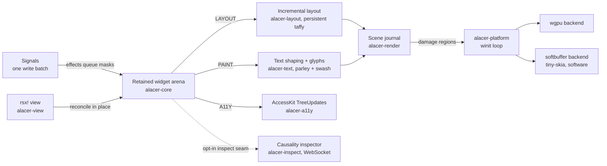

<div align="center">
  
  <p>
    <strong>A retained-mode Rust GUI toolkit where reactivity, layout, paint, and accessibility share one invalidation currency.</strong><br/>
    Widgets live in a retained arena, <code>rsx!</code> views compile into cheap trees that reconcile in place, and every write queues per-node <code>Change</code> masks that each subsystem — layout, paint, accessibility, devtools — consumes independently. It is built for Rust developers who need accessibility, headless CI, and idle-cheap windows without giving up fine-grained reactivity; proven cores (reactive_graph, taffy, parley, accesskit, winit, wgpu) are adopted as-is and the composition is what this workspace owns. In the published baseline, incremental relayout of 10,000 nodes under 10% style churn measured 14.06× faster than a full rebuild, and a fifty-event pointer storm routes one coalesced event instead of fifty dispatches (40.7×) — contracts CI enforces on every run.
  </p>
  <p>
    <a href="https://github.com/elcoosp/alacer/blob/main/Cargo.toml"></a>
    <a href="https://github.com/elcoosp/alacer/blob/main/LICENSE-MIT"></a>
    <a href="https://github.com/elcoosp/alacer/blob/main/rust-toolchain.toml"></a>
    <a href="https://github.com/elcoosp/alacer/actions/workflows/ci.yml"></a>
    <a href="https://github.com/elcoosp/alacer/blob/main/crates/alacer-platform"></a>
    <a href="https://github.com/elcoosp/alacer/blob/main/crates/alacer-a11y"></a>
    <a href="https://github.com/elcoosp/alacer/blob/main/crates/alacer/src/hot.rs"></a>
  </p>
</div>

<p align="center">
  <a href="#quickstart">Quickstart</a> • <a href="#features">Features</a> • <a href="#how-it-works">How it works</a> • <a href="#usage">Usage</a> • <a href="#status">Status</a> • <a href="#learn-more">Learn more</a>
</p>

## Quickstart

Prerequisites: Rust 1.99 or newer (`rust-toolchain.toml` pins the exact workspace toolchain); a GPU driver for the wgpu path, or none at all with `ALACER_SOFTWARE=1`.

```sh
git clone https://github.com/elcoosp/alacer
cd alacer
cargo run -p alacer --example counter
```

A 360×200 window titled "Alacer counter" opens with a label reading `Clicked 0 times` and an `Increment` button. Each click is one write batch, and the scheduling contract collapses every batch into exactly one layout and paint cycle — nothing else in the tree pays for it.

More entry points, straight from the catalog:

```sh
cargo run -p alacer --example gallery                           # the whole widget vocabulary in one window
cargo run -p alacer --example counter_view                      # the same counter as an rsx! view
ALACER_SOFTWARE=1 cargo run -p alacer --example scrolling_list  # software backend: VMs, CI, no-GPU machines
cargo run -p alacer --example input_storm                       # the frame-batched input queue, demonstrated
cargo run -p alacer --example inspector_demo                    # counter + Causality inspector (prints a URL)
cargo run -p alacer --example announcements                     # the app's voice: live-region speech acts, polite and assertive
cargo run -p alacer --example disabled                          # the availability tier: a form's send button the app holds unavailable
cargo run -p alacer --example frame_ledger                      # the frame's ledger: one write batch, one layer re-commit
cargo run -p alacer --example focus_traversal                   # the focus walk: one funnel for Tab and the app's door
cargo run -p alacer --example focus_trap                        # the focus trap: the walk scoped to the modal's subtree
cargo run -p alacer --example focus_direction                   # the directional walk: arrows read the window, Tab reads the tree
cargo run -p alacer --example focus_outcome                     # the walk's answer as data: landings and named refusals
cargo run -p alacer --example focus_trail                       # the causal log: the walk's answers, streamed to the inspector
cargo run -p alacer --example dpad_navigation                   # the ring's arrows ride the walk through the real dispatch
cargo test --workspace                                          # headless: the real pipeline, software raster
```

> [!TIP]
> On machines without a GPU, set `ALACER_SOFTWARE=1` to present through softbuffer. CI and the headless tests already run this path — no mock renderer, no mock event loop.

## Features

- **One invalidation currency.** Every consumer reads the same per-node `Change` masks (`STRUCTURE | LAYOUT | PAINT | A11Y | FOCUS`, `crates/alacer-core/src/mask.rs`). Effects queue masks and never mutate widgets, so a feature that cannot express itself as a mask is redesigned or rejected (architecture axiom A1).
- **Incremental layout over a persistent tree.** The Taffy tree is built once and never cleared (`crates/alacer-layout`); relayout is bounded by the dirty set's root candidate, scrolling composes as translation-only updates with zero measure calls, and the ≥ 2× incremental-vs-full gate is test-enforced (`crates/alacer-layout/tests/w1_gate.rs`) — measured at 14.06× in the published baseline.
- **Two backends from one scene journal.** The paint pass records per-node layers (`crates/alacer-render`); wgpu rasterizes rounded-rect SDFs and glyphs from a CPU coverage atlas, while tiny-skia + softbuffer blends the same bitmaps headlessly. Both implement identical damage semantics, and an equivalence fuzz pins partial repaints pixel-equal to full renders across clicks, typing, and IME composition.
- **Accessibility by construction.** `role()` and `label()` are required `Widget` trait methods, so an unnamed widget does not compile; updates ship as incremental AccessKit `TreeUpdate`s — dirty nodes only, the full M6 vocabulary (values, toggle state, grid slots) riding the same delta — and the real window drains the pipeline's own sink: the adapter-activation response is the sink's full tree, the steady state is the delta (ADR-0015). Since M10 the action tier routes faithfully — a screen reader can scroll the list canon, an increment is never munged into a press, and a focused button answers Space/Enter like a pointer click (ADR-0016) — and since M11 the selection is tree vocabulary: a focused input exposes its anchor and caret in UTF-16 units, the value tier (`SetValue`, `ReplaceSelectedText`, `SetTextSelection`) carries its payload or is refused honestly, and the report drops while an IME composes (ADR-0017). Since M12 the selection is modality-agnostic: a click places the caret at the hit point, a drag extends the range from its anchor, and the AT reads the drag's own direction — the same tree vocabulary whichever input wrote it (ADR-0018). Since M13 the selection is word-addressable too: Alt/Ctrl+arrows hop word runs with the same anchor semantics, a word chord deletes exactly the span the caret would hop, a double-click selects the word under it (or collapses on a separator — it never wanders), and the UAX #29 segmentation behind it is the text seam's required vocabulary, ICU-backed (`crates/alacer-text`), never the widget's own tables (ADR-0019). Since M14 the selection is transferable too: Ctrl/Cmd+C copies the span, Ctrl/Cmd+X moves it out, Ctrl/Cmd+V inserts the clipboard's text with line breaks collapsed to spaces — the clipboard seam has no default (the OS clipboard is a platform fact), the engine rides arboard in `alacer-platform`, and a refused write never deletes (ADR-0020). Since M15 the selection is reversible too: Ctrl/Cmd+Z takes an edit back and Shift+Ctrl/Cmd+Z (or Ctrl/Cmd+Y) replays it — a typed run undoes as one step, every step restores the selection it consumed, a whole-value replacement resets the journal, and the bounded journal is core's own vocabulary (`crates/alacer-core/src/history.rs`), never a widget dialect (ADR-0021). Since M18 the tree speaks: `announce` ships the app's state changes that own no widget as a reserved live-region node through the same sink and the same delta — polite or assertive, present from the first frame, last write wins, and the refusals (empty text, no root) honest — the `aria-live` pairing the sink emits is what a screen reader speaks (`crates/alacer-core/src/announce.rs`, ADR-0024). Since M20 the value tier is a widget: a `Slider` carries its bounded value in the same tree vocabulary — the AT reads it, writes it with `SetValue`, and steps it with `Increment`/`Decrement`, the same funnel a drag or an arrow key rides, with every write clamped to the range and snapped to the step inside the widget (ADR-0026). Since M21 the value is reportable too: a `Progress` carries the app's bounded scalar as a read-only value the AT reads — the write vocabulary is the app's own (the binding bridge or the mutate seam, both landing `PAINT | A11Y`), a write that lands where the value already is queues no masks, and every AT action is refused honestly — a reporting widget has no write door (`crates/alacer-widgets/src/progress.rs`, ADR-0027). Since M22 the availability tier is widget vocabulary: one `enabled` source of truth on the `Widget` trait — the four actionable controls carry it, the default `focusable()` derivation consults it, so an unavailable control is never a Tab stop and never a focus candidate, and focus is evicted from a control that becomes unavailable — every door refuses honestly (the pointer is a wall that never clicks through, the keyboard and the IME are answered with silence, every AT action refused, never munged), and the a11y sink maps the flag faithfully onto AccessKit's `disabled` property, so the AT reads the refusal before it happens — a write that lands where the flag already is queues no masks, and the muted paint tells the same truth the tree carries (`crates/alacer-core/src/widget.rs`, ADR-0028). Since M24 the focus walk is public vocabulary: one `FocusMove` direction and one `PassPipeline::focus_move` door — the keyboard's Tab/Shift+Tab fallback and the app's code ride the same funnel (the walk skips unavailable controls, wraps at both ends, and a refusal with no candidate queues no masks — an idle frame), with `tracing` spans at `alacer::focus` and the demonstration in `examples/focus_traversal.rs` (`crates/alacer-core/src/passes.rs`, ADR-0030). Since M25 the walk is bounded too: a scope roots the walk in a subtree — the modal's focus trap — one `PassPipeline::focus_move_in` door beside the unscoped funnel, the same candidate list, the same availability filter, the same wrap, and the same honest refusal inside the scope, while the read doors keep answering the whole tree and the refusals carry their help as plain text on the `alacer::focus` target (`crates/alacer-core/src/passes.rs`, ADR-0031). Since M26 the walk reads the window too: the four directional moves (`Left`/`Right`/`Up`/`Down`) select the candidate the *geometry* names — fully beyond the focused node's edge in the direction, nearest edge distance first, cross-axis misalignment breaking ties — riding the same two doors and the same one walk, skipping the unavailable controls, never wrapping (space has no wrap; the window's edge is the walk's end), and refusing honestly when nothing lies in the direction (`crates/alacer-core/src/passes.rs`, ADR-0032). Since M27 the walk's answer is data: the two doors return a `FocusMoveOutcome` — a `FocusLanding` carrying the endpoints and the wrap when the walk moved, a named `FocusRefusal` species (the empty list, the dead scope, the geometry-less focus, the empty direction, the single-candidate stall) when it refused — the re-open rule ADR-0031 pre-registered, with the demonstration in `examples/focus_outcome.rs` (`crates/alacer-core/src/passes.rs`, ADR-0033). Since M29 the ring rides too: a plain directional key the focused widget did not answer — a D-pad button, a TV remote's ring — maps onto its `FocusMove` at the same dispatch fallback Tab rides and lands the geometry's answer, the widget's own arrows always taking precedence and a refused direction falling through honestly (ADR-0035). Tests query the accessibility tree rather than widget internals (`crates/alacer-a11y`, `crates/alacer-testing`).
- **Hot reload with state intact.** The `hot-reload` feature wraps the view generation in `subsecond::call`; a binary patch swaps code, never state, and the loop answers with exactly one scoped re-render — pinned by a dedicated CI hot-patch suite (`crates/alacer/src/hot.rs`, `crates/alacer/tests/hot_reload_subsecond.rs`).
- **The Causality inspector.** An opt-in seam records edge activations, provenance-tagged signal writes, per-frame pass ledgers, and a dirty-node mask heatmap, streamed over a documented WebSocket protocol to an embedded client (`crates/alacer-inspect`, `docs/inspector-protocol.md`). Since M28 the walk's own answers join the causal log: every focus-move door ride — the keyboard's Tab fallback and the app's code alike — streams one `FocusRecord` (the landing's endpoints and wrap, or the named refusal species) the moment the door resolves, the "why did focus change — or why didn't it" trail a status line, an inspector, or a test routes on (`crates/alacer-core/src/inspect.rs`, ADR-0034).
- **Frame-batched input (M8).** Raw platform pointer events queue into the pipeline (`alacer_core::input::EventCoalescer`) and coalesce there — compatible moves merge, same-direction wheel deltas accumulate on both axes — and the tick routes one batch: a storm costs one frame of work, not N events (`crates/alacer-core/src/input.rs`, the `input_storm_batching` budget, demonstrated by `examples/input_storm.rs`). Since M19 the drag holds its target: a press implicitly captures its deepest accepting hit, so the gesture's moves and its release keep arriving past the widget's frame — the wheel still follows the hover, and with no press in flight the routing is the hit test exactly as before (`crates/alacer-core/src/passes.rs`, ADR-0025, demonstrated by `examples/drag_capture.rs`).
- **Performance budgets as contracts.** All 62 criterion cases are published with their environment in `benchmarks/baselines/baselines.json` and gated by `benchmarks/contracts.json`; the CI perf-contracts job fails on a same-host regression or an uncontracted benchmark. Since M23 the frame carries a public ledger: the scene journal reports its own commits, drops, and live layers through the `SceneJournal::stats` seam read at `PassPipeline::journal_stats` (`crates/alacer-core/src/passes.rs`), and `examples/frame_ledger.rs` demonstrates one write batch ⇒ one layer re-commit. The M24/M25-promised focus routes (`input/route_100_focus_moves_1k`, `input/route_100_scoped_moves_1k`) finally join the published corpus beside the M26 directional route at this cut's measurement run — the coordinated rule (bench, gates, and baseline in the same cut) that the two earlier ADRs described and the tree never delivered.
- **The cross-framework beat, measured and reproducible (M7).** The declared rig (`benchmarks/rig.json`), the competitor harnesses (idiomatic egui and Masonry under `benchmarks/competitors/`), and the 5-run-median runner (`scripts/run_comparison.py`) publish `benchmarks/comparisons/results.json` — the §18 beat computed same-host, every row labeled with its scope: incremental relayout of a 10k-node churn frame measures 1.10 ms against egui's 20.7 ms full frame (18.8×) and Masonry's 4.6 ms full pass pipeline (4.2×).

## How it works

A frame starts with state: handlers write signals in one batch, and the flux bridge turns each write into masks on the affected nodes. The view layer (`alacer-view`) diffs the new `rsx!` tree against the old one and patches the retained arena in place — keyed children route through a longest-increasing-subsequence diff. The ten-pass pipeline then runs only what the masks demand: incremental layout over the persistent Taffy tree, text shaping through parley, paint into the scene journal, and incremental AccessKit updates. The platform layer (`alacer-platform`) presents through wgpu or softbuffer and parks in `ControlFlow::Wait` between interactions, so an idle window costs zero CPU.



The public API lives in the `alacer` facade; the twelve crates form a layered DAG that `scripts/check_dag.py` enforces in CI.

## Usage

### Views

The `rsx!` DSL compiles element trees into `ViewNode` builders — elements, interpolated text, `key:`, `for`, and `if`/`else` (`crates/alacer-macro`, exercised in `crates/alacer/tests/rsx.rs`):

```rust
use alacer::prelude::*;
use reactive_graph::traits::{Get, Set};

fn counter_view(count: alacer_core::FluxRwSignal<i32>) -> ViewNode {
    rsx! {
        column { gap: 8.0, padding: 12.0,
            label { text: "Clicked {count.get()} times" }
            button { text: "Increment", on_click: move || count.set(count.get() + 1) }
        }
    }
}
```

The full wiring — `pipeline_default()`, `mount_view(&counter_view(count), &mut pipeline)`, `run_window(...)` — is `crates/alacer/examples/counter_view.rs`. Widgets can also be assembled directly without the DSL; `crates/alacer/examples/counter.rs` shows that form.

### Widgets

The shipped vocabulary covers `Label`, `Button`, `TextInput`, `Checkbox`, `Slider`, `Progress`, `Column`, `Row`, `Spacer`, `List`, `Table`, and `Panel` (`crates/alacer-widgets`), each carrying its required role and label and reading shared theme constants. Handlers write signals in one batch; reactive text lands through `RenderBinding`s.

### Examples

| Example | Demonstrates |
|---|---|
| `counter` | one signal, one bound label, one button — masks end to end |
| `counter_view` | the same app as an `rsx!` view, reconciled in place |
| `gallery` | the whole widget vocabulary in one window |
| `scrolling_list` | panels in a clipped viewport; translation-only scrolling |
| `input_storm` | the frame-batched input queue: a custom `StormPanel` probe records every routed pointer event — wave the pointer and the log grows at most one entry per frame |
| `drag_capture` | the pointer capture: press the panel and drag past its edge — the log keeps counting while the gesture is anywhere in the window, and the release rides back to the panel; wave without pressing and only the moves inside the frame arrive |
| `text_input` | caret and selection editing — keyboard, pointer (click-to-caret, drag-select, double-click word selection), word-wise movement and deletion, clipboard chords (copy, cut, and the single-line paste rule), the AT value tier, and the undo/redo chords alike — secure mode, Tab focus cycling, IME preedit and commit |
| `undo_redo` | the M15 journal driven directly: record under the pure-append rule, undo/redo with the selection each step returns, the app-write reset, the honest refusal — no `TextInput` riding along |
| `announcements` | the M18 announcement seam driven from the consumer side: polite and assertive speech acts, the honest refusal, the status line mirroring what the reserved live region carries |
| `slider` | the M20 value tier driven from the consumer side: one `Slider` over 0..=100 whose drag, arrow keys, and the AT's `SetValue`/`Increment`/`Decrement` all land in the same funnel — the status line mirrors the value the a11y tree carries |
| `progress` | the M21 reported value driven from the consumer side: one bound `Progress` the app writes through both doors — the bridge (the *Step the batch* button's one-batch signal write) and the mutate seam (the lease, the write, the masks on the guard) — with `tracing` spans at `alacer::progress`; the status line mirrors the value the a11y tree carries |
| `disabled` | the M22 availability tier driven from the consumer side: a send button the app holds unavailable — the *Enable sending* checkbox flips it through the bridge in one write batch, the AT reads the flag before it tries the door, and the muted paint tells the same truth the tree carries |
| `frame_ledger` | the M23 frame ledger driven from the consumer side: a static label and a bound ticker — the *Tick* write re-commits exactly one journal layer while the static layer replays untouched, and the ledger (commits, drops, live layers) is read through `PassPipeline::journal_stats`, with `tracing` spans at `alacer::frame_ledger` |
| `focus_traversal` | the M24 focus walk driven from the consumer side: a four-control form walked one stop per beat — forward, backward, and the honest refusal while the availability tier holds every control down; the landing names the candidate the walk rests on, and in the window Tab/Shift+Tab ride the same funnel, with `tracing` spans at `alacer::focus_traversal` |
| `focus_trap` | the M25 focus scope driven from the consumer side: a modal's form walked inside its subtree — forward, backward, and the honest refusal while the availability tier holds every control in the trap down; the background control never becomes a stop, the read doors keep answering the whole tree, and the unscoped Tab stays the window's door, with `tracing` spans at `alacer::focus_trap` |
| `focus_direction` | the M26 directional walk driven from the consumer side: a two-by-two grid where the tree order and the spatial reading disagree — `Right`/`Down` land the button the geometry names, the corner refuses honestly (space never wraps) while `Next` still wraps, and the modal's form walks directionally inside its scope, with `tracing` spans at `alacer::focus_direction` |
| `focus_outcome` | the M27 outcome vocabulary driven from the consumer side: the same two-by-two grid and the modal's form walked one beat per `FocusMove` — the status line mirrors what the walk answered as data: `Moved` landings name their endpoints and the wrap, the refused beats name their species (the empty direction at the corner, the held-down trap's empty list, the dead scope, the single-candidate stall), read back through the a11y tree, with `tracing` spans at `alacer::focus_outcome` |
| `focus_trail` | the M28 causal trail driven from the consumer side: the same two-by-two grid and the modal's form walked one beat per `FocusMove` with the causal observer riding — the trail logs what the walk answered as data the moment each door resolved (landings with their endpoints and wrap, refusals with their species, the keyboard's Tab rides among them), read back through the a11y tree, with `tracing` spans at `alacer::focus_trail` |
| `dpad_navigation` | the M29 directional keys driven from the consumer side: the two-by-two grid and a slider — arrow presses through the real `dispatch_key` walk the grid by geometry (the entry from nothing, the stride the row breaks, the edge's honest fall-through), and the focused slider's own arrows step the value without moving the focus | the M29 demonstration: the directional keys ride the walk (ADR-0035, ADR-0032's pre-registered rule) — a plain arrow the focused widget did not answer maps onto its `FocusMove` at the same dispatch fallback Tab rides, the chords staying the widgets' vocabulary, the M28 trail carrying every ride, with `tracing` spans at `alacer::dpad_navigation` |
| `hot_reload` | swaps the view generation live; state survives |
| `todo` | the todo canon end-to-end: text input, checkboxes, the a11y tree, record/replay |
| `data_table` | the table canon: grid slots, headers, keyboard navigation |
| `inspector_demo` | the counter with the Causality inspector riding on it, served at `127.0.0.1:9217` |

`docs/examples.md` is the complete catalog, including the contract each example exercises.

### Testing

```sh
cargo test --workspace                     # headless: real pipeline + software rasterizer
ALACER_BLESS=1 cargo test -p alacer-testing  # re-bless PNG snapshots after an intentional visual change
```

Snapshot scenarios live in `crates/alacer-testing/blessed/`; accessibility tests query the a11y tree (`query(role).named(..)`, `press`, `find_all`) through the harness in `crates/alacer-testing`.

## Status

> [!NOTE]
> Alacer is at 0.17.0, pre-1.0: milestones M0 through M29 of `docs/architecture.md` are complete, but the API still moves between minor versions. Linux is the primary CI platform — fmt, clippy (pedantic, warnings denied), headless tests, docs, the crate-DAG check, the hot-patch suite, cargo-deny, benches, and perf contracts — while Windows is smoke-tested on a subset of crates; macOS is expected to work through winit and wgpu but is not exercised in CI. The MSRV is 1.99 with the 2024 edition.

## Learn more

- [Architecture](https://github.com/elcoosp/alacer/blob/main/docs/architecture.md) — the full system document: design axioms, the ten-pass contract, rendering, accessibility, DX and performance architecture, roadmap and kill criteria
- [ADRs](https://github.com/elcoosp/alacer/blob/main/docs/adr/) — thirty-six decision records, from workspace discipline to the M29 scope
- [Examples catalog](https://github.com/elcoosp/alacer/blob/main/docs/examples.md) — every example with the contract it exercises
- [Migrating from Iced](https://github.com/elcoosp/alacer/blob/main/docs/migration/from-iced.md) and [from egui](https://github.com/elcoosp/alacer/blob/main/docs/migration/from-egui.md) — mental-model mappings with interop limits stated plainly
- [Inspector protocol](https://github.com/elcoosp/alacer/blob/main/docs/inspector-protocol.md) — the versioned WebSocket contract behind `alacer-inspect`
- [Performance dashboard](https://github.com/elcoosp/alacer/blob/main/benchmarks/dashboard/index.html) — published baselines and budget contracts, regenerated by CI
