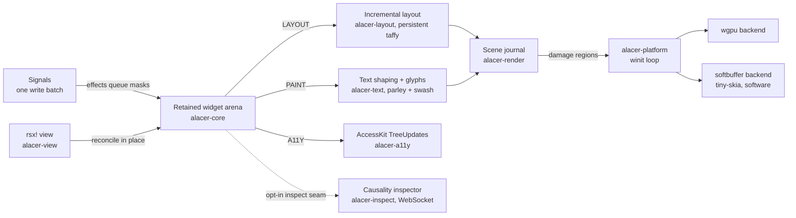

<div align="center">
  
  <p>
    <strong>A retained-mode Rust GUI toolkit where reactivity, layout, paint, and accessibility
    share one invalidation currency.</strong><br/>
    Widgets live in a retained arena; <code>rsx!</code> views reconcile in place; every write queues
    per-node <code>Change</code> masks that layout, paint, accessibility and devtools each consume
    independently. Proven cores — reactive_graph, taffy, parley, accesskit, winit, wgpu — adopted
    as-is; the composition is what this workspace owns. Built for accessibility, headless CI and
    idle-cheap windows, without giving up fine-grained reactivity.
  </p>
  <p>
    <a href="https://github.com/elcoosp/alacer/blob/main/Cargo.toml"></a>
    <a href="https://github.com/elcoosp/alacer/blob/main/LICENSE-MIT"></a>
    <a href="https://github.com/elcoosp/alacer/blob/main/rust-toolchain.toml"></a>
    <a href="https://github.com/elcoosp/alacer/actions/workflows/ci.yml"></a>
    <a href="https://github.com/elcoosp/alacer/blob/main/crates/alacer-platform"></a>
    <a href="https://github.com/elcoosp/alacer/blob/main/crates/alacer-a11y"></a>
    <a href="https://github.com/elcoosp/alacer/blob/main/crates/alacer/src/hot.rs"></a>
  </p>
</div>

<p align="center">
  <a href="#highlights">Highlights</a> • <a href="#quickstart">Quickstart</a> • <a href="#how-it-works">How it works</a> • <a href="#accessibility">Accessibility</a> • <a href="#the-causality-inspector">Inspector</a> • <a href="#examples">Examples</a> • <a href="#status">Status</a> • <a href="#learn-more">Learn more</a>
</p>

---

## Highlights

|                                   |                                                                                                                                                                                                                |
| --------------------------------- | -------------------------------------------------------------------------------------------------------------------------------------------------------------------------------------------------------------- |
| 🎯 **One invalidation currency**  | Per-node `Change` masks (`STRUCTURE \| LAYOUT \| PAINT \| A11Y \| FOCUS`). Effects queue masks and never mutate widgets — a feature that cannot express itself as a mask is redesigned or rejected (axiom A1). |
| ⚡ **Incremental everything**     | The Taffy tree is built once and never cleared; relayout is bounded by the dirty set; scrolling is translation-only, zero measure calls.                                                                       |
| ♿ **Accessible by construction** | `role()` and `label()` are required trait methods — an unnamed widget does not compile. Updates ship as incremental AccessKit deltas; tests query the a11y tree, not internals.                                |
| 🖥️ **Two backends, one journal**  | wgpu and tiny-skia/softbuffer render the same scene journal; an equivalence fuzz pins partial repaints pixel-equal to full renders. True cargo features, honest refusals.                                      |
| 🔭 **The Causality inspector**    | Every focus move, edit, shortcut, clipboard trip, value write, gesture, scroll, AT text write, app text write and boundary drop answers as _named data_ on an opt-in WebSocket trail.                                                                        |
| 🔥 **Hot reload, state intact**   | A subsecond binary patch swaps code, never state — exactly one scoped re-render, pinned by a CI hot-patch suite.                                                                                               |
| 💤 **Idle-cheap**                 | The winit loop parks in `ControlFlow::Wait` between interactions — an idle window costs zero CPU.                                                                                                              |

**Measured, gated, published:**

| Contract                                              | Baseline                                        | Enforced by                                                                                            |
| ----------------------------------------------------- | ----------------------------------------------- | ------------------------------------------------------------------------------------------------------ |
| Incremental relayout, 10 000 nodes @ 10 % style churn | **15.22×** vs full rebuild                      | ≥ 2× gate, `alacer-layout/tests/w1_gate.rs`                                                            |
| 50-event pointer storm                                | **1** coalesced dispatch (**41.28×**)           | `input_storm_batching` budget                                                                          |
| 10k-node churn frame vs egui, same host               | 1.10 ms vs 20.7 ms full frame (**18.8×**)       | 5-run medians, declared rig (`benchmarks/rig.json`)                                                    |
| …vs Masonry                                           | 1.10 ms vs 4.6 ms full pass pipeline (**4.2×**) | same rig, `scripts/run_comparison.py`                                                                  |
| All 68 criterion cases                                | `benchmarks/baselines/baselines.json`           | `contracts.json` + the CI perf-contracts job: fails on a same-host regression or an uncontracted bench |

_Competitor rows compare Alacer's incremental frame against their full frame/pass — every row in
`benchmarks/comparisons/results.json` is labeled with its scope._

> [!IMPORTANT]
> **The contracts the whole tree keeps.** Every rider — pointer, keyboard, screen reader, app
> code — lands the _same_ funnel. Every refusal is a _named species_, never a munged action or a
> collapsed `false`. A write that lands where the value already is queues **no masks** (an idle
> frame). Every causal trail is bounded, silent when nobody listens (the A7 idle contract), and
> never carries a payload that could be a secret.

## Quickstart

Rust **1.99+** (`rust-toolchain.toml` pins the workspace toolchain); a GPU driver for wgpu, or
none at all with `ALACER_SOFTWARE=1`.

```sh
git clone https://github.com/elcoosp/alacer
cd alacer
cargo run -p alacer --example counter
```

A 360×200 window opens with a label and an _Increment_ button. Each click is one write batch,
and the scheduling contract collapses it into exactly one layout and paint cycle — nothing else
in the tree pays for it.

```sh
cargo run -p alacer --example gallery                           # the whole widget vocabulary
cargo run -p alacer --example counter_view                      # the same counter as an rsx! view
ALACER_SOFTWARE=1 cargo run -p alacer --example scrolling_list  # software backend: VMs, CI, no GPU
cargo run -p alacer --example input_storm                       # frame-batched input, demonstrated
cargo run -p alacer --example inspector_demo                    # counter + Causality inspector
cargo test --workspace                                          # headless: real pipeline, software raster
```

> [!TIP]
> `ALACER_SOFTWARE=1` presents through softbuffer — the platform honors it at startup
> (`BackendPreference::software_env`) whichever backend the app asked for; any other value is
> refused with a named warning, never guessed. CI and the headless tests already run this path:
> no mock renderer, no mock event loop. The full 54-example catalog is [below](#examples).

## How it works

A frame starts with state: handlers write signals in one batch, and the flux bridge turns each
write into masks on the affected nodes. The view layer diffs the new `rsx!` tree against the old
one and patches the retained arena in place — keyed children ride a longest-increasing-subsequence
diff. The ten-pass pipeline then runs only what the masks demand: incremental layout over the
persistent Taffy tree, parley text shaping, paint into the scene journal, incremental AccessKit
updates. The platform presents through wgpu or softbuffer and parks between interactions.



Twelve crates, one layered DAG — `scripts/check_dag.py` enforces it in CI:

| Crate             | Role                                                                                                                                                |
| ----------------- | --------------------------------------------------------------------------------------------------------------------------------------------------- |
| `alacer`          | the public facade: prelude, `pipeline_default()`, `mount_view()`, `run_window()`, the hot-reload seam                                               |
| `alacer-core`     | arena, `Change` masks, flux bridge, ten-pass pipeline, input coalescer, history, keymap, gesture/scroll/value/clipboard seams, the inspect recorder |
| `alacer-view`     | `rsx!` tree reconciliation in place; keyed LIS diff                                                                                                 |
| `alacer-macro`    | the `rsx!` DSL                                                                                                                                      |
| `alacer-layout`   | the persistent Taffy tree; incremental relayout; translation-only scrolling                                                                         |
| `alacer-text`     | parley shaping, swash glyphs, ICU-backed UAX #29 segmentation                                                                                       |
| `alacer-render`   | the scene journal: per-node layers, damage, the frame ledger                                                                                        |
| `alacer-platform` | the winit loop; wgpu + softbuffer present paths; the arboard clipboard engine                                                                       |
| `alacer-a11y`     | the AccessKit sink: incremental `TreeUpdate`s                                                                                                       |
| `alacer-widgets`  | the widget vocabulary                                                                                                                               |
| `alacer-inspect`  | the WebSocket server + embedded client                                                                                                              |
| `alacer-testing`  | the headless harness: snapshots, a11y-tree queries                                                                                                  |

**Backends are true features (M34).** `backend-wgpu` and `backend-softbuffer` compile their own
present paths; single-backend and pipeline-only builds are supported shapes, warning-free under
`-D warnings`; a preference whose backend the build compiled out refuses honestly at startup
(`PlatformError::BackendUnavailable`, ADR-0040) — the feature matrix is CI-enforced. wgpu
rasterizes rounded-rect SDFs and glyphs from a CPU coverage atlas; softbuffer blends the same
bitmaps through tiny-skia. Both implement identical damage semantics.

**The frame ledger.** Since M23 the frame carries a public ledger: the journal reports its own
commits, drops and live layers through `PassPipeline::journal_stats` — one write batch ⇒ one
layer re-commit, the static layers replay untouched (`frame_ledger` example).

## Accessibility

Accessibility is not a layer bolted on — it is the tree's own vocabulary:

- **Required naming**: `role()` and `label()` are `Widget` trait methods; an unnamed widget does
  not compile.
- **Deltas, not rebuilds**: dirty nodes only; adapter activation answers with the sink's full
  tree, the steady state is the delta (ADR-0015). The full M6 vocabulary — values, toggle state,
  grid slots — rides the same delta.
- **Tests read the tree**: the harness queries roles and names (`alacer-testing`), never widget
  internals.

| Tier                   | What ships                                                                                                                                                                                                                                          | ADR       |
| ---------------------- | --------------------------------------------------------------------------------------------------------------------------------------------------------------------------------------------------------------------------------------------------- | --------- |
| **Actions** (M10)      | Faithful routing: a screen reader scrolls the list canon, an increment is never munged into a press, a focused button answers Space/Enter like a click                                                                                              | 0016      |
| **Selection** (M11)    | Anchor + caret in UTF-16 units on the focused input; `SetValue` / `ReplaceSelectedText` / `SetTextSelection` carry their payload or refuse honestly; the report drops while an IME composes                                                         | 0017      |
| **Any modality** (M12) | Click places the caret at the hit point, drag extends from its anchor, the AT reads the drag's direction — one tree vocabulary whichever input wrote it                                                                                             | 0018      |
| **Words** (M13)        | Alt/Ctrl+arrows hop word runs, word chords delete exactly the span, double-click selects the word (or collapses on a separator); UAX #29 is ICU-backed in `alacer-text`, never widget tables                                                        | 0019      |
| **Clipboard** (M14)    | Ctrl/Cmd+C/X/V; paste collapses line breaks to spaces; the seam has no default (the OS clipboard is a platform fact — arboard in `alacer-platform`); a refused write never deletes                                                                  | 0020      |
| **Undo/redo** (M15)    | A typed run undoes as one step, every step restores the selection it consumed, a whole-value replace resets the bounded journal — core's own vocabulary (`history.rs`)                                                                              | 0021      |
| **Live speech** (M18)  | `announce` ships state changes that own no widget through a reserved live-region node: polite or assertive, present from the first frame, last write wins, refusals honest                                                                          | 0024      |
| **Values** (M20/M21)   | `Slider` is writable through one funnel — drag, arrows, AT `SetValue`/`Increment`/`Decrement` — clamped and snapped inside the widget; `Progress` is read-only: the app writes it, every AT action refuses (no write door)                          | 0026/0027 |
| **Availability** (M22) | One `enabled` truth on the trait: unavailable controls are never Tab stops, focus is evicted, every door refuses (pointer wall, keyboard/IME silence, AT refusal), AccessKit reads `disabled` before it tries, the muted paint tells the same truth | 0028      |

Since M20 the value tier is a widget — the `Slider` answers drag, arrows and AT writes from one
funnel. Since M21 the value is reportable too — the read-only `Progress` names the door that has
no write. Since M22 the availability tier is widget vocabulary — one `enabled` truth every door
refuses behind, the AT reading the flag before it tries.

## Focus & shortcuts

One walk, many riders — the keyboard's Tab fallback and the app's code ride the same doors. Since M24 the focus walk is public vocabulary (`FocusMove`, the framework's own door). Since M25 the walk is bounded too (`focus_move_in` roots it in a subtree). Since M26 the walk reads the window too (arrows answer from geometry, not tree order):

| Capability                | What ships                                                                                                                                                              | ADR  |
| ------------------------- | ----------------------------------------------------------------------------------------------------------------------------------------------------------------------- | ---- |
| **The walk** (M24)        | `FocusMove` + `PassPipeline::focus_move`: skips unavailable controls, wraps at both ends, a refusal with no candidate queues no masks                                   | 0030 |
| **The trap** (M25)        | `focus_move_in` roots the walk in a subtree — the modal's scope; same candidates, same filter, same wrap; read doors still answer the whole tree                        | 0031 |
| **Direction** (M26)       | Arrows read the _geometry_: fully beyond the focused edge, nearest edge first, cross-axis misalignment breaks ties; space never wraps                                   | 0032 |
| **Outcome as data** (M27) | `FocusMoveOutcome`: a `FocusLanding` (endpoints, wrap) or a named `FocusRefusal` — empty list, dead scope, geometry-less focus, empty direction, single-candidate stall | 0033 |
| **The ring** (M29)        | A directional key the widget didn't answer — D-pad, TV remote — rides the walk at the same dispatch fallback Tab rides; the widget's own arrows always win              | 0035 |
| **Shortcuts** (M35)       | Window-level keymap: chords fire wherever focus sits, the focused widget keeps precedence, a rebind moves in place, the fall-through is honest                          | 0041 |
| **Names** (M37)           | `fired_name` is a provided method; the funnel captures it only under an observer (A7) — the fired binding's prose name rides the record                                 | 0043 |
| **Primary chords** (M38)  | `Chord::primary()` resolves at build time — Command on Apple platforms, Control elsewhere; one chord means "primary+S" everywhere, the exact-shape match untouched      | 0044 |

## The Causality inspector

An opt-in seam records edge activations, provenance-tagged signal writes, per-frame pass ledgers
and a dirty-node mask heatmap, streamed over a [documented WebSocket protocol](https://github.com/elcoosp/alacer/blob/main/docs/inspector-protocol.md)
to an embedded client (`inspector_demo` serves at `127.0.0.1:9217`). Every subsystem's facts join
the same trail — one record per _fact_, never per event:

| Record                      | One per…                                      | Carries                                                                                                                                                                                                                                                                                    | ADR                 |
| --------------------------- | --------------------------------------------- | ------------------------------------------------------------------------------------------------------------------------------------------------------------------------------------------------------------------------------------------------------------------------------------------ | ------------------- |
| **Focus** (M28/M30)         | door ride — Tab, ring, app alike              | the landing's endpoints + wrap, or the named refusal — plus the `FocusRider` who moved it                                                                                                                                                                                                  | 0034/0036           |
| **Edit** (M31)              | undo / redo / reset / refused chord           | the depths, the refusal named                                                                                                                                                                                                                                                              | 0037                |
| **Announce** (M33)          | answered speech act                           | politeness beside delivered / superseded / refused                                                                                                                                                                                                                                         | 0039                |
| **Key** (M36/M37)           | keymap consult                                | the chord + **three named answers** — fired (with its prose name), fall-through, uninstalled — never one collapsed `false`                                                                                                                                                                 | 0042/0043           |
| **Clipboard** (M39/M41/M42) | round trip                                    | the payload's _scalar count_ (never the payload — it can carry a secret); refusals split three ways: the field's (`no_selection`, `write_refused`), the engine's write species (`unnamed`/`unsupported`/`occupied`/`conversion`/`os_error`), the read's (`empty`/`non_text`/`unsupported`) | 0045/0047/0048      |
| **Value** (M40/M43/M47/M49) | AT-tier write                                 | the landed value + the **target control** (the funnel stamps the id); species `unavailable`/`invalid_payload`/`non_finite_value`/`no_write_door`; Home/End as `jump_to_min`/`jump_to_max`, never a munged `SetValue`; the **pinned bound** when the wall held a past ask                   | 0046/0049/0053/0055 |
| **Gesture** (M46/M48)       | _phase_ — `Started` / `Ended`, never per move | the value found and the value landed, the edge it pinned (`min`/`max`); 100 moves inside one gesture = exactly 2 records (the flood rule)                                                                                                                                                  | 0052/0054           |
| **Scroll** (M50–M54)        | ask — wheel, AT, app door                     | the landed offset, the wall the clamp pinned, the asker's **unit** (item/page — the step's page rides beside the step species too), the wheel's priced **run** (one line = 40 px); `no_scrollable_content` / `non_finite_ask` refused before corruption                                     | 0056/0058           |
| **Content clamp** (M51)     | resize that shrank content under the offset   | the wall it pinned — no ask (a resize is not an ask), no route; resizes the offset never felt queue nothing                                                                                                                                                                                | 0057                |
| **Text write** (M55/M56)    | write at a field's door — the AT's or the app's | the shape named by **lengths** (`replaced`/`inserted`, UTF-16 units — never the payload: a field's value can carry a secret), the landing selection, the ask beside the landing on the selection door, `unavailable` refused honestly, the **door** the write rode (`at_door`/`app_door`) | 0061/0062           |
| **Route drop** (M57)        | ask the boundary dropped before any widget's door | the dropped action's stable tag beside the species (`unknown_action`/`no_payload`/`off_target_selection`/`unknown_target`/`no_focused_field`) and the aimed id, verbatim — never a munged widget-door fact                                                                                                                | 0063                |
| **Key edit** (M58)          | edit the typing door landed — the keyboard's keys, the IME's commit | the change's shape named by **lengths** (`replaced`/`inserted`, UTF-16 units — never the payload), the landing selection, the driver (`keyboard`/`ime`), the journal's fold — a coalesced typed run landing as **one** record (the flood rule), the clipboard chords riding their own trail | 0064                |

The trail's growth, milestone by milestone: Since M50 the scroll answers on the log too — the
wheel, the AT's unit scrolls and value steps, and the app's own door stream the landed offset
beside the ask. Since M51 the content clamp answers on the log too — the content's own resize
streams when it shrank the offset under it. Since M52 the AT's unit scrolls name their unit too.
Since M53 the wheel's coalesced runs name their line count too. Since M54 the value steps name their page too.
 Since M55 the AT's text writes name their door too — a screen reader's
`SetValue`, `ReplaceSelectedText` and `SetTextSelection` stream one `TextWrite` record the tick
after they resolve, the shape named by lengths (never the payload) and the landing selection
beside it. Since M56 the app's own text writes name their door too — the imperative `set_value` (the
door the view reconciliation's patches ride) streams the same record with `source: app_door`, so
the log answers "did the screen reader rewrite this field, or did the app" from one row. Since M57 the boundary's drops stream their fact too — the unknown action, the payloadless write, the
off-target selection and the unknown target ride one `RouteDrop` record each, the action's tag
beside the species and the aimed id, never a munged widget-door fact. Since M58 the typing door's
edits stream their fact too — a typed run, a backspace, a word chord, a committed composition ride
one `KeyEdit` record each, the shape named by lengths, the driver beside it, and the journal's own
fold bounding a typed run to one record (the flood rule: N keystrokes in one run = one row). Since M59 the route's other silence names its drop too — the IME event no live field held (a committed composition with nowhere to land) rides one `RouteDrop` record with the `no_focused_field` species, the event's tag beside it, the aim riding its honest absence.
 Widget-own doors stay off the value log until a consumer prices them (ADR-0046's
kill rule); every trail is bounded and silent when nobody listens. Since M63 the log carries a
provided reader — `TrailLog`, the bounded window the seam grows beside the trait (one installation
serving many readers, the drain the read's own window, the eviction named, never a silent loss;
the harness installs it in one call), and since M64 the single observer slot shares — the tee
fans the recorder's wire out beside the in-process reader, two doors behind one installation.

## Input & hot reload

- **Frame-batched input (M8).** Raw pointer events queue into `alacer_core::input::EventCoalescer`:
  compatible moves merge, same-direction wheel deltas accumulate on both axes, the tick routes
  one batch — a storm costs one frame of work, not N events (the 41.28× contract above).
- **Drag capture (M19).** A press implicitly captures its deepest accepting hit — moves and the
  release keep arriving past the widget's frame; the wheel still follows the hover; with no press
  in flight, routing is the hit test exactly as before (ADR-0025, `drag_capture` example). Since M19 the drag holds its target — the moves and the release keep arriving at the captured ancestor past the widget's own frame, and the wheel still follows the hover.
- **Hot reload with state intact.** The `hot-reload` feature wraps view generation in
  `subsecond::call`; a binary patch swaps code, never state, and the loop answers with exactly one
  scoped re-render — pinned by a dedicated CI hot-patch suite (`tests/hot_reload_subsecond.rs`).

## Views & widgets

The `rsx!` DSL compiles element trees into `ViewNode` builders — elements, interpolated text,
`key:`, `for`, `if`/`else`:

```rust
use alacer::prelude::*;
use reactive_graph::traits::{Get, Set};

fn counter_view(count: alacer_core::FluxRwSignal<i32>) -> ViewNode {
    rsx! {
        column { gap: 8.0, padding: 12.0,
            label { text: "Clicked {count.get()} times" }
            button { text: "Increment", on_click: move || count.set(count.get() + 1) }
        }
    }
}
```

Full wiring (`pipeline_default()`, `mount_view()`, `run_window()`) in
`crates/alacer/examples/counter_view.rs`; direct assembly without the DSL in `counter.rs`.

The shipped vocabulary: `Label` · `Button` · `TextInput` · `Checkbox` · `Slider` · `Progress` ·
`Column` · `Row` · `Spacer` · `List` · `Table` · `Panel` — each with its required role and label,
reading shared theme constants. Since M32 the value tier is view vocabulary too: `slider` and
`progress` are `rsx!` elements with the value-carrying `on_change` handler and the f32 `binding`
prop — the bridge still owns the value (ADR-0038). Handlers write signals in one batch; reactive
text lands through `RenderBinding`s.

## Examples

Run any of them with `cargo run -p alacer --example <name>`. Start here:

| Example                                              | Shows                                                                            |
| ---------------------------------------------------- | -------------------------------------------------------------------------------- |
| `counter` / `counter_view`                           | one signal → masks end to end; the same app as an `rsx!` view                    |
| `gallery`                                            | the whole widget vocabulary in one window                                        |
| `scrolling_list`                                     | clipped viewport, translation-only scrolling (try `ALACER_SOFTWARE=1`)           |
| `input_storm`                                        | a probe logs at most one routed pointer event per frame, wave as you like        |
| `text_input`                                         | the full editing canon: selection, words, clipboard, undo/redo, IME, secure mode |
| `slider` / `progress` / `value_view`                 | the value tier: drag, arrows and AT land in one funnel; `rsx!` elements          |
| `focus_traversal` / `focus_trap` / `focus_direction` | the walk: Tab, the modal's scope, the geometry's reading                         |
| `shortcut_map`                                       | window shortcuts that rebind live, wherever focus sits                           |
| `inspector_demo`                                     | the counter with the Causality inspector at `127.0.0.1:9217`                     |
| `todo` / `data_table`                                | the canons: a11y tree, record/replay, grid slots, keyboard navigation            |

<details><summary><b>53 examples, grouped (54 ship; recording live in the catalog)</b></summary>

**Start here**

| Example | Shows |
| ---------------- | ---------------------------------------------------------------- |
| `counter` | one signal, one bound label, one button — masks end to end |
| `counter_view` | the same app as an `rsx!` view, reconciled in place |
| `gallery` | the whole widget vocabulary in one window |
| `scrolling_list` | panels in a clipped viewport; translation-only scrolling |
| `todo` | the todo canon: text input, checkboxes, a11y tree, record/replay |
| `data_table` | the table canon: grid slots, headers, keyboard navigation |
| `hot_reload` | swaps the view generation live; state survives |
| `inspector_demo` | counter + Causality inspector, served at `127.0.0.1:9217` |

**Input & the frame**

| Example | Shows |
| -------------- | ---------------------------------------------------------------------------------------- |
| `input_storm` | the frame-batched queue: a `StormPanel` probe records ≤ 1 routed event per frame |
| `drag_capture` | press and drag past the panel's edge — the log keeps counting; release rides back |
| `frame_ledger` | one write batch re-commits exactly one journal layer; the static layer replays untouched |

**Editing & speech**

| Example | Shows |
| ---------------- | ------------------------------------------------------------------------------------------------------------------------ |
| `text_input` | caret/selection by keyboard, pointer and word; clipboard chords; AT value tier; undo/redo; IME; secure mode |
| `undo_redo` | the journal driven directly: pure-append record, selection-restoring steps, app-write reset, honest refusal |
| `edit_trail` | the same journal with the observer riding — one `Edit` record per action, coalescing visible as a depth that never moves |
| `at_text_writes` | the M55 AT text write driven from the consumer side: the selection ask beside its landing, the paste-shaped replacement priced by lengths, the whole-value rewrite with the journal reset beneath it, the locked field refusing honestly |
| `app_text_writes` | the M56 app door driven from the consumer side: the mutate seam's whole-value write beside the AT's ask on one log, the doors tellable apart by the record's `source`, the journal's reset streaming beneath the write |
| `route_drops` | the M57 boundary driven from the consumer side: the ask aimed at an unknown target names its drop (the species beside the aimed id), the delivered ask beside it streaming nothing — the honest absence, the committed composition no field held naming its own drop (the M59 beat) |
| `key_edits` | the M58 typing door driven from the consumer side: the typed run named as one fact (the flood rule), the backspace's span, the word chord's species, the IME's commit named by its driver, the app door's write beside them streaming nothing — the honest absence |
| `paste_edits` | the M60 chords driven from the consumer side: the paste named by its driver and shape (the payload priced by lengths, never carried), the paste over a selection pricing both spans, the cut's span, the refused paste streaming nothing — the honest absence, the copy editing nothing beside it |
| `preedit_trail` | the M61 composing door driven from the consumer side: one session composing in three frames riding one growing record (never an echo per frame), the cleared composition naming its own end, the commit landing beside it on the key-edit trail, the spurious clear streaming none |
| `edit_refusals` | the M62 wall driven from the consumer side: the routed edit key a held field ignored naming its ask behind the wall's species (the shape priced at nothing, the value untouched), the chords refusing behind their own actions while the engine never runs, the navigation keys riding no wall fact, the IME's commit refused with its own driver, the reopened door landing again |
| `announcements` | polite and assertive speech acts, the honest refusal, the status line mirroring the live region |
| `announce_trail` | one `Announce` record per answered act — superseded facts beside the survivor |
| `trail_reader` | the app reading its own log through the provided `TrailLog` (ADR-0069) — no hand-rolled collector; each *Read the log* press drains the window and names the tip |

**Values & availability**

| Example | Shows |
| --------------- | ----------------------------------------------------------------------------------------------------------------------- |
| `slider` | drag, arrows and AT `SetValue`/`Increment`/`Decrement` in one funnel; the status line mirrors the a11y value |
| `progress` | the app writes through both doors — bridge and mutate seam; the AT reads, never writes |
| `value_view` | slider + progress as `rsx!` elements; one `on_change` fans out through signals |
| `disabled` | a send button held unavailable: the AT reads the flag before it tries the door |
| `value_trail` | one `Value` record per AT write — landings, no-ops, all four refusal species |
| `value_targets` | two sliders, one funnel — every record names its control |
| `bound_jumps` | Home/End as `jump_to_min`/`jump_to_max`, the bound the ask, never a munged `SetValue` |
| `pinned_writes` | asks past both walls — `asked 150, landed 100, pinned at the max`; the ask that _was_ the wall rides the honest absence |

**Focus**

| Example | Shows |
| ----------------- | ------------------------------------------------------------------------------------------------------ |
| `focus_traversal` | a four-control form walked one stop per beat; Tab rides the same funnel |
| `focus_trap` | the modal's subtree scope; the background control never becomes a stop |
| `focus_direction` | a 2×2 grid where tree order and geometry disagree; the corner refuses, `Next` still wraps |
| `focus_outcome` | the walk's answer as data: landings with endpoints, refusals with species |
| `focus_trail` | the same beats streamed as `FocusRecord`s the moment each door resolves |
| `focus_riders` | all three riders — app doors, keyboard Tab, ring arrows — attributed on every record |
| `dpad_navigation` | arrows walk the grid through the real dispatch; the focused slider's own arrows step its value instead |

**Shortcuts**

| Example | Shows |
| ---------------- | ------------------------------------------------------------------------------------------------------------------ |
| `shortcut_map` | Ctrl+Up/Down step the count anywhere; _Swap chords_ rebinds in place |
| `keymap_trail` | one `Key` record per consult — fired, fall-through, uninstalled |
| `shortcut_names` | every fired record carries the binding's prose name; the rebind moves the name with the chord |
| `primary_chords` | one `Chord::primary()` table — Command/Control resolved at build time, the physical shape binding over it in place |

**Clipboard**

| Example | Shows |
| ------------------ | ------------------------------------------------------------------------------------------------- |
| `clipboard_trail` | copy/cut/paste and every honest refusal, counted — the payload never rides the log |
| `clipboard_engine` | engines swapped between beats: `unsupported`, the bool-only `unnamed`, the delivered cut |
| `clipboard_read` | the read's species split: `empty`, `non_text`, `unsupported` — apart from the field's own refusal |

**Gestures & scrolling**

| Example | Shows |
| --------------- | ----------------------------------------------------------------------------------------------------- |
| `drag_gesture` | `Started` + thirty silent moves + `Ended` — two records per gesture, the flood rule by construction |
| `drag_bounds` | the release at max names the wall it pinned; mid-track rides the honest absence |
| `scroll_trail` | wheel, AT and app asks — landings, walls, `no_scrollable_content`, the NaN refused before it corrupts |
| `content_clamp` | the shrink that pins the offset names its wall; idle resizes queue nothing |
| `scroll_units` | the AT's item and page scrolls name their unit; the wheel's coalesced run rides none |
| `wheel_lines` | the M53 wheel's run priced from the consumer side: one notch prices one line, the trackpad's fractional run its honest 2.5, the slam past the wall naming the run it was beside the pin, the NaN run refusing with no count |
| `step_pages` | the M54 value step's page driven from the consumer side: the increments and the decrement name the page they stepped by, the wheel's run riding the count and no unit, the app door riding none |

</details>

[`docs/examples.md`](https://github.com/elcoosp/alacer/blob/main/docs/examples.md) is the complete
catalog, including the contract each example exercises.

## Testing

```sh
cargo test --workspace                       # headless: real pipeline + software rasterizer
ALACER_BLESS=1 cargo test -p alacer-testing    # re-bless PNG snapshots after an intentional change
```

Snapshot scenarios live in `crates/alacer-testing/blessed/`; accessibility tests query the a11y
tree (`query(role).named(..)`, `press`, `find_all`) — never widget internals.

## Status

> [!NOTE]
> Alacer is at **0.17.0**, pre-1.0: milestones M0 through M64 of `docs/architecture.md` are
> complete, but the API still moves between minor versions. MSRV **1.99**, edition **2024**.

| Platform            | CI coverage                                                                                                                                                           |
| ------------------- | --------------------------------------------------------------------------------------------------------------------------------------------------------------------- |
| **Linux** (primary) | fmt · clippy (pedantic, warnings denied) · headless tests · docs · crate-DAG check · hot-patch suite · backend feature matrix · cargo-deny · benches · perf contracts |
| **Windows**         | smoke-tested on a subset of crates                                                                                                                                    |
| **macOS**           | expected to work through winit/wgpu; not exercised in CI                                                                                                              |

## Learn more

- [Architecture](https://github.com/elcoosp/alacer/blob/main/docs/architecture.md) — design axioms, the ten-pass contract, rendering, accessibility, DX, performance, roadmap and kill criteria
- [ADRs](https://github.com/elcoosp/alacer/blob/main/docs/adr/) — seventy-one decision records, from workspace discipline to the M64 scope
- [Examples catalog](https://github.com/elcoosp/alacer/blob/main/docs/examples.md) — every example with the contract it exercises
- [Migrating from Iced](https://github.com/elcoosp/alacer/blob/main/docs/migration/from-iced.md) · [from egui](https://github.com/elcoosp/alacer/blob/main/docs/migration/from-egui.md) — mental-model mappings, interop limits stated plainly
- [Inspector protocol](https://github.com/elcoosp/alacer/blob/main/docs/inspector-protocol.md) — the versioned WebSocket contract behind `alacer-inspect`
- [Performance dashboard](https://github.com/elcoosp/alacer/blob/main/benchmarks/dashboard/index.html) — published baselines and budget contracts, regenerated by CI

---

<div align="center">
  <sub>Licensed under MIT OR Apache-2.0 · One invalidation currency · Named refusals, never silent drops · Idle windows cost zero</sub>
</div>
