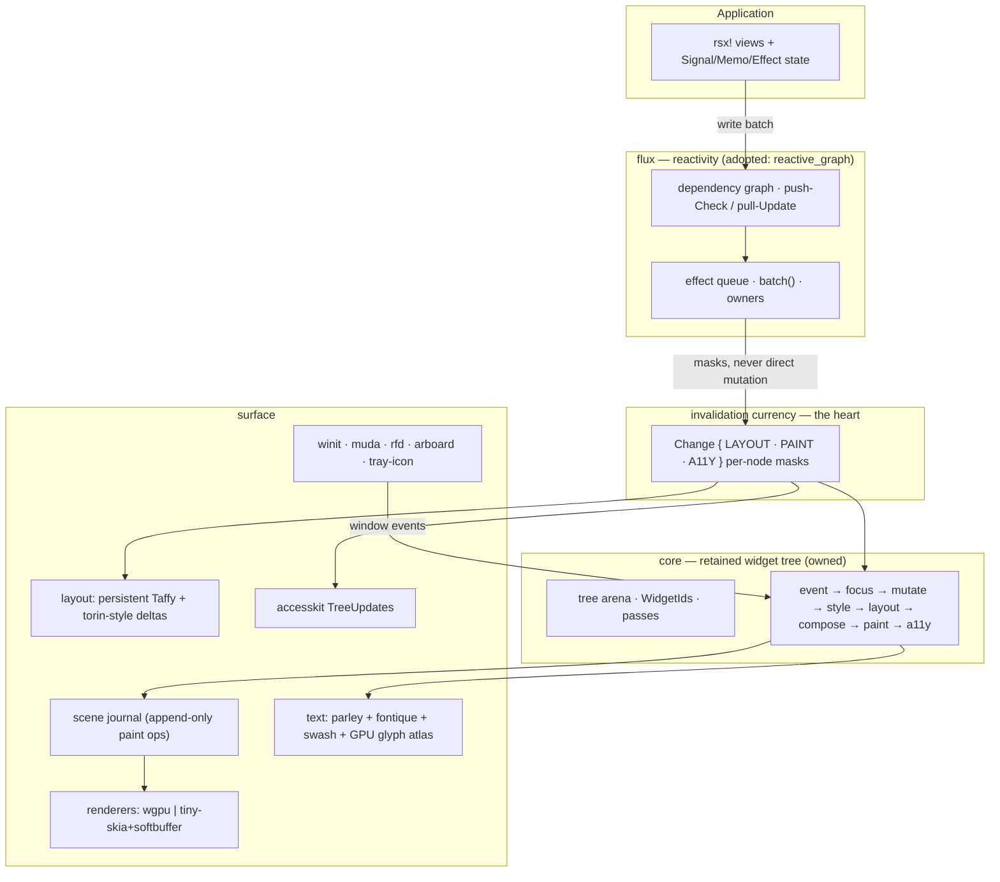

# Alacer — System Architecture

> **Alacer** — Latin for *swift, eager, lively*; the etymon of English *alacrity*: **brisk and cheerful readiness**.
> A retained-mode Rust UI framework whose reactivity, layout, paint, and accessibility consume **one shared invalidation currency** — engineered for best-in-class performance *and* best-in-class developer experience, with zero-config accessibility.

| | |
|---|---|
| **Status** | `architecture/draft-1` — ratified against the 2026-11-05 ecosystem audit |
| **Date** | 2026-11-05 (Europe/Paris) |
| **Evidence base** | `rust-ui-framework-audit-2026-11-05.zip`: 16 repositories verified, cloned, and pinned at exact SHAs; ~705 unique `file:line` citations, every path verified to exist in its pinned clone. Audit codename "Meridian" is superseded by **Alacer** (naming rationale in §2). |
| **Audience** | Core engineers building Alacer; reviewers evaluating its claims; future maintainers |
| **Companion documents** | `VISION.md`, `adr/ADR-1…7`, `audit/INDEX.md`, `audit/MATRIX.md`, `audit/STEAL.md`, `audit/INNOVATE.md`, `audit/PRIMITIVES.md`, `audit/LICENSES.md`, `audit/BENCHMARKS.md` (bundled in the audit ZIP) |

**Citation legend.** Claims about other frameworks are cited to the audited source tree at the pinned SHA, e.g. `crates/gpui/src/window.rs:3743 @ 056a44d` (full SHAs in `audit/INDEX.md`). Cross-framework synthesis lives in `audit/MATRIX.md`; per-framework reports in `audit/<framework>/REPORT.md`. Where the audit could not verify something, the claim is marked **UNVERIFIED** — this document inherits the audit's zero-fabrication policy. Design budgets for Alacer itself are labeled **[budget]** — they are commitments to be CI-enforced, not measurements.

---

## Contents

1. [Thesis](#1-thesis) — the quadrant, in one sentence and four numbers
2. [Name](#2-name) — why Alacer
3. [Design axioms](#3-design-axioms) — eight falsifiable commitments
4. [System overview](#4-system-overview) — layers, crates, and the life of a frame
5. [State & flux — the reactive core](#5-state--flux--the-reactive-core)
6. [Structure — views, reconciliation, identity](#6-structure--views-reconciliation-identity)
7. [Widget core — arena and the pass contract](#7-widget-core--arena-and-the-pass-contract)
8. [Layout — persistent Taffy + torin-style incrementality](#8-layout--persistent-taffy--torin-style-incrementality)
9. [Rendering — one scene journal, two honest backends](#9-rendering--one-scene-journal-two-honest-backends)
10. [Input & focus](#10-input--focus)
11. [Accessibility — a type-level contract](#11-accessibility--a-type-level-contract)
12. [Platform integration](#12-platform-integration)
13. [DX architecture](#13-dx-architecture) — the best-in-class developer experience plan
14. [Performance architecture](#14-performance-architecture) — the best-in-class performance plan
15. [What Alacer will not build](#15-what-alacer-will-not-build)
16. [Moats](#16-moats) — three defensible differentiators
17. [ADR register](#17-adr-register) — a hundred and twenty-six decision records
18. [Roadmap & kill criteria](#18-roadmap--kill-criteria)
19. [Risks & open questions](#19-risks--open-questions)
20. [Provenance, licensing, and honesty](#20-provenance-licensing-and-honesty)
21. [Glossary](#21-glossary)
22. [Appendix: evidence index](#22-appendix-evidence-index)

---

## 1. Thesis

> **Alacer is a retained-mode Rust UI framework in which reactivity, layout, paint, and accessibility consume one shared invalidation currency — delivering Zed-class responsiveness, Leptos-class reactivity ergonomics, and zero-config accessibility: the quadrant no audited framework occupies.**

The audit of 16 Rust UI frameworks (2026-11-05, pinned SHAs) produced four numbers that justify this project's existence:

| # | Verified finding | Consequence |
|---|---|---|
| **4** | Fine-grained reactivity was independently re-implemented four times (Leptos `reactive_graph`, Dioxus signals, Freya 0.4 core, Floem's crate — `audit/MATRIX.md` §3). One of them is MIT-licensed, framework-independent, and complexity-tested. | Writing a fifth reactive core is negative-value work. We adopt, extend, and upstream. |
| **5** | Five custom layout engines exist (Masonry, torin, morphorm, Slint's water-filling solver, Makepad's Walk) while Taffy — which won the flexbox/grid API war — is cleared and rebuilt *every frame* by the most layout-serious desktop app in the ecosystem (`crates/gpui/src/window.rs:3743` @ `056a44d`). | The industry's missing piece is not another solver; it is **incremental relayout over a persistent tree**. We build exactly that, once. |
| **2** | Two of the most popular "hobby-scale" stacks ship **zero** accessibility (Iced and Floem, grep-verified; iced's a11y issue #282 has been open since 2020). | Zero-config accessibility is the single largest verified differentiation slot in the ecosystem. |
| **1** | Dioxus's `subsecond` hot-patcher became ecosystem infrastructure: Dioxus, GPUI, Leptos, and Freya all hot-reload through it. | State-preserving hot reload is table stakes we adopt for free — and make CI-grade. |

**The market failure Alacer exploits:** every audited stack optimizes one vertex of the triangle *performance × ergonomics × accessibility* and treats the others as a tax. GPUI buys editor-class speed with per-frame rebuilds and a Zed-sized platform investment; egui buys unmatched tool-DX with immediate-mode ceilings (a11y nodes built lazily during the UI walk, unbounded glyph/state caches — `crates/epaint/src/text/glyph_atlas.rs:381-395`, `crates/egui/src/util/id_type_map.rs:573-601` @ `fc9d66d`); Iced and Floem buy approachability by dropping a11y entirely. Nobody composes. Composition is the product.

**Definition of done for v1** (traceable to §18): a widget set covering the counter/todo/data-table canon; benchmarks where Alacer beats both the immediate-mode DX baseline (egui) and the best audited retained stack on the same hardware in at least one shared workload; an accessibility CI gate that fails builds on unnamed widgets; and a public, reproducible benchmark harness (spec: `audit/BENCHMARKS.md` §5).

---

## 2. Name

**Alacer** (*ah-LAH-ker*), Latin adjective: *swift, quick, lively, eager*. It is the root of English **alacrity** — "brisk and cheerful readiness" — which is precisely the product contract: **swift** (performance) and **cheerful** (developer experience) are one property, not a trade-off.

Selection was evidence-driven, in the audit's spirit:

- **crates.io** (checked live, 2026-11-05): `alacer` is **unregistered**. Nearly every other candidate was taken and rejected on collision grounds: `ferrite` (an image-loading crate), `keel` (an active "Keel Engine"), `pronghorn`, `iridium`, `flywheel`, `stator`, `escapement`, `carina`, `fovea`, `saccade`, `tessera`, `vivace`, `legato`, `cairn`, `heddle` — all occupied.
- **GitHub** (checked live): 21 repos named `alacer`, none a software framework (max 7★, no Rust project).
- **Crate family:** `alacer`, `alacer-core`, `alacer-macro`, `alacer-view`, `alacer-layout`, `alacer-render`, `alacer-text`, `alacer-a11y`, `alacer-widgets`, `alacer-platform`, `alacer-inspect`, `alacer-testing` (availability to be re-verified at first publish — `UNVERIFIED` until done).
- The audit's internal codename "Meridian" is retired; all ADRs and audit references carry over unchanged.

---

## 3. Design axioms

Each axiom is a commitment with a falsifiable consequence. "Evidence" is the audited mechanism that motivates it.

### A1 — One currency of change
Every cross-cutting consumer — layout, paint, accessibility, devtools — consumes the same per-node `Change` masks. No subsystem invents private invalidation.
*Evidence of the wound:* GPUI clears its entire Taffy tree every frame and hides the cost behind entity caches (`crates/gpui/src/window.rs:3743`, `taffy.rs:55-60`); Freya 0.4 regressed to full repaint in its rewrite (`// TODO: Use incremental rendering`, `crates/freya-core/src/render_pipeline.rs:58`); Iced's damage-based redraw exists only on its software path — its wgpu `present()` accepts no damage parameter (`wgpu/src/window/compositor.rs:230-264` vs `tiny_skia/src/window/compositor.rs:149-185`).
*Consequence:* a feature that cannot express itself as a mask is rejected or redesigned. Devtools read the same masks (§13.3).

### A2 — Steal proven cores; own only the composition
We write **no subsystem for which a maintained, permissively-licensed, production-proven crate exists.** Adopted: `reactive_graph` (reactivity), `taffy` (flex/grid), torin's algorithm (incremental relayout), `parley`/`fontique`/`swash` (text), `accesskit`, `winit`, `wgpu`, `subsecond` (hot reload). Ported-as-algorithm: Slint's partial renderer. Owned: the **composition** — masks, passes, journals, and the DX/tooling above them.
*Evidence:* four reactive reimplementations; five layout engines; Masonry's pass contract is reusable as a design; `audit/STEAL.md` classifies all 20 steals (IDEA/ALGO/CODE) with licenses.

### A3 — Accessibility is a type-level invariant, not a feature
A widget that cannot be named cannot be compiled. Role and label source are required trait methods (Masonry precedent: `masonry_core/src/core/widget.rs:424-435` @ `dc49687`); test queries route through the accessibility tree (egui kittest precedent); a debug-mode CI walker fails builds on unnamed widgets.
*Consequence:* the a11y gap map (Iced/Floem/Blinc = zero) is structurally impossible in Alacer, by construction rather than by discipline.

### A4 — The test harness mirrors production
Headless testing runs the **real** pass pipeline with a software rasterizer — the design that four teams independently converged on (masonry_testing, freya-testing, egui kittest, floem headless; `audit/STEAL.md` #9). No mock event loop, no mock renderer for tests.
*Consequence:* every feature must be headless-testable before merge; GPU-less CI is the default, not a downgrade.

### A5 — Never fork core infrastructure
Iced pins three in-org forks by rev (winit, cosmic-text, cryoglyph — `Cargo.toml:206,207,249` @ `8ff48c4`); Floem rides a Lapce winit fork (`Cargo.toml:65` @ `1351ffb`). Both pay documented supply-chain and merge pain. KAS, by contrast, adopted a winit platform feature upstream within days (`kas-core/src/data_transfer.rs:4-7` @ `98d1419`).
*Consequence:* patches go upstream; a fork requires an ADR with a sunset plan (§17, ADR-1/ADR-9).

### A6 — Budgets are contracts, not aspirations
Floem commits event-path criterion baselines *inside a normative spec* — ~2.25 ns cached hit-test, ~390-410 ns pointer dispatch (`src/event/README.md:334-412` @ `1351ffb`). We extend the practice to build time, binary size, memory, and frame phases: budgets live in CI, regressions are red.
*Consequence:* performance debates end with a diff to a baseline file, not an opinion.

### A7 — Sustained speed, not sprint speed
Cheetahs win benchmarks; the 10,000th frame wins users. Immediate mode is a treadmill — correct and simple, but it re-pays full cost every frame; Alacer is a **flywheel** — work done once (measurement, shaping, journal entries, a11y nodes) is retained and re-used until invalidated.
*Evidence:* egui's whole-UI repaint each frame vs GPUI's `Entity::cached` subtree replay making per-frame element-tree rebuilds viable at editor scale (`crates/gpui/src/view.rs:552-568` @ `056a44d`); Masonry's debug-mode purity panics that catch cache-coherence bugs structurally (`masonry_core/src/passes/layout.rs:72-99`).
*Consequence:* idle CPU = 0% (`ControlFlow::Wait`); the warm paint path for a static UI performs **zero heap allocations** [budget, CI-enforced via the allocation ledger — M84, ADR-0088].

### A8 — The software path is first-class
One scene journal, consumed by both the GPU backend and the software backend. Slint's partial renderer already wraps both its Skia and software renderers — proof the pattern works (`internal/core/partial_renderer.rs:273` @ `0b1c00d`); Iced's GPU/software damage asymmetry is the cautionary tale.
*Consequence:* CI, screenshots, headless tests, and low-end machines exercise the identical scene representation the GPU sees.

---

## 4. System overview

### 4.1 Layers



ASCII fallback:

```
┌────────────────────────────────────────────────────────────────┐
│ application: rsx! views · Signal/Memo/Effect · owners          │
└───────────────┬────────────────────────────────────────────────┘
                │ write batch (coalesced)
┌───────────────▼────────────────────────────────────────────────┐
│ flux: reactive_graph — push-Check/pull-Update, effect queue    │
└───────────────┬────────────────────────────────────────────────┘
                │ Change{Layout,Paint,A11y} masks (merged upward)
┌───────────────▼──────────────┐   ┌─────────────────────────────┐
│ core: arena + pass system    │   │ layout: persistent Taffy    │
│ event→focus→mutate→style→    │◄──┤ + torin-style incremental   │
│ layout→compose→paint→a11y    │   │ deltas, LRU measure cache   │
└───────┬───────────┬──────────┘   └─────────────────────────────┘
        │           │
        ▼           ▼
┌───────────────────┐ ┌───────────────────────────────────────────┐
│ scene journal     │ │ accessibility: accesskit incremental      │
│ (append-only ops) │ │ TreeUpdates from dirty nodes              │
└─────┬───────┬─────┘ └───────────────────────────────────────────┘
      │       │
      ▼       ▼
┌───────────┐ ┌──────────────┐   ┌───────────────────────────────┐
│ wgpu      │ │ tiny-skia +  │   │ platform: winit · muda · rfd  │
│ (primary) │ │ softbuffer   │   │ arboard · tray-icon           │
└───────────┘ └──────────────┘   └───────────────────────────────┘
```

### 4.2 Crate workspace

Layering is a DAG, enforced in CI (no upward deps, no cycles, facade-only re-exports). Public API surface is confined to `alacer` + leaf crates; internals are free to change (ADR-9).

| Crate | Responsibility | Key dependencies (all MIT/Apache) | LOC budget [budget] |
|---|---|---|---|
| `alacer` | Facade: prelude, re-exports, docs, feature flags; hot-reload runtime (the `subsecond` integration + patch contract live here, not in a separate crate) | all below, `subsecond` (feature-gated) | ≤ 3k |
| `alacer-macro` | The `rsx!` view-DSL compiler → `alacer_view::ViewNode` builder trees | `proc-macro2`, `quote`, `syn` | ≤ 2k |
| `alacer-inspect` | Causality inspector: causal recorder, WebSocket wire protocol, embedded client (feature-gated at the facade) | `alacer-core`, serde, sha1, base64 | ≤ 15k |
| `alacer-testing` | Headless harness, a11y queries, snapshots, record/replay, fuzz targets | `alacer` + tiny-skia | ≤ 20k |
| `alacer-widgets` | Widget library (button, label, text input, list, table, scroll…) | `alacer-core` | ≤ 30k |
| `alacer-platform` | winit integration, frame-batched input queueing (M8: the coalescer lives in core; the platform pushes and never drains), window present over wgpu/softbuffer | `winit`, `wgpu`, `softbuffer`, `accesskit_winit` | ≤ 15k |
| `alacer-a11y` | AccessKit contract, incremental TreeUpdates, id-path NodeIds | `accesskit` | ≤ 8k |
| `alacer-text` | parley/fontique/swash façade, shaping caches, glyph atlas | `parley`, `fontique`, `swash` | ≤ 12k |
| `alacer-render` | Scene journal, wgpu + tiny-skia backends, damage/partial paint | `wgpu`, `tiny-skia`, `softbuffer` | ≤ 35k |
| `alacer-layout` | Persistent Taffy host, torin-style incremental engine, measure cache | `taffy`, `euclid` | ≤ 10k |
| `alacer-view` | Ephemeral view trees, keyed reconciliation (peel → key map → LIS), id-path hashing | `alacer-core`, `rustc-hash` | ≤ 15k |
| `alacer-core` | Widget trait + arena + pass system + Change masks + focus/IME contract | `euclid`, `tracing` | ≤ 25k |

Dependency weight is a design goal: the audit's build-cost proxies show lockfiles of 599–1,576 unique crates for peer stacks (`audit/BENCHMARKS.md` §2). Alacer's own-code budget is ~190k LOC — deliberately larger than a toy, an order of magnitude smaller than Makepad's 1.85M-LOC vendoring monorepo — and its *direct* dependency list is the twelve crates above.

### 4.3 The life of a frame

Design budgets for a 120 Hz frame (8.33 ms) on the reference rig (§14.2), mid-size app (1k nodes, one region dirty) **[budget]**:

| Phase | Budget | Mechanism |
|---|---|---|
| Input coalescing | ≤ 0.3 ms | compatible-event merge, wheel accumulation (§10.2) |
| Flux: effect drain to fixpoint | ≤ 0.5 ms | push-Check/pull-Update; 1-bit coalescing; batch() |
| Reconciliation (view diff → mutations) | ≤ 1.0 ms | peel → key map → LIS; only dirty scopes |
| Layout (incremental) | ≤ 2.0 ms | common-ancestor re-measure + translation-only updates |
| Paint (journal append) | ≤ 2.5 ms | dirty subtrees only; cached subtrees replayed |
| Accessibility TreeUpdate | ≤ 0.5 ms (p99 @ 1k nodes) | dirty-node incremental updates |
| Present | remainder | damage-aware on both backends |

Idle contract: no timers, no polling — `ControlFlow::Wait`; 0% CPU between interactions [budget]. Violations of any phase budget are CI failures against committed criterion/tracing baselines (A6), not release-note apologies.

---

## 5. State & flux — the reactive core

### 5.1 Decision: adopt `reactive_graph`, extend, upstream

Alacer's reactivity is **Leptos's `reactive_graph` crate (MIT) as a dependency — not a vendored copy, not a re-implementation.** It is the only Rust reactivity engine that is (a) framework-independent, (b) runtime-agnostic via `any_spawner` (tokio, glib, wasm-bindgen, async-executor — `any_spawner/Cargo.toml:12-20, 33-39` @ `7d656a4`), and (c) complexity-tested (2,170 test LOC including amortized-regression tests, of 17,794 source LOC). Three other frameworks converged on the same design — Dioxus's signals/generational-box, Freya's 0.4 core, Floem's crate — independently re-deriving it (ADR-6). A fifth hand-rolled core would repeat the ecosystem's most expensive duplication.

Core semantics we inherit (all cited at `7d656a4`):

| Mechanism | What it buys us | Where verified |
|---|---|---|
| **push-Check / pull-Update** propagation | glitch suppression; recomputation only toward actual dirty sources | `reactive_graph/src/computed/inner.rs:69-79, 81-97, 106-124` |
| **Order-preserving `FxIndexSet` edges** | effects observe dependencies in registration order ("the inner effect assumes the outer has already run" — `shift_remove` preserves it) | `src/graph/sets.rs:1-13, 84-93` |
| **1-bit effect channel** (`AtomicBool` + `AtomicWaker`) | N synchronous signal writes coalesce into **one** wake/rerun | `src/channel.rs:17-21, 51-56, 61-77` |
| **WriteGuard notifies on drop** | notifications deferred until the mutable borrow ends — no torn reads | `src/signal/guards.rs:354-368` |
| **`batch()`** | nested-safe, ordered `IndexSet` replay at scope end | `src/effect/immediate.rs:150-183, 210-255` |
| **Owner tree** with amortized-O(1) pruning + regression tests; pause/resume cascades | leak-safe teardown; disposal order children → cleanups → arena | `src/owner.rs:327-351`, `:546-559`, `owner.rs:661-708` (tests); `owner.rs:476-515` (pause/resume); `src/owner.rs:533-543` (structure) |
| **`RenderEffect`** | synchronous first run *during rendering*; per-dynamic-slot render bindings; re-dirty on hot patch | `src/effect/render_effect.rs:22-37, 175-216` |

### 5.2 What Alacer adds (and gives upstream)

1. **Memo cycle detection.** Verified gap: `reactive_graph` has none (grep clean; only an `ImmediateEffect` recursion warning at `immediate.rs:352-354`). A memo cycle today misbehaves silently. We contribute a dev-only DFS-over-edges detector at memo creation — the same class of check Masonry applies to measure purity. *Kill-switch note (ADR-6):* if effect scheduling cannot drive paint batching within M0's budget, GPUI-style draw-level entity tracking (`crates/gpui/src/app.rs:1459-1466, 1468-1495` @ `056a44d`) becomes the documented fallback for paint, keeping `reactive_graph` for data.
2. **Borrow-location diagnostics.** Port Floem's `TrackedRefCell` (MIT): in debug builds, signal cells record the `Location` of every borrow, turning "already borrowed" panics into a two-location diff (`reactive/src/signal.rs:29-37, 118-120` @ `1351ffb`).
3. **The mask bridge (this is the composition).** Effects in Alacer do not mutate widgets. Every effect drain ends by applying `Change` masks to arena nodes; widget mutation happens only inside the pass system (§7). This is the single rule that makes Pillar 3 (§4.1) possible: *reactivity is upstream of invalidation, never tangled with it.*
4. **A scheduling contract, test-enforced:** *one write batch ⇒ at most one layout+paint cycle* (plus an animation-tick frame when springs are active). Freya is the counterexample we refuse to become: its memos/effects are async task loops with arrival-order scheduling and no cycle detection (`crates/freya-core/src/lifecycle/memo.rs:106-116`, `effect.rs:48-203` @ `0b13171`).

### 5.3 Public API surface (what users touch)

```rust
use alacer::prelude::*;
use reactive_graph::traits::{GetUntracked as _, Set as _};

fn counter_view(count: alacer_core::FluxRwSignal<i32>) -> ViewNode {
    rsx! {
        column { gap: 8.0, padding: 12.0,
            label { text: "Clicked {count.get()} times" }
            button { text: "Increment", on_click: move || count.set(count.get() + 1) }
        }
    }
}

fn main() {
    let mut pipeline = pipeline_default();
    let count = pipeline.flux_mut().signal(0_i32);
    let mut root = mount_view(&counter_view(count), pipeline);
    // … the app re-runs the view closure on its own schedule; the
    // reconciler applies the diff as in-place widget mutations.
    # let _ = &mut root;
}
```

Ergonomic targets, borrowed from the audited winners: `Copy` signal handles over generational arenas (Dioxus `packages/generational-box` semantics — thread-local arenas, generation counters, `Owner` teardown, `packages/generational-box/src/unsync.rs:38-46`, `entry.rs:31-59` @ `7dfd07e`); dynamic per-run dependency tracking (no manual `unwrap`-style declarations); hooks-rule violations caught with actionable panics (Freya's HOOKS_ERROR pattern, `lifecycle/base.rs:9-107` @ `0b13171`). The shipped surface is the facade's prelude (`rsx!`, the re-exports) over `pipeline_default`/`mount_view`/`run_window` — the hook-form (`use_signal`/`use_memo` inside one `app()` closure) stays the ergonomics option, not the shipped shape.

**Why not the alternatives (decided, with evidence):**
- *Elm-style whole-app re-run* (Masonry/Xilem): every message re-runs `app_logic` and diffs the whole view tree (`xilem/src/driver.rs:256-293` @ `dc49687`) — a tax that grows with app size, paid even when one label changes.
- *Immediate-mode no-reactivity* (egui): unmatched for tools, but it forces whole-UI repaint and structurally complicates a11y/damage (§9, §11).
- *Entities + draw-level tracking only* (GPUI): cheap and correct for redraws, but no memo-level data reuse; adopted as the paint-consumer fallback, not the core (ADR-6).

---

## 6. Structure — views, reconciliation, identity

### 6.1 View layer: ephemeral builders, retained widgets

Alacer separates what is *declared* from what *lives*:

- **View tree** — ephemeral, re-created for dirty scopes only: a typed tree produced by `rsx!` (proc-macro builders; no external DSL — §15).
- **Widget tree** — retained, arena-owned: created once, mutated in place; widgets are never re-created on state change (Xilem/Masonry bridge precedent: view diff emits `WidgetMut` mutations; `xilem_masonry/src/pod.rs:21-59`, `masonry_root.rs:45-71` @ `dc49687`).

This hybrid is the audited sweet spot: GPUI proves per-frame element trees need entity caches to survive editor scale (`crates/gpui/src/element.rs:10-14`, `view.rs:552-568`); Masonry proves retained widgets + ephemeral views give a11y and IME a structural home. Reconciliation cost is bounded by scoping: only scopes dirtied by the flux layer re-run their view closures (the Leptos insight — each dynamic slot is its own binding — applied to a widget world).

### 6.2 Keyed reconciliation: peel → key map → LIS

For collections, Alacer ports the diff pipeline Dioxus hardened (Apache/MIT, `packages/vdom/src/diff/iterator.rs:231-352` @ `7dfd07e`):

1. **Prefix/suffix peel** — match runs with equal keys at both ends (`iterator.rs:250-267`).
2. **Key map** — remaining nodes resolved through a hash map of keys (debug-assert: keys unique — `iterator.rs:241-254`).
3. **Longest-increasing-subsequence** — LIS members are "stable": they do not move; everything else is the minimal mutation set (`iterator.rs:271-346`). Floem's LCS-style keyed diff (`src/view/mod.rs:398-480` @ `1351ffb`) is the cross-check ALGO reference.

Anti-goal: Iced's default — index-based `TypeId`-tag diffing where a mismatch recreates whole subtree state (`core/src/widget/tree.rs:62-73` @ `8ff48c4`), with keying available only as opt-in `keyed_column` (`widget/src/keyed.rs:1-42`). Keying is the default in Alacer's list widgets; index-pairing remains an explicit, documented opt-out for append-mostly lists.

### 6.3 Identity: one hash, four consumers

Every element gets an **id path** from the view structure; each path prefix carries a pre-folded hash (GPUI design, `crates/gpui/src/element.rs:212-236` @ `056a44d`). That single hash value serves as:

| Consumer | Role of the hash |
|---|---|
| Element-state slot | persistence key across re-renders (GPUI `(GlobalElementId, TypeId)` pattern, `window.rs:1044`) |
| Hit-testing identity | the same node id reported by the spatial index (§10.1) |
| AccessKit `NodeId` | stable across frames without extra mapping tables (GPUI: `element.rs:253-255`) |
| Hot-reload template key | template signals keyed by `file:line:col` (Dioxus global-signal interning, `packages/signals/src/global/mod.rs:120-170` @ `7dfd07e`) |

One identity system for state, input, accessibility, and tooling kills an entire class of drift bugs — the a11y tree can never disagree with the hit-test tree about what a node *is*.

### 6.4 Correctness regime for the diff

Dioxus is the only audited project fuzzing its reconciler; we adopt the practice wholesale (IDEA+CODE): a mock-tree **oracle** (`packages/oracle/src/lib.rs:1-9`) + libFuzzer structured-mutation harness asserting *incremental result ≡ fresh rebuild* (`packages/fuzz/README.md:1-18`), plus a miri stress suite (`packages/vdom/tests/miri_stress.rs`). The same harness pattern later guards the invalidation engine (§8.4) and the scene journal (§9.2).

---

## 7. Widget core — arena and the pass contract

### 7.1 Arena

Widgets live in a `tree_arena`-style arena (Masonry's standalone `tree_arena` crate, Apache-2.0): safe nested-`Vec` nodes with a parents map as the **default**; an O(1) hash-map arena exists upstream but ships with 11 `unsafe` blocks and is self-described as "not yet fully tested" (`tree_arena/src/lib.rs:7-75`, `tree_arena_unsafe.rs:8` @ `dc49687`). Alacer ships safe-by-default; the fast arena lands only behind a feature flag *after* passing the fuzz equivalence suite (ADR-9). `WidgetId` = `NonZeroU64` from a global atomic counter, attributed on attach (`masonry_core/src/core/widget.rs:34-44`).

All tree mutation flows through guard types that **merge invalidation flags upward on Drop** (Masonry `WidgetMut` discipline, `masonry_core/src/core/widget_mut.rs:22-43`) — combined with GPUI's lease-and-panic re-entrancy protection (`entity_map.rs:164-177, 296-307` @ `056a44d`): mutating a widget mid-update is a panic with the two contending locations named.

### 7.2 The pass contract

Ten named passes, each explicit, ordered, and independently traceable (Masonry's pass system as contract — `masonry_core/src/doc/pass_system.md:26-41, 133-147` @ `dc49687`; ~3,600 pass LOC in Masonry validates the scale). Every cross-cutting concern becomes a testable, debuggable stage instead of scattering through callbacks:

| # | Pass | Responsibility | Flag consumed / produced |
|---|---|---|---|
| 1 | `event` | target widget via spatial index + z-order; capture → bubble along precomputed immutable paths (Floem's 400-line normative spec, `src/event/README.md:24-152, 154-242` @ `1351ffb`) | consumes input; emits masks |
| 2 | `update_focusable` | recompute focus candidates after tree changes | `Change::Structure` |
| 3 | `update_focus` | resolve active focus; emit platform IME area (Masonry sentinel pattern, `render_root.rs:47`) | focus diffs |
| 4 | `mutate` | drain queued `WidgetMut` closures; flags merge on Drop | `Change::*` |
| 5 | `style` | recalc with reason flags — Floem's Chromium-grade `StyleReasonFlags` (SELECTOR/ANIMATION/TRANSITION/INHERITED_CHANGE…, `src/style/recalc.rs:1-69` @ `1351ffb`) to fixpoint | `Change::Layout`/`Paint` |
| 6 | `layout` | measure/layout split (Masonry `LenReq` model, `layout/len_req.rs`); 10-slot LRU measurement cache per widget (`layout/measurement_cache.rs:7-94`); **debug purity panics** (`passes/layout.rs:72-99`) | `Change::Layout` → geometry |
| 7 | `compose` | scroll offsets, transforms; translation-only updates (torin `post_measure` pattern, §8.2) | geometry → final rects |
| 8 | `paint` | append scene ops to the journal; skip non-dirty subtrees; replay cached ranges | `Change::Paint` |
| 9 | `accessibility` | build incremental AccessKit updates from dirty nodes only (`passes/accessibility.rs:16-60` pattern) | `Change::A11y` |
| 10 | `action` | propagate typed `Action`s to ancestors, then to the app driver (`pass_system.md:99-103`) | side-channel, never masks |

*Pass-overhead kill criterion:* if pass-system bookkeeping exceeds 15% of frame time on the 10k-node churn workload (tracing spans, M1 gate), collapse to a 3-pass pipeline — the masks and the journal survive; the taxonomy shrinks.

---

## 8. Layout — persistent Taffy + torin-style incrementality

### 8.1 The decision (ADR-3)

- **Taffy stays** — flex + grid, multi-org maintained (GPUI pins `=0.15.0`; Floem 0.9.2; Slint delegates flexbox to taffy 0.15.1; blitz uses `stylo_taffy` — `audit/MATRIX.md` §4). Building a sixth engine is exactly the duplicated work A2 forbids.
- **The tree persists** — never cleared between frames. The anti-pattern is specific and verified: GPUI clears its whole `TaffyTree` after every draw (`window.rs:3743`, `taffy.rs:55-60`) and hides the cost behind entity caches — a tax on every general-purpose app that uses its stack.
- **Incrementality is ported from torin (MIT)** — Freya's 3.7k-LOC engine proves partial relayout works over an engine seam (`crates/torin/src/torin.rs:44-242`, `measure.rs:59-154` @ `0b13171`).
- **Masonry's measurement discipline is adopted as contract** — measure/layout split, per-widget LRU cache, debug purity panics.

### 8.2 The incremental algorithm (ported semantics, cited at `0b13171`)

1. **Dirty-reason map** — per-node `DirtyReason` (torin: `None | InnerLayout | Reorder` at `torin.rs:94-107`; Alacer extends with `Style` and `Text`).
2. **Invalidation walk** — `invalidate_with_reason` walks dependants and stops at ascendants that do not need re-measure (`torin.rs:197-242`).
3. **Root candidate** — the **closest common ancestor** of dirty nodes bounds the re-measure region (`torin.rs:44-92`, `measure()` at 289-330).
4. **Translation-only updates** — if only position changed (ancestor moved, size identical), `recursive_translate` repositions without re-measuring (`measure.rs:59-154`). This is the workhorse: scrolling a 10k-row list touches translations, not measurements.
5. **Text is a node concern** — text/font changes mark only the text node dirty in Taffy (Floem pattern: `taffy.mark_dirty(node)`, `src/views/label.rs:214-218` @ `1351ffb`), never restyling the tree.

### 8.3 Numeric discipline

- Layout computes in `f32`; one documented rounding point at `compose`, per axis, in device pixels (single-snapping policy). 
- egui's hard-won cache lesson is adopted as ALGO: **integer wrap-width rounding** in the galley cache kills the re-wrap feedback loop class (`crates/epaint/src/text/galley_cache.rs:41-64`, citing issues #4927/#4928/#5084/#5163 @ `fc9d66d`).
- Masonry's debug purity panic is enabled from day one: if a forced re-measure disagrees with the cached size, the build panics at the guilty widget (`passes/layout.rs:72-99`).

### 8.4 Verification

The §6.4 fuzz harness is mirrored for layout: *incremental relayout ≡ full relayout* on random style/structure churn. Coherence bugs — the known cost of incremental everything (`audit/INNOVATE.md` I4) — are caught by fuzzing + purity panics + snapshot tests, not by users.

**Q1 kill-switch (ADR-3):** a 3-day spike decides whether Taffy's API tolerates ancestor-candidate relayout without forking. If not, torin itself becomes the engine (it is `no_std`-capable and euclid-only, `torin/src/lib.rs:2`) with Taffy kept as an optional compatibility layer.

---

## 9. Rendering — one scene journal, two honest backends

### 9.1 Scene journal (GPUI design, Apache-2.0 CODE)

Paint produces an append-only **scene journal** (GPUI's `scene.rs` architecture, `crates/gpui/src/scene.rs:39-53, 151-163, 172-180` @ `056a44d`):

- per-kind primitive vectors (quads, text runs, images, shadows, borders) enabling same-kind batching for instanced draws (`batches()`);
- an ordered `paint_operations` journal with `finish()` sorting by painter order — replay is deterministic and cache-friendly;
- rounded corners and shadows as SDF quad properties (`scene.rs:574-586`) — no polygon explosion for the two most common effects.

Because the journal is a *record*, it is also a *replay*: cached subtrees re-emit their recorded ranges (GPUI `Entity::cached` replay semantics, `view.rs:552-568`, `scene.rs:141-149` — with its documented constraint respected: caching requires definite sizes, `view.rs:252-256`).

### 9.2 Two backends, one journal (ADR-2)

| Backend | Role | Notes |
|---|---|---|
| **wgpu** | primary | consensus substrate (7/10 audited stacks; Masonry 28, Iced 30, egui 30, Blitz 30, Floem 27, Blinc 26 — Cargo.locks verified) |
| **tiny-skia + softbuffer** | headless/CI/low-end/VM | the test rig *is* this backend (A4); Floem proves a 4-backend `Renderer` trait with honest fallback (`renderer/src/lib.rs:103-150`, `src/paint/renderer.rs:66-83` @ `1351ffb`) |

Vello is **tracked, not load-bearing** (at Masonry HEAD it was removed as a direct dep and survives via `imaging_vello` — API churn is real, `audit/PRIMITIVES.md` P2). Skia may arrive later as an optional external backend (Floem's anyrender-skia precedent), never in core: its C++ build tax is exactly the cold-build cost we budget against (`audit/BENCHMARKS.md` §2).

### 9.3 Partial paint: damage with an escape hatch

- **Damage model:** the union of `Change::Paint` rects, merged into at most **three** DirtyRegion boxes with least-growth overflow merging, old+new rects on geometry change — Slint's algorithm, ported **clean-room** from documented behavior (its code is GPL/commercial; `audit/LICENSES.md` classifies it IDEA/ALGO-only): `internal/core/partial_renderer.rs:273` fixes the ≤3-rect budget, `:290-318` merges overflow by least growth, `:604-618` adds old+new screen rects on geometry change @ `0b1c00d`.
- **Overflow → full frame.** When damage exceeds the region budget or is untrackable (backdrop-blur-style effects, Slint `:726-735`), Alacer presents the whole frame. Correctness first; partial paint is an optimization with a defined fallback, never a risk.
- **Per-item paint trackers** (Slint's `PropertyTracker` slabs, `:748-763`) are a stretch goal behind Q4 — the journal-replay path alone is expected to carry most of the win, exactly as GPUI's does.

### 9.4 Text

- **parley + fontique + swash** as the default stack (ADR-4): Linebender-family convergence (Masonry 0.8, Floem 0.7, Slint migrating to 0.12) means bugfixes flow from a shared ecosystem.
- **Glyph atlas:** cryoglyph-lineage GPU pipeline (glyphon's descendant, Apache/MIT) with 4-way subpixel binning (GPUI precedent, `gpui_linux/src/linux/text_system.rs` + `text_system.rs:50-53` @ `056a44d`).
- **Caches evict.** Where egui's atlas "grows in height as needed" forever (`glyph_atlas.rs:381-395`) and `IdTypeMap` is never auto-collected (`id_type_map.rs:573-601`), Alacer's shaping/galley caches use frame-windowed eviction (egui's own `FrameCache` scheme, `cache/frame_cache.rs:37-44`) with allocation budgets the ledger enforces (§14.3, ADR-0088).
- Per-OS platform shapers (GPUI's `PlatformTextSystem` trait design) remain the documented post-1.0 escape hatch for per-platform text quality — behind the `TextLayout` trait seam, not a fork.

---

## 10. Input & focus

### 10.1 Routing as a normative spec

Event routing ships as a **written spec with committed performance baselines** — Floem's model, adopted end to end (`src/event/README.md:24-152, 154-242` for the normative dispatch spec; `:334-412` for the committed baselines @ `1351ffb`): z-index-aware hit-testing; capture → bubble phases; precomputed immutable event paths (no per-event tree walks); W3C pointer-capture semantics (pending → active); synthetic click-after-pointer-up. Baselines: ~2.25 ns cached hit-test, ~390-410 ns flat-tree dispatch, ~100-120 ns per depth level.

**Status:** the capture half of this spec is M19's delivery (ADR-0025): a press implicitly holds its deepest accepting hit — single-pointer, because the event vocabulary carries no pointer id (ADR-0014's shape) — and the gesture's `Move`/`Up`/`Leave` stream routes through the captured node's ancestor chain with the same capture→bubble phases; the `Up`/`Leave` and the target's death release the capture, the wheel stays hover-routed, and a frame with no capture in flight is the per-event hit test exactly as before. Floem's pending→active two-phase capture and the precomputed event paths remain the tracked evolution.

- **Spatial index:** a `GridF64` 100 px-cell index over element boxes (Floem's understory backends, `src/view/storage.rs:104, 130-143` @ `1351ffb`) plus a 2-entry exact-float-bits hit-test cache, cleared on layout/tree changes (`src/event/path.rs:17-24`) — the Blink-inspired micro-optimization, kept honest by the spec's baselines.

### 10.2 Coalescing and pacing

Adopt Freya's event-buffer discipline (`crates/ragnarok/src/event_buffer.rs:10-69` @ `0b13171`): compatible consecutive events merge; `MouseMove` coalesces on equal button state (`platform.rs:169-178`); same-direction wheel deltas accumulate (`platform.rs:179-198`); the release deadline derives from the monitor's refresh interval in mHz (`crates/freya-winit/src/window.rs:754-763`). Result: input storms cost one frame of work, not N events. **Status:** delivered by M8 (ADR-0014) — the coalescer lives on the `PassPipeline` (`alacer_core::input::EventCoalescer`); the platform queues and never drains; `tick` routes the coalesced batch at its start, and the `input_storm_batching` budget publishes the ratio.

### 10.3 Focus, IME, shortcuts

- **Focus** is a pair of first-class passes (§7.2), not an afterthought on the event path. Since M24 the walk is public vocabulary (`FocusMove`, one `focus_move` door), since M25 it bounds to a subtree (`focus_move_in`, the modal's focus trap), and since M26 it reads the window too: the four directional moves select the candidate the laid-out bounds name — fully beyond the focused node's edge in the direction, nearest edge distance first, cross-axis misalignment breaking ties — never wrapping, refusing honestly at the edge, the scope and the availability tier filtering before the geometry answers (ADR-0030/ADR-0031/ADR-0032); and since M27 the walk's answer is data — the two doors return one `FocusMoveOutcome` (`FocusLanding` with endpoints and wrap, or the named `FocusRefusal` species) instead of the boolean they took through M26, the walk behind them untouched (ADR-0033); since M28 the walk's answers stream to the causal log (one `FocusRecord` per ride — the keyboard's Tab fallback, the code's doors, and since M29 the ring's arrows alike, the widget's own arrows always taking precedence, a refused direction falling through honestly — ADR-0034/ADR-0035).
- **IME contract** (I2): preedit styling, cursor-rect sync, purpose hints, commit semantics — semantics copied from GPUI's `EntityInputHandler` (UTF-16 ranges, marked text) and egui's platform-quirk table including the Windows-Korean preedit workaround (`egui-winit/src/lib.rs:741-763, 795-806` @ `fc9d66d`). Where winit falls short on Wayland, contribute `zwp_text_input_v3` handling upstream (smithay-client-toolkit), *never* fork (A5).
- **Shortcuts:** GPUI's action/keymap system (typed actions, multi-key sequences) as the IDEA steal; actions flow through pass 10, so keymaps are inspectable and conflict-checkable.
- **Drag & drop** and clipboard data-transfer formats land post-0.1 (winit's data-transfer extension is the seam — KAS precedent, `kas-core/src/data_transfer.rs:4-7`).

---

## 11. Accessibility — a type-level contract

The audit's sharpest finding is a market failure: AccessKit is the de-facto standard (8/10 Tier-1 use it or route through the webview), yet Iced and Floem ship **zero** a11y, and iced's issue #282 has been open since 2020 (`audit/MATRIX.md` §6; `audit/INNOVATE.md` I1). Alacer treats that as the opening.

### 11.1 The contract (ADR-5)

1. **Required widget methods.** The `Widget` trait requires `role` and a label source — Masonry's required-method design (`masonry_core/src/core/widget.rs:424-435` @ `dc49687`) shipped as required trait methods: a widget that cannot be named cannot compile, and the friction lands in the two methods every widget writes. The `#[derive(Widget)]` form stays the ergonomics option for the day the set grows past hand impls.
2. **Debug-mode CI walker.** A test-only pass walks the widget tree and fails the build if any widget lacks role/label or exposes unnamed input controls — novel in the ecosystem, cheap to build (egui's kittest already panics on unnamed inputs *at test time*; we move the check to *compile/test gate* time, `crates/egui_kittest/README.md` @ `fc9d66d`).
3. **Identity sharing.** AccessKit `NodeId` = id-path hash = hit-test id (§6.3) — the a11y tree is the same tree, not a parallel one.
4. **Incremental updates.** TreeUpdates built from dirty nodes only (Freya's `accessibility/dirty_nodes.rs` @ `0b13171`), inside pass 9 — never a full-tree rebuild per frame (egui emits a full `TreeUpdate` every end-pass, `crates/egui/src/context.rs:3182-3207` @ `fc9d66d`; we do not inherit that cost).
5. **Tests drive the a11y tree.** The official query API — `find(ROLE_BUTTON).named("Save")` — routes through AccessKit nodes with settle-or-error semantics (kittest: 8,131 LOC, `crates/egui_kittest/src/lib.rs:69-80`): a test can only pass if the widget is *reachable, named, and actionable* by a screen reader. Testing and accessibility reinforce each other; neither can rot silently.
6. **Actions are routed, never munged** (M10, ADR-0016). The platform maps each AccessKit `ActionRequest` onto exactly one `A11yAction` variant (`Click`, `Increment`, `Decrement`, `ScrollUp/Down` with the request's `ScrollUnit`); pass 10 delivers it and the widget refuses what it does not implement — refusal queues no masks and fires nothing, so an AT is never silently lied to. The canon consumes the tier: the list answers scroll/step actions translation-only, and keyboard parity holds because a focused button answers Space/Enter like a pointer press-and-release.
7. **The selection is tree vocabulary, not widget trivia** (M11, ADR-0017). The focused editable exposes anchor and caret in the §10.3 UTF-16 contract unit (`Widget::selection()` → `TreeNode.selection` → AccessKit `TextSelection` on the value-bearing node), and the value tier rides the same faithful mapping: `SetValue`, `ReplaceSelectedText`, and `SetTextSelection` carry their payload or are dropped at the boundary — a `SetValue` without data never becomes a press, and a refused value action costs an idle frame. While a preedit composes, the report drops: the IME owns the canvas, and a stale range would lie to the AT.
8. **The unavailable control is tree vocabulary** (M22, ADR-0028). One
   `enabled()` source of truth on the `Widget` trait — the default
   `focusable()` derivation consults it, so an unavailable control is
   never a Tab stop and never a focus candidate; pass 3's sentinel
   discipline evicts focus from a control that becomes unavailable; the
   pointer is a wall (the gesture never clicks through), the keyboard
   and the IME are answered with silence, and every AT action is
   refused, never munged (the M11 rule). The flag rides pass 9's
   snapshot — `TreeNode.enabled` — and the sink maps it faithfully onto
   AccessKit's `disabled` property, so the AT reads the refusal before
   it happens; a write that lands where the flag already is queues no
   masks.

### 11.2 Budgets

TreeUpdate p99 < 0.5 ms at 1k nodes (M3 gate); a11y pass cost is a committed tracing baseline like every other phase; and since M10 the action route is a published same-host regression gate (`a11y_action/route_100_actions_1k`) — routing an AT action stays in the cost class of routing a pointer event, never an a11y re-materialization; since M11 the same holds for the value tier's payload transport (`a11y_action/route_100_setvalue_1k`). *Kill-switch:* if the budget breaks frame targets, scope updates to lazy-subtree mode — the type-level contract stays; the update granularity adapts.

---

## 12. Platform integration

**winit, un-forked** (ADR-1): Masonry, Freya, egui, Slint and blitz ride stock winit; `accesskit_winit`, `muda`, and friends assume its types — ecosystem gravity is free interop. Alacer isolates the platform behind a thin `Platform` trait (GPUI's `crates/gpui/src/platform.rs` design) from day one so a future custom loop (display-link pacing, layer-shell) never breaks the public API.

Platform services, all permissive-licensed, all adopted not written (audit PRIMITIVES P8): menus via **muda** (Slint ships a 1,112-LOC integration; Dioxus and Floem also use it), dialogs via **rfd**, clipboard via **arboard** (+ `smithay-clipboard` on Linux), tray via **tray-icon**, file watching via **notify**, window handles via **raw-window-handle**.

The line we do not cross: GPUI's 7 per-OS platform crates and ~100k LOC of platform code are a Zed-scale investment (`audit/ADR-1`); Alacer buys its wins (IME quality, display-link pacing) via upstream contribution, and buys nothing else until users demand it.

---

## 13. DX architecture

Best-in-class DX is a *subsystem*, specified and budgeted like rendering. Six pillars:

### 13.1 Views that compile-check: `rsx!` with real diagnostics

Proc-macro builders, no external DSL (§15). Slint's DSL tooling is the gold standard — and the cautionary investment: a 91,430-LOC compiler with 66 passes plus a 36,427-LOC LSP (`internal/compiler/passes/`, `tools/lsp` @ `0b1c00d`). Alacer steals the *diagnostics patterns*, not the compiler: miette-style labeled spans on `rsx!` errors, "did you mean" for style properties, and error texts written like Masonry's hint strings ("Did you forget to use `with_action_widget`?", `xilem/src/driver.rs:317-322` @ `dc49687`).

### 13.2 State-preserving hot reload that CI proves

`subsecond` is adopted as-is (ADR-7): jump-table fn-pointer patching with state preserved in generational-box owners — already shared infrastructure for Dioxus, GPUI, Leptos, and Freya (`crates/gpui/src/hot_reload.rs:11-40` @ `056a44d`; Leptos `Cargo.toml:62-64, 116-125` @ `7d656a4`). Alacer's contribution is the **contract + the proof**:

- all UI-adjacent state lives in owners that survive `subsecond::call` frames (Dioxus precedent);
- on patch, `RenderEffect`s re-dirty instead of rebuilding the world (Leptos pattern, `render_effect.rs:175-216`) — **scoped re-render, not Dioxus's `SchedulerMsg::AllDirty`** (`packages/vdom/src/virtual_dom.rs:798-803` @ `7dfd07e`);
- a **CI hot-patch suite**: every example is hot-patched in CI and asserted to render the new value with state intact. Nobody in the audited ecosystem does this; subsecond's admitted edges (thread-local resets, segfault class — in-code warnings at `packages/subsecond/subsecond/src/lib.rs:88-93`; issues #5317/#4872; Freya's child-scope breakage #2304) are precisely what such a suite catches.
- *Fallback (ADR-7):* if subsecond cannot pass the suite by M4, ship template-only hot reload (the `leptos_hot_reload` AST-diff pattern, MIT) and re-evaluate at 1.0.

### 13.3 The Causality inspector

Every audited devtools answers "what does the tree look like?"; none answers "**why**" (Dioxus's most-requested missing tooling; `audit/INNOVATE.md` I5). Because Alacer owns both the reactive graph and the journals, it can answer causally — the moat is that only the framework can build this:

| Question | Answered from |
|---|---|
| "Why did this render?" | reactive_graph edge activations leading to the node's mask |
| "Who wrote this signal?" | write provenance recorded per `Signal` (dev-mode) |
| "Who subscribes to this memo?" | graph reverse edges |
| "Why is this frame slow?" | per-phase tracing spans + frame journal (GPUI ships a 3,542-LOC profiler journal as precedent, `profiler/journal.rs`) |
| "What did this mask touch?" | mask heatmap overlaid on the widget tree |
| "Why did focus change — or why didn't it?" | the focus doors' own answers, streamed as records beside the events (ADR-0034) |
| "Who rode the walk — the keyboard, the ring, or the app?" | the `FocusRider` every record carries beside its movement (ADR-0036) |
| "What did this field's journal do — and how deep is it now?" | the `InspectEvent::Edit` record every journal action streams at the tick's start drain (ADR-0037) |
| "Why did the live region speak — or refuse?" | the `InspectEvent::Announce` record every speech act streams where the pipeline answers it (ADR-0039) |
| "Did a shortcut take this key — or why not — and *which* shortcut?" | the `InspectEvent::Key` record every keymap consult streams the moment the funnel resolves it — the chord beside the species (ADR-0042), the fired binding's prose name beside it (ADR-0043) |
| "Did the text move — or why not, and which clipboard failed it?" | the `InspectEvent::Clipboard` record every round trip streams (ADR-0045), the engine's and the read's own species beside the verdict (ADR-0047, ADR-0048) |
| "Did the AT's write land — where, and which control answered?" | the `InspectEvent::Value` record every value-tier action streams (ADR-0046), the control's id beside it (ADR-0049), the ask beside the landing (ADR-0050) |
| "Where did the drag start, where did it land?" | the `InspectEvent::Gesture` record every drag phase streams — one per-gesture record, never per-move (ADR-0052), the keyboard's jumps named beside it (ADR-0053) |
| "Did the drag pin a wall — which edge did the landing hit?" | the gesture record's `bound` beside the landing (ADR-0054), the funnel's writes naming their wall on the value log beside it (ADR-0055) |
| "Did the list scroll — where, or why not?" | the `InspectEvent::Scroll` record every scroll ask streams — the wheel, the AT's unit scrolls and value steps, the app's own door, the landed offset beside the ask, the wall the clamp pinned, the refusals named (ADR-0056) |
| "Why did the offset move without any ask?" | the `ScrollAction::ContentClamp` record the content's door streams when `set_content_height` re-clamps — the landing beside the wall it pinned, the non-finite height refused before it corrupts (ADR-0057) |
| "By how much did the AT ask?" | the `unit` beside the scroll record's unit-scroll actions — one item or one page, the honest absence on every story with no unit (ADR-0058) |
| "Did the AT's press land — or why not, and who pressed?" | the `InspectEvent::Action` record every activation ask streams at the tick's start drain (ADR-0075) — the landing or the named refusal (`unavailable` when the M22 wall held the control, `no_door` when no door answered) beside the aimed id, and since ADR-0076 the rider beside the ask (`action_route` for the AT's route, `keyboard` for the Space/Enter parity) |
| "Did the screen reader rewrite this field — or did the app?" | the `TextWriteSource` every `InspectEvent::TextWrite` record carries beside its action (ADR-0062) — `at_door` for the AT's asks, `app_door` for the imperative `set_value` door the view reconciliation's patches ride |
| "The AT asked — why did no door ever answer?" | the `InspectEvent::RouteDrop` record the boundary streams where it refuses (ADR-0063) — the unknown action, the payloadless write, the off-target selection, the unknown target — the action's tag beside the species and the aimed id, never a munged widget-door fact |
| "What does the vocabulary consult — and when did the OS move it?" | the `InspectEvent::Setting` record the platform adapter's door streams at the tick's start drain (ADR-0080) — the dark-mode fact beside the flip that landed it, the bool *is* the fact, and since ADR-0083 the reduced-motion fact beside the dark one, and since ADR-0085 the high-contrast fact beside the two (one seam, one record, never a second seam per fact), and since ADR-0082 the broadcast's node count beside the facts (the lengths rule), the no-op flip streaming none (the idle-frame property, A1's rule at the setting tier), the facts never munging the palette the roles borrow |
| "Which palette is live now — and how much did the swap repaint?" | the `InspectEvent::Theme` record the app's own door streams at the tick's start drain (ADR-0079) — the palette's tag beside the swap that landed it, the colors never riding (the payload rule: the log names the palette, the paint pass resolves it), and since ADR-0084 the broadcast's node count beside the tag (the lengths rule at the theme tier, the composed swap naming the same reach the flip broadcast — one flip, one count), the no-op swap streaming none (the idle-frame property, A1's rule at the theme tier) |
Overhead is feature-gated and sampled; the inspector is a standalone app (Freya's devtools-app precedent, `crates/freya-devtools/src/server.rs:20-90` @ `0b13171`) speaking a documented WS protocol.

### 13.4 Testing as a product (`alacer-testing`, day one)

The four-way convergence (masonry_testing / freya-testing / kittest / floem headless) is adopted and extended (I6):

- **Headless = production pipeline + software raster** (A4): synthetic pointer/key/IME/a11y events, time control (`animate_ms` — Masonry, `masonry_testing/src/harness.rs:73-130` @ `dc49687`), PNG snapshots GPU-free with `BLESS` re-blessing and oxipng size caps.
- **A11y-driven queries** as the only official API (§11.1) — including automatic panics on unnamed input widgets.
- **Record/replay**: user interactions recorded to `.alc` files replayable in `cargo test` (Iced's `.ice` precedent, `examples/todos/tests/carl_sagan.ice` @ `8ff48c4`) — bug reports that are also regression tests.
- **Baselines as contracts**: committed event-latency and phase-time criterion baselines (Floem precedent) — the harness fails on regression before users feel it.
- **Fuzz targets**: reconciler, incremental layout, and journal equivalence (§6.4, §8.4).
- **Hot-patch suite** (§13.2).
- Snapshot hygiene: per-OS thresholds (kittest's `kittest.toml` pattern) so cross-platform font differences don't rot the corpus.

### 13.5 Zero-to-first-pixel: budgets a user feels

Publish and CI-enforce (I7; nothing in the audited ecosystem publishes compile-time budgets):

| Metric | Budget [budget] | Anchor |
|---|---|---|
| Cold build, counter example | < 60 s | reference rig; no Skia-class C++ in the dep tree |
| Incremental rebuild | < 1 s | ThinLink-style object patching if needed (Dioxus's <500 ms claim is UNVERIFIED — we commit to the weaker number) |
| Binary size (stripped) | < 10 MB | against peer stacks' lockfile weight (`audit/BENCHMARKS.md` §2) |
| Idle RSS | < 40 MB | with evicting caches (§9.4) |
| Example gallery | counter ≈ 30 LOC, todo ≈ 70 LOC | Dioxus counter = 21, Freya = 48, Floem = 80, Xilem todo = 169 (`audit/MATRIX.md` §7) |

### 13.6 Docs and migration

A book written against the benchmark canon (counter / todo / data-table); migration notes from egui (state where each `Memory`-ism lives now) and Iced (message → signal mapping); an examples gallery doubling as the storybook (Makepad's storybook app is the UX precedent).

---

## 14. Performance architecture

### 14.1 The method (before the numbers)

The audit's dynamic phase was honest about its limits: no GPU, no toolchain — so it fabricated nothing and left a harness spec (`audit/BENCHMARKS.md` §5). Alacer adopts that spec as its own performance constitution: shared workloads, fixed rig, 5-run medians, maintainer-reviewed idiomatic examples per compared framework (no strawmen), criterion for CPU paths, tracing spans for phase attribution, dhat for allocations, everything labeled.

### 14.2 Workloads and targets

| # | Workload (BENCHMARKS §5) | Target [budget] | Mechanism under test |
|---|---|---|---|
| W1 | 10k-node tree build + 10%/frame style churn | ≥ 5× vs full relayout by M2 gate (≥ 2× minimum to keep the design) | persistent Taffy + ancestor candidates (§8) |
| W2 | text-dense relayout: 1k paragraphs, width jitter ±5% | stable frame times; no re-wrap oscillation | text-node-only dirty marks + integer wrap rounding (§8.3) |
| W3 | animation loop, 1k nodes, position/opacity @ vsync | 120 fps @ 1k nodes on the reference rig | journal replay + translation-only updates (§8.2, §9.1) |
| W4 | input-to-paint latency | p99 ≤ 2 frames @ 120 Hz | coalescing (§10.2) + phase budgets (§4.3) |
| W5 | signal-graph churn: 10k signals, 1k memos | one rerun per write batch; no glitching | push-Check/pull-Update + 1-bit coalescing (§5.1) |

**Reference rig** (declared once, kept stable): a specified Linux desktop (Vulkan) plus an llvmpipe software run for parity; same winit version across competitors; vsync locked.

### 14.3 Memory discipline

- Idle RSS < 40 MB [budget, maintainer-run]; the warm-frame allocation budget runs in CI through the allocation ledger (ADR-0088).
- **Warm-path allocation budget: zero heap allocations** for a static UI's steady-state frame (paint replay + present) [budget]; the masks/journal design makes this checkable, and any new feature that breaks it needs an ADR — enforced since M84 by the allocation ledger and the `alloc` corpus (ADR-0088).
- Every cache has an eviction policy *and a test that proves it* — the ecosystem's unbounded-cache club (egui's atlas and `IdTypeMap`; cited issues #3689) stays at zero members.
- Hot-path maps use `FxHash`-class hashing only where profiling justifies it (Makepad measured SipHash at ~4% of main-thread encode samples, `platform/hal/src/lib.rs:13-15` @ `8049ae2` — the lesson is "measure then swap", not "swap everywhere").

### 14.4 Degradation ladder (backpressure)

When a frame can't fit its budget: (1) coalesce remaining flux work into the next frame (already the default); (2) merge damage regions and present one larger region; (3) present full frame; (4) *never* skip the a11y or focus passes — latency may degrade, correctness may not. This ladder is documented, ordered, and each rung is observable in the frame journal.

### 14.5 Scheduling model

Main thread owns the frame loop, the arena, and paint (retained tree mutation is main-thread by contract — Makepad documents the same reality honestly, `widgets/core/src/widget_tree.rs:14-17` @ `8049ae2`). Async work (resources, IO) runs on any_spawner's executors off-thread and lands in the frame via signals — the effect channel coalesces their wakeups. Parallel layout/paint of independent subtrees is an explicit non-goal for v1 (§15) — sequencing risk is not worth pre-1.0 complexity when W1–W5 targets are reachable single-threaded.

---

## 15. What Alacer will not build

Scope discipline is architecture. Each non-goal cites who owns it and why we lose nothing:

| Non-goal | Reason (evidence-based) |
|---|---|
| **No external DSL** | Slint's DSL moat rests on a 91k-LOC compiler + 36k-LOC LSP; competing there doubles scope for a moat we don't need. Proc-macro builders + stolen diagnostics patterns cover the need. |
| **No webview runtime** | Dioxus owns it; the memory cost and non-native a11y seams are verified (`audit/STEAL.md` anti-steals). |
| **No web/mobile in the first 6 months** | Desktop-first; wasm/mobile = M4+ stretch behind the platform matrix (I8). GPUI's iOS a11y absence is the cautionary tale — we won't ship platforms we can't make accessible. |
| **No embedded/MCU story** | Slint's software renderer is 15 years of company work. We keep a first-class *desktop* software path only (A8), which incidentally serves CI/headless. |
| **No 3D / game-engine ambitions** | Bevy adjacency is a trap; wgpu composability is the escape hatch. |
| **No TUI** | Out of the audited problem space (ratatui owns it). |
| **No runtime CSS engine** | Typed Rust style properties with Floem-style reason-flag recalc (§7.2 pass 5); selectors/parity with Stylo is a multi-year spec, and no audited native stack ships a full engine either. |
| **No vendored monorepo** | Makepad's 1.85M LOC / 205 vendored crates buys independence at the price of audit impossibility and bus-factor ≈ 1 (squashed history). We buy the same independence with small, permissive deps (A2, A5). |

---

## 16. Moats

Three differentiators, each hard to copy and disproportionately funded (the audit requires ≥ 3, each evidenced):

1. **The invalidation composition (§4.1, Pillar 3).** One `Change` currency feeding incremental layout (torin-on-Taffy), journal-replay paint, and incremental AccessKit updates. A competitor matching it must rework their layout engine (all Taffy users), their renderer (egui, Iced), or their reactivity (GPUI) — and Freya 0.4 shows what churn without this discipline does (`render_pipeline.rs:58`). We fund it as the core (~40% of M1–M3 effort), and it is kill-proof: the engine transfers to any widget set.
2. **Zero-config accessibility at the type level (§11).** Competitors can bolt on AccessKit; making it *required* breaks their APIs — a cost incumbents demonstrably defer (iced #282, open 6 years). We fund the docs, the quirks tables, the CI gate, and the a11y-driven test API that no solo project matches.
3. **Causality devtools (§13.3).** "Why did this render / who wrote / who subscribes" requires owning the reactive core's semantics *and* the renderer's journals — a composition only the framework itself can build. GPUI's profiler journal and Iced's message replay prove the appetite; nobody owns the whole causal chain.

---

## 17. ADR register

ADRs 1–7 were ratified with the audit bundle (`adr/ADR-*.md`); each carries its own kill-switch. ADRs 8–11 are authored here to complete the architecture; ADR-0012…ADR-0031 scope milestones M6–M25 as they shipped, ADR-0032 scopes M26, ADR-0033 scopes M27, ADR-0034 scopes M28, ADR-0035 scopes M29, ADR-0036 scopes M30, ADR-0037 scopes M31, ADR-0038 scopes M32, ADR-0039 scopes M33, ADR-0040 scopes M34, ADR-0041 scopes M35, ADR-0042 scopes M36, ADR-0043 scopes M37, ADR-0044 scopes M38, and ADR-0045 scopes M39; ADR-0046…ADR-0056 scope M40–M50 as they shipped, ADR-0057 scopes M51, ADR-0058 scopes M52, ADR-0059 scopes M53, ADR-0060 scopes M54, ADR-0061 scopes M55, ADR-0062 scopes M56, ADR-0063 scopes M57, ADR-0064 scopes M58, ADR-0065 scopes M59, ADR-0066 scopes M60, ADR-0067 scopes M61, ADR-0068 scopes M62, ADR-0069 scopes M63, ADR-0070 scopes M64, ADR-0071 scopes M65, ADR-0072 scopes M66, ADR-0073 scopes M67, ADR-0074 scopes M68, ADR-0075 scopes M69, ADR-0076 scopes M70, ADR-0077 scopes M71, ADR-0078 scopes M72, ADR-0079 scopes M73, ADR-0080 scopes M74, ADR-0081 scopes M75, ADR-0082 scopes M76, ADR-0083 scopes M77, ADR-0084 scopes M78, ADR-0085 scopes M79, ADR-0086 scopes M80, ADR-0087 scopes M81, ADR-0088 scopes M84, ADR-0089 scopes M85, ADR-0090 scopes M86, ADR-0091 scopes M87, ADR-0092 scopes M88, ADR-0093 scopes M89, ADR-0094 scopes M90, ADR-0095 scopes M91, ADR-0096 scopes M92, ADR-0097 scopes M93, ADR-0098 scopes M94, ADR-0099 scopes M95, ADR-0100 scopes M96, ADR-0101 scopes M97, ADR-0102 scopes M98, ADR-0103 scopes M99, ADR-0104 scopes M100, ADR-0105 scopes M101, ADR-0106 scopes M102, ADR-0107 scopes M103, ADR-0108 scopes M104, ADR-0109 scopes M105, ADR-0110 scopes M106, ADR-0111 scopes M107, ADR-0112…ADR-0122 scope M108–M118 as they shipped, ADR-0123 scopes M119, ADR-0124 scopes M120, and ADR-0125 scopes M121 (see `docs/adr/`).

| ADR | Decision | Status | Kill-switch (falsifiable) |
|---|---|---|---|
| **ADR-0000** | M0 scope: the walking skeleton — one window, one label, one button, the masks flowing end to end (the canon the M0 exit suite pins) | Accepted | the skeleton cannot carry a second widget or a second mask without a rewrite → re-cut the spine, priced by the M1 canon (see `docs/adr/ADR-0000-m0-scope.md`) |
| **ADR-0001** | Windowing: stock winit behind a thin `Platform` trait; contribute upstream, never fork | Accepted | winit blocks a launch-critical feature (e.g. sub-frame pacing) > 2 months → patch crate, not fork |
| **ADR-0002** | GPU: wgpu primary + tiny-skia/softbuffer behind one scene journal; Vello tracked, not load-bearing; Skia optional later | Accepted | journal replay on wgpu misses W3 budget by M3 → re-evaluate GPUI-style per-OS pipelines |
| **ADR-0003** | Layout: persistent Taffy tree + torin-style incremental port + Masonry measurement discipline | Accepted (Q1-gated) | 3-day spike: Taffy API resists ancestor-candidate relayout → adopt torin as the engine, Taffy optional |
| **ADR-0004** | Text: parley + fontique + swash behind a `TextLayout` trait; cryoglyph-lineage atlas; egui cache lessons as ALGO | Accepted | blocking CJK/complex-script parley bug with no upstream bandwidth → swap impl to cosmic-text |
| **ADR-0005** | A11y: AccessKit-only, required methods via derive, id-path NodeIds, dirty-node updates, a11y-driven tests | Accepted | AccessKit can't express a needed platform → evaluate Makepad's bespoke stack (interop UNVERIFIED — audit before reuse) |
| **ADR-0006** | Reactivity: adopt `reactive_graph`; upstream memo-cycle detection; TrackedRefCell diagnostics | Accepted | effect scheduling can't drive paint batching in M0 → GPUI-style draw-level tracking for paint, reactive_graph for data |
| **ADR-0007** | Hot reload: adopt subsecond as-is + CI hot-patch suite + scoped re-render contract | Accepted | CI suite fails by M4 (segfault class) → template-only hot reload (leptos_hot_reload pattern) |
| **ADR-0008** *(new)* | **Identity & reconciliation:** id-path prefix hashing as the single identity across element-state, hit-testing, AccessKit NodeIds, and hot-reload keys; keyed peel→map→LIS diffing; fuzz-equivalence gate | Accepted | equivalence fuzz finds a class LIS cannot express minimally → fall back to key-map move semantics, keep fuzz gate |
| **ADR-9** *(new)* | **Workspace & discipline:** 12-crate DAG (§4.2) with facade-only re-exports; `missing_docs` + `unsafe_code` deny (Iced precedent, `Cargo.toml:253-254` @ `8ff48c4`); zero unsafe outside platform crates; `cargo-deny` license gate (no AGPL, no unknown licenses); upstream-first patch policy | Accepted | DAG friction measurably slows feature work > 1 sprint → consolidate to 6 crates, re-vote |
| **ADR-10** *(new)* | **Testing productization:** headless-with-real-pipeline as default `cargo test`; a11y-driven queries as the only official API; baselines-as-contracts; fuzz targets; hot-patch suite | Accepted | it *is* the validation (I6) — scope shrinks only via roadmap gates, not by removing the harness |
| **ADR-11** *(new)* | **Versioning & stability:** 0.x semver; `alacer` + widget crates follow semver-style care from 0.1 (deprecations, migrate notes); internals (`alacer-core`, `-view`, `-render`) may break at minors with CHANGELOG; MSRV pinned; renaming the audit codename to Alacer is recorded as the first entry | Accepted | community pain signals (issue-labeled `stability`) > 10/month → adopt 1.0-RC freeze earlier |
| **ADR-0012** | M6 scope: widget canon + record/replay + W2/W3/W5 published benches | Accepted | canon can't hold the a11y contract end-to-end → narrow the canon to what can |
| **ADR-0013** | M7 scope: the reproducible bench rig + cross-framework comparison beat | Accepted | competitor absolute medians gated → benchmark theatre (never done) |
| **ADR-0014** | M8 scope: frame-batched input — the coalescer joins the scheduling contract | Accepted | per-event dispatch semantics change observable widget behavior → route the batch per event behind a queue-depth knob |
| **ADR-0015** | M9 scope: the windowed a11y path joins the incremental contract — the pipeline's sink is the only `TreeUpdate` materialization path | Accepted | a platform adapter needs a shape the sink cannot express → re-open the seam with the shape as a trait method |
| **ADR-0016** | M10 scope: the a11y action tier joins the dispatch contract — faithful `ActionRequest` mapping, the `Increment`/`Decrement`/`Scroll*` vocabulary, keyboard-operable buttons | Accepted | an action class needs a shape pass 10 cannot express → grow the vocabulary behind the same refuse-don't-munge contract |
| **ADR-0017** | M11 scope: the UTF-16 selection model joins the editing and a11y contracts — anchor+caret in the contract unit, selection-consuming edits, the `SetValue`/`ReplaceSelectedText`/`SetTextSelection` tier mapped faithfully | Accepted | an AT needs a selection shape the value-bearing node cannot express → grow the snapshot vocabulary behind the same refuse-don't-munge contract |
| **ADR-0018** | M12 scope: the pointer joins the editing contract — the resolved frame reaches `on_pointer_event`, the text seam inverts the caret's own prefix widths (`hit_test`), a click places the caret and a drag extends the selection from the anchor | Accepted | a pointer gesture needs a mapping the event/text seams cannot express → grow the contract behind the same `PAINT \| A11Y` currency (frame on `EventCtx`, `hit_test` on `TextSeam`) |
| **ADR-0019** | M13 scope: the word joins the editing contract — the text seam carries the UAX #29 segmentation (`word_segments`, required — no honest default without the tables), core fixes one hop rule, the editor hops word runs (Alt/Ctrl+arrows), deletes the hop's span (Ctrl/Alt+Backspace/Delete), and a double-click selects the word under it (`PointerEvent::Down` grows the platform-computed `click_count`) | Accepted | a word gesture needs a mapping the event/text seams cannot express → grow the contract behind the same `PAINT \| A11Y` currency (segmentation on `TextSeam`, the chain on `PointerEvent::Down`) |
| **ADR-0020** | M14 scope: the clipboard joins the editing contract — the `ClipboardSeam` carries the OS round trip (no provided implementation; the engine rides arboard in `alacer-platform`), core fixes one paste rule (line breaks collapse to spaces), the editor answers Ctrl/Cmd+C/X/V with the M11 selection rules, a refused write never deletes, and refused chords cost an idle frame | Accepted | a clipboard shape the seam cannot express → grow the contract behind the same refuse-don't-munge rule (the seam in `alacer-core`, the engine in `alacer-platform`) |
| **ADR-0021** | M15 scope: the undo stack joins the editing contract — the `EditHistory` journal in core carries the inverse of every committed edit (bounded, the pure-append coalescing rule, the whole-value reset), the editor routes every edit through one journaling funnel and answers Ctrl/Cmd+Z, Shift+Ctrl/Cmd+Z, and Ctrl/Cmd+Y with the M11 selection semantics, and an exhausted or reset journal refuses with no masks | Accepted | an undo gesture needs a mapping the edit funnel cannot express → grow the contract behind the same refuse-don't-munge rule (the journal in `alacer-core`, the funnel in the editor) |
| **ADR-0022** | M16 scope: the consumable contract — the 0.12.0 cut completes (the internal dependency pins and the lockfile ride `[workspace.package]`), `PlatformError`/`BackendError` carry their `source()` chains and name the escape hatch they know, the widgets crate's self-description matches the shipped vocabulary, and the M15 journal gets its consumer demonstration (`examples/undo_redo.rs`, blessed with the m1 corpus) | Accepted | a feature milestone lands in a surface that cannot publish, mis-describes itself, or drops its error chains → fix the surface first; the ledger's candidates (announcements, pointer capture, a `Slider`) each need a full corpus cycle (see `docs/adr/ADR-0022-m16-scope.md`) |
| **ADR-0023** | M17 scope: the demonstrated queue — the M8 coalescer gets its consumer demonstration (`examples/input_storm.rs`, a custom `StormPanel` probe blessed with the m1 corpus, tracing at `alacer::input`), the living documents re-agree with the checked-in baselines (the README's 15.22×/41.28×, the migration guides' 0.12.0 self-description, the facade's shipped-surface rustdoc), and the error-chain discipline reaches `Recording::load` (the parse cause walks) and `LayoutError` (the failing node is data, not prose) | Accepted | a feature milestone lands in a surface whose demonstrations, numbers, or error chains lag its own API → fix the surface first; the ledger's candidates (announcements, pointer capture, a `Slider`) each need a full corpus cycle (see `docs/adr/ADR-0023-m17-scope.md`) |
| **ADR-0024** | M18 scope: the announced delta — the a11y announcement seam joins the invalidation currency (a reserved live-region node in pass 9's snapshot, polite/assertive `aria-live`, the handler-reachable queue drained at the tick, refuse-don't-munge, `examples/announcements.rs` blessed with the m1 corpus, tracing at `alacer::announce`), the last two `String` error leaves carry their causes (`PlatformError::Softbuffer` ← `softbuffer::SoftBufferError`, `BackendError::SurfaceCreation` ← `wgpu::CreateSurfaceError`), the dead convenience APIs go (`PassPipeline::has_queued_input`, `run_hot_window_with_channel`, the registry accessors), and the living documents re-agree (the ADR count, the migration guides' snapshot counts, the journal's materialization-shape claim, the facade's pass-order rustdoc) | Accepted | the region is a second invalidation channel or announcing moves the tree's shape → collapse it into the widget vocabulary; a speech act needs a shape the sink cannot express → re-open the seam with the shape as a property on the snapshot node (see `docs/adr/ADR-0024-m18-scope.md`) |
| **ADR-0025** | M19 scope: the captured drag — the pointer capture joins the dispatch contract (a press implicitly holds its deepest accepting hit, the gesture's Move/Up/Leave stream rides the captured node's ancestor chain wherever the pointer goes, the Up/Leave and the target's death release it, the wheel stays hit-tested, and a frame with no capture routes exactly as the hit test always did), the surface work rides the same cut (the dead `EventCoalescer::pending` goes — zero call sites, the M18 pattern — and the `rsx!` single-root diagnostic names what it found with its help text), and the living documents re-agree (the README's 53-case criterion count finally quotes the 54-case baseline, the §10.1 routing spec states the capture it ships, `examples/drag_capture.rs` demonstrates the contract) | Accepted | a gesture needs a route the single capture slot cannot express (multi-pointer, per-button capture) → grow the event vocabulary with the pointer id first, then the capture table; a widget needs to refuse or steal the implicit capture → re-open the seam with the opt-out as a `Widget` predicate beside `accepts_pointer` (see `docs/adr/ADR-0025-m19-scope.md`) |
| **ADR-0026** | M20 scope: the valued widget — the slider joins the widget vocabulary (a `Role::Slider` that is requires-name and focusable and carries its bounded value through the M3 `value()` contract; one funnel with four doors — drag against the resolved frame, arrows and Home/End, the AT's `SetValue`/`Increment`/`Decrement` through the existing action route — with every write clamped to the range and snapped to the step inside the widget, non-numeric and non-finite writes refused honestly, a no-op write queues no masks), `examples/slider.rs` is the consumer demonstration, the corpus grows 54 → 55 by the coordinated rule (the M19-promised `input/route_100_captured_moves_1k` measured, published, and gated at this run), the m1 corpus grows 33 → 35 (the drag-capture and slider scenarios), and the living documents re-agree (the README's badge, count, vocabulary, and status block, the catalog, the migration guides, the CHANGELOG) | Accepted | a range or multi-thumb slider needs a vocabulary one value cannot express → re-open the seam with the second thumb priced by a real UI; a value write needs a shape the funnel cannot express → grow the contract behind the same refuse-don't-munge rule (see `docs/adr/ADR-0026-m20-scope.md`) |
| **ADR-0027** | M21 scope: the reported value — the progress indicator joins the value tier as its read half (a `Role::ProgressIndicator` that is requires-name and *not* focusable and reports the app's bounded scalar through the M3 `value()` contract; two app doors landing the same `PAINT \| A11Y` currency — the binding bridge with the caller's masks, and the mutate seam whose `set_value` answers the move it made so a write that lands where the value already is queues nothing; every AT action refused honestly — a reporting widget has no write door, the M11 rule), `examples/progress.rs` is the consumer demonstration (the mutate seam's first one), the corpus grows 55 → 56 by the coordinated rule (the value-write route's `progress/route_100_value_writes_1k` measured, published, and gated at this run), the m1 corpus grows 35 → 36 (the reported value's window), the micro-debt the audit priced rides the cut (the dead `PassPipeline::has_observer` and the wgpu backend's dead stats surface go), and the living documents re-agree (the migration guides' 0.12.0 self-description among them — the M16 pattern's remainder) | Accepted | a report needs a write door (an editable progress) → that is the editor's or the slider's contract, not a reporter's — grow the vocabulary there; a value report needs a shape the bridge cannot express → re-open the seam with the shape as a property on the binding contract (see `docs/adr/ADR-0027-m21-scope.md`) |
| **ADR-0028** | M22 scope: the unavailable control — the availability tier joins the widget contract (one `Widget::enabled` source of truth; the default `focusable()` derivation consults it; pass 3 evicts focus from a control that becomes unavailable; the pointer is a wall, the keyboard and IME are answered with silence, and every AT action is refused honestly, never munged), the flag rides pass 9's snapshot (`TreeNode.enabled`) and the sink maps it onto AccessKit's `disabled` property, two doors land the same `PAINT \| A11Y` currency (the fixed `set_enabled` that answers the move it made; the button's `enabled_binding` bridge door), `examples/disabled.rs` is the consumer demonstration, the corpus grows 56 → 57 by the coordinated rule (the refused route's `disabled/route_100_refused_presses_1k` measured, published, and gated at this run), the m1 corpus grows 36 → 37, the micro-debt the sweep priced rides the cut (the software renderer's dead `glyphs_rendered` — the M21 gate's own blind spot — plus `PassPipeline::clear_observer`/`timings_enabled` and the `ViewRoot::root` duplicate), and the `rsx!` diagnostics reach the ADR-0025 species' remainder | Accepted | a control needs a third availability state → grow the vocabulary as a snapshot property, not a second flag; a door needs a shape refuse-don't-munge cannot express → re-open the seam with the shape as a trait method beside `enabled` (see `docs/adr/ADR-0028-m22-scope.md`) |
| **ADR-0029** | M23 scope: the frame's ledger — the scene journal becomes legible to its consumers: a required `SceneJournal::stats()` carrying the `JournalStats` vocabulary (commits, drops, live layers) with `PassPipeline::journal_stats()` as the pipeline's one read door, `examples/frame_ledger.rs` as the consumer demonstration (tracing at `alacer::frame_ledger`), the m1 corpus's broken trio repaired (the `list_scrolled_120`/`400` scenarios never fed `set_content_height`, so the scroll clamp folded every offset to zero and three distinct scroll positions blessed one identical image — the scenarios grow the range and feed the clamp; the next bless run re-blesses them distinct), and the micro-debt the sweep priced rides the cut (the journal's dead inherent accessors replaced by the seam, the todo canon's dead `footer_node`, the `rsx!` body-cardinality diagnostic names its cardinality with `help:` text, the inspector's accept loop reports the session errors it swallowed through the adopted `tracing` core — no new dependency enters the graph) | Accepted | a ledger read per frame on the hot path → that is the damage report's job; grow `FrameReport`, never a second channel (the re-open rule's shape) |
| **ADR-0030** | M24 scope: the focus walk joins the dispatch contract — Tab's private cycle becomes public vocabulary: a `FocusMove` direction (`Next`/`Prev`) and one `PassPipeline::focus_move` door the keyboard's Tab/Shift+Tab fallback and the consumer's code both ride (one funnel, two doors — the order never duplicated at the call site), the walk skips unavailable controls (the M22 cycle-time `enabled` check), wraps at both ends, resolves immediately (key routing sees the new focus this event), and refuses honestly when no candidate exists (no masks, an idle frame, never a first-candidate reset), with `tracing` spans at `alacer::focus` and `examples/focus_traversal.rs` as the consumer demonstration; the micro-debt the sweep priced rides the cut (the flux runtime's dead `effect_count` introspection, the harness's dead `spec_of`/`with_text_context`/`text_size` probes), and the living documents re-agree at M24 (the README's status block, count, features bullet, quickstart, and table; the catalog; the register; the roadmap; the m1 header's snapshot count that lagged its own pin; the m20–m23 suites' document pins; the CHANGELOG) | Accepted | a walk needs an order the tree order cannot express (spatial/D-pad navigation) → grow the vocabulary as a second door priced by a real UI, never a second pipeline channel; a consumer needs the walk bounded to a subtree (a modal's focus trap) → re-open the seam with the scope as a predicate beside `focusable` (the ADR's re-open rule) |
| **ADR-0031** | M25 scope: the focus walk bounds to a subtree — ADR-0030's pre-registered re-open rule (the modal's focus trap) ships as one `PassPipeline::focus_move_in(scope, movement)` door beside the unscoped funnel, the scope the subtree's root node, the walk generalized behind both doors (`cycle_focus_in` — the same candidate list, the M22 availability filter, the wrap, the immediate resolution; the scope bounds the walk, never the candidate list), refusals honest and named with plain help text on the `alacer::focus` target (ADR-0029's rule), `examples/focus_trap.rs` as the consumer demonstration, the micro-debt the sweep priced riding the cut (the dead `fixed_size_of`, the dead `to_f32_rgba`), and the living documents re-agree at M25 and 0.16.0 — the m7 release-state pin re-joining the chain (it missed the M23/M24 sweeps) | Accepted | a scope needs a shape the subtree root cannot express → grow the scope vocabulary beside `focus_move_in`, priced by a real UI, never a second walk (see `docs/adr/ADR-0031-m25-scope.md`) |
| **ADR-0032** | M26 scope: the directional focus walk — ADR-0030's pre-registered re-open rule (spatial/D-pad navigation) ships as four `FocusMove` directions (`Left`/`Right`/`Up`/`Down`) riding the same two doors and the same one walk: the tree-order moves keep the pre-order list and their wrap, the directional moves read the bounds pass 6 wrote (`directional_neighbor` — fully beyond the focused node's edge in the direction, nearest edge distance first, cross-axis center misalignment breaking ties, then tree order), the availability tier filters before the geometry answers, the scope bounds the directional walk exactly as it bounds the tree-order one, space never wraps (the window's edge is the walk's end) and the refusals are honest and named on the `alacer::focus` target (ADR-0029's rule), the entry contract is repaired to what ADR-0031 has documented since M25 (from no focus — or a focus outside the filtered list — the walk takes the list's first candidate; the M25-era arithmetic landed the second), `examples/focus_direction.rs` as the consumer demonstration (tracing at `alacer::focus_direction`), the micro-debt the sweep priced riding the cut (the selection's dead `is_degenerate`, the color's dead `to_premultiplied_rgba8` whose only caller was its own test — the M25 species), and the corpus debt the M24/M25 coordinated rule left rides the cut: the two promised focus routes join the published corpus beside the directional route at this cut's measurement run (the corpus pins move 57 → 60 across the m5–m25 chain in the same commit) | Accepted | a walk needs an order neither the tree nor the edge-distance heuristic can express (a true 2-D grid with occlusion or warping) → grow the selection vocabulary beside `directional_neighbor`, priced by a real UI, never a second pipeline channel; a door needs to observe the walk's refusals as data → grow the answer into a result vocabulary priced by that consumer (ADR-0031's rule stands) (see `docs/adr/ADR-0032-m26-scope.md`) |
| **ADR-0033** | M27 scope: the walk's answer becomes data — ADR-0031's pre-registered re-open rule ("a door needs to observe the walk's refusals as data") ships as the `FocusMoveOutcome` vocabulary the two doors (`focus_move`, `focus_move_in`) return instead of the boolean they took through M26: a `FocusLanding` (`from`/`to`/`wrapped` — the entry landing carries `from: None` and never the wrap, the directional landings never wrap) when the walk moved, a named `FocusRefusal` species when it refused (`NoCandidates` — the empty arena, the held-down trap; `DeadScope` — the M25 refusal, now named; `NoGeometry` — the directional move before the first layout; `NothingInDirection` — the M26 edge, naming its node and direction; `AlreadyFocused` — the single-candidate stall), the `moved()` verdict accessor keeping the routing call sites (the keyboard's Tab fallback) one line, the walk behind the doors untouched (the same candidate list, the same availability filter, the same wrap, the same immediate resolution, the same no-mask idle refusals — the M11 rule stays, the answer stops being silent), the per-species help staying plain text on the `alacer::focus` target (ADR-0029's rule), `examples/focus_outcome.rs` as the consumer demonstration (tracing at `alacer::focus_outcome`), and the outcome route (`input/route_100_outcome_moves_1k`) joining the published corpus beside the three focus routes at this cut's measurement run (the corpus pins move 60 → 61 across the m5–m26 chain in the same cut — the coordinated rule), the repair debt riding the cut (the M23-era `SceneJournal::stats` never landed on three impls — the `pass_overhead` bench's and two test harnesses' `NullJournal`s — so the M23 cut's own benches and tests could not compile; the three focus-route baselines the M26 cut promised but never published, leaving the m5 bijection red; the `focus_trap`/`focus_traversal` examples' unboxed multi-line-closure buttons and the unused `Widget` imports the CI warnings-deny would have failed; the dead `Slider::set_on_change` setter and the dead `AccessKitSink::is_initialized` read door — the M25 species) | Accepted | a caller needs the refusal's species as data (a status line that names the wall, an inspector trail, a test that pins the walk by its answer) → this is the re-open rule shipping; a door needs a shape the outcome cannot express → grow the vocabulary beside `FocusRefusal`, priced by a real consumer, never a second walk (ADR-0030's rule stands) (see `docs/adr/ADR-0033-m27-scope.md`) |
| **ADR-0034** | M28 scope: the walk joins the causal log — ADR-0033's pre-registered re-open rule ("a consumer needs to observe the walk's refusals as *streamed events* — the inspector's causal log: 'why did focus change / why didn't it'") ships as one `InspectEvent::Focus` carrying a `FocusRecord` (the movement the caller asked for, the scope that bounded the walk — `None` for the unscoped funnel — and the door's own `FocusMoveOutcome` verbatim), streamed the moment the two doors (`focus_move`, `focus_move_in`) resolve, whoever the rider is (the keyboard's Tab fallback rides `focus_move`, so its rides stream the same records the consumer's code streams — one funnel, two doors, one trail; the dead-scope refusal streams before the walk runs), the walk behind the doors untouched (the same candidate list, the same availability filter, the same wrap, the same immediate resolution, the same no-mask idle refusals — the M11 rule stays; the answer just reaches the log too), the recorder growing the bounded focus ring beside its frames/edges/writes/inputs (the §14.3 eviction discipline, `alacer-inspect`'s `focus()` read door and `WireEvent::Focus` wire shape — the protocol staying additive at version 1), `examples/focus_trail.rs` as the consumer demonstration (tracing at `alacer::focus_trail`), the observed route (`input/route_100_observed_moves_1k`) joining the published corpus beside the four focus routes at this cut's measurement run (the corpus pins move 61 → 62 across the m5–m27 chain in the same cut — the coordinated rule), the micro-debt the sweep priced riding the cut (the `FrameReport::pass_overhead_nanos`/`pass_overhead_ratio` pair narrowed to `pub(crate)` — the M25 species: their only callers were the crate's own M1 gate), and the living documents re-agree at M28 and 0.17.0 (the README's badge riding the release that shipped, status block, count, inspector bullet, quickstart, perf bullet, and table; the catalog; the register; the §13.3 questions table; the roadmap; the m-suite pins moving the corpus 61 → 62, the count M27 → M28, the register 34 → 35, and the badge 0.16.0 → 0.17.0 across the chain; the CHANGELOG) | Accepted | a consumer needs the walk's *history* (a multi-step replay, candidate distances over time) → grow the record beside `FocusRecord`, priced by a real consumer, never a second walk; a client needs the trail's species rendered → the wire vocabulary grows beside `WireEvent::Focus`, the protocol's additive rule (ADR-0010's rule stands) (see `docs/adr/ADR-0034-m28-scope.md`) |
| **ADR-0035** | M29 scope: the directional keys ride the walk — ADR-0032's pre-registered re-open rule ("a platform key needs to ride a direction — a D-pad button, a TV remote's ring — map the key onto `FocusMove` at the platform's key-fallback seam, priced by a real backend, never a second dispatch channel") ships at `PassPipeline::dispatch_key`'s fallback, the seam Tab and Shift+Tab ride since M24: a plain directional key the focused widget did not answer maps onto its `FocusMove` (`ArrowLeft → Left`, `ArrowRight → Right`, `ArrowUp → Up`, `ArrowDown → Down`) and rides the same funnel, the platform's key map already carrying the arrows (`alacer-platform/src/keys.rs`), the widget's answer always taking precedence (a focused input's caret, a slider's step — the m20/m11/m13 contracts stand; the m29 suite pins the slider's precedence), a modifier held meaning the key belongs to whatever vocabulary answers it (the chords are the widgets' — the window's walk is never a chord's rider), a refused direction falling through honestly (`Ignored`, the refused Tab's shape, the M11 rule at the dispatch seam, the M28 trail carrying the arrows' rides like every ride — one funnel, now three riders: Tab, the code, the ring), `examples/dpad_navigation.rs` as the consumer demonstration (tracing at `alacer::dpad_navigation`), the corpus standing at 62 (the arrows ride the published routes — the coordinated rule's no-growth arm), and the living documents re-agree at M29 and 0.17.0 (the README's status block, count, features bullet, quickstart, and table; the catalog; the register; the §10.3 keyboard paragraph; the roadmap; the m-suite pins moving M28 → M29 and 35 → 36 across the chain; the CHANGELOG) | Accepted | a platform needs directions the four arrows cannot name (a ring's diagonals, a jog dial's steps) → grow the mapping beside the arrow `match` at the same seam, priced by a real backend — never a second dispatch channel (ADR-0030's rule stands); a widget needs the window's arrow while it holds focus → grow the response vocabulary beside `EventResponse`, priced by a real widget — never a bypass of the funnel; a consumer needs the arrows' rides distinguished in the causal log → grow `FocusRecord` beside its `movement`, priced by a real reader — never a second trail (see `docs/adr/ADR-0035-m29-scope.md`) |
| **ADR-0036** | M30 scope: the trail names the rider — ADR-0035's pre-registered re-open rule ("a consumer needs the rides distinguished in the causal log → grow `FocusRecord` beside its `movement` (a rider field), priced by a real reader — never a second trail") ships as one `FocusRider` vocabulary (`Keyboard` — the Tab/Shift+Tab fallback, the M24 seam; `Ring` — the four directional keys' fallback, the M29 seam; `Consumer` — the app's own door calls) riding every `FocusRecord` as a new `rider` field, the attribution declared where the route is known: the public doors (`focus_move`, `focus_move_in`) stream `Consumer` and the dispatch fallbacks stream through one private rider-aware door (`focus_move_via`) — the same funnel, the walk behind the doors untouched (the same candidate list, the same availability filter, the same wrap, the same immediate resolution, the same no-mask idle refusals — the M11 rule stays), the wire growing the `rider` field (`keyboard` / `ring` / `consumer`, `FocusRider::name` the single source) as the additive kind the protocol's versioning rule admits at version 1 (`PROTOCOL_VERSION` stays 1), `examples/focus_riders.rs` as the consumer demonstration (tracing at `alacer::focus_riders`), the corpus standing at 62 (the riders ride the published routes — the coordinated rule's no-growth arm, the M29 precedent), and the living documents re-agree at M30 and 0.17.0 (the README's status block, count, inspector bullet, quickstart, and table; the catalog; the register; the §13.3 questions table; the roadmap; the protocol document's focus section; the m-suite pins moving M29 → M30 and 36 → 37 across the chain; the CHANGELOG) | Accepted | a consumer needs a rider the three names cannot express (a plugin's walk, a test driver) → grow the vocabulary beside `FocusRider`, priced by a real route — never a stringly-typed rider; a client needs the rides grouped or filtered by rider → grow the client's rendering beside the field the wire already carries (ADR-0010's additive rule), priced by that client — never a second wire vocabulary; a caller needs the walk's history across ring evictions → grow the record beside `FocusRecord` (the ADR-0034 rule stands), priced by a real consumer — never a second trail (see `docs/adr/ADR-0036-m30-scope.md`) |
| **ADR-0037** | M31 scope: the journal rides the causal log — the hook the journal's own docs pre-registered ("the inspector may *someday* surface the depth") ships as one `InspectEvent::Edit` per `EditHistory` action (`EditAction` — `record`/`undo`/`redo`/`reset`, `name()` the wire's tag; the `coalesced` flag naming the pure-append fold; the `refused` flag naming the exhausted journal — the refusal streams too, the depths naming the journal it did not move; the `undo_depth`/`redo_depth` the action left), the journal speaking for itself on the editing thread (the clipboard-seam shape, ADR-0020 — handlers cannot reach the pipeline, axiom A1) and the dispatching pipeline draining at the tick's start (the announcement drain's shape, ADR-0024), the trail dev-mode and bounded (`EDIT_TRAIL_CAP` 256, oldest dropped — the §14.3 rule applied to the echo; one branch per action when disabled, the A7 idle contract), the wire growing the `edit` event additively at version 1 (the rider field's rule, ADR-0010), the recorder growing the bounded edit ring beside its frames/edges/writes/inputs/focus (512, `CausalRecorder::edits()` the read door), the embedded client rendering the echo beside the focus trail, `examples/edit_trail.rs` as the consumer demonstration (tracing at `alacer::edit_trail`), the m31 exit suite pinning the contract headlessly (the real pipeline, a real `TextInput`, real key events, the refused chord streaming with no masks, the no-observer idle contract), the corpus standing at 62 (the coordinated rule's no-growth arm), and the living documents re-agree at M31 and 0.17.0 (the README's status block, count, inspector bullet, quickstart, and table; the catalog; the register — the ADR-0000 row joining at last; the §13.3 questions table; the roadmap; the protocol document's `edit` section; the m-suite pins moving M30 → M32 and 37 → 39 across the chain; the CHANGELOG) | Accepted | a consumer needs the echo's content (the edit's text, the selection each step restored) → grow the record beside `EditRecord`, priced by a real reader — never a second journal; a consumer needs per-field attribution (which of several inputs streamed the fact) → grow the record beside the depths, priced by a real multi-field reader — never a stringly-typed tag; a client needs the echo grouped or filtered by action → grow the client's rendering beside the event the wire already carries (ADR-0010's additive rule), priced by that client — never a second wire vocabulary (see `docs/adr/ADR-0037-m31-scope.md`) |
| **ADR-0038** | M32 scope: the value tier joins the view registry — the re-open rule the M6 canon's registry work left open ("a widget vocabulary the `rsx!` DSL cannot express is a second-class citizen of its own toolkit") ships as the `slider` and `progress` elements in `default_registry` (create/patch pairs, the canon shape: create reads `name`/`min`/`max`/`step`/`value`/`on_change`/`accent` and `name`/`min`/`max`/`value`/`fill`/`binding`, patch takes what has an in-place writer), the patch answers the widgets' own (the slider's programmatic write clamps and snaps inside the widget, fires no handler, and reports visual only when the funnel moved the value — the widget's own `total_cmp` equality, never `f32::eq`; the progress's `set_value` bool *is* the M21 idle-frame property), the prop vocabulary growing the two types the tier needs (`PropValue::NumberHandler` — `SharedNumberHandler`, `on_change`, the flag/text handlers' rule at a value, the patcher's handler-churn exemption covering it; `PropValue::NumberBinding` — the f32 `RenderBinding`, `From<RenderBinding<f32>>` the text binding's rule, a bound progress's patch re-hanging the same slot idempotently — the bound label's rule at the value tier), the bridge still owning the value (the assembly-time `bind_value` the `counter_view` rule names — the DSL expresses the shape, the flux bridge expresses the reactivity, neither grows a second channel, axiom A1), `examples/value_view.rs` as the consumer demonstration (the slider's funnel routing to one signal, the bridge fanning the write out to the bar, the label, and the tree's answer), the rsx suite pinning the contract headlessly (both elements reachable and valued through the a11y tree, a real drag heard in gesture order, the rebuild patching in place with zero churn), the registry suite pinning the create/patch semantics, the corpus standing at 62 (the coordinated rule's no-growth arm), and the living documents re-agree at M32 and 0.17.0 (the README's status block, count, widgets usage bullet, and table; the catalog; the register; the roadmap; the m-suite pins moving M30 → M32 and 37 → 39 across the chain; the CHANGELOG) | Accepted | a view app needs the bridge wired by the DSL (a `bind:` prop naming the signal, the arena lookup automated) → grow the mount beside `PropValue::NumberBinding`, priced by a real view app — never a second binding channel; a widget needs a value-carrying prop the two types cannot express → grow the vocabulary beside `PropValue`, priced by a real widget — never a stringly-typed prop; a consumer needs an element set that differs from the widget set → the registry's own `register` door already answers — grow the docs, never a second registry (see `docs/adr/ADR-0038-m32-scope.md`) |
| **ADR-0039** | M33 scope: the announcement rides the causal log — the hook the M18 contract's own refusals pre-registered ("why did the live region speak — or refuse" was answerable only by re-implementing the observation at the call site) ships as one `InspectEvent::Announce` per answered speech act (`AnnounceRecord` — the `Politeness` the act asked for, `AnnounceOutcome::name` the wire's tag: `delivered`, `superseded` — the last-write-wins rule visible as data, the batch draining whole — or `refused` with the named species `AnnounceRefusal::{EmptyText, NoRoot}`; the refusals stream too, the M28 honesty at the speech-act tier), streamed where the answer resolves: the direct door's answers at the door (`PassPipeline::announce`), the push-side empty refusal on the thread's trail (the clipboard-seam discipline, ADR-0020), the drain's batch answers at the tick's start (the edit trail's shape, ADR-0037), the trail dev-mode and bounded (`ANNOUNCE_TRAIL_CAP` 256, oldest dropped; one branch per act when disabled, the A7 idle contract; `set_observer` enabling it beside the edit trail's), the wire growing the `announce` event additively at version 1 (the rider field's rule, ADR-0010), the recorder growing the bounded announce ring beside its rings (512, `CausalRecorder::announces()` the read door), the embedded client rendering the echo beside the focus and edit trails, `examples/announce_trail.rs` as the consumer demonstration (tracing at `alacer::announce_trail`), the m33 exit suite pinning the contract headlessly (the real pipeline, real speech acts, the delivered record's politeness beside the tree's own answer, both refusals at the door and at the push, the no-root refusal at the drain, the last-write-wins shape visible as data, the no-observer idle contract), the corpus standing at 62 (the coordinated rule's no-growth arm — the speech acts ride the published announcement route, re-measured at this cut: 18.62 ms median against the published 18.81 ms, -1.0%), and the living documents re-agree at M33 and 0.17.0 (the README's status block, count, inspector bullet, quickstart, and table; the catalog; the register; the §13.3 questions table; the roadmap; the protocol document's `announce` section; the m-suite pins moving M32 → M34 and 39 → 41 across the chain; the CHANGELOG) | Accepted | a consumer needs the echo's content (the act's text, the region's label at the moment it changed) → grow the record beside `AnnounceRecord`, priced by a real reader — never a second announcement channel; a consumer needs per-act attribution (which route streamed the fact) → grow the record beside the outcome, priced by a real multi-route reader — never a stringly-typed tag; a client needs the echo grouped or filtered by politeness or outcome → grow the client's rendering beside the event the wire already carries (ADR-0010's additive rule), priced by that client — never a second wire vocabulary (see `docs/adr/ADR-0039-m33-scope.md`) |
| **ADR-0040** | M34 scope: the backend features are true — the capability the feature names pre-registered (`backend-wgpu` / `backend-softbuffer` forward to optional dependencies, promising single-backend builds the tree never delivered: the platform's backend modules, enum, and construction paths compiled unconditionally, so `--no-default-features` failed with 151 errors and every single-backend combination failed at `cargo check`, a latent breakage CI's `--all-features` runs never exercised) ships as each present path compiling with its feature (the modules, re-exports, `Backend` variants, and per-backend builders `build_wgpu_backend` / `build_softbuffer_backend` gating with the feature that owns them, the present ladder and the resize path's arms splitting into the backends' own functions, the framebuffer and the glyph source riding the same gate; all four combinations compiling warning-free under `-D warnings`: both, each alone, none — the default's behavior unchanged), a missing path refusing honestly at startup (`PlatformError::BackendUnavailable { requested }` — the preference's own name, `BackendPreference::name` the single source; the display naming the gate that answers it, the chain ending at the build fact — the M16 boundary's leaf rule at the build tier, never a panic, never a munged fallback; the facade's `run_window` propagating it unchanged), CI gaining the features job that exercises all four combinations (the no-backend build compiling and running its refusal tests, each backend alone, the facade's software-only and pipeline-only builds; the M16/M18 error-chain unit tests gating with the variants they exercise), and the living documents re-agree at M34 and 0.17.0 (the README's status block, count, backends bullet, and table; the register; the roadmap; the m-suite pins moving M32 → M34 and 39 → 41 across the chain; the CHANGELOG) | Accepted | a platform needs a third present path (a headless pixel sink, a remote compositor) → grow the feature beside the two the platform already gates, priced by a real backend — never a fourth ungated module; a consumer needs the refusal to name an escape hatch the display cannot carry → grow the variant beside `requested`, priced by a real reader — never a stringly-typed message; a single-backend build needs a backend the features cannot express (a runtime registry) → re-open ADR-2's primary rule with a real consumer — never a dynamic registry the enum's variants cannot name (see `docs/adr/ADR-0040-m34-scope.md`) |
| **ADR-0041** | M35 scope: the keymap seam — the app's shortcuts ride the dispatch contract: the keyboard's window-level half ships as one `KeymapSeam` the assembly site installs (the clipboard seam's thread-local discipline, ADR-0020 — `Chord` naming one logical `Key` plus the exact `Modifiers` shape it answers, `Keymap` the provided table with one binding per chord, `bind` replacing in place so the settings story is a move and never a shadow, `unbind` returning the chord to the framework's fallbacks, the install trio `install`/`is_installed`/`dispatch_installed`), consulted by `PassPipeline::dispatch_key` when the focused widget did not answer and before the framework's own fallbacks (the precedence made three-tier and pinned by the m35 suite: the focused widget's vocabulary, the app's shortcuts — the explicit beats the implicit, a bound plain `Tab` holding focus while the unbound `Shift+Tab` — a different chord — still walks backward — and the framework's Tab cycling (M24) and directional ring (M29) standing exactly where the app stayed silent), the consult needing no focused widget at all (window-level vocabulary answers wherever the focus sits; a shortcut is focus-neutral and queues no masks of its own — the M21 idle-frame property at the app seam), the press-only match carrying the GTK activation rule to the window tier, the fired binding naming itself on the `alacer::keymap` target (the house tracing idiom), the seam optional so the read is total (no panic door — the clipboard's rule inverted for an optional seam; the M11 rule at the dispatch seam), `examples/shortcut_map.rs` the consumer demonstration (tracing at `alacer::shortcut_map`), the corpus growing by the coordinated rule (the keymap's mixed route joining the published routes — bench, gate, and baseline in the same cut, the corpus pins moving 62 → 63 across the m5–m30 chain), and the living documents re-agree at M35 and 0.17.0 (the README's status block, count, and table; the catalog; the register; the roadmap; the m-suite pins moving M34 → M35 and 41 → 42 across the chain; the CHANGELOG) | Accepted | a consumer needs the shortcut's firings in the causal log → grow the record beside the input vocabulary the funnel already streams (`InspectEvent`'s additive rule, priced by a real reader) — never a second trail; a consumer needs a chord the exact `Modifiers` shape cannot name (platform-conditional primaries, key-position chords) → grow the vocabulary beside `Chord`, priced by a real table — never a stringly-typed chord the funnel cannot compare; a consumer needs the table to change the tree's answer (move focus, edit a widget) → ride the doors the funnel already names (`focus_move`, the mutate seam) from inside the action — never a bypass of the pass contract the action's masks already flow through (see `docs/adr/ADR-0041-m35-scope.md`) |
| **ADR-0042** | M36 scope: the keymap rides the causal log — the consult's answer as data: ADR-0041's pre-registered re-open rule ships (`a consumer needs the shortcut's firings in the causal log → grow the record beside the input vocabulary the funnel already streams`) — `KeymapConsult` (`Uninstalled` / `FellThrough` / `Fired`, `fired()` the verdict accessor, `name()` the wire's tag) and `consult` answering the funnel's read as data with `dispatch_installed` staying the fired verdict (the M35 contract unchanged), one `KeyRecord` (the chord beside the outcome — one binding per chord makes the chord the fired binding's identity, no second naming channel) streamed per funnel consult the moment it resolves (before the fallbacks' focus records — a key event's trail reads keymap → focus → input → frame; only a consult streams, the focused widget's precedence visible as an absent record), `Key`/`Chord` gaining the additive `Copy` the by-value record rides, the recorder growing the bounded key ring beside its rings (`CausalRecorder::keys()`, 512), the wire growing the `key` event additively at version 1 (the rider field's rule), the embedded client rendering the echo beside the focus and edit trails, `examples/keymap_trail.rs` the consumer demonstration (tracing at `alacer::keymap_trail`), the corpus standing at 63 (the coordinated rule's no-growth arm — the record rides the published keymap route's consult and streams only under an observer), and the living documents re-agree at M36 and 0.17.0 (the README's status block, count, inspector bullet, quickstart, and table; the catalog; the register; the roadmap; the §13.3 questions table; the protocol document's `key` section; the m-suite pins moving M35 → M36 and 42 → 43 across the chain; the CHANGELOG) | Accepted | a consumer needs the fired binding's prose name in the record → grow the seam beside `dispatch` with a provided method the provided table answers and custom implementations default, priced by that reader — never a second consult channel; a consumer needs a chord the exact `Modifiers` shape cannot name → grow the vocabulary beside `Chord`, priced by a real table — never a stringly-typed chord the funnel cannot compare (ADR-0041's rule stands); a consumer needs the table to change the tree's answer → ride the doors the funnel already names from inside the action — never a bypass of the pass contract (ADR-0041's rule stands) (see `docs/adr/ADR-0042-m36-scope.md`) |
| **ADR-0043** | M37 scope: the binding names itself in the record — the consult's prose name rides: ADR-0042's pre-registered re-open rule ships (`a consumer needs the fired binding's prose name in the record → grow the seam beside `dispatch` with a provided method the provided table answers and custom implementations default`) — one *provided* `KeymapSeam::fired_name` beside `dispatch` (the provided `Keymap` table answers the binding its `dispatch` would run — the same match, the same chord scan; a custom seam names its own answer; one that overrides nothing keeps the default `None`, the M35/M36 custom seams compiling and streaming unnamed), the answer the record field's own `Option<String>` (an owned name hands the record its field; a wrapper seam delegates through its guard, where a borrowed `&str` could not escape), one `consult_name` pure read beside `consult` that runs no action — the consult's dispatch staying the only door — the funnel capturing the name *before* the consult's dispatch (the name the consult resolves to, never what a mid-flight rebind leaves behind; the SelfRenaming exit test pins the ordering) and only under an observer (the A7 idle contract: the unobserved funnel byte-for-byte), the record growing `name` beside chord and outcome (`Some` only on a fired consult, the funnel clamping the capture; the record trading its M36 `Copy` for `Clone` — the name is a heap `String`, the chord keeping the by-value ride), the wire growing the `key` event's `name` field additively at version 1 (the rider field's rule), the embedded client rendering the name beside the outcome, `examples/shortcut_names.rs` the consumer demonstration (tracing at `alacer::shortcut_names`), the corpus standing at 63 (the coordinated rule's no-growth arm — the name leg costs the unobserved funnel nothing and rides the published keymap route's consult), and the living documents re-agree at M37 and 0.17.0 (the README's status block, count, inspector bullet, quickstart, and table; the catalog; the register; the roadmap; the §13.3 questions table; the protocol document's `key` section; the m-suite pins moving M36 → M37 and 43 → 44 across the chain; the CHANGELOG) | the m37 exit suite pins the contract headlessly (the real pipeline, real widgets, real key events: the fired record carrying its binding's prose name, the miss and the uninstalled window carrying none, a custom seam defaulting to `None` and answering its own name beside `dispatch`, the mid-flight swap leaving the resolved binding's name in the record, the rebind moving the name with the chord, and with no observer the funnel answering byte-for-byte); the wire carries the name beside the outcome and stays at version 1; no new dependency edges, no corpus growth (the no-growth arm) | a consumer needs a chord the exact `Modifiers` shape cannot name (platform-conditional primaries, key-position chords) → grow the vocabulary beside `Chord`, priced by a real table — never a stringly-typed chord the funnel cannot compare (ADR-0041's rule stands); a consumer needs the table to change the tree's answer → ride the doors the funnel already names (`focus_move`, the mutate seam) from inside the action — never a bypass of the pass contract (ADR-0041's rule stands); a client needs the rides grouped or filtered by outcome → grow the client's rendering beside the event the wire already carries (ADR-0010's additive rule) (see `docs/adr/ADR-0043-m37-scope.md`) |
| **ADR-0044** | M38 scope: the primary chord — the platform's primary modifier as chord vocabulary: ADR-0043's pre-registered re-open rule ships (`a consumer needs a chord the exact `Modifiers` shape cannot name → grow the vocabulary beside `Chord`, priced by a real table`) — one `Chord::primary` builder resolving at build time the way `Modifiers::primary` reads (Command on Apple platforms, Control elsewhere — the input's command-chord convention): no new field, no logical flag, no match-time platform context — the chord's shape *is* the event's physical shape, the exact-shape match (the M35 invariant) untouched and the funnel's compare the compare it always was, the resolution the chord's identity (off Apple platforms a `primary()` chord *is* a `control()` chord — one binding per chord makes a rebind move in place; on Apple platforms the two are different chords, free for different actions), the aliasing never widening (a `Cmd+S` event off Apple platforms is a different shape, the consult falling through honestly, the record carrying the chord the funnel *asked* about — the meta shape, unnamed), the drift fixed not the flag (`Chord::control`'s doc claimed "Control (Linux/Windows) or Command (macOS)" — a claim the physical shape never kept — and its second paragraph named a `primary()` builder that did not exist; the doc now pins the physical `control` flag and points at `Chord::primary`), the wire untouched (the `key` event's `modifiers` field printing the resolved physical shape — the truth the wire always carried; the protocol document's `modifiers` bullet saying so), `examples/primary_chords.rs` the consumer demonstration (tracing at `alacer::primary_chords`), the corpus standing at 63 (the no-growth arm — the resolution happens at bind time, a `cfg!` branch, no match-time cost), and the living documents re-agree at M38 and 0.17.0 (the README's status block, count, quickstart, and table; the catalog; the register; the roadmap; the m-suite pins moving M37 → M38 and 44 → 45 across the chain; the protocol document's `modifiers` sentence; the CHANGELOG) | the m38 exit suite pins the contract headlessly (the real pipeline, real widgets, real key events: the primary chord firing under the platform's own flag with the M37 name riding, the other platform's flag never aliasing — the fall-through streaming the asked chord, the resolution's identity rebinding in place, and with no observer the funnel answering byte-for-byte); no wire change, no corpus growth (the no-growth arm); no new dependency edges | a consumer needs a chord the resolved primary *still* cannot name (key-position chords, per-layout chords) → grow the vocabulary beside `Chord`, priced by a real table — never a stringly-typed chord the funnel cannot compare (ADR-0041's rule stands); a consumer needs the table to change the tree's answer → ride the doors the funnel already names (`focus_move`, the mutate seam) from inside the action — never a bypass of the pass contract (ADR-0041's rule stands); a client needs the rides grouped or filtered by outcome → grow the client's rendering beside the event the wire already carries (ADR-0010's additive rule) (see `docs/adr/ADR-0044-m38-scope.md`) |
| **ADR-0045** | M39 scope: the clipboard rides the causal log — the ride ADR-0010's additive rule and the M31/M33/M36/M37 rhythm pre-register for every seam that answers in facts: the clipboard tier's chords (ADR-0020) answered the field's own `bool`, whose `false` collapsed three different facts (the selection that was not there, the clipboard that carried nothing, the platform that refused the write) into one silence — now every round trip the editing chords answer streams one `ClipboardRecord` (the action, the outcome beside the payload's scalar count, the refusals named: `no_selection`, `empty_clipboard`, `write_refused`), noted where the round trip resolves through `clipboard::note_round_trip`, the funnels restructured so one round trip streams one fact (a cut never rides the copy funnel), the count naming the fact while the payload never rides (a clipboard can carry a secret — the log is a devtools surface, not a shadow clipboard), the trail the edit trail's shape (thread-local, 256-bounded, the A7 gate, the tick's start drain running ahead of the edit drain so a cut's trail reads clipboard → edit — the causal order the round trip ran), the wire growing one `clipboard` kind additively at version 1 (the announce event's flat rule — the recorder's 512 ring beside the other seams', the embedded client rendering the echo, the protocol document's section), the corpus standing at 63 (the no-growth arm — the trail is dev-mode and bounded, no new hot loop), and the living documents re-agree at M39 (the README's status block, count, quickstart, and table; the catalog; the register; the roadmap; the m-suite pins moving M38 → M39 and 45 → 46 across the chain; the protocol document's `clipboard` section; the CHANGELOG) | the m39 exit suite pins the contract headlessly (the real pipeline, a real `TextInput`, real chords: the copy, the cut, the paste, and every honest refusal streaming one fact per round trip, the locked door's refused write never deleting, the trail reading clipboard → edit in arrival order, a fact streaming once, and with no observer the chords answering byte-for-byte); no wire version bump (additive at 1), no corpus growth (the no-growth arm); no new dependency edges | a consumer needs the clipboard's platform-side facts the widget's round trips cannot name (the engine's own refusal diagnostics, the OS's change notifications) → grow the seam's engine contract beside `ClipboardSeam`, priced by a real engine — never a guess the OS did not answer (ADR-0020's rule stands); a consumer needs the rides grouped or filtered by outcome → grow the client's rendering beside the event the wire already carries (ADR-0010's additive rule); a consumer needs the payload on the log → grow it as an explicit, opt-in consumer-side capture beside the seam — never a default on a devtools surface a secret can reach (the count-not-payload rule stands) (see `docs/adr/ADR-0045-m39-scope.md`) |
| **ADR-0046** | M40 scope: the value tier rides the causal log — the ride ADR-0010's additive rule and the M31/M33/M36/M37/M39 rhythm pre-register for every seam that answers in facts: the value tier's AT actions (ADR-0026, the `Slider`; ADR-0027, the read-only `Progress`) answered the widget's own `bool`, whose `false` collapsed four different facts (the control the availability tier holds down, the payload that parsed to nothing, the payload the funnel cannot carry, the control that never had a write door) into one silence — now every value-tier write the AT asks streams one `ValueRecord` (the action, the outcome beside the value the control holds, the refusals named: `unavailable`, `invalid_payload`, `non_finite_value`, `no_write_door`), noted where the write resolves through `value::note_write` (the new trail module beside the clipboard trail's), a no-op delivery answering like the landed write it is (the M20 idle-frame property, the log naming it), a question outside the value tier not being a value fact (the clipboard trail's own scope over its chords), the two parse facts named apart (the m20 suite's `loud` and `inf` refusals, one `bool` no longer collapsing them), the value being the tree's own vocabulary the AT already reads (never a secret — the clipboard's count-not-payload rule was a secret's rule), the trail the clipboard trail's shape (thread-local, 256-bounded, the A7 gate, the tick's start drain running after the edit drain — a value write explains itself, it deletes nothing), the wire growing one `value` kind additively at version 1 (the clipboard event's flat rule — the recorder's 512 ring beside the other seams', the embedded client rendering the echo, the protocol document's section), the corpus standing at 63 (the no-growth arm — the trail is dev-mode and bounded, no new hot loop), and the living documents re-agree at M40 (the README's status block, count, quickstart, and table; the catalog; the register; the roadmap; the m-suite pins moving M39 → M40 and 46 → 47 across the chain; the protocol document's `value` section; the CHANGELOG) | the m40 exit suite pins the contract headlessly (the real pipeline, real `Slider` and `Progress` widgets, real AT actions: one fact per write, the refusals streaming their species, the no-op answering without masks, the read-only tier naming `no_write_door`, the drain one frame late and streaming once, the idle contract holding with no observer) and the wire pins round-trip the documented JSON | a consumer needs the *who* on the record → grow the record beside the action's routing (the dispatch funnel knows the target node; the widget does not); a consumer needs the keyboard's and the drag's value rides on the log → grow the record beside the funnel's other doors, never a per-pointer-move flood on a devtools surface; a consumer needs the *requested* value beside the landed one → grow the record's fields additively, never a second observation channel (see `docs/adr/ADR-0046-m40-scope.md`) |
| **ADR-0047** | M41 scope: the clipboard engine names its platform-side facts — ADR-0045's own re-open rule ships (`a consumer needs the clipboard's *platform-side* facts the widget's round trips cannot name → grow the seam's engine contract beside `ClipboardSeam`, priced by a real engine — never a guess the OS did not answer`): one *provided* `ClipboardSeam::write_reported` door beside the `bool` contract of record (the M37 provided-method discipline — the provided default maps the `bool` door and names its absence honestly, a real engine overrides and names its species), one `ClipboardWriteRefusal` species vocabulary (`unnamed`, `unsupported`, `occupied`, `conversion`, `os_error` — the arboard engine's own error kinds mapped, the `#[non_exhaustive]` remainder staying `os_error` rather than classified past the answer), one additive record field (`ClipboardRecord::engine` — `Some(species)` beside a refused write, `None` on a delivery and on every other refusal: a paste reads, a no-selection copy never asked the engine; the round trip says *what* moved, the engine fact says *which platform answered*), one additive wire field (`engine` beside the clipboard event's refusal — the versioning rule's field at version 1, clients that ignore unknown fields unaffected), the recorder's ring carrying the record verbatim (no new ring — the same 512 slots), the client rendering the species beside the refusal, the `bool` door and the round trips themselves untouched byte-for-byte (the M35 contract-of-record rule — a refusal through either door deletes nothing, ADR-0020's rule stands), the corpus standing at 63 (the no-growth arm), and the living documents re-agree at M41 (the README's status block, count, quickstart, and table; the catalog; the register; the roadmap; the m-suite pins moving M40 → M41 and 47 → 48 across the chain; the protocol document's `engine` field; the CHANGELOG) | the m41 exit suite pins the contract headlessly (the real pipeline, a real `TextInput`, real chords through swapped engines: the bool-only engine's honest `unnamed`, the kiosk's `unsupported` named on the record, the delivered write's null absence, the refused write never deleting, the idle contract holding with no observer) and the wire pins round-trip the documented JSON | a consumer needs the OS's change notifications → grow the engine contract beside the write door (a listen tier, priced by a real engine's notification protocol), never a poll guessed onto a devtools surface; a consumer needs the unclassifiable `os_error` split → grow the species additively, never a description string guessed past the engine's answer; a consumer needs the read side's facts → grow the read door beside the write door (the same provided-method discipline) (see `docs/adr/ADR-0047-m41-scope.md`) |
| **ADR-0048** | M42 scope: the clipboard read names its facts — ADR-0047's third re-open rule ships (`a consumer needs the read side's facts the paste's `None` collapsed → grow the read door beside the write door, the same provided-method discipline`): one *provided* `ClipboardSeam::read_reported` door beside the `Option` contract of record (the M37 provided-method discipline — the provided default maps the `Option` door and names its absence honestly, a real engine overrides and names its species), one `ClipboardReadRefusal` species vocabulary (`unnamed`, `unsupported`, `empty`, `non_text`, `os_error` — the arboard engine's own read answers mapped, the empty and the non-text payload split by the OS's second answer: the image question asked only when the text read refused, each species the OS's own answer to a question the engine asked), one additive record field (`ClipboardRecord::read` — `Some(species)` beside a paste the read refused, `None` on a delivery, on the field's own refusal (a payload that sanitized to nothing — the read delivered), and on every write-side round trip: a copy never asked a read question), one additive wire field (`read` beside the clipboard event's refusal — the versioning rule's field at version 1, clients that ignore unknown fields unaffected), the recorder's ring carrying the record verbatim (no new ring — the same 512 slots), the client rendering the species beside the paste's refusal, the `read_text` door and the round trips themselves untouched byte-for-byte (the M35 contract-of-record rule — a refused read inserts nothing, ADR-0020's rule stands), the memory engine naming its own known emptiness (the harness's paste refusals naming the species in headless CI), the corpus standing at 63 (the no-growth arm), and the living documents re-agree at the cut (the README's status block, count, quickstart, and table; the catalog; the register; the roadmap; the m-suite pins moving M41 → M43 and 48 → 50 across the chain; the protocol document's `read` field; the CHANGELOG) | the m42 exit suite pins the contract headlessly (the real pipeline, a real `TextInput`, real chords through swapped engines: the bool-only engine's honest `unnamed`, the kiosk's `unsupported`, the image-only engine's `non_text`, the memory store's `empty`, the delivered paste's null absence, the field-refused paste carrying the read's absence beside the same verdict — the M39 pair named apart, the copy and cut carrying no read fact, and the idle contract holding with no observer) and the wire pins round-trip the documented JSON | a consumer needs the read side's payload on the log → grow it as an explicit, opt-in consumer-side capture beside the seam — never a default on a devtools surface a secret can reach (the count-not-payload rule stands); a consumer needs the OS's clipboard change notifications → grow the engine contract beside the write door (a listen tier, priced by a real engine's notification protocol) — never a poll guessed onto a devtools surface; a consumer needs the unclassifiable `os_error` split → grow the species additively, never a description string guessed past the engine's answer (see `docs/adr/ADR-0048-m42-scope.md`) |
| **ADR-0049** | M43 scope: the value record names its control — ADR-0046's first re-open rule ships (`a consumer needs the *who* — the control's identity on the record — → grow the record beside the action's routing, priced by a real reader — never a node id guessed at the note site`): one additive `ValueRecord::target` (the AccessKit-stable id hash the dispatch funnel routed — the vocabulary the AT's client and the wire already speak), the stamp side living where the knowledge lives (`value::ActionTargetGuard`, `pub(crate)`, held by `PassPipeline::dispatch_a11y_action` for the length of one widget call — the facts queued beneath the action carrying the id, a panicking widget leaving no stale identity, the widget never guessing its own identity), one additive wire field (`target` beside the value event's outcome — the versioning rule's field at version 1, clients that ignore unknown fields unaffected), the client rendering the control beside the record, the widget's own doors staying off the value log (the keyboard's step and the drag stream no value fact — the input tier's records carry those rides until a consumer prices them, the second kill rule's open arm, the m43 suite pinning the silence), the writes themselves untouched byte-for-byte (the funnel's clamp-and-snap answering as it always answered, the A7 idle contract one branch per write while nobody listens), the corpus standing at 63 (the no-growth arm), and the living documents re-agree at the cut (the README's status block, count, quickstart, and table; the catalog; the register; the roadmap; the m-suite pins moving M41 → M43 and 48 → 50 across the chain; the protocol document's `target` field; the CHANGELOG) | the m43 exit suite pins the contract headlessly (the real pipeline, two real sliders and a real progress bar, real AT actions through the funnel: each record naming the control its action arrived under, the refusals attributing beside the deliveries, the two controls' facts tellable apart, the keyboard's step streaming no value fact — the attribution exclusive to the AT tier, and the idle contract holding with no observer) and the wire pins round-trip the documented JSON | a consumer needs the keyboard's and the drag's value rides on the log attributed → grow the record beside the funnel's other doors (ADR-0042's rhythm), priced by a real reader — never a per-pointer-move flood on a devtools surface; a consumer needs the *requested* value beside the landed one (a clamp the trail cannot show) → grow the record's fields additively (ADR-0010's rule), priced by that reader — never a second observation channel (see `docs/adr/ADR-0049-m43-scope.md`) |
| **ADR-0050** | M44 scope: the value record shows the clamp — ADR-0049's second re-open rule ships: one additive `ValueRecord::requested` (the finite scalar the AT asked before the control's clamp-and-snap), carried where the knowledge lives (the widget's own door computes the ask; no stamp — nothing outside the widget knows it), the absence honest per species (JSON cannot carry an infinite ask), the wire growing additively at version 1, the client rendering asked-beside-landed | Accepted | the ask proves not finite on the wire → the species names the wall; a consumer needs the snap's lattice separately → grow beside the step arithmetic, priced |
| **ADR-0051** | M45 scope: the keyboard's ride joins the value log, attributed — ADR-0049's first kill rule ships: `visit_key` holds `ActionTargetGuard` (the focused control's id, the action route's own discipline), the slider's `step_note` streams the step's own species with M44's ask, the idle contract one Cell read (no walk off an observer), Home/End and the drag staying off (no-munging, flood rules) | Accepted | the drag is priced → a per-gesture record first; Home/End priced → a named bound species, never a munged jump |
| **ADR-0052** | M46 scope: the drag's story joins the log, per-gesture — ADR-0046's second kill rule's open arm and ADR-0051's first kill rule ship: one `GestureRecord` per phase (`Started`/`Ended`, the found value beside the landing, `None` on the beginning's fact — each record self-contained), the `gesture` trail the value trail's shape (bounded, the A7 one-branch idle contract, the tick's-start drain after the value drain), the pointer route holding `GestureTargetGuard` (the deepest hit that captured, ADR-0025 — the M43 stamp discipline at the pointer tier), the slider's drag door noting its own phases (the press before the press's write lands; the release and the leave answering; the wall arming nothing) | Accepted | the moves' mid-flight story is priced → a sampled per-gesture trajectory, never a per-move record; a second gesture kind is priced → the record's vocabulary grows beside the phases |
| **ADR-0053** | M47 scope: the keyboard's jumps are named facts — ADR-0051's second kill rule ships: `ValueAction` grows `JumpToMin`/`JumpToMax` beside `SetValue` (the wire's `action` vocabulary growing the two tags additively at version 1), the slider's `jump_note` streams the jump's species through the same shared route (the bound the ask, the landing beside it — M44's discipline), the M45 key route's stamp riding for free (one funnel, four named facts), the no-op jump answering like the landed write it is (the M20 idle-frame property, the log naming it) | Accepted | the pointer asks for a bound → the M46 gesture record's vocabulary grows, never the AT tier's; the refused write's pinned edge is priced → the refusal's payload grows beside the species |
| **ADR-0054** | M48 scope: the drag's wall is a named fact — ADR-0053's first kill rule ships: `GestureRecord` grows `bound: Option<RangeBound>` (the range's edge the `Ended` record's landing pinned, `min`/`max` on the wire additively at version 1), the beginning and every mid-track landing riding the honest absence, the slider's `landed_bound` computing the wall where the knowledge lives (the release and the leave answering through one door), the stamp riding for free (the M46 pointer route), the flood rule untouched, and `examples/drag_bounds.rs` the consumer demonstration; the corpus stands at 64, the living documents re-agree | Accepted | the wheel or the chords ask for a bound → the ask's own tier grows its fact beside its species, never the gesture record's; the overshoot is priced → the bound's payload grows it beside the species |
| **ADR-0055** | M49 scope: the funnel's wall is a named fact — ADR-0053's second kill rule ships: `ValueRecord` grows `pinned: Option<RangeBound>` (the range's edge the funnel pinned the landing at — the clamp, the snap, the wall that held a no-op against a past ask), beside the species, never a second action species, the jumps' ask-by-construction and every refusal riding the honest absence, the slider's `pinned_bound` computing the wall where the knowledge lives (the AT tier's and the arrows' note sites, the read-only `Progress` carrying the absence), and `examples/pinned_writes.rs` the consumer demonstration; the corpus stands at 64, the living documents re-agree | Accepted | the overshoot is priced → the pinned payload grows it beside the species; a range-less tier needs its wall → that tier's own record grows its own fact, never the value record's |
| **ADR-0056** | M50 scope: the scroll's story joins the causal log — ADR-0055's second kill rule ships: the scroll tier's own record (`ScrollRecord` — `ScrollAction` naming the wheel, the AT's unit scrolls and value steps, and the app's own door; the landed `offset` beside the finite `requested` ask; `pinned: Option<RangeBound>` the clamp pinned, ADR-0054's one named-edges concept; the `no_scrollable_content` and `non_finite_ask` refusals named), the stamp riding the wheel and action routes (the M43/M45/M46 discipline at the scroll tier), the thread trail the value trail's shape (ADR-0046), the micro-debt the trail's design exposed cashed with it (the non-finite wheel delta that spread NaN into the scroll state now refuses before the arithmetic), and `examples/scroll_trail.rs` the consumer demonstration; the corpus stands at 64, the living documents re-agree | Accepted | the asker's unit is priced → the record grows it beside the species; a horizontal axis ships → the record grows the axis; the content-side clamp is priced → the door grows its own fact |
| **ADR-0057** | M51 scope: the content-side clamp joins the causal log — ADR-0056's third kill rule ships: the content's own door grows its own fact (`ScrollAction::ContentClamp`, the door with no ask; `ScrollRefusal::NonFiniteContent`, the ask tier's wall at the content's door), the landing beside the wall it pinned riding ADR-0054's one `RangeBound` vocabulary (never a second action species), the same `pinned_offset_bound` arithmetic the ask doors answer by, a resize the offset never felt queueing nothing (the M20 idle-frame property at the content's door), the stamp's honest absence (the app door's rule), the micro-debt the record's design priced cashed with it (the non-finite height that spread NaN into the offset and the stored span alike now refuses before the arithmetic), and `examples/content_clamp.rs` the consumer demonstration; the corpus stands at 64, the living documents re-agree | Accepted | the held offset is priced → the record grows it beside the action; the resize needs attribution → the door grows a route of its own; a viewport story is priced → the door grows the viewport's fact |
| **ADR-0058** | M52 scope: the asker's unit joins the scroll record — ADR-0056's first kill rule ships: `ScrollRecord` grows the additive `unit: Option<ScrollUnit>` beside the `ScrollUp`/`ScrollDown` actions (one item or one page, the ask the distance is priced against; the honest absence on the wheel's coalesced run, the value step's page, the app's own door, and the content's own clamp — stories with no unit ride none), `ScrollUnit` grows its `name()` (`item`/`page`, the protocol's `snake_case` rule), the AT action door fills the unit where the ask is decoded (the other doors riding the absence), the wire's `scroll` event carrying the additive `unit` field at version 1, the embedded client rendering "the scroll landed (the offset 140) by one page", and `examples/scroll_units.rs` the consumer demonstration; the corpus stands at 64, the living documents re-agree | Accepted | the step's unit is priced → the record grows it beside the step species; the wheel's line count is priced → the record grows it beside the wheel; a unit the vocabulary does not carry ships → `ScrollUnit` grows the species |
| **ADR-0059** | M53 scope: the wheel's line count joins the scroll record — ADR-0058's second kill rule ships: `ScrollRecord` grows the additive `lines: Option<f32>` beside the `Wheel` action (the coalesced run's notional lines, priced by the platform's own convention — one line = 40 px, §10.2, the rule the platform's wheel conversion prices `LineDelta` with — so a notch answers 1.0 and the trackpad's pixel runs their honest fraction, computed at the door before the clamp arithmetic so a pinned run still names the run it was; the honest absence on the AT's unit scrolls, the value steps, the app's own door, and the content's own clamp — stories with no run ride none; the non-finite run prices no count — the refusal names the wall), the wire's `scroll` event carrying the additive `lines` field at version 1, the embedded client rendering "the run priced 1 line" beside the landing, and `examples/wheel_lines.rs` the consumer demonstration; no new corpus case — the field rides the route the wheel already rides, the corpus stands at 64, the living documents re-agree | Accepted | the run's direction is priced → the record grows it beside the count; the trackpad's pixel run needs its own unit → the record grows the pixel distance beside the count; the keyboard's scroll ride is priced → the tier grows the species the funnel already routes |
| **ADR-0060** | M54 scope: the value step's page joins the scroll record — ADR-0058's first kill rule ships: the AT action door fills the unit beside the step species too — `Some(ScrollUnit::Page)` beside the `Increment`/`Decrement` actions (the step's page is a unit-like distance a reader may want attributed the same way; the step steps a page, always, by the action vocabulary's own contract, M10/ADR-0016), the same field the unit scrolls answer by (no new field, no version bump — the field's contract grew beside its shape, the additive rule ADR-0010 names), the honest absence keeping its other stories (the wheel's coalesced run — M53 priced it its own magnitude beside the unit's seat — the app's own door, the content's own clamp), the embedded client rendering "by one page" beside the steps, and `examples/step_pages.rs` the consumer demonstration; no new corpus case — the field rides the route the step already rides, the corpus stands at 64, the living documents re-agree | Accepted | the step's own magnitude is priced → the step grows its distance beside the unit; the app door's ask is priced a unit → the door grows the unit the app passes; a horizontal step ships → the tier grows the axis beside the unit |
| **ADR-0061** | M55 scope: the AT's text write joins the causal log — ADR-0046's second kill rule ships: the input's AT door streams one `TextWriteRecord` per ask (the value trail's shape, ADR-0046, at the tier whose door the rule held off the log) — the write's shape named by lengths (`replaced`/`inserted`, UTF-16 units — never the payload: a field's value can carry a secret, the clipboard trail's rule, ADR-0045), the landing selection beside them, the ask beside the landing on the selection door (the M44 rule, ADR-0050, at the text tier), the closed door's refusal streaming (`unavailable` — the value tier's own species, ADR-0028's tier), the stamp riding the funnel's own guard (M43, ADR-0049), the facts riding the tick's start drain into `InspectEvent::TextWrite` (the scroll drain's shape), the wire carrying the additive `text_write` event at version 1, the embedded client rendering "11 replaced by 21" beside the landing, and `examples/at_text_writes.rs` the consumer demonstration; no new corpus case — the record rides the route the write already rides, the corpus stands at 64, the living documents re-agree | Accepted | a consumer prices the payload's content → the record grows it behind an explicit opt-in seam (the clipboard trail's own re-open rule), never a default-on wire field; the app's own `set_value` is priced → the app door grows its own record beside the reset echo; the platform's defensive drops are priced → the route grows its own refusal vocabulary, never a munged widget-door fact |
| **ADR-0062** | M56 scope: the app's text write joins the causal log — ADR-0061's second kill rule ships: `TextWriteRecord` grows the additive `source` (`AtDoor` / `AppDoor`, the M30 attribution rule at the text tier), the app door (`set_value`, the mutate seam and the view reconciliation's patches) streams its own fact beside the journal's reset echo, the AT door rides a raw `apply_value` so one ask streams one fact, the wire carries the additive `source` field at version 1, and `examples/app_text_writes.rs` is the consumer demonstration; the corpus stands at 64, the living documents re-agree | Accepted | a consumer prices the keyboard's and IME's edits → the edit stream grows its own per-change record; the app door's refusals are priced → the door grows its own refusal species; the reconciliation's writes are priced apart → the source grows its third species (see `docs/adr/ADR-0062-m56-scope.md`) |
| **ADR-0063** | M57 scope: the boundary's drops join the causal log — ADR-0061's third kill rule ships: the platform route grows its own refusal vocabulary (`RouteDropRecord` — the action's stable tag, the species `unknown_action`/`no_payload`/`off_target_selection`/`unknown_target`, the aimed id verbatim), the trail the text-write trail's shape (bounded 256, the tick's start drain), the funnel's unknown-target refusal joining, the wire's flat `route_drop` event at version 1, and `examples/route_drops.rs` the consumer demonstration; the corpus stands at 64, the living documents re-agree | Accepted | a consumer prices the platform's other silences → the tier that resolves them grows its own record; the dropped payload's shape is priced → the record grows the length behind an explicit opt-in seam; the unknown-target refusals need their rider → the record grows the rider beside the aim (see `docs/adr/ADR-0063-m57-scope.md`) |
| **ADR-0064** | M58 scope: the typing door's edits join the causal log — ADR-0062's first kill rule ships: the edit stream grows its own per-change record beside the journal's (`KeyEditRecord` — the action the field's own editing vocabulary names `insert`/`backspace`/`delete`/`word_delete_back`/`word_delete_forward`, the driver `keyboard`/`ime`, the shape named by lengths `replaced`/`inserted` — never the payload (a field's value can carry a secret, ADR-0011), the landing selection, the journal's own fold), the flood rule the journal's fold (`EditHistory::record` answers whether it coalesced; a coalesced typed run supersedes the run's record — N keystrokes in one run = one record), the clipboard chords riding their own trail (one fact per trail), a no-op door answering no fact, the trail the text-write trail's shape (bounded 256, the tick's start drain after the route-drop drain), the IME route holding the funnel's stamp (the key route's own discipline, ADR-0049), the wire's flat `key_edit` event at version 1, the embedded client rendering "the keyboard insert (0 replaced by 3) — the selection at 3..3 — the journal folded the run", `examples/key_edits.rs` the consumer demonstration, and one new corpus case (`editing/route_100_key_edits_1k` — the corpus stands at 65, the regression gate and the baseline published, the m-suite pins re-agreed), the living documents re-agree | Accepted | a consumer prices the field's composing state → the IME tier grows its own record beside the commit's, never a default-on echo of every composition frame; a consumer needs the typing door's refusals → the record grows an outcome beside the landed shape, never a munged delivered edit; a consumer prices the clipboard chords' field changes → the action vocabulary grows the chords behind the clipboard trail's own re-open rule, never a double-priced edit by default (see `docs/adr/ADR-0064-m58-scope.md`) |
| **ADR-0065** | M59 scope: the IME's boundary drops join the route-drop vocabulary — ADR-0063's first kill rule ships: the route tier resolves the silence (`dispatch_ime`'s event no live field held — the committed composition dropping with only a consumed `Ignored` verdict) and grows the species (`no_focused_field` — the event named by its stable tag `ime_preedit`/`ime_commit`, the aimed id riding its honest absence: the boundary had no aim to name), no new trail and no new wire kind (the record rides the M57 route-drop trail and the `route_drop` event's species field — a new value of a documented field, `PROTOCOL_VERSION` stays 1), the client's prose rendering the echo unchanged, `examples/route_drops.rs` growing the fourth beat, and no new corpus case (the note rides the dispatch route, the corpus stands at 65), the living documents re-agree | Accepted | a consumer prices the dead focused node's drop apart from the never-focused one → the vocabulary splits the species behind a real reader's ask; a consumer prices the adapter activation's timing or the a11y sink's full-tree fallbacks → the tier that resolves them grows its own record beside its route, never a boundary-wide echo channel; a consumer needs the dropped composition's shape → the record grows the length behind an explicit opt-in seam (see `docs/adr/ADR-0065-m59-scope.md`) |
| **ADR-0066** | M60 scope: the clipboard chords' field changes join the key-edit vocabulary — ADR-0064's third kill rule ships: `KeyEditAction` grows `paste`/`cut` (the chords' own species, never munged onto the insert and delete they mirror — a cut that streamed a delete fact and a cut fact would double the edit, the round trip's own rule, ADR-0020) and `KeyEditDriver` grows `clipboard` (the M30 attribution rule at the typing tier), the note sites standing where the chord resolves (the round trip's fact first, the causal order clipboard → edit), one fact per trail (the round trip keeps the clipboard trail's, ADR-0045; the journal keeps the depths; the typing door names the field's change), the refused paste and the copy answering no fact (the M58 no-op rule), the chords never riding the flood rule (the supersede stays the typed run's — zero trail-mechanics changes), the wire carrying the new `action`/`driver` values at version 1 (the M59 precedent — no new kind), the embedded client naming the chord's door, and `examples/paste_edits.rs` the consumer demonstration; no new corpus case — the note rides the route the clipboard bench already prices (`editing/route_100_clipboard_ops_1k`), the corpus stands at 65, the living documents re-agree (the M58 suite's clipboard-chord pin re-agrees to the priced chord) | Accepted | a consumer prices the paste's payload source → the record grows the engine fact behind the clipboard trail's own re-open rule, never a default-on wire field; a consumer prices the cut's payload destination as one correlated pair → the wire grows the correlation id behind a real reader's ask; a consumer prices the chords' refusals → the record grows an outcome beside the landed shape, never a munged delivered edit (see `docs/adr/ADR-0066-m60-scope.md`) |
| **ADR-0067** | M61 scope: the field's composing state joins the causal log — ADR-0064's first kill rule ships: one `PreeditRecord` per composing fact (the phase `composing`/`cleared` — the composing state's own phases, never the edit tier's), the composition's inline shape named by its UTF-16 length (never the payload — ADR-0011's rule at the composition tier; the secret-entry field suppresses the preedit echo at the platform, the trail keeps the same discipline), the platform's preedit-local cursor beside it (a position inside the preedit, never a field offset — the composition lands nowhere), the funnel's stamp (the M43 rule at the composing tier — the IME route has held the guard since M58), the flood rule the session's own supersede (N composition frames = one growing record — never a default-on echo of every composition frame; the supersede never crosses the phase boundary or the stamp's identity), the preedit not an edit and the commit not a preedit (the commit's landing keeps its own key-edit fact, M58 — one fact per trail; the spurious clear answering no fact), the trail the key-edit trail's shape (a new bounded module, `PREEDIT_TRAIL_CAP` = 256, the tick's start drain after the key-edit drain), the wire carrying the flat `preedit` event at version 1 (a new kind, additive by the protocol's own rule), the embedded client rendering "the composition shows (shape 3) — the cursor at 2", and `examples/preedit_trail.rs` the consumer demonstration; no new corpus case — the note rides the dispatch route the IME events already take, the corpus stands at 65, the living documents re-agree | Accepted | a consumer prices the composition's payload → the record grows it behind an explicit opt-in seam, never a default-on wire field; a consumer prices the session's boundaries → the record grows the edges behind a real reader's ask, never a speculative state machine; a consumer prices the secret-entry echo's absence as its own fact → the composing tier grows the named absence beside the value tier's, never a guessed echo (see `docs/adr/ADR-0067-m61-scope.md`) |
| **ADR-0068** | M62 scope: the typing door's refusals join the causal log — ADR-0064's second kill rule ships: the record grows its outcome beside the landed shape (`KeyEditOutcome::Landed` on every delivered edit — the M58 shape named additively; `Refused(KeyEditRefusal::Unavailable)` on the wall — the availability tier's species in the value tier's own word, ADR-0027's tag), the ask named by the door's own match (`refused_action` — the classify half of `edit_key`'s match, so a character, a unit or word delete, and the chords name themselves while the caret's walk and the copy and journal chords ride none; a release names no ask), the chords' refusals riding behind their own actions (`paste`/`cut` under the `clipboard` driver — ADR-0066's third kill rule cashing beside; the engine never ran, one fact per trail), the shape priced at nothing and the selection the untouched one (never a munged delivered edit; an open door's no-op staying silent — the M20 rule's own word), the window the availability tier's own (the M22 eviction is the frame's pass, not the door — the wall answers the frame it is held down in; the boundary's post-eviction silence the route's own vocabulary, never a munged typing-door fact; the m58 pin re-agrees with the boundary named), the supersede staying the delivered run's fold (a refusal at the tip supersedes nothing — the outcome guard), the wire carrying the additive `outcome`/`refusal` fields at version 1, the client rendering "the keyboard refused — the wall held (unavailable)", and `examples/edit_refusals.rs` the consumer demonstration; no new corpus case and no new bench case — the record rides the route the keys already take and the editing bench already prices, the corpus stands at 65, the living documents re-agree | Accepted | a consumer prices the composition's hold → the vocabulary grows the hold species behind a real reader's ask, never a default-on echo of every inert keystroke; a consumer prices the payloadless chord → the wall grows the read's species beside the door's (the M42 split at the typing tier), never a double-priced round trip; a consumer prices the answered-but-moved-nothing ask → the outcome grows the answered species (the M20 rule's own word), never a munged refusal (see `docs/adr/ADR-0068-m62-scope.md`) |
| **ADR-0069** | M63 scope: the trail's provided reader joins the seam — the collector ask the m-suite pre-registered ships (every gate file and every trail example hand-rolled the same `Rc<RefCell<VecDeque>>`-behind-a-one-method-observer shape, 33 files over; the benches' `Share` wrapper beside it): `TrailLog` lives in `alacer-core` beside `InspectObserver` (the clipboard seam's provided `MemoryClipboard` precedent — a provided implementation beside the trait, clonable, `Arc<Mutex>`-backed so one installation serves many readers), the drain the reader's own window (the held events handed back oldest-first, the window emptied behind them), the look reading without disturbing, the tip named, the eviction counted (`dropped` — the named-refusal rule at the reader's own tier, never a silent loss), the window bounded (`TRAIL_RING_CAP` = 1,024; `with_cap` prices a reader's own; a `0` cap refused with the house's honest panic), the harness growing the one-call door (`TestHarness::trail` / `trail_with_cap` — one line where every suite wrote eleven), the corpus growing by the coordinated rule (`trail/reader_announce_100_1k` + `trail_ring/fill_drain_1024` gated by the `trail_reader_overhead` budget ≤ 2× the unobserved announce route and two same-host regression gates, the m5/m6 pins re-agreeing to 68), and `examples/trail_reader.rs` the consumer demonstration; no wire change — the reader holds the events the routes already stream | Accepted | a consumer prices the collector → the seam grows the provided reader behind a real ask, never a per-file collector the next suite copies again; a consumer prices the undrained trail → the ring evicts its oldest and counts the eviction, never a frame-budget liability; a consumer prices the route → the budget holds the reader at ≤ 2× the unobserved route, never a re-price of the route itself (see `docs/adr/ADR-0069-m63-scope.md`) |
| **ADR-0070** | M64 scope: the observer's tee joins the seam — the second-door ask the single slot pre-registered ships (the pipeline's observer slot is one, and two devtools at once — the inspector's recorder on the wire beside the trail's provided reader in-process — needed a hand-rolled wrapper or one door silently losing the other): `Tee` lives in `alacer-core` beside `InspectObserver` (two boxed observers behind one, each event forwarded first to `first` then to `second` — the arrival order the causal reads rely on), a third reader nesting (`Tee::new(a, Tee::new(b, c))` — the composition the slot cannot hold on its own), the fan-out priced not assumed (`trail/tee_announce_100_1k` gated by the `trail_tee_overhead` budget ≤ 2.5× the unobserved announce route and its own regression gate, the m5/m6 pins re-agreeing to 68 beside ADR-0069's additions), `examples/inspector_demo.rs` wiring the recorder and the reader behind one tee (the recorder keeps the wire, the app holds the in-process reading handle, the window closes on a read-back naming what the tee forwarded); no wire change — the tee forwards the events the routes already stream, the slot's single `None` branch unchanged (A7) | Accepted | a consumer prices the second door → the seam grows the combinator the slot's own contract implies, never a door that loses the other by omission; a consumer prices the fan-out → the budget holds two doors at ≤ 2.5× the unobserved route, never a second pass over the route; a consumer prices the arrival order → the tee forwards first-then-second per event, never a collapsed ordering (see `docs/adr/ADR-0070-m64-scope.md`) |
| **ADR-0071** | M65 scope: the route drop names its rider and splits its silence — two pre-registered prices cash (ADR-0063's third kill rule: the drops need their rider; ADR-0065's first kill rule: the dead focused node's drop prices apart from the never-focused one): the record grows the additive `RouteDropRider` beside the aim (`Boundary` — the platform's mapping arms, the ask never became a core action; `Funnel` — the dispatch door's own refusal, the unknown target; `ImeRoute` — the composing event no live field held; the M30 attribution rule at the route tier, the attribution declared where the drop resolves, never guessed from the species), and the silence splits (`RouteDropSpecies::NoFocusedField` keeps the never-focused half, the focused node's death riding its own `DeadFocus`/`dead_focus` — the IME route's else branch answers which absence it is, the aim riding its honest absence either way), the wire carrying the rider field and the new species value additively at version 1 (the clipboard `engine` field's rule), the embedded client rendering "… — the funnel refused it" beside the species, `examples/route_drops.rs` walking the rider beats (the funnel's drop, the boundary's species, the never-focused commit, the composition whose field died mid-session naming `dead_focus`); no new corpus case — the field rides the routes the drops already ride and grows a `Copy` discriminant on a route no criterion case prices (the M57 precedent), the corpus standing at 68 | Accepted | a consumer prices the rider the vocabulary cannot name → `RouteDropRider` grows the species beside its `name()`, priced by a real route — never a stringly-typed rider; a consumer prices the dead node's drop apart from a *non-field* live focus (the IME event a live non-editable widget ignored) → the vocabulary grows that species behind the door's own match, priced by a real reader — never a munge onto the route's two; a consumer prices the boundary's other silences (the adapter activation's timing, the sink's full-tree fallbacks) → the tier that resolves them grows its own record beside its route (ADR-0059's rule stands) (see `docs/adr/ADR-0071-m65-scope.md`) |
| **ADR-0072** | M66 scope: the journal's echo names its field — ADR-0037's second kill rule cashes (a consumer needs per-field attribution: two inputs, two journals, one log — the depths streamed but the field unnamed left "whose journal moved" unanswerable from the rows alone): the record grows the M43 stamp beside the depths (one additive `EditRecord::target` — the AccessKit-stable id the routed event arrived under, stamped where the echo resolves: `EditHistory`'s note filling a `None` with [`crate::value::action_target()`]'s answer — the same guard the key route has held since M45 and the AT action route since M43, the identity never guessed at the note site), the app's direct rides carrying the honest absence (the stamp fills only what the route knows, a dropped guard leaving no stale identity), the wire carrying the `target` field additively at version 1 (the route-drop `rider` field's rule), the embedded client rendering "— the field N" beside the depths, and `examples/edit_trail.rs` walking the two stamps (one committed composition routed through the real IME route into a live `TextInput` — its echo carrying the field's id, the direct journal's echoes beside it carrying none); no new corpus case — the field rides the routes the journal already rides (the coordinated rule's no-growth arm, the corpus at 68) | Accepted | a consumer needs attribution the id cannot express (per-subtree journals, a journal shared across fields) → grow the stamp beside `target`, priced by a real reader — never a second journal channel; a consumer prices the depths' shape → the record grows it beside the stamp behind a real ask (ADR-0021's rule stands); a client needs the rides grouped or filtered by field → grow the client's rendering beside the field the wire already carries (ADR-0010's additive rule) (see `docs/adr/ADR-0072-m66-scope.md`) |
| **ADR-0073** | M67 scope: the adapter's full-tree echo joins the causal log — M59's pre-registered kill rule cashes (a consumer prices the adapter activation's timing and the a11y sink's full-tree fallbacks: the AT connected or reconnected, the app answered with the whole resolved tree, and the answer was traced and gone): the a11y tier grows its own trail (`A11yEchoRecord` beside the route-drop trail's shape — the tree named by its node count, the lengths rule at the a11y tier, `0` never riding the honest absence), the note site the sink's own full-tree build (the activation response the adapter forwards, the same builder the deltas use, the build's purity unchanged — the note the trail's one branch, not a ledger write), the drain at the tick's start ahead of the frame's routes (a connect predates the asks), the wire carrying the flat `a11y_echo` event at version 1 (the additive rule), the embedded client rendering the echo, and `examples/a11y_echo.rs` walking the beat; no new corpus case — the echo rides no measured route (the coordinated rule's no-growth arm, the corpus at 68) | Accepted | a consumer prices the delta pushes' rhythm → the tier grows the steady-state echo behind a real reader's ask, never a frame-rate companion; a consumer needs the echo's asker named → the record grows the rider beside the count, priced by a real connect; a consumer prices the tree's shape beyond its size → the record grows it behind the lengths rule's own re-open, never a payload on the log (see `docs/adr/ADR-0073-m67-scope.md`)
| **ADR-0075** | M69 scope: the activation ask answers on the log — the action tier's own kill rule cashes (a consumer prices the AT's press, the default accessibility action the platform's action route aims at a control: the ask arrived, the target's door answered, and the answer was a bare `bool` whose `false` collapsed the two facts a trail reader wants apart — the availability tier's wall and the doorless target's silence; "did the AT's press land — or why not" unanswerable from the log alone): the action tier grows its own trail (`ActionRecord` — `ask`, `target`, `outcome` — in `InspectEvent::Action` at the tick's start drain, the preedit drain's shape, one frame after the ask; the thread trail bounded 256, the recorder's ring 512), the note site the exact place the ask resolves — the dispatch funnel `dispatch_a11y_action` (the route-drop trail's shape, ADR-0063) — the species computed where both facts live (the route holds the ask, the aimed id, the door's answer, and the tree's one `enabled` truth, M22/ADR-0028: `ActionRefusal::Unavailable` when the wall held the control, `ActionRefusal::NoDoor` when nothing did — the collapsed `false` split, never guessed at a widget-private call site), one fact per trail (the value tier's writes, the scroll tier's asks, and the text-write tier's rewrites stream no action fact — the M39 rule at the activation tier), the mask-queueing `bool` contract of record unchanged (the trail rides beside it, never instead of it), the wire carrying the flat `action` event at version 1, the embedded client rendering the row the other trails render, the corpus growing by the coordinated rule (`a11y_action/route_100_presses_1k` — the worst-case walk, the door's refusal, the trail's one disabled branch under the A7 contract — bench, gate, and baseline in the same cut, the corpus pins moving 68 → 69), and `examples/action_trail.rs` walking the activation beat | Accepted | a consumer prices the out-of-tier asks (the increment aimed at a button) → the ask vocabulary grows beside the tiers' own refusals, never a munge onto the activation ask; a trail reader cannot tell the AT's press from the keyboard's Space/Enter activation → the record grows the rider beside the ask (the M30 rule at the activation tier, ADR-0076); a consumer needs the press's handler story (a button with no handler) → the app's own wiring prices it — the door's answer is the tree's fact, never a call-graph guess (see `docs/adr/ADR-0075-m69-scope.md`) |
| **ADR-0076** | M70 scope: the activation names its rider — ADR-0075's own kill rule cashes (a consumer cannot tell the AT's press from the keyboard's Space/Enter activation on the log the action trail streams: the record answered "did the press land — or why not", never "who pressed"): the record grows the rider beside the ask (`ActionRider` — the M30 attribution rule at the activation tier, `ActionRider::ActionRoute` the dispatch funnel's own note site, `ActionRider::Keyboard` the M10 parity the widgets answer like a click — the button's GTK release rule and the checkbox's toggle-on-press, named where the route is known), the keyboard's ride carrying the key route's stamp (M45/ADR-0051 — the focused control's AccessKit-stable id, the guard the key visit holds, never guessed at the note site), one fact per activation (the pressed phase arms nothing on the log, the release is where the button's door answered — the flood rule at the activation tier), the wire carrying the additive `rider` field at version 1 (`action_route` / `keyboard`, `ActionRider::name` the single source), the embedded client rendering "the AT's press landed" and "the keyboard's press landed" on one log, and `examples/action_trail.rs` walking the rider beat beside the activation beats | Accepted | a consumer needs a rider the two names cannot express (a plugin's activation driver, a test harness's own route) → grow the vocabulary beside `ActionRider`, priced by a real route — never a stringly-typed rider; a consumer prices the keyboard's activation on a held-down control → the M22 keyboard silence stays the honest absence (the wall's own contract, ADR-0028), the AT route's wall the priced fact; a consumer prices the press's handler story → the app's own wiring prices it (see `docs/adr/ADR-0076-m70-scope.md`) |
| **ADR-0074** | M68 scope: the payloadless chord names its read — ADR-0068's second kill rule cashes (a consumer prices the payloadless chord: the copy or cut whose selection is empty, the chord arrived, the door answered, nothing to move, the key-edit trail silent — "why did my copy do nothing" unanswerable from the field's tier alone): the wall grows the read's species beside the door's (`KeyEditRefusal::EmptySelection`, the ask named by the door's own match — the action vocabulary growing `KeyEditAction::Copy`, the delivered copy answering no fact, the m60 rule standing), one fact per trail (the round trip keeping its `NoSelection` fact, the field's refusal beside it — the delivered cut's two-fact shape mirrored at the wall), the paste keeping the honest absence (its read is the clipboard seam's, the m60 pin standing), the wire carrying the new `action` value and `refusal` species additively at version 1, and `examples/paste_edits.rs` walking the read beat; no new corpus case — the refusal rides the editing route the key-edit bench already prices (the M62 precedent, the corpus at 68) | Accepted | a consumer prices the write-refused cut's field answer → the wall grows the engine's species behind the door's own match, never a double-priced round trip; a consumer prices the paste's read → the record grows the read's rider beside its species, priced by a real reader's ask; a consumer prices the selection the read left → the record grows it beside the landing selection, never a re-price of the untouched tree (see `docs/adr/ADR-0074-m68-scope.md`) |
| **ADR-0077** | M71 scope: the frame's refusals join the causal log — the frame tier's own kill rule cashes (a consumer cannot answer "why did nothing paint?" from the log the causal trail streams: the frame, the tier every other tier's work rides, answered a `tracing::error!` line and a skipped frame when it went unpainted — the tick's layout refusal, the backends' present ladder, no record at all): the frame grows its own trail (`FrameRefusalRecord` — the species beside the failing node when one is the fact, `InspectEvent::FrameRefusal` at the tick's start drain, the route-drop trail's shape, one frame after the frame that refused; the thread trail bounded 256, the recorder's ring 512), the note sites the exact places the refusals resolve (the tick's layout block for the engine seam's `LayoutError` — ADR-0023's error shape, the node riding verbatim; the platform's present ladder for the render and present stages, both compiled backends — the softbuffer full re-rasterization's silent `None` named at the same cut), the species the ladder's own stages (`layout_refused`/`render_failed`/`partial_repaint_failed`/`framebuffer_lost`/`present_failed`), one fact per refusal (the frames that painted stream none — the flood rule at the frame tier), the record beside the door that still answers `Err(LayoutError)` (the payload rule's shape — the engines' prose staying on the error types), the wire's flat `frame_refusal` event at version 1, the embedded client rendering the row, and `examples/frame_refusals.rs` walking the beat | Accepted | a consumer prices the ladder's full-vs-partial distinction per backend → grow the species beside the ladder's stages, priced by a real renderer — never a stringly-typed stage; a consumer needs the engines' prose on the log → the payload rule holds — the summary stays on the error type and the trace line, the record the fact; a consumer prices the frames that painted → the frame summary's ledger already answers (ADR-0029), never a double-priced frame (see `docs/adr/ADR-0077-m71-scope.md`) |
| **ADR-0078** | M72 scope: the view's patch joins the causal log — the view tier's own kill rule cashes (a consumer cannot answer "what did my re-render change — and how much?" from the log the causal trail streams: the view reconciliation, the tier every re-render rides, answered a `PatchReport` the imperative caller read and dropped — the mount's build streamed nothing at all, no record on the log): the view grows its own trail (`ViewPatchRecord` — the reconciler's four counts beside each other, `created`/`removed`/`patched`/`moved`, named by its lengths — the props a patch applied never ride, the text they carry can; `InspectEvent::ViewPatch` at the tick's start drain, the route-drop trail's shape, one frame after the re-render that asked for it; the thread trail bounded 256, the recorder's ring 512), the note sites the exact places the patch resolves (the reconciler's mount for the build — the tree named by its element count; the update for the diff — the counts verbatim, gated on the diff moving something — the idle-frame property), one fact per patch that moved something, never per frame (the frames that re-render nothing stream none, and the no-op re-render streams none too — the m32 canon's own pre-registered rule, the flood rule at the view tier shipped at this cut), the record beside the door's own `PatchReport` (the door's contract unchanged), the wire's flat `view_patch` event at version 1, the embedded client rendering the counts' row, and `examples/patch_trail.rs` walking the beat; the corpus grows 71 → 73 by the coordinated rule (`view_patch/note_disabled` — the A7 contract's one disabled branch per note; `view_patch/note_enabled_bounded` — the enabled steady state's bounded push, the eviction priced — and the M71 cut's promised `frame_refusal` baselines publishing in the same run, bench, gate, and baseline in the same cut) | Accepted | a consumer needs the patch's driver named → the record grows the rider beside the counts (`ViewPatchRider`: the hot-reload swap's regenerate beside the app's own re-render), priced by a real reader — never a munged default-on attribution; a consumer prices the patch's cost in time → the record grows the duration behind a real reader's ask, never a per-prop breakdown (the payload rule's shape — the counts are the fact) (see `docs/adr/ADR-0078-m72-scope.md`) |
| **ADR-0079** | M73 scope: the runtime theme seam — the paint tier grows its own seam, the palette every widget borrowed for its un-overridden paint roles installs as one `ThemeSeam` (`PassPipeline::set_theme`), resolves once per paint pass into `PaintCtx`, the swap broadcasting `Change::PAINT` on the tree (A1's own mask semantics) and streaming one `ThemeRecord` — the palette's tag, never its colors (the payload rule's shape) — the no-op swap answering `false` and streaming nothing (the idle-frame property, A1's rule at the theme tier); the corpus grows 73 → 76 by the coordinated rule (the note site's own cost and the door's idle cost beside it), the wire grows additively at version 1 (`theme` — the `palette` tag), the embedded client renders the theme row beside the trails, and `examples/theme_swap.rs` drives the seam from the consumer side | Accepted | a consumer needs runtime font metrics → the seam grows the metrics beside the roles, priced by a real reader; a consumer prices which nodes the swap repainted → the record grows the broadcast's node count beside the tag; a consumer needs the OS's dark-mode fact → the platform grows the setting seam the palette reads (ADR-0080) |
| **ADR-0080** | M74 scope: the OS setting seam — the paint tier's setting half cashes ADR-0079's pre-registered rule: the OS's dark-mode fact existed nowhere in the pipeline, a widget that wanted it guessed or polled — the fact installs as one `SettingSeam` (`PassPipeline::set_settings`), the platform's `WinitSettings` adapter pushing the window's opening `theme()` and every `ThemeChanged` event through the door (the adapter the platform owns, ADR-0009), the flip broadcasting `Change::PAINT` on the tree and resolving the fact once per paint pass into `PaintCtx` beside the palette — the fact never munging the palette (the roles re-resolve from the installed palette exactly as they were) — and streaming one `SettingRecord` (the bool is the fact) in the tick's start drain just ahead of the theme trail's; a flip that lands where the fact already is answers `false` and queues nothing (the idle-frame property, A1's rule at the setting tier); the corpus grows 76 → 79 by the coordinated rule, the wire grows additively at version 1 (`setting` — the `dark` fact), the embedded client renders the setting row beside the theme's, and `examples/dark_mode.rs` drives the seam from the consumer side | Accepted | a consumer needs more OS facts than dark mode → the trait grows the fact beside `dark_mode`, priced by a real reader; a consumer prices which nodes the flip repainted → the record grows the broadcast's node count beside the fact; a consumer needs the palette to follow the OS fact → the pipeline grows the composition door, priced by a real reader |
| **ADR-0081** | M75 scope: the composition door — ADR-0080's pre-registered re-open rule cashes: the palette that *follows* the OS's dark-mode fact installs as one `SettingComposer` (`PassPipeline::set_composer`), a pure function reading no platform state — the pipeline hands it the fact, it answers a palette and the tag the theme trail carries; the install resolves against the fact that *is* (the effective-palette equality — the canon constants where no theme is installed), one `ThemeRecord` tagged with the composer's name, `Change::PAINT` on the tree; every landed flip re-resolves the composition riding the flip's own broadcast, the composed swap streaming behind the flip's own `Setting` fact (the M74 drain ordering); the manual `set_theme` door wins while the fact is still, the composition owning the palette only when the OS moves; `CanonComposer` is the provided implementation — the canon palette for either fact, the composition that follows nothing; the corpus grows 79 → 81 by the coordinated rule (`settings/composer_install_no_op`, `settings/door_flip_composed`), and `examples/follow_os.rs` drives the door from the consumer side | Accepted | a consumer prices which nodes the flip repainted → the setting record grows the broadcast's node count beside the fact; a consumer needs more OS facts than dark mode → the trait grows the fact beside `dark_mode`, priced by a real reader; a consumer prices the composition's resolution on the overhead ledger → the composed palette already rides the theme seam's once-per-pass shape |
| **ADR-0082** | M76 scope: the flip names its repaint count — ADR-0080's second pre-registered re-open rule cashes: the setting record grows the broadcast's node count beside the fact (`repainted` — the lengths rule, the count computed where the broadcast resolves, the walk's length *is* the flip's reach, the ids never riding; the count is the fact of the flip's own moment, a tree that grows later never rewriting a queued record), the wire growing additively at version 1 (`setting` — the fact beside its reach), the embedded client rendering the count in the row's detail line, the no-op flip naming nothing (no record, no count, the idle-frame property unchanged), the composition's swaps riding the grown record unchanged (one flip, one count, however many palettes the composition resolved); the corpus grows 81 → 82 by the coordinated rule (`settings/door_flip_counted` — the counted flip read end to end, the real reader the lengths rule priced), and `examples/dark_mode.rs`'s exit read-back names the reach beside the fact | Accepted | a consumer prices the flip's per-node cost → the pass-overhead corpus prices the broadcast merge directly, the record's count never becoming a per-node ledger; a consumer needs the count on other tiers' records → each tier's record grows its own lengths by its own coordinated cut, never a shared side-channel |
| **ADR-0083** | M77 scope: the setting seam grows the motion fact — ADR-0080's first pre-registered re-open rule cashes: through M76 a widget that wanted the OS's reduced-motion fact guessed or polled — the fact rides the seam the dark fact already has (`SettingSeam::reduced_motion`, required like the fact it sits beside — one seam, one door, never a second seam per fact), `CanonSettings` answering the canon absence (light, motion allowed — the facts the blessed corpus was blessed with), the adapter answering the honest absence where winit reports no read (ADR-0080's adapter rule: a platform that reports no fact answers the absence, never a guess), the door's equality check comparing both facts (the M74 check would have swallowed a motion-only flip — the fact moved, the door answered `false`, the vocabulary never saw it), a landed flip broadcasting `Change::PAINT` and resolving the fact once per paint pass into `PaintCtx` beside the palette and dark (one dynamic call per pass, never per node), the record growing the fact beside the facts it already names (`SettingRecord { dark, reduced_motion, repainted }` — one record per flip, the additive field rule at version 1), the embedded client rendering the fact in the row's headline and detail line, and `examples/reduced_motion.rs` driving the fact from the consumer side (the canon build, the motion-only landing, the honest no-op, the fact restored beside a dark flip); the corpus grows 82 → 83 by the coordinated rule (`settings/door_flip_motion` — the motion-only flip landing where the dark fact is still, the real reader naming the motion fact) | Accepted | a consumer needs more OS facts than these two → the trait grows the fact beside the two, priced by a real reader — never a second seam per fact; a consumer needs the composition to follow the motion fact → the composer's signature grows beside `palette(dark)` only when the fact exists to hand (ADR-0081's rule); a platform grows the read → the adapter maps the fact where the platform knows it, the honest absence retired by the read |
| **ADR-0084** | M78 scope: the swap names its repaint count — ADR-0082's second pre-registered re-open rule reaching the theme tier: through M77 a swap's `ThemeRecord` named the tag alone while the flip's `SettingRecord` beside it carried its count (the asymmetry the two doors' rows show side by side on one log) — the theme record grows the broadcast's node count beside the tag (`repainted` — the lengths rule, the count computed where the swap's broadcast resolves, the ids never riding, the count the fact of the swap's own moment), the composed swap naming the same reach the flip's broadcast resolved (one flip, one count — the install path walking its own broadcast and naming that walk's length), the wire growing additively at version 1 (`theme` — the tag beside its reach), the embedded client rendering the count in the row's detail line, the no-op swap naming nothing (the idle-frame property unchanged), and `examples/theme_swap.rs`'s exit read-back names the reach beside the tag; the corpus grows 83 → 84 by the coordinated rule (`theme/door_swap_counted` — the counted swap read end to end, the real reader the lengths rule priced) | Accepted | a consumer prices the count on a third tier's record → that tier's record grows its own lengths by its own coordinated cut, never a shared side-channel; a consumer prices the count's own maintenance → the count is the broadcast walk's length collected where the walk already runs, priced by `theme/door_swap_counted`; a consumer prices which nodes the swap repainted → the counts stay counts (the payload rule — the ids never ride) |
| **ADR-0085** | M79 scope: the setting seam grows the contrast fact — ADR-0083's first pre-registered re-open rule cashed a second time: through M78 a widget that wanted the OS's high-contrast preference guessed or polled — the fact rides the seam the dark and motion facts already have (`SettingSeam::high_contrast`, required like the facts it sits beside — one seam, one door, never a second seam per fact), `CanonSettings` answering the canon absence (light, motion allowed, standard contrast — the facts the blessed corpus was blessed with), the adapter answering the honest absence where winit reports no read (ADR-0080's adapter rule, the M77 line the second read rides beside), the door's equality check comparing all three facts (the M77 check would have swallowed a contrast-only flip — the fact moved, the door answered `false`, the vocabulary never saw it), a landed flip broadcasting `Change::PAINT` and resolving the fact once per paint pass into `PaintCtx` beside the palette and the facts (one dynamic call per pass, never per node), the record growing the fact beside the facts it already names (`SettingRecord { dark, reduced_motion, high_contrast, repainted }` — one record per flip, the additive field rule at version 1), the embedded client rendering the fact in the row's headline and detail line, and `examples/high_contrast.rs` driving the fact from the consumer side (the canon build, the contrast-only landing, the honest no-op, the fact restored beside a dark flip); the corpus grows 84 → 85 by the coordinated rule (`settings/door_flip_contrast` — the contrast-only flip landing where the other facts are still, the real reader naming the contrast fact) | Accepted | a consumer needs more OS facts than these three → the trait grows the fact beside the three, priced by a real reader — never a second seam per fact; a consumer needs the composition to follow the contrast fact → the composer's signature grows beside the facts it hands (ADR-0081's rule); a platform grows the read → the adapter maps the fact where the platform knows it, the honest absence retired by the read |
| **ADR-0086** | M80 scope: the composition follows the facts — ADR-0083's second pre-registered re-open rule, grown by ADR-0085's own cut: through M79 the composition resolved against the dark fact alone (a palette that wanted to calm or raise by the facts could not answer without reaching into the platform's adapter, the reach ADR-0081 forbids) — the composer's signature grows the facts beside `dark` (`SettingComposer::palette(&self, dark, reduced_motion, high_contrast)`, the pipeline handing the composition what it asks for, never the composer reaching into an adapter), every landed flip re-resolving the composition against the facts that landed (a motion-only flip composing the calm palette riding the flip's own broadcast — one flip, one count, ADR-0084's rule unchanged), the install resolving against the facts that are, the canon composition answering the canon palette for any facts (behavior unchanged, signature grown), the wire carrying nothing new (the tag names the composition, not the palette — the M75 *duet* rule), and `examples/follow_os.rs`'s *Duet* composition growing its calm answer (the composed swap naming the composition, the flip's own record naming the fact it followed); the corpus carrying the composition's pricing unchanged (`settings/door_flip_composed` — the route is not new, the a11y echo's precedent) | Accepted | a consumer needs the composition to answer a third fact beside the three → the signature grows the fact beside the three by this cut's own shape; a consumer prices the resolution's own maintenance → the re-resolution rides the flip's own priced walk, the ledger's row unchanged; a consumer needs the composition to follow a fact the seam does not hold → the fact joins the seam first, the signature growing beside it |
| **ADR-0087** | M81 scope: the setting seam grows the accent fact, the composition follows it — ADR-0085's own pre-registered re-open rule cashed a third time (the named accent color), grown by ADR-0086's own rule beside it: through M80 a widget that wanted the OS's accent preference guessed or polled, and a composition that wanted to tint by it reached for the platform's adapter, the reach ADR-0081 forbids — the seam grows the fact beside the three (`SettingSeam::accent_color` → `Option<Color>`, required, one seam one door never a second seam per fact, the fact riding its presence — `None` the honest absence, never a guessed color), the door's equality check comparing all four facts (the accent-only flip the M79 check swallowed lands now), the fact resolving once per paint pass into `PaintCtx` beside the palette and the facts, the record and the wire growing the field beside the facts by this cut's own shape (the additive `accent` field at version 1 — the documented `#RRGGBBAA` hex, `null` the honest absence, the embedded client rendering it), the composition resolving by it beside the three (`SettingComposer::palette` growing the fact by ADR-0086's own shape, the pipeline handing the composition what it asks for, `CanonComposer` grown in signature unchanged in behavior), the adapter answering the honest absence where winit reports no read (ADR-0083's adapter rule); the corpus grows 85 → 86 by the coordinated rule (`settings/door_flip_accent`), and `examples/accent_follow.rs` the consumer demonstration | Accepted | a consumer needs a fifth fact the seam does not hold → the fact joins the seam first by this cut's own shape, the composition growing beside it only when a real reader prices it; a consumer prices the accent flip's own maintenance on the overhead ledger → the flip rides the door's own priced walk, the ledger's rows unchanged by the fact's growth; a consumer needs the accent's presence logged where no flip lands → the fact stays the flip record's — the door is the fact's one resolution point, never a second setting tier; a platform reports the accent through winit's vocabulary → the adapter grows the read beside `from_theme`, the seam's shape unchanged (see `docs/adr/ADR-0087-m81-scope.md`) |
| **ADR-0088** | M84 scope: the allocation ledger, the warm-frame budget enforced — A7's consequence shipped as an instrument: the adopted hook (`dhat::Alloc`, A2 — steal proven cores; own only the composition) and the budget's vocabulary beside it (`alacer_testing::alloc`: the armed `AllocLedger` window, the `AllocStats` snapshots, the `AllocDelta` answers — `is_clean` the budget's word, `is_balanced` the churn's), the measured truth the instrument found and fixed (the tick's ledger buffer dying with every report — 2 blocks / 288 bytes per warm tick — the buffer now riding back into the pipeline, the warm frame's report carrying the canonical idle ledger by `Arc` handle), the warm tick answering **zero heap allocations** to the byte (the m84 suite and `alloc/warm_frame_zero_alloc` pinning it), the corpus growing 86 → 90 by the coordinated rule, and `examples/alloc_budget.rs` the consumer demonstration (see `docs/adr/ADR-0088-m84-scope.md`) | Accepted | a consumer needs the budget at a tier the warm tick does not cover → the beat joins the suite as its own measured case, priced by the same ledger — never a budget asserted without an instrument; a production build wants heap accounting → the platform grows its own vocabulary, priced by its own ADR; the pass count changes → the cache's length check regenerates the ledger once, the buffer riding back as before — never a stale handle served after the contract grew |
| **ADR-0089** | M85 scope: the kiosk lock, the composition that follows nothing — ADR-0081's rule cashed a second time beside §13.3's provided-implementation rule: through M84 a palette the facts could not move had two half-doors (the manual `set_theme` hold that loses on the next flip; the canon lock that locks only the canon palette) — `KioskComposer::locked` the lock over any palette (const, one `Palette` for every fact permutation, all sixteen bit-flips pinned by the settings tier's unit tests), the lock's flip the equality check's idle answer (the flip lands, one `SettingRecord` streams, the theme tier streams none), the manual door winning while it holds and the next flip winning it back (the `ThemeRecord` tagged `kiosk`, the reach beside it), the m85 suite pinning the story in pixels and records, `examples/kiosk.rs` the consumer demonstration, and the corpus growing 90 → 91 by the coordinated rule (`settings/kiosk_flip_no_op`) (see `docs/adr/ADR-0089-m85-scope.md`) | Accepted | a consumer needs a lock with shape → the provided-composition rule grows the second provided composer beside the lock, never a lock flag the facts interpret; a consumer needs the refusal to tell → the setting tier already streams the fact, a theme record for a refused swap priced by a real reader first (ADR-0084's rule), never a record per idle frame; a consumer needs the lock released → the app composes back through the same door it locked in, never a lock flag |
| **ADR-0090** | M86 scope: the shaped composition lock, the lock with shape — ADR-0089's own pre-registered re-open rule cashed: through M85 a palette the OS's facts could not move followed nothing at all (the kiosk lock answers one palette for every fact permutation, an app's own composition follows every fact by how it is written) — `ShapedComposer::over` with `FactShape` the second provided composer beside the kiosk one, the shape holding the facts it pins and the base composition (the app's own fact → palette mapping) answering the rest: the pinned fact substituted before the base resolves, the followed facts riding the base's answer the way the composition tier always has, the lock's flip the equality check's idle answer wherever the shape holds (one `SettingRecord` streams, the theme tier silent on the pinned fact), one `ThemeRecord` tagged `shaped` riding the followed fact's swap, no pipeline plumbing (the shape is a composition the door already resolves), the corpus growing 91 → 92 by the coordinated rule (`settings/shaped_flip_pinned_no_op`), the m86 suite pinning the story in pixels and records, `examples/shaped_lock.rs` the consumer demonstration (see `docs/adr/ADR-0090-m86-scope.md`) | Accepted | a consumer needs the shape's answer to tell which facts it held → a record field or a reader API naming the shape priced by a real reader first (ADR-0084's rule), never a record per resolution; a consumer needs the shape itself composed (a pin following a different fact's landing) → the shape grows a second-axis pin beside the per-fact ones, the substitution algebra it already owns, never a second composer type per axis; a consumer needs the base swapped at runtime → the app composes through the same door it locked in (`set_composer` with the new base shaped), never a mutable shape the facts interpret; a consumer prices the shape's overhead → the install rides `composer_install_no_op`'s shape and the flip rides `shaped_flip_pinned_no_op`'s, the ledger's rows unchanged |
| **ADR-0091** | M87 scope: the input-frame allocation budget — ADR-0088's own pre-registered re-open rule cashed: through M86 the ledger's budget had one tier (the warm tick of a static UI, pinned clean to the byte) and an input-driven frame was priced by nothing, so the instrument measured first — the pointer-move frame churns a small, balanced burst (allocated and freed inside the same tick), the dispatch queue's one-time block lands on the first tracked move frame and is held ever after, the key and click frames balance beside it, and the warm idle tick answers clean in the same window — the budget the m87 suite pins is the honest shape (the input frame's line balanced, net zero to the byte, the one-time block named — never a zero the facts refute), `alloc/input_frame_budget` joining the corpus by the coordinated rule (92 → 93), and `examples/input_budget.rs` the consumer demonstration (see `docs/adr/ADR-0091-m87-scope.md`) | Accepted | a consumer needs a second tier priced (a frame class the budget does not carry) → the instrument measures first, the budget joining the ledger as its own tier, never an extrapolated zero; a consumer needs the one-time block amortized → the budget names it where the ledger reads it, the held allocation honest beside the balanced ones |
| **ADR-0092** | M88 scope: the bring-into-view door, the scroll ask priced in nodes — the complement the scroll tier's own door set always named (the wheel, the AT's unit scrolls and value steps, and the app's raw-offset handle all answer asks priced in *offsets*; the ask consumers actually hold is priced in *nodes*): `PassPipeline::scroll_into_view` reads the bounds ledger it already owns and prices the minimal offset that lands the aimed node fully inside the nearest scrollable ancestor's viewport (the content-space rect the bounds' own difference — container and descendants ride the same compose translation, so the difference is invariant under every offset the bounds reflect; above the window scrolls to the top edge, below it to the bottom edge, a rect taller than the viewport pins its top edge), the container's own door answering by the clamp arithmetic the wheel already rides (`Widget::bring_into_view`, the span walls, the named refusals, the state moved only on a delivery — never the pipeline guessing at a widget-private span), the answer data at every landing (`Landed` beside the container, `Visible` the honest no-op with no masks and no record, the refusals named `unknown_node`/`not_laid_out`/`no_scrollable_ancestor`/`no_scroll_door` — the door's own facts, typed answers alone, never tier records: a question outside the tier is not a tier fact), a landed ask streaming one `bring_into_view` record with the container's stamp beside the new additive `aimed` field (the M30 attribution rule at the scroll tier — the two ids one ask produced), `PAINT | A11Y` merged on the container (the wheel's own currency), the corpus growing 93 → 94 by the coordinated rule (`scroll/route_100_bring_into_view_1k`), and `examples/scroll_into_view.rs` the consumer demonstration (see `docs/adr/ADR-0092-m88-scope.md`) | Accepted | a consumer needs the horizontal axis → the door grows the axis beside the ask, the vertical scalar the vocabulary's only offset today; a consumer needs deeper containers to follow → the walk grows a cascade beside the nearest-ancestor answer, each container's ask priced by its own clamp; a consumer needs the focus walk's landing to follow → the doors compose at the call site first, never a hidden scroll inside the walk; a consumer needs the AT's own bring-into-view ask → the action route grows the rider beside the app door (the M30 rider rule), never a second door |
| **ADR-0093** | M89 scope: the two-axis door — ADR-0092's own re-open rule cashed: a consumer needs the *horizontal* axis (a container that scrolls on both axes), so the ask grows the x half beside the vertical one ([`BringIntoViewAsk`]), the container's answer grows the axis's own landing beside it ([`ScrollLanding`] + [`ScrollAxisLanding`], the vertical-only container refusing the x half `no_scrollable_content` against its undeclared span), the record grows the axis beside the action (ADR-0056's axis rule: the additive `horizontal` [`HorizontalScrollFact`], `None` on the stories with no half), the wheel's x run reaches the same clamp, the list grows the two-axis constructor and its width door (`List::two_axis`, `set_content_width`, `offset_x`), the wire grows the scroll event's additive `horizontal` object at version 1, the corpus growing 94 → 95 by the coordinated rule (`scroll/route_100_horizontal_bring_into_view_1k`), and `examples/horizontal_scroll.rs` the consumer demonstration (see `docs/adr/ADR-0093-m89-scope.md`) | Accepted | a consumer needs the deeper containers to follow → the walk grows a cascade beside the nearest-ancestor answer; a consumer needs the AT's horizontal vocabulary → the action enum grows the pair, every variant gaining its consuming widget in the same cut; a consumer needs the app's own two-axis handle door → the handle grows the x half with the same named-wall record, priced by a real reader first; a consumer needs the walk's landing to follow → the composition joins the two doors at the call site first |
| **ADR-0094** | M90 scope: the handle grows the x half — ADR-0093's third re-open rule cashed: a consumer needs the app's own *two-axis handle door* (`scroll_to_x` beside `scroll_to`; everything two-axis shipped at M89 but the app's own programmatic ask still had only the vertical scalar), so [`ListHandle::scroll_to_x`] prices the x ask by the same clamp arithmetic every door answers by (the declared width span, the named walls, the refusals), the record the same named-wall record — the x story riding its horizontal half (ADR-0056's axis rule) beside the vertical fields riding the identity answer (the M89 content door's own convention), the stamps riding their honest absence (the app door's rule, the M43 discipline at the x half), the visible motion composing at the mutate-guard `request` seam (the M23 shape, ADR-0093's call-site composition rule), the corpus growing 95 → 96 by the coordinated rule (`scroll/route_100_handle_scroll_x_1k`), and `examples/handle_scroll_x.rs` the consumer demonstration (see `docs/adr/ADR-0094-m90-scope.md`) | Accepted | a consumer needs the deeper containers to follow the handle's x ask → the handle grows a cascade beside the nearest-ancestor answer; a consumer needs the AT's horizontal vocabulary → the action enum grows the pair in its own cut (the M91 cut, pre-registered); a consumer needs the handle's x ask to carry a unit → the door grows the unit beside the scalar, the record's `unit` field the fact it already is |
| **ADR-0096** | M92 scope: the `#[derive(Widget)]` form — architecture §19 Q5's own option cashed: the required pair the hand-written widget writes on every type (the role, the name, the `Any` upcast) is the exact boilerplate the option existed to retire, so the derive grows into `alacer-macro` beside the `rsx!` compiler it already hosts: the attribute speaks the vocabulary the whole framework prints (`role = "…"` in `Role::name`'s words, `live_region` refused with its ADR-0024 reason) and the name form (`label = "…"` riding `LabelSource::text`, `label = from_children` riding the container contract Column and Table declare themselves) is required too — silence is never the derive's default — and the expansion is the required pair and nothing else, every other method riding the trait's own default (the derived widget exactly as honest as the hand-written one beside it), the facade re-exporting the derive beside the trait it implements (the serde pattern, one name two namespaces), the corpus growing 97 → 99 by the coordinated rule (`derive/snapshot_1k_derived` beside `derive/snapshot_1k_handwritten`, the `derive_zero_overhead` ratio budget the host-independent contract class prices), and `examples/derive_widget.rs` the consumer demonstration (see `docs/adr/ADR-0096-m92-scope.md`) | Accepted | a consumer needs the *behavioral* overrides generated too — a `paint = path` or `value = expr` entry — → the attribute grows the entry beside the pair, the expansion delegating to the named path, never a second derive; a consumer needs generics → the expansion grows the impl generics the attribute cannot express yet; a consumer needs the view DSL to mint derived widgets → the registry grows the registration the elements already ride, the derive untouched |
| **ADR-0097** | M93 scope: the layout seam's call ledger — the seam's own probe has carried one number since M1 (`measure_calls`, the translation-only probe), every other fact of the call invisible, so the alloc ledger's own precedent (A7, M84) names the shape: `alacer_layout::recording::RecordingLayout` wraps the engine the assembly site chose, one `LayoutCallRecord` lands per call (the root asked, the dirty set's size, the viewport, the outcome — the error's own message riding a refusal), the ledger a bounded window that evicts its oldest and counts the eviction (the A7 discipline the trail ring answers by), the reading handle cloned beside the install (`TestHarness::with_layout`, the trail door's own shape), the instrument installed by the binary that wants it and never by the framework, the corpus growing 99 → 101 by the coordinated rule (`recording/wrapper_1k_dirty_10pct` beside `recording/bare_wrapper_1k_dirty_10pct`, the `recording_wrapper_overhead` ratio budget holding the instrument's cost at the route's noise floor), and `examples/layout_probe.rs` the consumer demonstration — the layout seam's first consumer example (see `docs/adr/ADR-0097-m93-scope.md`) | Accepted | a consumer needs the *per-node* call story → the record grows the node list beside the count, the ledger's shape unchanged; a consumer needs the timing story → the record grows the duration beside the facts, the ratio budget untouched; a consumer needs the ledger on the causal log → the observer route grows the event species, the harness ledger staying the test-side instrument (A4's tier rule) |
| **ADR-0098** | M94 scope: the checkbox grows the mixed state — the vocabulary's declared-but-unproduced state cashed: `ToggleState::Mixed` has ridden the a11y sink's M6 mapping since the tree could announce it and no widget ever produced one, so the producer ships (`Checkbox::state` beside the binary `checked` door it keeps, `toggle_state()`/`is_mixed()` the read side, `toggled()` answering the full vocabulary), the resolution rule naming the cut's own decision — the mixed state is a *summary*, never a third bit, every user door (the pointer's click, the keyboard's Space, the AT's press) resolving it fully checked and the programmatic `set_state` door writing it verbatim (the view-reconciliation path, the write tier queueing its own masks) — the painter telling the tri-state truth (the accent fill and the horizontal dash beside the check mark's strokes, the font-free quad discipline), the view DSL growing the `state:` word (`on`/`off`/`mixed`, unknown words refused by absence), the corpus growing 101 → 103 by the coordinated rule (`toggle/snapshot_1k_tri_state` beside `toggle/snapshot_1k_binary`, the `toggle_tri_state_overhead` ratio budget holding the summary at the route's noise floor), and `examples/tri_state.rs` the consumer demonstration — the select-all parent recomputing from the tasks, the resolution cascading in one batch (see `docs/adr/ADR-0098-m94-scope.md`) | Accepted | a consumer needs the group semantics priced by the framework → the composition grows a helper beside the canon builders, the widget staying the producer and the app the owner of the flags; a consumer needs other controls carrying the vocabulary → the trait contract already answers them (`toggled()` is not checkbox-shaped); a consumer prices the resolution rule's other arm → the rule is one `match` arm at the widget's funnel, the suite's door tests re-pinning the answer beside it |
| **ADR-0099** | M95 scope: the description tier — the boundary-declared property the widget set never produced cashed (`Widget::description` beside the name it explains, the snapshot carrying it, the sink mapping AccessKit's `Description`, `Button`/`Checkbox`/`TextInput` producing it with the one write answering whether it moved, the `description:` word patching through the a11y-only prop class, the corpus growing 103 → 104 by the coordinated rule) (see `docs/adr/ADR-0099-m95-scope.md`) | Accepted | a consumer needs the description on other roles → the trait door already answers them (`description()` is not button-shaped), the producers joining without a seam change |
| **ADR-0100** | M96 scope: the placeholder tier — the painted hint the tree could never say cashed (`Widget::placeholder` beside the paint that already told the truth, `TextInput` overriding, the sink mapping AccessKit's `Placeholder`, the write answering whether it moved, the `placeholder:` word patching through the a11y-*also* prop class, the corpus growing 104 → 108 by the coordinated rule) (see `docs/adr/ADR-0100-m96-scope.md`) | Accepted | a consumer needs the hint on other editables → the trait door already answers them, the producers joining without a seam change |
| **ADR-0101** | M97 scope: the range tier — the declared span every value-tier write funnels through cashed (`Widget::value_range` beside the clamp that already told the truth, `Slider`/`Progress` overriding, the sink mapping AccessKit's `MinNumericValue`/`MaxNumericValue` beside the step, no patch-tier growth — the range is constructor-immutable, the corpus growing 108 → 109 by the coordinated rule) (see `docs/adr/ADR-0101-m97-scope.md`) | Accepted | a consumer needs the numeric *now* → the sink's mapping is one setter beside the walls, the trait door growing the answer where the value widgets already report their scalar |
| **ADR-0102** | M98 scope: the orientation tier — the declared axis every scroll door answers on cashed (`Widget::scroll_orientation` beside the constructors that already told the truth — `List::new` naming the y axis its only story, `List::two_axis` both, the snapshot carrying it, the sink mapping AccessKit's `Orientation`, the two-axis answer the honest absence ARIA spells `undefined`, no patch-tier growth — the declaration is constructor-immutable, the corpus growing 109 → 110 by the coordinated rule) (see `docs/adr/ADR-0102-m98-scope.md`) | Accepted | a consumer needs the *both* word carried → AccessKit growing the variant is one sink arm beside the two it has; a consumer needs the declaration movable → the write door joins beside the handle's doors, the idle-frame property answering whether the word moved |
| **ADR-0103** | M99 scope: the numeric tier — the number behind the value's spoken word cashed, the re-open rule ADR-0101 pre-registered (`Widget::numeric_value` beside the range it answers — `Slider` and `Progress` carrying the scalar their funnel holds, the snapshot carrying it, the sink mapping AccessKit's `NumericValue`, the prose value never parsed into a guessed number, no patch-tier growth — the number is derived, not declared, the corpus growing 110 → 111 by the coordinated rule) (see `docs/adr/ADR-0103-m99-scope.md`) | Accepted | a consumer needs the *large step* → the `ValueRange` shape grows the field the same way the step did, the sink mapping it where the walls map; a consumer needs the number on other scalars → the trait door already answers them (`numeric_value()` is not slider-shaped), the producers joining without a seam change |
| **ADR-0104** | M100 scope: the secure tier — the field's declared secret entry cashed (`Widget::secure_entry` beside the constructor word the IME contract has carried since M4 — `TextInput` overriding, the snapshot carrying the flag *and* masking the value the tree resolves (one masking character per code point, never the secret — the payload rule at the tree tier), the sink mapping AccessKit's `PasswordInput` role whose own contract the tree now satisfies, no patch-tier growth — the declaration is constructor-immutable, the corpus growing 111 → 112 by the coordinated rule) (see `docs/adr/ADR-0104-m100-scope.md`) | Accepted | a consumer needs the *revealed* word → AccessKit's own contract names the mapping, the flag grows the revealed state beside the constructor's, the sink's mapping one branch beside the one it has; a consumer needs the word on other editables → the trait door already answers them, the producers joining without a seam change |
| **ADR-0105** | M101 scope: the scroll position tier — the position and extent the scroll doors resolve cashed (`Widget::scroll_position` beside the axis word the tree already said — each axis riding its own honesty, an empty span the same wall every scroll door answers `no_scrollable_content` with, `None` never a guessed zero), the snapshot carrying it (`TreeNode::scroll_position` — the offset beside the wall it clamps to, one type per axis pair), the sink mapping AccessKit's `ScrollY` / `ScrollYMin` / `ScrollYMax` properties (the `ScrollX` halves beside them on a two-axis container, the floor the funnel clamps to carried, not guessed), the tree's currency rule the wheel's own (the doors that pay `PAINT | A11Y` re-announce the frame the offset moved; the app's handle rides the next paid pass), no patch-tier growth (the position is runtime state the doors resolve, never a declarable word), the corpus growing 112 → 113 by the coordinated rule) (see `docs/adr/ADR-0105-m101-scope.md`) | Accepted | a consumer needs the position on other containers → the trait door already answers them, the producers joining without a seam change; a consumer needs the proportion named on the tree → the composition is the AT's story, the vocabulary maps no derived word (the M99 rule: never a parsed guess beside the numbers the tree says) |
| **ADR-0106** | M102 scope: the reveal tier — ADR-0104's first pre-registered re-open rule cashed (the "show password" toggle said by the tree: `Widget::secure_revealed` beside the secure word — a compound word, meaningful only where the secure word holds, the plain field's absence honest), the producer shipping (`TextInput`'s `revealed()` builder and `set_revealed` — the app's live door through the mutate seam, the caller's `PAINT | A11Y` request paying the re-announcement), the snapshot carrying it (`TreeNode::secure_revealed`) *and* the value following it (the mask yielding to the revealed state, the pixels and the tree telling one truth), the sink's mapping one branch beside the one it has (AccessKit's own contract: `PasswordInput` only while secured *and* unrevealed), no patch-tier growth (the revealed state is runtime state, never a declarable word), the corpus growing 113 → 114 by the coordinated rule) (see `docs/adr/ADR-0106-m102-scope.md`) | Accepted | a consumer needs the toggle on other editables → the trait door already answers them, the producers joining without a seam change; a consumer needs the AT to drive the toggle → the action vocabulary prices itself when a screen reader names the ask (the ADR-0046 kill rule) |
| **ADR-0107** | M103 scope: the time seam — the one external effect with no seam cashed (the clock: the platform's click chain hardcoded `Instant::now`, its own M13 test block carrying the pre-registered gap since ADR-0019 — "the time bound rides `Instant` and is not sleep-tested"), the producer shipping (`TimeSeam` — one required read, `now_nanos`, monotonic nanos since the clock's own anchor, durations the caller's arithmetic of two reads; `MonotonicClock` the canon beside `ManualClock` the deterministic seam — a shared reading a test advances while the consumer reads), the click chain riding the seam (`Box<dyn TimeSeam>` pricing `now − then ≤ DOUBLE_CLICK_NANOS`, the canon default byte-for-byte today's behavior, four deterministic tests closing the M13 gap — 200 ms chains, 500 ms starts fresh, exactly 400 ms chains, the triple counts), the seam public vocabulary in core's prelude (the app's code never calling `Instant::now`), no trail tier (a clock read prices what the frame already did — it writes nothing, queues nothing), the corpus growing 114 → 116 by the coordinated rule (`click_chain/seamed_chain_1k` beside `click_chain/manual_chain_1k` — no ratio budget, the pair's ratio is the clock read's own price — both cases regression-gated) (see `docs/adr/ADR-0107-m103-scope.md`) | Accepted | a consumer needs a wall-calendar read or a sleeping timer → the seam says no honestly (the winit loop parks, never polls; wall dates are the setting seam's platform facts) — a genuine wait is a new contract, not a method on this one (see `docs/adr/ADR-0107-m103-scope.md`) |
| **ADR-0108** | M104 scope: the pipeline's pass timings ride the time seam — ADR-0107's seam cashed at the last hardcoded read (the M1 gate instrumentation's nine `Instant::now` sites: the ledger the benches gate against, the overhead test asserts, and the frame report carries was wall noise no test could assert exactly), the door shipping (`PassPipeline::set_clock` beside `set_timings` — the newest install wins, one door to swap a deterministic clock in and the canon real time out), the fallback kept (no clock installed: the anchor's elapsed answers, byte-for-byte the pre-seam tick), the timed frame exact data (a stepping clock prices every pass a whole step, two idle ticks price identically — asserted as data; a frozen clock prices zero; the due-gated passes read only when due — a skipped pass prices zero and pays no read), no patch-tier growth and no trail tier (instrumentation state the door swaps; a clock read has no side effect), the corpus growing 116 → 118 by the coordinated rule (`pass_overhead/timed_idle_10k` beside `pass_overhead/seamed_timed_idle_10k`, the `timed_tick_seam_overhead` ratio budget ≤ 1.25×) (see `docs/adr/ADR-0108-m104-scope.md`) | Accepted | a consumer needs the timed frame to keep wall pricing while a seam clock is installed → the fallback anchor is one uninstall away (install nothing — the default build's behavior is byte-for-byte the pre-seam tick's) (see `docs/adr/ADR-0108-m104-scope.md`) |
| **ADR-0109** | M105 scope: the read-only tier — the field whose value is the app's, said by the tree (the word the write walls priced since M55/M62 without the tree carrying it: the field that reads, selects, copies and walks its caret like any other while refusing only the writes), the producer shipping (`Widget::read_only` — `false` the honest absence, the ADR-0087 presence rule at the tier; `TextInput::read_only` the constructor word beside `set_read_only` the app's live door), the snapshot carrying it (`TreeNode::read_only`), the sink mapping AccessKit's `ReadOnly` flag (ARIA's `aria-readonly`, one branch beside the disabled flag's), the walls the doors' own vocabulary (`KeyEditRefusal::ReadOnly` on the typing door's classified asks — typing, deletes, the word chords, paste, cut — and the IME's commit; `TextWriteRefusal::ReadOnly` on the AT's `SetValue`/`ReplaceSelectedText`, the selection door answering beside the wall; `KeyEditAction::Undo`/`Redo` joining the wire vocabulary so the journal's chords price their walls), the availability tier the outer one (a field both disabled and read-only names `Unavailable`, the read-only word riding beside it), the app's own `set_value` never asked (the tier walls user doors, not the app's), no patch-tier growth, the corpus growing 118 → 119 by the coordinated rule (`read_only/snapshot_1k_read_only` against `placeholder/snapshot_1k_bare`, the `read_only_snapshot_overhead` ratio budget ≤ 1.25×) and the published baseline re-agreeing with its own pins (the M103/M104 cases the baseline file trailed joining beside the tier's own) (see `docs/adr/ADR-0109-m105-scope.md`) | Accepted | a consumer needs the word on other editables → the trait door already answers them, the producers joining without a seam change; a consumer needs the AT to drive the lock → the availability tier's action vocabulary prices itself when a screen reader names the ask (the ADR-0046 kill rule) (see `docs/adr/ADR-0109-m105-scope.md`) |
| **ADR-0110** | M106 scope: the required tier — the form contract's word said by the tree (the word every form vocabulary speaks before the submit fires — "this one must be filled" — and the tree never carried: the AT announced the field, the hint, the span, and never the ask), the producer shipping (`Widget::required` — `false` the honest absence; `TextInput::required` beside `set_required`, `Slider::required` and `Checkbox::required` joining without a seam change), the snapshot carrying it (`TreeNode::required`), the sink mapping AccessKit's `Required` flag (ARIA's `aria-required`, one branch beside the read-only flag's), the word pricing the word and nothing else (required is not a wall — the doors answer exactly as they always did, the empty submit the app's own contract the AT reads the declaration before), no patch-tier growth, the corpus growing 119 → 120 by the coordinated rule (`required/snapshot_1k_required` against `placeholder/snapshot_1k_bare`, the `required_snapshot_overhead` ratio budget ≤ 1.25×) (see `docs/adr/ADR-0110-m106-scope.md`) | Accepted | a consumer needs the word on other value controls → the trait door already answers them, the producers joining without a seam change; a consumer needs the tree to refuse the empty submit → the wall stays where it always was — the app's own submit handler — a tree that refused on the word's behalf would price a contract it does not own (see `docs/adr/ADR-0110-m106-scope.md`) |
| **ADR-0111** | M107 scope: the invalid tier — the form's rejection said by the tree (the word every form vocabulary speaks when the value lands wrong — "this one is not valid as given" — and the tree never carried: the AT announced the ask, the hint, the span, and never the rejection), the producer shipping (`Widget::invalid` — `None` the honest absence, the kind riding beside the word: `InvalidKind::True` the bare rejection, `Grammar` and `Spelling` the prose-error kinds the AT reads natively, ARIA's own three values mirrored so the mapping is one branch with no translation), the producer shipping (`TextInput::invalid` beside `set_invalid` — the app's live door, `None` restoring the honest absence — with `Slider::invalid` and `Checkbox::invalid` joining without a seam change), the snapshot carrying it (`TreeNode::invalid`), the sink mapping AccessKit's `Invalid` property (ARIA's `aria-invalid`, one branch beside the required flag's), the word pricing the word and nothing else (invalid is not a wall — the doors answer exactly as they always did, the re-submit the app's own contract the AT reads the rejection while the user edits), no patch-tier growth, the corpus growing 120 → 121 by the coordinated rule (`invalid/snapshot_1k_invalid` against `placeholder/snapshot_1k_bare`, the `invalid_snapshot_overhead` ratio budget ≤ 1.25×), and the campaign re-agreeing the pins earlier cuts trailed (see `docs/adr/ADR-0111-m107-scope.md`) | Accepted | a consumer needs the word on other value controls → the trait door already answers them, the producers joining without a seam change; a consumer needs the tree to refuse the invalid value → the wall stays where it always was — the app's own submit handler — a tree that refused on the word's behalf would price a contract it does not own (see `docs/adr/ADR-0111-m107-scope.md`) |
| **ADR-0112** | M108 scope: the selected tier — the collection's pick said by the tree (the word every collection vocabulary speaks about the member — "this one is the pick" — and the tree never carried: the AT announced the position, the name, the form facts, and never the pick), the word being the honest trio (`Widget::selected` answering `Option<bool>` — `None` the member of no selection collection, the absence ARIA spells `undefined`, never a guessed `false`; `Some(false)` the member standing unpicked beside its picked siblings; `Some(true)` the pick), the producers shipping without a seam change (`TableRow::selected` beside `set_selected` — the app's live door through the mutate seam, `None` restoring the honest absence, the write that lands where the word already is queues nothing — with `TableCell::selected` and `TableCell::set_selected` riding beside it, the cell tier beside the row tier), the snapshot carrying it (`TreeNode::selected`), the sink mapping AccessKit's `Selected` property (ARIA's `aria-selected`, one branch beside the invalid word's), the word pricing the word and nothing else (selected is not a wall — the word names state, it walls nothing, the pick's press and focus routes the widget's own), no patch-tier growth, the corpus growing 121 → 123 by the coordinated rule (the tier's own honest pair: `selected/snapshot_1k_selected` against `selected/snapshot_1k_rows_bare`, the `selected_snapshot_overhead` ratio budget ≤ 1.25×), and the campaign re-agreeing the stale fragments earlier cuts trailed (m9's corpus doc comment, the 94-case panic messages) (see `docs/adr/ADR-0112-m108-scope.md`) | Accepted | a consumer needs the word on other collection members → the trait door already answers them, the producers joining without a seam change; a consumer needs the tree to wall the unpicked member's doors → the word names state, it walls nothing — a tree that refused on the word's behalf would price a contract it does not own (see `docs/adr/ADR-0112-m108-scope.md`) |
| **ADR-0113** | M109 scope: the multiselectable tier — the collection's capacity said by the tree (the word every collection vocabulary speaks about the container — "this one allows more than one pick" — and the tree never carried: the AT announced the picks, the positions, the names, and never the capacity), the word being one flag (`Widget::multiselectable` answering `bool` — `false` the honest absence, the read-only shape, the container word carrying no trio-ambiguity for the presence rule to protect), the producer joining without a seam change (`Table::multiselectable` beside `set_multiselectable` — the app's live door through the mutate seam, `false` restoring the honest absence, the write that lands where the word already is queues nothing; the `List` carrying no collection role to size — the tree says `ScrollArea` for it — so no producer joins there), the snapshot carrying it (`TreeNode::multiselectable`), the sink mapping AccessKit's `Multiselectable` property (ARIA's `aria-multiselectable`, one branch beside the selected word's), the word pricing the word and nothing else (multiselectable is not a wall — the word names capacity, it walls nothing, the members' routes the widgets' own), no patch-tier growth, the corpus growing 123 → 125 by the coordinated rule (the tier's own honest pair: `multiselectable/snapshot_1k_multiselectable` against `multiselectable/snapshot_1k_tables_bare`, the `multiselectable_snapshot_overhead` ratio budget ≤ 1.25×) (see `docs/adr/ADR-0113-m109-scope.md`) | Accepted | a consumer needs the word on other collection containers → the trait door already answers them, the producer joining without a seam change; a consumer needs the tree to wall the members' doors on the container's word → the word names capacity, it walls nothing — a tree that refused on the word's behalf would price a contract it does not own (see `docs/adr/ADR-0113-m109-scope.md`) |
| **ADR-0114** | M110 scope: the expanded tier — the collection member's disclosure said by the tree (the word every collection vocabulary speaks about the member that opens and closes — "this one is expanded, that one collapsed" — and the tree never carried: the AT announced the picks, the positions, the names, and never the disclosure), the word being the honest trio (`Widget::expanded` answering `Option<bool>` — `None` the member that opens and closes not, the absence ARIA spells `undefined`, never a guessed `false`; `Some(false)` the member standing collapsed; `Some(true)` the member standing open; AccessKit's own contract naming the mapping verbatim, one branch with no translation), the producer shipping without a seam change (`TableRow::expanded` beside `set_expanded` — the app's live door through the mutate seam, `None` restoring the honest absence, the write that lands where the word already is queues nothing; the cells beside it answering nothing, the disclosure the row's), the snapshot carrying it (`TreeNode::expanded`), the sink mapping AccessKit's `Expanded` property (ARIA's `aria-expanded`, one branch beside the multiselectable word's), the word pricing the word and nothing else (expanded is not a wall — the word names state, it walls nothing, the open and close routes the widget's own), no patch-tier growth, the corpus growing 125 → 127 by the coordinated rule (the tier's own honest pair: `expanded/snapshot_1k_expanded` against `expanded/snapshot_1k_rows_bare`, the `expanded_snapshot_overhead` ratio budget ≤ 1.25×), and the campaign re-agreeing the stale fragments earlier cuts trailed (the README's tier-vocabulary table and its tier paragraph) (see `docs/adr/ADR-0114-m110-scope.md`) | Accepted | a consumer needs the word on other collection members → the trait door already answers them, the producers joining without a seam change; a consumer needs the tree to wall the members' doors on the disclosure → the word names state, it walls nothing — a tree that refused on the word's behalf would price a contract it does not own (see `docs/adr/ADR-0114-m110-scope.md`) |
| **ADR-0115** | M111 scope: the auto-complete tier — the field's suggestion contract said by the tree (the word every field vocabulary speaks about the suggestions it offers — "this one completes inline, that one lists them" — and the tree never carried: the AT announced the hint, the span, the form facts, and never the suggestion contract), the word being the kind beside it (`Widget::auto_complete` answering `Option<AutoCompleteKind>` — `None` the honest absence, ARIA's `none` the absence the `Option` spells, never a guessed mode; `Inline`/`List`/`Both` AccessKit's own three enum values mirrored, one branch with no translation), the producer shipping without a seam change (`TextInput::auto_complete` beside `set_auto_complete` — the app's live door through the mutate seam, `None` restoring the honest absence, the write that lands where the word already is queues nothing), the snapshot carrying it (`TreeNode::auto_complete`), the sink mapping AccessKit's `AutoComplete` property (ARIA's `aria-autocomplete`, one branch beside the expanded word's), the word pricing the word and nothing else (the suggestion contract is not a wall — the field stays editable, the AT's write landing untouched), no patch-tier growth, the corpus growing 127 → 128 by the coordinated rule (`auto_complete/snapshot_1k_auto_complete` against `placeholder/snapshot_1k_bare`, the M96 case, the M95 pricing rule, the `auto_complete_snapshot_overhead` ratio budget ≤ 1.25×) (see `docs/adr/ADR-0115-m111-scope.md`) | Accepted | a consumer needs the word on other editable controls → the trait door already answers them, the producers joining without a seam change; a consumer needs the tree to wall the field's doors on the contract → the word names a contract, it walls nothing — a tree that refused on the word's behalf would price a contract it does not own (see `docs/adr/ADR-0115-m111-scope.md`) |
| **ADR-0116** | M112 scope: the sort direction tier — the sorted column's order said by the tree (the word every sorted-column vocabulary speaks about the rows it orders — "this one sorts ascending, that one descending" — and the tree never carried: the AT announced the position the M6 slot carried, the name, the form facts, and never the order), the word being the kind beside it (`Widget::sort_direction` answering `Option<SortDirection>` — `None` the honest absence, ARIA's `none` the absence the `Option` spells, never a guessed direction; `Ascending`/`Descending`/`Other` AccessKit's own three enum values mirrored, one branch with no translation), the producer shipping without a seam change (`ColumnHeader::sort` beside `set_sort` — the app's live door through the mutate seam, `None` restoring the honest absence, the write that lands where the word already is queues nothing), the snapshot carrying it (`TreeNode::sort_direction`), the sink mapping AccessKit's `SortDirection` property (ARIA's `aria-sort`, one branch beside the auto-complete word's), the word pricing the word and nothing else (the order is not a wall — the column's press and focus routes the widget's own), no patch-tier growth, the corpus growing 128 → 130 by the coordinated rule (`sort/snapshot_1k_sort` against `sort/snapshot_1k_headers_bare`, the tier's own honest pair, the M95 pricing rule, the `sort_snapshot_overhead` ratio budget ≤ 1.25×) (see `docs/adr/ADR-0116-m112-scope.md`) | Accepted | a consumer needs the word on other collection surfaces → the trait door already answers them, the producers joining without a seam change; a consumer needs the tree to wall the column's doors on the order → the word names an order, it walls nothing — a tree that refused on the word's behalf would price a contract it does not own (see `docs/adr/ADR-0116-m112-scope.md`) |
| **ADR-0117** | M113 scope: the level tier — the nested member's depth said by the tree (the word every nested-collection vocabulary speaks about how deep a member stands — "this one is a level-2 row under the level-1 one" — and the tree never carried: the AT announced the grid position the M6 slot carried, the name, the form facts, and never the depth), the word being the zero-based count beside it (`Widget::level` answering `Option<usize>` — `None` the honest absence, the flat row, never a guessed `0`; the count AccessKit's own zero-based base, the contract naming it verbatim beside ARIA's one-based `aria-level`, one branch with no translation), the producer shipping without a seam change (`TableRow::level` beside `set_level` — the app's live door through the mutate seam, `None` restoring the honest absence, the write that lands where the word already is queues nothing), the snapshot carrying it (`TreeNode::level`), the sink mapping AccessKit's `Level` property (one branch beside the sort word's), the word pricing the word and nothing else (the depth is not a wall — the member's press and focus routes the widget's own), no patch-tier growth, the corpus growing 130 → 131 by the coordinated rule (`level/snapshot_1k_level` against `expanded/snapshot_1k_rows_bare`, the M110 case the M111 precedent reuses, the M95 pricing rule, the `level_snapshot_overhead` ratio budget ≤ 1.25×) (see `docs/adr/ADR-0117-m113-scope.md`) | Accepted | a consumer needs the word on other collection surfaces → the trait door already answers them, the producers joining without a seam change; a consumer needs the tree to wall the member's doors on the depth → the word names a depth, it walls nothing — a tree that refused on the word's behalf would price a contract it does not own (see `docs/adr/ADR-0117-m113-scope.md`) |
| **ADR-0118** | M114 scope: the current tier — the set's current item said by the tree (the word every navigation and wizard vocabulary speaks about which item the reader stands in — "this one is the page we're on, that step is where we are" — and the tree never carried: the AT announced the name, the position the M6 slot carried, the form facts, and never the currency), the word being the kind beside it (`Widget::current` answering `Option<CurrentKind>` — `None` the honest absence, ARIA's `false` the absence the `Option` spells, never a guessed flavor; `True`/`Page`/`Step`/`Location`/`Date`/`Time` AccessKit's own six enum values mirrored, one branch with no translation), the producer shipping without a seam change (`Button::current` beside `set_current` — the app's live door through the mutate seam, `None` restoring the honest absence, the write that lands where the word already is queues nothing), the snapshot carrying it (`TreeNode::current`), the sink mapping AccessKit's `AriaCurrent` property (ARIA's `aria-current`, one branch beside the level word's), the word pricing the word and nothing else (the currency is not a wall — the item's press and focus routes the widget's own), no patch-tier growth, the corpus growing 131 → 133 by the coordinated rule (`current/snapshot_1k_currents` against `current/snapshot_1k_buttons_bare`, the tier's own honest pair, the M95 pricing rule, the `current_snapshot_overhead` ratio budget ≤ 1.25×) (see `docs/adr/ADR-0118-m114-scope.md`) | Accepted | a consumer needs the word on other item surfaces → the trait door already answers them, the producers joining without a seam change; a consumer needs the tree to wall the item's doors on the currency → the word names a currency, it walls nothing — a tree that refused on the word's behalf would price a contract it does not own (see `docs/adr/ADR-0118-m114-scope.md`) |
| **ADR-0119** | M115 scope: the has-popup tier — the opener's target said by the tree (the word every menu-and-picker vocabulary speaks about what a control opens — "this one opens a menu, that one a dialog" — and the tree never carried: the AT announced the name, the currency the M114 word carried, the form facts, and never the target), the word being the kind beside it (`Widget::has_popup` answering `Option<HasPopupKind>` — `None` the honest absence, the attribute's unset state the absence the `Option` spells, never a guessed target; `Menu`/`Listbox`/`Tree`/`Grid`/`Dialog` AccessKit's own five enum values mirrored, one branch with no translation), the producer shipping without a seam change (`Button::has_popup` beside `set_has_popup` — the app's live door through the mutate seam, `None` restoring the honest absence, the write that lands where the word already is queues nothing), the snapshot carrying it (`TreeNode::has_popup`), the sink mapping AccessKit's `HasPopup` property (ARIA's `aria-haspopup`, one branch beside the current word's), the word pricing the word and nothing else (the target is not a wall — the opener's press and focus routes the widget's own), no patch-tier growth, the corpus growing 133 → 134 by the coordinated rule (`has_popup/snapshot_1k_has_popups` against `current/snapshot_1k_buttons_bare`, the M114 case the M111 precedent reuses, the M95 pricing rule, the `has_popup_snapshot_overhead` ratio budget ≤ 1.25×) (see `docs/adr/ADR-0119-m115-scope.md`) | Accepted | a consumer needs the word on other opener surfaces → the trait door already answers them, the producers joining without a seam change; a consumer needs the tree to wall the opener's doors on the target → the word names a target, it walls nothing — a tree that refused on the word's behalf would price a contract it does not own (see `docs/adr/ADR-0119-m115-scope.md`) |
| **ADR-0120** | M116 scope: the role-description tier — the role a custom control is read as, said by the tree (the word every custom-control vocabulary speaks about what a widget is read as — "this slider is a star rating, that button is a wizard page" — and the tree never carried: the AT announced the generic role — "slider", "button" — the description the M95 word carried, the target the M115 word carried, the form facts, and never the read-as specialization), the word being the single string beside the generic role (`Widget::role_description` answering `Option<&str>` — `None` the honest absence, a control that claims no specialization read as the generic role it already was, never a guessed one; no kind enum mirrored because AccessKit's `RoleDescription` is a string property — the description precedent at the string tier, one branch with no translation), the producers shipping without a seam change (`Button::role_description` beside `set_role_description` — the app's live door through the mutate seam, `None` restoring the honest absence, the write that lands where the word already is queues nothing; `Slider::role_description` joining by the M107 rule — the constructor word, the value funnel the doors it always was), the snapshot carrying it (`TreeNode::role_description`), the sink mapping AccessKit's `RoleDescription` property (ARIA's `aria-roledescription`, one branch beside the description word's), the word pricing the word and nothing else (the read-as role is not a wall — the control's press and focus routes the widget's own), no patch-tier growth, the corpus growing 134 → 135 by the coordinated rule (`role_description/snapshot_1k_role_descriptions` against `current/snapshot_1k_buttons_bare`, the M114 case the M111 precedent reuses, the M95 pricing rule, the `role_description_snapshot_overhead` ratio budget ≤ 1.25×) (see `docs/adr/ADR-0120-m116-scope.md`) | Accepted | a consumer needs the word on other custom-control surfaces → the trait door already answers them, the producers joining without a seam change; a consumer needs the tree to wall the control's doors on the word → the word names a read-as role, it walls nothing — a tree that refused on the word's behalf would price a contract it does not own (see `docs/adr/ADR-0120-m116-scope.md`) |
| **ADR-0121** | M117 scope: the busy tier — the subtree's updating fact, said by the tree (the word every bulk-update vocabulary speaks about the region under construction — "this list is still loading, hold what you would announce" — and the tree never carried: the AT announced every half-settled intermediate the stream wrote in), the word being a plain bool on the containers (`Widget::busy` — `false` the honest absence, a container that declared nothing announcing nothing, never a guessed "updating"; the declared counterpart of the announcement machinery §11.6/ADR-0024 reserves — the app says *which* region is settling, the AT holds what it would announce while it is), the producers joining without a seam change (`List::busy` beside `set_busy` — the scroller the feed fills; `Table::busy` joining by the M107 rule — the streaming ledger; the word a container word: members and plain widgets answer nothing), the snapshot carrying it (`TreeNode::busy`), the sink mapping AccessKit's `Busy` property (ARIA's `aria-busy`, one branch beside the multiselectable word's), the word pricing the word and nothing else (the updating fact is not a wall — the children's press and focus routes the widgets' own; the AT defers its own speech, it is never the tree's to silence), no patch-tier growth, the corpus growing 135 → 137 by the coordinated rule (`busy/snapshot_1k_lists_busy` against `busy/snapshot_1k_lists_bare`, the tier's own honest pair, the M95 pricing rule, the `busy_snapshot_overhead` ratio budget ≤ 1.25×) (see `docs/adr/ADR-0121-m117-scope.md`) | Accepted | a consumer needs the word on other container surfaces → the trait door already answers them, the producers joining without a seam change; a consumer needs the tree to silence the region's routes on the word → the word names the updating fact, it walls nothing — the AT defers its own speech, a tree that refused on the word's behalf would price a contract it does not own (see `docs/adr/ADR-0121-m117-scope.md`) |
| **ADR-0122** | M118 scope: the routing-outcome doors — the harness's keyboard and IME doors answer what the pipeline answered, as data (the one routing question a test could only smuggle out through effects before — the value that moved, the trail that streamed — now a direct, deterministic answer: the funnel's own `EventResponse` verdict, `Handled` the widget or the keymap or a framework fallback consumed the key, `Ignored` it bubbled on; `TestHarness::key`/`press_key`/`ime` answering the dispatch's own return, `type_text` one verdict per dispatched character in order), the doors pricing nothing but the answer (the dispatch byte-for-byte the dispatch they always ran, the settle and the `# Panics` contract standing; the corpus keeping its count at the M117 cut — the verdict is the return value the funnel already computed, never a second route), the replay driver recording steps, not verdicts (the recording tier's own contract, its door calls reading unchanged) (see `docs/adr/ADR-0122-m118-scope.md`) | Accepted | a test needs a richer verdict than consumed/bubbled (the species, the fallback that took it) → the trail already streams the consults and the focus moves — grow `InspectEvent`, never a second dispatch; a consumer needs the doors' verdicts recorded into replay steps → re-open the recording contract with the verdict as data beside the step (see `docs/adr/ADR-0122-m118-scope.md`) |
| **ADR-0123** | M119 scope: the set tier — the member's place and the collection's size, said by the tree (the two numbers every collection vocabulary speaks about its members and its span — "row 3 of 500" — and the tree never carried: the AT announced the grid position the M6 slot carried, the depth, the name — and never the place or the size), the words riding AccessKit's own contracts (`Widget::position_in_set` answering `Option<usize>` — the zero-based index AccessKit's `PositionInSet` property maps, where ARIA's `aria-posinset` is one-based, the base difference the trait's documentation carries, never a silent cast; `Widget::size_of_set` answering `Option<usize>` — the span AccessKit's `SizeOfSet` property maps, on the *container* where ARIA sets it on each item, the placement difference the documentation carries), the producers joining without a seam change (`TableRow::position_in_set` beside `set_position_in_set` — the M108 member shape; `Table::size_of_set` beside `set_size_of_set` — the M109 container shape; `None` the honest absence, the write that lands where a word already is queues nothing), the snapshot carrying them (`TreeNode::position_in_set`/`TreeNode::size_of_set`), the sink mapping AccessKit's `PositionInSet`/`SizeOfSet` properties (one branch pair beside the level word's), the words pricing the words and nothing else (a place and a span name facts, they wall nothing — the rows' and the table's press and focus routes the widgets' own), no patch-tier growth, the corpus growing 137 → 139 by the coordinated rule (`set/snapshot_1k_rows_set` against `set/snapshot_1k_rows_bare`, the M117 denominator shape, the `set_snapshot_overhead` ratio budget ≤ 1.25×) and the range/numeric budgets re-published at the measured 1.35× (the M119 cut's honest re-measurement — see ADR-0101/ADR-0103) (see `docs/adr/ADR-0123-m119-scope.md`) | Accepted | a consumer needs the words on other collection surfaces → the trait doors already answer them, the producers joining without a seam change; a consumer needs the place word on cells (the grid half beside the row) → re-open the tier with the cell producer beside the row (the ADR's re-open rule) (see `docs/adr/ADR-0123-m119-scope.md`) |
| **ADR-0124** | M120 scope: the live tier — the declared live region, said by the tree (the word every streaming vocabulary speaks about the region whose changes the AT speaks — "this region is live, announce what lands here" — and the tree never carried for a region the app declared: the pipeline's reserved region carried the imperative half alone, the AT spoke what the framework's channel pushed and never what the app named), the word being the politeness the announcement seam's own vocabulary carries (`Widget::live` answering `Option<Politeness>` — ADR-0022's pair reused, never a second politeness type; `None` the honest absence), the producers joining without a seam change (`List::live` beside `set_live` — the feed the AT watches; `Table::live` beside `set_live` — the streaming ledger, the M107 rule), the snapshot growing the field it already carried for the pipeline's own region to the app's containers (one field, two riders), the sink's existing `Live` mapping serving both (the Status/Alert role pairing re-stated as the pipeline's region's own — a container that declares the word keeps the role it already was), the word pricing the word and nothing else (the word names the region the AT watches, it walls nothing — the AT decides what it speaks, it is never the tree's to silence), no patch-tier growth, the corpus growing 139 → 140 by the coordinated rule (`live/snapshot_1k_lists_live` against `busy/snapshot_1k_lists_bare`, the M117 case reused by the M111 precedent, the `live_snapshot_overhead` ratio budget ≤ 1.25×) (see `docs/adr/ADR-0124-m120-scope.md`) | Accepted | a consumer needs the word on other container surfaces → the trait door already answers them, the producers joining without a seam change; a consumer needs the declarative word to silence the imperative channel's echoes → the two halves are separate contracts — the reserved region answers the app's pushes, the declared word answers the AT's watch; a channel that refused on the word's behalf would price a contract it does not own (see `docs/adr/ADR-0124-m120-scope.md`) |
| **ADR-0125** | M121 scope: the shortcut tier — the chord the keymap rides, said by the tree (the word every menu-and-toolbar vocabulary speaks about how a control is invoked from the keyboard — "Save — Control+S" — and the tree never carried for the control the AT walks to: the keymap named its bindings to the causal trail (the M37 consult, ADR-0043) and the platform menus carried their accelerators, while the control the screen reader announced said its name and never its chord), the word being the string the app declared (`Widget::keyboard_shortcut` answering `Option<&str>` — no kind enum, AccessKit's `KeyboardShortcut` property a string, the ADR-0099 description precedent at the string tier; `None` the honest absence), the producer joining without a seam change (`Button::keyboard_shortcut` beside `set_keyboard_shortcut` — the M114 precedent's own shape; the word an actionable word, so no other producer joins at the cut), the word mirroring the keymap seam it never replaces (the word says the chord the app named, it never binds a key — the keymap's dispatch ADR-0041 owns is the dispatch it always was; the trail leg names the binding a press fired, the tree leg says the chord the control declared — neither silences the other), the snapshot carrying it (`TreeNode::keyboard_shortcut`) and the sink mapping AccessKit's `KeyboardShortcut` property (ARIA's `aria-keyshortcuts`) in the same snapshot every other property rides, the word pricing the word and nothing else (the chord names a fact, it walls nothing), no patch-tier growth, the corpus growing 140 → 141 by the coordinated rule (`shortcut/snapshot_1k_buttons_shortcut` against `current/snapshot_1k_buttons_bare`, the M114 case reused by the M111 precedent, the `shortcut_snapshot_overhead` ratio budget ≤ 1.25×, measured 1.22×) (see `docs/adr/ADR-0125-m121-scope.md`) | Accepted | a consumer needs the word on other actionable surfaces → the trait door already answers them, the producers joining without a seam change; a consumer needs the word to dispatch the key → the two halves are separate contracts — the word says the chord the app declared, the keymap seam answers the press; a word that swallowed a key would price a contract the tree does not own (see `docs/adr/ADR-0125-m121-scope.md`) |
| **ADR-0095** | M91 scope: the AT's vocabulary grows the horizontal pair — ADR-0093's second re-open rule cashed: a consumer needs the AT's *horizontal* vocabulary (`ScrollLeft`/`ScrollRight` beside the unit scrolls; AccessKit's vocabulary carried the pair all along and the boundary's mapping dropped them unmapped), so the action enum grows [`A11yAction::ScrollLeft(ScrollUnit)`]/[`A11yAction::ScrollRight(ScrollUnit)`] — the same unit contract the vertical pair travels by (an item is one line, a page is the viewport's *width*) — and the scroll area consumes them by the same clamp arithmetic on the declared width span, the record's species naming the ask ([`ScrollAction::ScrollLeft`]/[`ScrollAction::ScrollRight`], the wire tags flowing additively) with the horizontal fact beside the vertical identity, the boundary's mapping carries AccessKit's pair through (never dropped unmapped again), the value tier refuses the pair in the same cut (the enum's own rule: every variant gaining its consuming widget — or its named refusal — at once), the corpus growing 96 → 97 by the coordinated rule (`a11y_action/route_100_horizontal_actions_1k`), and `examples/at_horizontal.rs` the consumer demonstration (see `docs/adr/ADR-0095-m91-scope.md`) | Accepted | a consumer needs the AT's set-scroll-offset vocabulary → the action enum grows the setter beside the pair, the payload tier's own contract naming it; a consumer needs deeper containers to follow the AT's horizontal ask → the walk grows a cascade beside the nearest-ancestor answer (ADR-0093's first rule, standing); a consumer needs the handle's x door to carry a unit → the door grows the unit beside the scalar (ADR-0094's third rule, standing) |

---

## 18. Roadmap & kill criteria

Six months, ordered, each gate falsifiable (evolved from VISION.md; M-names align with the audit's plan).

| # | Weeks | Milestone | Exit criteria | Kill criteria |
|---|---|---|---|---|
| M0 | 1–2 | Skeleton: winit + wgpu + reactive_graph + taffy + parley + accesskit on one window | counter + scrolling list render; masks flow end-to-end | reactive_graph cannot drive redraw batches without Glut-style full re-runs (> 1 rebuild per write batch) → pivot Pillar 1 per ADR-6 |
| M1 | 3–6 | Widget arena + pass contract; `alacer-testing` headless crate from day one | 30 blessed snapshots green; a11y queries pass | pass-system overhead > 15% of frame time on 10k nodes (tracing) → collapse to 3 passes |
| M2 | 7–12 | **The invalidation currency**: masks + persistent Taffy + torin-style deltas + scene journal replay | W1 ≥ 2× vs full relayout; journal replay paths cached | W1 < 2× → abandon incremental layout, keep journals (GPUI model) |
| M3 | 13–18 | A11y contract + a11y-driven queries + partial paint on GPU path + IME contract | TreeUpdate p99 < 0.5 ms @ 1k nodes; fcitx5/ibus CI matrix green | a11y cost breaks frame budget → lazy-subtree a11y updates only |
| M4 | 19–24 | DX: subsecond + CI hot-patch suite; Causality inspector spike; publish 0.1 + this architecture doc | sub-second hot reload demo with state intact; inspector demo | subsecond unstable in CI (segfault class) → template-only hot reload per ADR-7 |
| M5 | cont. | Community: examples gallery, egui/Iced migration notes, perf dashboards | criterion baselines published as contracts | — |
| M6 | cont. | Widget canon + record/replay + W2/W3/W5 published benches (ADR-0012) | todo/data-table canons end-to-end through the a11y tree; committed recording replays green; W5 one-rerun-per-batch at graph scale | — |
| M7 | cont. | The reproducible rig + cross-framework beat (ADR-0013) | declared rig, no-strawman competitor harnesses, 5-run-median results committed, beat computed same-host (W1 won; W2/W3 published as lost, scoped) | competitor absolute medians gated → benchmark theatre (never done) |
| M8 | cont. | Frame-batched input: the coalescer joins the scheduling contract (ADR-0014) | a 50-move storm routes one coalesced event (probe + counter + ledger agree); the `input_storm_batching` budget ≥ 2× | per-event dispatch semantics change observable widget behavior → route the batch per event behind a queue-depth knob |
| M9 | cont. | The windowed a11y path joins the incremental contract (ADR-0015): the pipeline's `AccessKitSink` is the only `TreeUpdate` materialization path | the window drains dirty-only deltas with the full M6 vocabulary (values, toggle state, grid slots); the activation response is the sink's own full tree; the `a11y_incremental_speedup` budget ≥ 2×; corpus 45 → 47 | a platform adapter needs a shape the sink cannot express → re-open the seam with the shape as a trait method |
| M10 | cont. | The a11y action tier joins the dispatch contract (ADR-0016): faithful `ActionRequest` mapping, the `Increment`/`Decrement`/`Scroll*` vocabulary, keyboard-operable buttons | the list canon scrolls from the AT side (translation-only, zero measure calls); a non-implemented action is refused with no masks and no effects (never munged into a press); a focused button activates on Space/Enter with GTK release semantics; the `a11y_action/route_100_actions_1k` gate is published; corpus 47 → 48 | an action class needs a shape pass 10 cannot express → grow the vocabulary behind the same refuse-don't-munge contract |
| M11 | cont. | The UTF-16 selection model joins the editing and a11y contracts (ADR-0017): anchor+caret in the contract unit, selection-consuming edits, the `SetValue`/`ReplaceSelectedText`/`SetTextSelection` tier mapped faithfully | a focused input selects with Shift+arrows/Home/End and Ctrl+A and paints the highlight; the sink's `TreeUpdate` carries the selection and drops it while a preedit composes; a refused value action costs an idle frame (button and input both refuse honestly); the `a11y_action/route_100_setvalue_1k` gate is published; corpus 48 → 49 | an AT needs a selection shape the value-bearing node cannot express → grow the snapshot vocabulary behind the same refuse-don't-munge contract |
| M12 | cont. | The pointer joins the editing contract (ADR-0018): the resolved frame reaches `on_pointer_event`, the text seam grows the bounds-aware `hit_test`, a click places the caret at the hit point and a press-drag extends the selection from the anchor | a click inside the field places the caret at the hit offset (edges clamp, ties break to the cluster start); a drag selects and the release keeps the range; an unpressed move is hover, never selection; the drag's selection reaches the AT in the drag's own direction (anchor at the press) and drops while a preedit composes; the `editing/route_100_caret_clicks_1k` gate is published; corpus 49 → 50 | a pointer gesture needs a mapping the event/text seams cannot express → grow the contract behind the same `PAINT \| A11Y` currency (frame on `EventCtx`, `hit_test` on `TextSeam`) |
| M13 | cont. | The word joins the editing contract (ADR-0019): the text seam grows the required UAX #29 segmentation (`word_segments` — no default without the tables), core fixes the hop rule, the editor maps Alt/Ctrl+arrows to word hops with the M11 anchor semantics, word chords delete the hop's span, and a double-click selects the word under the hit | Alt/Ctrl+Left/Right hop word runs (a plain press collapses a live selection first, Shift extends from the anchor); a chord deletes exactly the span the caret would hop; a double-click on a word selects it in the click's own reading order, on a separator it collapses (never wanders); the word selection rides the a11y delta unchanged; the `editing/route_100_word_moves_1k` gate is published; corpus 50 → 51 | a word gesture needs a mapping the event/text seams cannot express → grow the contract behind the same `PAINT \| A11Y` currency (segmentation on `TextSeam`, the chain on `PointerEvent::Down`) |
| M14 | cont. | The clipboard joins the editing contract (ADR-0020): the `ClipboardSeam` carries the OS round trip beside the text seam (no provided implementation — the engine rides arboard in `alacer-platform`, opened lazily), core fixes the single-line paste rule (`paste_text` — every line break pastes as one space), and the editor answers Ctrl/Cmd+C/X/V with the M11 selection rules | Ctrl/Cmd+C writes the selection's exact UTF-16 span and edits nothing; Ctrl/Cmd+X writes it and deletes the range; Ctrl/Cmd+V inserts the sanitized clipboard text, consuming an active selection first; an empty clipboard and a refused write are honest no-ops — Handled, no masks, an idle frame — and a refused cut never deletes; the chords are inert while a preedit composes; the paste rides the a11y delta unchanged; the `editing/route_100_clipboard_ops_1k` gate is published; corpus 51 → 52 | a clipboard shape the seam cannot express → grow the contract behind the same refuse-don't-munge rule (the seam in `alacer-core`, the engine in `alacer-platform`) |
| M15 | cont. | The undo stack joins the editing contract (ADR-0021): the `EditHistory` journal joins the editing rules beside `paste_text` and `word_hop` (pure UTF-16 arithmetic — the replaced span, the removed and inserted text, the selection on both sides; the pure-append coalescing rule; the whole-value reset; the bounded, evicting capacity), the editor routes every committed edit through one journaling funnel, and answers Ctrl/Cmd+Z, Shift+Ctrl/Cmd+Z, and Ctrl/Cmd+Y with the M11 selection semantics | a typed run undoes as one step (a deletion, a paste, a cut, an IME commit are their own); an undo restores the selection the edit consumed and the AT reads it unchanged; a whole-value replacement resets the journal (the app's write is never undone); an exhausted journal is consumed with no masks — an idle frame; the chords are inert while a preedit composes; the `editing/route_100_undo_redo_1k` gate is published; corpus 52 → 53 | an undo gesture needs a mapping the edit funnel cannot express → grow the contract behind the same refuse-don't-munge rule (the journal in `alacer-core`, the funnel in the editor) |
| M16 | cont. | The consumable contract (ADR-0022): the 0.12.0 cut completes — the internal dependency pins and the lockfile ride `[workspace.package]`'s version — `PlatformError`/`BackendError` carry their `source()` chains with escape-hatch help text at the seams that know one, the widgets crate's self-description matches the shipped vocabulary, and the M15 journal gets its consumer demonstration (`examples/undo_redo.rs`: the pure-append rule, the reset rule, the honest refusal, the introspection reads, tracing at `alacer::editing`) | `cargo metadata` resolves the 0.12.0 family as one cut; a failed window start walks a real `source()` chain and the no-adapter message names `ALACER_SOFTWARE=1`; `cargo doc` and the manifest descriptions describe the shipped widgets, not the M0 set; the example compiles in CI and its blessed snapshot pins it; corpus 53 unchanged, PNGs 32 → 33 | a feature milestone lands in a surface that cannot publish, mis-describes itself, or drops its error chains → fix the surface first; the ledger's candidates (announcements, pointer capture, a `Slider`) each need a full corpus cycle |
| M17 | cont. | The demonstrated queue (ADR-0023): the M8 coalescer gets its consumer demonstration (`examples/input_storm.rs` — a custom `StormPanel` probe recording every routed pointer event, the log read back through the one-batch mirror, tracing at `alacer::input`), the living documents re-agree with the checked-in data (the README quotes the baselines' 15.22× and 41.28×, the migration guides map onto 0.12.0, the facade's rustdoc describes the shipped surface), and the error chains complete: a malformed `.alc` walks to its parse cause, and `LayoutError` carries the failing node as data | the example compiles in CI and its blessed snapshot pins it (the m1 corpus grows 31 → 32 scenarios, 33 → 34 PNGs); the README's ratios match `baselines.json`'s medians; a malformed `.alc`'s `source()` downcasts to the `serde_json` cause; `LayoutError.node` is `Option<NodeId>`, not prose; corpus 53 unchanged, no new dependency edges | a feature milestone lands in a surface whose demonstrations, numbers, or error chains lag its own API → fix the surface first; the ledger's candidates (announcements, pointer capture, a `Slider`) each need a full corpus cycle |
| M18 | cont. | The announced delta (ADR-0024): the a11y announcement seam joins the invalidation currency — a reserved live-region node in pass 9's snapshot (present from the first frame, the root's last child, `aria-live` polite/assertive with the ARIA `status`/`alert` pairing), `PassPipeline::announce` for assembly sites and the ambient `announce` queue for handlers (the input queue's shape: push now, the tick routes one frame later, last write wins), the refusals honest (empty text, no root), `examples/announcements.rs` as the consumer demonstration; the surface completes: the last two `String` error leaves carry their causes, the dead convenience APIs (`has_queued_input`, `run_hot_window_with_channel`, the registry accessors) go, and the living documents re-agree | the region rides one node-only delta (the example compiles in CI and its blessed snapshot pins it, the m1 corpus grows 32 → 33 scenarios, 34 → 35 PNGs); an assertive act re-roles to `alert` and a refusal queues no masks; the softbuffer and surface-creation chains downcast to their structured causes; corpus 53 → 54 by the coordinated rule (baseline + regression contract published); no new dependency edges | the region is a second invalidation channel or announcing moves the tree's shape → collapse it into the widget vocabulary; a speech act needs a shape the sink cannot express → re-open the seam with the shape as a property on the snapshot node |
| M19 | cont. | The captured drag (ADR-0025): the pointer capture joins the dispatch contract — a press implicitly holds its deepest accepting hit, the gesture's Move/Up/Leave stream routes through the captured node's ancestor chain (capture→bubble, the same phases), the Up/Leave and the target's death release it, the wheel stays hover-routed, a frame with no capture is the hit test exactly as before, `PassPipeline::captured` introspects, tracing at `alacer::capture`, and `examples/drag_capture.rs` is the consumer demonstration; the surface work rides the cut (the dead `EventCoalescer::pending` goes, the `rsx!` single-root diagnostic names its token) and the living documents re-agree | the drag past the target's frame still routes and the m19 exit suite pins it headlessly; the captured release completes the armed button's click; a wheel during a capture scrolls the hover; the uncaptured storm routes by the hit test alone (the count gate); no new dependency edges; the criterion case `input/route_100_captured_moves_1k` and the example's blessed-corpus scenario join at the measurement run by the coordinated rule (the checker fails an uncontracted benchmark — CONTRIBUTING's publishing rule) | a gesture needs a route the single capture slot cannot express → grow the event vocabulary with the pointer id first, then the capture table (the ADR's re-open rule) |
| M20 | cont. | The valued widget (ADR-0026): the slider joins the widget vocabulary — `Role::Slider` in core (requires-name, focusable, the M3 `value()` contract), one funnel with four doors (drag against the resolved frame, arrows and Home/End, the AT's `SetValue`/`Increment`/`Decrement` through the existing action route) with every write clamped and snapped inside the widget, refusals honest (non-numeric, non-finite, `DefaultPress` — never munged), a no-op write queues no masks, and the a11y sink maps the role faithfully; `examples/slider.rs` is the consumer demonstration; the corpus grows 54 → 55 (the M19-promised capture case measured, published, and gated at this run) and the m1 corpus grows 33 → 35 (the drag-capture and slider scenarios blessed); the living documents re-agree (the README's badge, count, vocabulary, and status block; the catalog; the migration guides; the CHANGELOG) | the AT's write, a drag, and an arrow land in the same value (the m20 exit suite pins the tier headlessly); a non-numeric `SetValue` is refused with an idle frame; the hover writes nothing (the idle count gate); the capture case carries a real 100-sample median and its same-host gate; no new dependency edges | a range or multi-thumb slider needs a vocabulary one value cannot express → re-open the seam with the second thumb priced by a real UI (the ADR's re-open rule) |
| M21 | cont. | The reported value (ADR-0027): the progress indicator joins the value tier as its read half — `Role::ProgressIndicator` in core (requires-name, not focusable, the M3 `value()` contract), two app doors landing the same `PAINT \| A11Y` currency (the binding bridge with the caller's masks; the mutate seam whose `set_value` answers the move it made — a write that lands where the value already is queues nothing), refusals honest (every AT action — a reporting widget has no write door, never munged), and the a11y sink maps the role faithfully; `examples/progress.rs` is the consumer demonstration (the mutate seam's first one, tracing at `alacer::progress`); the corpus grows 55 → 56 (the value-write route's criterion case measured, published, and gated at this run) and the m1 corpus grows 35 → 36 (the reported value's window blessed); the micro-debt the audit priced rides the cut (the dead `PassPipeline::has_observer` and the wgpu backend's dead stats surface go) and the living documents re-agree (the migration guides' 0.12.0 self-description among them; the README; the catalog; the register; the CHANGELOG) | the app's write, the bridge's write, and the tree's read land in the same value (the m21 exit suite pins the tier headlessly); a same-value write costs an idle frame (the count gate); every AT action is refused with the value unchanged; the value-write case carries a real 100-sample median and its same-host gate; no new dependency edges | a report needs a write door → that is the editor's or the slider's contract, not a reporter's — grow the vocabulary there (the ADR's re-open rule) |
| M22 | cont. | The unavailable control (ADR-0028): the availability tier joins the widget contract — one `Widget::enabled` source of truth (the four actionable controls carry it), the default `focusable()` derivation consults it (an unavailable control is never a Tab stop and never a focus candidate), pass 3's sentinel discipline evicts focus from a control that becomes unavailable, every door refuses honestly (the pointer is a wall that never clicks through, the keyboard and IME are answered with silence, every AT action refused — never munged, the M11 rule), the flag rides pass 9's snapshot (`TreeNode.enabled`) and the a11y sink maps it faithfully onto AccessKit's `disabled` property, two doors land the same `PAINT \| A11Y` currency (the fixed `set_enabled` answering the move it made — a write that lands where the flag already is queues no masks; the button's `enabled_binding` bridge door), the look tells the truth (the muted paint the theme constants borrow — the shipped corpus's enabled pixels untouched), `examples/disabled.rs` is the consumer demonstration (tracing at `alacer::disabled`); the corpus grows 56 → 57 (the refused route's criterion case measured, published, and gated at this run) and the m1 corpus grows 36 → 37 (the availability window blessed); the micro-debt the sweep priced rides the cut (the software renderer's dead `glyphs_rendered` — the M21 gate's own blind spot — plus the dead `PassPipeline::clear_observer`/`timings_enabled` and the `ViewRoot::root` duplicate with its lying doc) and the weak errors reach the ADR-0025 species' remainder (the `rsx!` fall-through names the token; the unterminated-`{` help names the escape) and the living documents re-agree (the README's count, bullet, table, and status block; the catalog; the register; the roadmap; the migration guides' snapshot counts; the CHANGELOG) | the AT reads the flag and every door refuses (the m22 exit suite pins the tier headlessly); a refused gesture costs an idle frame (the count gate); focus never rests on an unavailable control; the refused route carries a real 100-sample median and its same-host gate; no new dependency edges | a control needs a third availability state → grow the vocabulary as a snapshot property, not a second flag; a door needs a shape the refuse-don't-munge rule cannot express → re-open the seam with the shape as a trait method beside `enabled` (the ADR's re-open rule) |
| M23 | cont. | The frame's ledger (ADR-0029): the scene journal becomes legible to its consumers — a required `SceneJournal::stats()` carrying the `JournalStats` vocabulary (commits, drops, live layers), `PassPipeline::journal_stats()` as the pipeline's one read door, and `examples/frame_ledger.rs` as the consumer demonstration (tracing at `alacer::frame_ledger`); the blessed trio repaired (the `list_scrolled_120`/`400` scenarios never fed `set_content_height`, so the scroll clamp folded every offset to zero and three distinct scroll positions blessed one identical image — the scenarios grow the range and feed the clamp from the laid-out children, and the next bless run re-blesses them distinct, CONTRIBUTING's diff-is-the-review rule); the micro-debt the sweep priced rides the cut (the journal's dead inherent accessors replaced by the seam, the todo canon's dead `footer_node`, the `rsx!` body-cardinality diagnostic names its cardinality, the inspector's swallowed session errors reported through the adopted `tracing` core); and the living documents re-agree at 0.14.0 (the README's badge, status block, quickstart, perf bullet, and table; the catalog; the register; the roadmap; the migration guides' family line; the widgets manifest's shipped vocabulary; the m-suite pins move together) | one ticker write re-commits exactly one layer while the static layer replays untouched and nothing churns (the m23 exit suite pins the delta headlessly); idle frames write no ledger entries; the three blessed list scenarios are pairwise-distinct images; no new dependency edges, no corpus growth (the demonstration shows no new visual arrangement) | a ledger read per frame on the hot path → that is the damage report's job; grow `FrameReport`, never a second channel; a journal shape the `JournalStats` vocabulary cannot express → grow the struct as a snapshot field, never a second read channel (the ADR's re-open rule) |
| M24 | cont. | The focus walk joins the dispatch contract (ADR-0030): Tab's private cycle becomes public vocabulary — a `FocusMove` direction (`Next`/`Prev`) and one `PassPipeline::focus_move` door the keyboard's Tab/Shift+Tab fallback and the consumer's code both ride (one funnel, two doors — the walk's order never duplicated at the call site), the walk skips unavailable controls (the M22 cycle-time `enabled` check), wraps at both ends, resolves immediately (key routing sees the new focus this event), and refuses honestly when no candidate exists (no masks, an idle frame, never a first-candidate reset — the M11 rule, at the focus seam), `PassPipeline::focus()` stays the one read door, `examples/focus_traversal.rs` is the consumer demonstration (tracing at `alacer::focus_traversal`); the micro-debt the sweep priced rides the cut (the flux runtime's dead `effect_count` introspection, the harness's dead `spec_of`/`with_text_context`/`text_size` probes) and the living documents re-agree at M24 (the README's status block, count, features bullet, quickstart, and table; the catalog; the register; the roadmap; the m1 header's snapshot count that lagged its own pin; the m20–m23 suites' document pins; the CHANGELOG) | the walk lands where Tab lands, in the same order (the m24 exit suite pins the two doors against each other headlessly); an unavailable control is never a stop and the walk skips it without a recompute; a refusal with no candidate costs an idle frame; one move costs one frame (the ring repaint lands, the frame after is idle); no new dependency edges, no corpus growth (the demonstration shows no new visual arrangement — the catalog's own rule), and the focus-move route's criterion case joins at the measurement run by the coordinated rule (the checker fails an uncontracted benchmark — CONTRIBUTING's publishing rule) | a walk needs an order the tree order cannot express (spatial/D-pad navigation) → grow the vocabulary as a second door priced by a real UI, never a second pipeline channel; a consumer needs the walk bounded to a subtree (a modal's focus trap) → re-open the seam with the scope as a predicate beside `focusable` (the ADR's re-open rule) |
| M25 | cont. | The focus scope (ADR-0031): the walk bounds to a subtree — ADR-0030's pre-registered re-open rule ships as `PassPipeline::focus_move_in(scope, movement)`, the modal's focus trap as the real UI that prices it: the scope is the subtree's root node (the cheapest honest predicate specialization — no closures in the public API, no second walk), the scoped door rides the same generalized walk as Tab and `focus_move` (`cycle_focus_in`, one funnel, two scopes — the pre-order candidate list, the M22 cycle-time `enabled` filter, the wrap at both ends, the immediate resolution), the scope bounds the walk never the candidate list (`focusables()` and `focus()` keep answering the whole tree, the unscoped door stays the keyboard's funnel), refusals honest and named (a dead scope, an empty trap, a trap the availability tier holds down — `false`, no masks, an idle frame, plain help text on the `alacer::focus` target, ADR-0029's rule), `examples/focus_trap.rs` is the consumer demonstration (tracing at `alacer::focus_trap`); the micro-debt the sweep priced rides the cut (the layout mapping's dead `fixed_size_of`, the color's dead `to_f32_rgba` documented for a GPU-uniform consumer that never landed) and the living documents re-agree at M25 and 0.16.0 (the README's badge and status block riding the pending-cut convention, count, features bullet, quickstart, and table; the catalog; the migration guides' family line; the register; the roadmap; the m7 release-state pin re-joining the chain after missing the M23/M24 sweeps; the m20–m24 suites' document pins; the CHANGELOG) | the scoped walk stays in the trap and lands where the unscoped door lands at the root (the m25 exit suite pins both headlessly); an unavailable control inside the trap is never a stop; every refusal costs an idle frame and never munges focus; one move costs one frame (the ring repaint lands, the frame after is idle); no new dependency edges, no corpus growth (the demonstration shows no new visual arrangement — the catalog's own rule); the focus routes (`input/route_100_focus_moves_1k` from M24's cut, `input/route_100_scoped_moves_1k` from this one) join the published corpus at the measurement run by the coordinated rule (the checker fails an uncontracted benchmark — CONTRIBUTING's publishing rule) | a scope needs a shape the subtree root cannot express (a predicate over subtrees, a trap with holes) → grow the scope vocabulary beside `focus_move_in`, priced by a real UI, never a second walk; a door needs to observe the walk's refusals as data → grow the answer into a result vocabulary priced by that consumer (ADR-0030's rule stands) |
| M26 | cont. | The directional focus walk (ADR-0032): the walk reads the window, not only the tree — ADR-0030's pre-registered re-open rule (spatial/D-pad navigation) ships as four `FocusMove` directions (`Left`/`Right`/`Up`/`Down`) riding the same two doors (`focus_move`, `focus_move_in`) and the same one walk (`cycle_focus_in(scope, movement)`): the tree-order moves keep the pre-order list and their wrap, the directional moves read the bounds pass 6 wrote (`directional_neighbor` — a candidate qualifies fully beyond the focused node's edge in the direction, the nearest edge distance wins, cross-axis center misalignment breaks ties, then tree order), the M22 availability filter runs before the geometry answers, the scope bounds the directional walk exactly as it bounds the tree-order one, space never wraps (the window's edge is the walk's end — an edge refusal queues no masks, an idle frame), the refusals are honest and named on the `alacer::focus` target (ADR-0029's rule), and the entry contract is repaired to what ADR-0031 has documented since M25 — from no focus, or from a focus outside the filtered candidate list, the walk takes the list's first candidate, both directions (the M25-era arithmetic landed the second forward and the last backward), `examples/focus_direction.rs` is the consumer demonstration (tracing at `alacer::focus_direction`); the micro-debt the sweep priced rides the cut (the selection's dead `is_degenerate`, the color's dead `to_premultiplied_rgba8` whose only caller was its own test — the M25 species) and the corpus debt the M24/M25 coordinated rule left rides the cut: the promised focus routes (`input/route_100_focus_moves_1k`, `input/route_100_scoped_moves_1k`) join the published corpus beside the directional route (`input/route_100_directional_moves_1k`) at this cut's measurement run, the corpus pins moving 57 → 60 across the m5–m25 chain in the same commit, and the living documents re-agree at M26 and 0.16.0 (the README's badge and status block riding the pending-cut convention, count, features bullet, quickstart, perf bullet, and table; the catalog; the register; the roadmap; the §10.3 focus paragraph; the m-suite pins; the CHANGELOG) | the directional walk lands the geometry's answer, not the tree's next stop (the m26 exit suite pins the two against each other on a real two-by-two grid); an unavailable neighbor is skipped and the far column's control lands; a corner refusal costs an idle frame and never wraps while `Next` still wraps; the scoped directional walk stays in the trap; the entry contract lands the first candidate from outside the list; one move costs one frame (the ring repaint lands, the frame after is idle); no new dependency edges, no m1 corpus growth (the demonstration shows no new visual arrangement — the catalog's own rule) | a walk needs an order neither the tree nor the edge-distance heuristic can express (a true 2-D grid with occlusion or warping) → grow the selection vocabulary beside `directional_neighbor`, priced by a real UI, never a second pipeline channel; a door needs to observe the walk's refusals as data → grow the answer into a result vocabulary priced by that consumer (ADR-0031's rule stands) |
| M27 | cont. | The walk's answer as data (ADR-0033): ADR-0031's pre-registered re-open rule ships — the two focus doors (`focus_move`, `focus_move_in`) grow their answer from the M24-era boolean into the `FocusMoveOutcome` vocabulary: a `FocusLanding` carrying the endpoints and the wrap when the walk moved (the entry landing carries `from: None` and never the wrap; the directional landings never wrap — space has no wrap, ADR-0032), a named `FocusRefusal` species when it refused (`NoCandidates`, `DeadScope`, `NoGeometry`, `NothingInDirection` with its node and direction, `AlreadyFocused` — the single-candidate stall the old `false` collapsed into the same bucket as the empty arena), the `moved()` verdict accessor keeping the keyboard's Tab fallback one line, the walk behind the doors untouched — the same candidate list, the same availability filter, the same wrap, the same immediate resolution, the same no-mask idle refusals (the M11 rule stays; the answer stops making the caller guess) — the per-species help staying plain text on the `alacer::focus` target (ADR-0029's rule), `examples/focus_outcome.rs` is the consumer demonstration (tracing at `alacer::focus_outcome`); the repair debt the sweep priced rides the cut: the M23-era required `SceneJournal::stats` never landed on three `NullJournal` impls (`benches/pass_overhead.rs`, `alacer-view/src/mount.rs`'s and `alacer-layout/src/host.rs`'s test harnesses — the M23 cut's own benches and tests could not compile at the shipped HEAD), the three focus-route baselines the M26 cut promised but never published (`benchmarks/baselines/baselines.json` stalled at 57 entries while the pins moved to 60 — the m5 bijection red at HEAD), the `focus_trap`/`focus_traversal` examples' unboxed multi-line-closure buttons (the examples did not compile — the catalog's own "every example builds in CI" claim false at HEAD) and the unused `Widget` imports the CI warnings-deny would have failed, the dead `Slider::set_on_change` (zero call sites anywhere — the view registry patches handlers at a different name) and the dead `AccessKitSink::is_initialized` (its only caller was its own unit test — the M25 species), and the living documents re-agree at M27 and 0.16.0 pending the cut (the README's badge and status block riding the pending-cut convention, count, features bullet, quickstart, perf bullet, and table; the catalog; the register; the roadmap; the §10.3 focus paragraph; the m-suite pins moving 60 → 61 and M26 → M27 across the chain; the CHANGELOG) | the landing names what the boolean could not: `from`/`to`/`wrapped` (the m27 exit suite pins the outcomes against the walk on the real grid and the real trap); every refusal species is named and carries its node (and its direction, at the edge); a refused walk costs an idle frame and never munges; the Tab fallback routes on the verdict accessor unchanged; the outcome route joins the published corpus beside the three focus routes at the measurement run; no new dependency edges, no m1 corpus growth (the demonstration shows no new visual arrangement — the catalog's own rule) | a door needs a shape the outcome cannot express (a walk that reports candidate distance, or a multi-step replay) → grow the vocabulary beside `FocusLanding`, priced by a real consumer, never a second walk; a consumer needs to observe the walk's refusals as *streamed events* (the inspector's causal log) → grow the observation seam beside `InspectEvent`, priced by that consumer (ADR-0031's rule stands) |
| M28 | cont. | The walk joins the causal log (ADR-0034): ADR-0033's pre-registered re-open rule ships — the two focus doors (`focus_move`, `focus_move_in`) stream their answers beside `InspectEvent` as one `FocusRecord` per ride (`movement`, `scope` — `None` for the unscoped funnel — and the door's own `FocusMoveOutcome` verbatim), the record written the moment the door resolves so a key event's trail reads focus → input → frame, the dead-scope refusal streaming before the walk runs, the keyboard's Tab fallback riding the same funnel and streaming the same records (one funnel, two doors, one trail — ADR-0030's rule, now observable), the walk behind the doors untouched (the same candidate list, the same availability filter, the same wrap, the same immediate resolution, the same no-mask idle refusals — the M11 rule stays), the recorder growing the bounded focus ring beside its frames/edges/writes/inputs (the §14.3 eviction discipline, `CausalRecorder::focus()` the read door, `WireEvent::Focus` the wire shape — the protocol additive at version 1), `examples/focus_trail.rs` is the consumer demonstration (tracing at `alacer::focus_trail`); the observed route (`input/route_100_observed_moves_1k`) joins the published corpus beside the four focus routes at this cut's measurement run by the coordinated rule (the corpus pins move 61 → 62 across the m5–m27 chain in the same cut); the micro-debt the sweep priced rides the cut (the `FrameReport::pass_overhead_nanos`/`pass_overhead_ratio` pair narrowed to `pub(crate)` — the M25 species); and the living documents re-agree at M28 and 0.17.0 (the README's badge riding the release that shipped, status block, count, inspector bullet, quickstart, perf bullet, and table; the catalog; the register; the §13.3 questions table; the roadmap; the m-suite pins; the CHANGELOG) | the landing names what it named and the log carries it (the m28 exit suite pins the records against the doors on the real grid and the real trap); the keyboard's ride streams what the door's ride streams; a refusal streams its species and costs the idle frame it always cost; the trail ring is bounded and the clear control empties it; the observed route's delta against the unobserved funnel is the seam's own cost; no new dependency edges, no m1 corpus growth (the demonstration shows no new visual arrangement — the catalog's own rule) | a consumer needs the walk's history (a multi-step replay, candidate distances over time) → grow the record beside `FocusRecord`, priced by a real consumer, never a second walk; a client needs the trail's species rendered → the wire vocabulary grows beside `WireEvent::Focus`, the protocol's additive rule (ADR-0010's rule stands) |
| M29 | cont. | The directional keys ride the walk (ADR-0035): ADR-0032's pre-registered re-open rule ships — a plain directional key the focused widget did not answer maps onto its `FocusMove` at `dispatch_key`'s fallback (the seam Tab rides since M24; the platform's key map already carries the arrows), the widget's answer always taking precedence, a modifier held never the window's walk (the chords are the widgets' vocabulary), a refused direction falling through honestly (`Ignored`, the key nobody's, the M28 trail carrying the arrows' rides like every ride — one funnel, now three riders), `examples/dpad_navigation.rs` is the consumer demonstration (tracing at `alacer::dpad_navigation`); the corpus stands at 62 (the arrows ride the published routes — no new criterion case, the coordinated rule's no-growth arm); and the living documents re-agree at M29 and 0.17.0 (the README's status block, count, features bullet, quickstart, and table; the catalog; the register; the §10.3 keyboard paragraph; the roadmap; the m-suite pins moving M28 → M29 and 35 → 36 across the chain; the CHANGELOG) | the arrows land the geometry's answer through the real dispatch (the m29 exit suite pins the four directions on the real grid); a focused slider's arrows step the value and never move the focus (the m20 contract stands); a refused direction falls through with the refusal recorded and the idle frame it always cost; the arrows' rides stream to the causal log like the doors'; no new dependency edges, no corpus growth (the demonstration shows no new visual arrangement — the catalog's own rule) | a platform needs directions the four arrows cannot name → grow the mapping beside the arrow `match` at the same seam, priced by a real backend; a widget needs the window's arrow while it holds focus → grow the response vocabulary beside `EventResponse`, priced by a real widget; a consumer needs the rides distinguished → grow `FocusRecord` beside its `movement`, priced by a real reader |
| M30 | cont. | The trail names the rider (ADR-0036): ADR-0035's pre-registered re-open rule ships — every `FocusRecord` grows a `rider` field beside its `movement`, one `FocusRider` vocabulary for the funnel's three riders (`Keyboard` — the Tab/Shift+Tab fallback, `Ring` — the directional keys, `Consumer` — the app's own doors), the attribution declared where the route is known (the doors stream `Consumer`, the dispatch fallbacks stream through one private rider-aware door — no second dispatch channel, no second trail), the wire growing the `rider` field additively at version 1, `examples/focus_riders.rs` is the consumer demonstration (tracing at `alacer::focus_riders`), the corpus standing at 62 (the riders ride the published routes — the coordinated rule's no-growth arm), and the living documents re-agree at M30 and 0.17.0 (the README's status block, count, inspector bullet, quickstart, and table; the catalog; the register; the §13.3 questions table; the roadmap; the protocol document's focus section; the m-suite pins moving M29 → M30 and 36 → 37 across the chain; the CHANGELOG) | the code's doors, the keyboard's Tab, and the ring's arrows stream records their riders name (the m30 exit suite pins the three against the real grid through the real dispatch); a trail reader answers "who moved focus — or why didn't it" from the records alone; the wire carries the rider beside the movement and stays at version 1; no new dependency edges, no corpus growth (the demonstration shows no new visual arrangement — the catalog's own rule) | a consumer needs a rider the three names cannot express → grow the vocabulary beside `FocusRider`, priced by a real route — never a stringly-typed rider; a client needs the rides grouped or filtered by rider → grow the client's rendering beside the field the wire already carries (ADR-0010's additive rule), priced by that client; a caller needs the walk's history across ring evictions → grow the record beside `FocusRecord` (the ADR-0034 rule stands), priced by a real consumer — never a second trail |
| M31 | cont. | The journal rides the causal log (ADR-0037): the hook the journal's own docs pre-registered ("the inspector may *someday* surface the depth") ships — every `EditHistory` action (`record`/`undo`/`redo`/`reset`) streams one `InspectEvent::Edit` the tick's start drain forwards to the observer (the announcement drain's shape — the journal queues on the editing thread, the dispatching pipeline drains, one frame after the chord), the record carrying the action (`EditAction::name` the wire's tag), the `coalesced` flag (the pure-append fold visible as a depth that never moves), the `refused` flag (the exhausted journal's chord — the refusal streams too, the M28 honesty at the edit tier), and the `undo_depth`/`redo_depth` the action left, the trail dev-mode and bounded (one branch per action when no observer is installed — the A7 idle contract; `EDIT_TRAIL_CAP` 256, oldest dropped, the §14.3 rule applied to the echo; a fact streams once), the wire growing the `edit` event additively at version 1 (the rider field's rule), the recorder growing the bounded edit ring beside its rings (512, `CausalRecorder::edits()`), the embedded client rendering the echo beside the focus trail, `examples/edit_trail.rs` the consumer demonstration (tracing at `alacer::edit_trail`), the corpus standing at 62 (the coordinated rule's no-growth arm), and the living documents re-agree at M31 and 0.17.0 (the README's status block, count, inspector bullet, quickstart, and table; the catalog; the register — the ADR-0000 row joining; the §13.3 questions table; the roadmap; the protocol document's `edit` section; the m-suite pins moving M30 → M32 and 37 → 39; the CHANGELOG) | the typed run streams one fact per keystroke with the coalescing visible (the m31 exit suite pins the contract headlessly — the real pipeline, a real `TextInput`, real key events); a refused chord streams its refusal and queues no masks; the AT's `SetValue` reset streams; with no observer the journal answers unchanged (the idle contract pinned); the trail ring is bounded and the drain empties it; no new dependency edges, no corpus growth (the demonstration shows no new visual arrangement — the catalog's own rule) | a consumer needs the echo's content → grow the record beside `EditRecord`, priced by a real reader, never a second journal; a consumer needs per-field attribution → grow the record beside the depths, priced by a real multi-field reader; a client needs the echo grouped or filtered by action → grow the client's rendering beside the event the wire already carries (ADR-0010's additive rule) |
| M32 | cont. | The value tier joins the view registry (ADR-0038): the re-open rule the M6 canon's registry work left open ships — the `slider` and `progress` elements in `default_registry` (create/patch pairs, the canon shape: create reads `name`/`min`/`max`/`step`/`value`/`on_change`/`accent` and `name`/`min`/`max`/`value`/`fill`/`binding`; patch takes what has an in-place writer), the patch answers the widgets' own (the slider's programmatic write clamps and snaps inside the widget, fires no handler, and reports visual only when the funnel moved the value — the widget's own `total_cmp` equality, never `f32::eq`; the progress's `set_value` bool *is* the M21 idle-frame property — a write that lands where the value already is queues no masks), the prop vocabulary growing the two types the tier needs (`PropValue::NumberHandler` — `on_change`, the flag/text handlers' rule at a value, the patcher's handler-churn exemption covering it; `PropValue::NumberBinding` — the f32 `RenderBinding`, a bound progress's patch re-hanging the same slot idempotently, the bound label's rule at the value tier), the bridge still owning the value (the assembly-time `bind_value` the `counter_view` rule names — the DSL expresses the shape, the flux bridge expresses the reactivity, axiom A1), `examples/value_view.rs` the consumer demonstration (the slider's funnel routing to one signal, the bridge fanning the write out to the bar, the label, and the tree's answer), the corpus standing at 62 (the coordinated rule's no-growth arm), and the living documents re-agree at M32 and 0.17.0 (the README's status block, count, widgets usage bullet, and table; the catalog; the register; the roadmap; the m-suite pins moving M30 → M32 and 37 → 39; the CHANGELOG) | both elements are reachable and valued through the a11y tree from the first frame (the rsx suite pins the contract headlessly); a real drag is heard by the view handler in gesture order and the a11y tree carries what the funnel wrote; the rebuild patches in place with zero churn; a no-op value write stays idle; the M20/M22 widget pins stand untouched; no new dependency edges, no corpus growth (the demonstration shows no new visual arrangement — the catalog's own rule) | a view app needs the bridge wired by the DSL → grow the mount beside `PropValue::NumberBinding`, priced by a real view app, never a second binding channel; a widget needs a value-carrying prop the two types cannot express → grow the vocabulary beside `PropValue`, priced by a real widget; a consumer needs an element set that differs from the widget set → the registry's own `register` door already answers — grow the docs, never a second registry |
| M33 | cont. | The announcement rides the causal log (ADR-0039): the hook the M18 contract's own refusals pre-registered ships — every speech act the pipeline answers streams one `InspectEvent::Announce` where the answer resolves (the direct door's acceptance and both refusals at the door, the push-side empty refusal on the thread's trail, the drain's batch answers at the tick's start — the edit trail's shape, ADR-0037), the record carrying the politeness it asked for and the outcome it got (`delivered`, `superseded` — the last-write-wins rule visible as data, the batch draining whole — or `refused` with the named species), the trail dev-mode and bounded (one branch per act when no observer is installed — the A7 idle contract; `ANNOUNCE_TRAIL_CAP` 256, oldest dropped, the §14.3 rule applied to the echo; a fact streams once), the wire growing the `announce` event additively at version 1 (the rider field's rule), the recorder growing the bounded announce ring beside its rings (512, `CausalRecorder::announces()`), the embedded client rendering the echo beside the focus and edit trails, `examples/announce_trail.rs` the consumer demonstration (tracing at `alacer::announce_trail`), the corpus standing at 62 (the coordinated rule's no-growth arm — the published announcement route re-measured at this cut), and the living documents re-agree at M33 and 0.17.0 (the README's status block, count, inspector bullet, quickstart, and table; the catalog; the register; the §13.3 questions table; the roadmap; the protocol document's `announce` section; the m-suite pins moving M32 → M34 and 39 → 41; the CHANGELOG) | the delivered act streams one record with its politeness beside the tree's own answer (the m33 exit suite pins the contract headlessly — the real pipeline, real speech acts); both refusals stream at the door and at the push and queue no masks; the no-root refusal streams at the drain; a two-act batch streams its superseded fact beside the survivor; with no observer the seam answers unchanged (the idle contract pinned); the trail ring is bounded and the drain empties it; no new dependency edges, no corpus growth (the demonstration shows no new visual arrangement — the catalog's own rule) | a consumer needs the echo's content → grow the record beside `AnnounceRecord`, priced by a real reader, never a second announcement channel; a consumer needs per-act attribution → grow the record beside the outcome, priced by a real multi-route reader; a client needs the echo grouped or filtered by politeness or outcome → grow the client's rendering beside the event the wire already carries (ADR-0010's additive rule) |
| M34 | cont. | The backend features are true (ADR-0040): the capability the feature names pre-registered ships — the platform's backend modules, re-exports, `Backend` variants, and per-backend builders compile with the features that own them (all four combinations compile warning-free under `-D warnings`: both backends — the default, its behavior unchanged — each alone, and none), a preference whose backend the build compiled out refuses honestly at startup (`PlatformError::BackendUnavailable { requested }`, `BackendPreference::name` the single source — the display naming the gate that answers it, the chain ending at the build fact, the M16 boundary's leaf rule at the build tier; never a panic, never a munged fallback; the facade's `run_window` propagating it unchanged), CI gains the features job exercising all four combinations (the no-backend build compiling and running its refusal tests, each backend alone, the facade's software-only and pipeline-only builds), and the living documents re-agree at M34 and 0.17.0 (the README's status block, count, backends bullet, and table; the register; the roadmap; the m-suite pins moving M32 → M34 and 39 → 41 across the chain; the CHANGELOG) | `--no-default-features`, each backend alone, and the facade's software-only and pipeline-only builds compile warning-free (the CI features job keeps the matrix honest; the m34 suite pins the cfg discipline, the matrix, and the forwarding); the no-backend build's suite carries the refusal's own pins (the display naming its gate, the chain ending at the fact); the default build's behavior is byte-for-byte today's; no new dependency edges, no corpus growth | a platform needs a third present path → grow the feature beside the two the platform already gates, priced by a real backend — never a fourth ungated module; a consumer needs the refusal to name an escape hatch the display cannot carry → grow the variant beside `requested`, priced by a real reader — never a stringly-typed message; a single-backend build needs a backend the features cannot express → re-open ADR-2's primary rule with a real consumer — never a dynamic registry the enum's variants cannot name |
| M35 | cont. | The keymap seam: the app's shortcuts ride the dispatch contract (ADR-0041) — the keyboard's window-level half ships as one [`KeymapSeam`] the assembly site installs (the clipboard seam's thread-local discipline, ADR-0020: `Chord` — one logical `Key` plus the exact `Modifiers` shape it answers; `Keymap` — the provided table, one binding per chord, `bind` replacing in place so the settings story is a move and never a shadow, `unbind` returning the chord to the framework's fallbacks; the install trio `install` / `is_installed` / `dispatch_installed`), consulted by `PassPipeline::dispatch_key` when the focused widget did not answer and before the framework's own fallbacks (the precedence made three-tier and pinned: the focused widget's vocabulary, the app's shortcuts — the explicit beats the implicit, a bound plain `Tab` holding focus while the unbound `Shift+Tab` — a different chord — still walks backward, and the framework's Tab cycling (M24) and directional ring (M29) standing exactly where the app stayed silent), the consult needing no focused widget at all (window-level vocabulary answers wherever the focus sits; a shortcut is focus-neutral and queues no masks of its own — the M21 idle-frame property at the app seam), the press-only match carrying the GTK activation rule to the window tier (a release is never a second firing, an auto-repeat one run per press), the fired binding naming itself on the `alacer::keymap` target (the house tracing idiom), the seam optional so the read is total (no panic door — the clipboard's rule inverted for an optional seam; the M11 rule at the dispatch seam), `examples/shortcut_map.rs` the consumer demonstration (tracing at `alacer::shortcut_map`), the corpus growing by the coordinated rule (the keymap's mixed route `keymap/dispatch_100_mixed_1k` joining the published routes — bench, gate, and baseline in the same cut, the corpus pins moving 62 → 63 across the m5–m30 chain), and the living documents re-agree at M35 and 0.17.0 (the README's status block, count, and table; the catalog; the register; the roadmap; the m-suite pins moving M34 → M35 and 41 → 42 across the chain; the CHANGELOG) | the m35 exit suite pins the contract headlessly (the real pipeline, real widgets, real key events: the bound chord firing behind a focused input, the widget's own answer keeping precedence, the explicit binding holding the framework's fallback, the unbound chord still riding the walk, the rebind-and-unbind settings story through a live-wrapped table, the uninstalled window answering byte-for-byte today's behavior); the keymap route is published, gated, and measured in the same cut (the m5 pin stands at 63); no new dependency edges | a consumer needs the shortcut's firings in the causal log → grow the record beside the input vocabulary the funnel already streams (`InspectEvent`'s additive rule, priced by a real reader) — never a second trail; a consumer needs a chord the exact `Modifiers` shape cannot name (platform-conditional primaries, key-position chords) → grow the vocabulary beside `Chord`, priced by a real table — never a stringly-typed chord the funnel cannot compare; a consumer needs the table to change the tree's answer (move focus, edit a widget) → ride the doors the funnel already names (`focus_move`, the mutate seam) from inside the action — never a bypass of the pass contract the action's masks already flow through (see `docs/adr/ADR-0041-m35-scope.md`) |
| M36 | cont. | The keymap rides the causal log (ADR-0042): ADR-0041's pre-registered re-open rule ships — the consult's answer as data (the M27 pattern at the keymap seam): one `KeymapConsult` vocabulary (`Uninstalled`, `FellThrough`, `Fired`; `fired()` the verdict accessor, `name()` the wire's tag) and one `consult` door answering the funnel's read as data with `dispatch_installed` staying the fired verdict (the M35 contract byte-for-byte, the m35 suite's no-seam pins untouched), the funnel streaming one `KeyRecord` per consult it runs the moment it resolves — the chord beside the species, one binding per chord making the chord the fired binding's identity — before the fallbacks' focus records, so a key event's trail reads keymap → focus → input → frame, and only a consult streams (the focused widget's answer pre-empts the keymap entirely — the M35 precedence visible as an absent record), `Key`/`Chord` gaining the additive `Copy` the by-value record rides, the recorder growing the bounded key ring beside its rings (`CausalRecorder::keys()`, 512), the wire growing the `key` event additively at version 1 (the rider field's rule), the embedded client rendering the echo beside the focus and edit trails, `examples/keymap_trail.rs` the consumer demonstration (tracing at `alacer::keymap_trail`), the corpus standing at 63 (the coordinated rule's no-growth arm — the record rides the published keymap route's consult and streams only under an observer: the A7 idle contract, the M31/M33 rule), and the living documents re-agree at M36 and 0.17.0 (the README's status block, count, inspector bullet, quickstart, and table; the catalog; the register; the roadmap; the §13.3 questions table; the protocol document's `key` section; the m-suite pins moving M35 → M36 and 42 → 43 across the chain; the CHANGELOG) | the m36 exit suite pins the contract headlessly (the real pipeline, real widgets, real key events: the fired chord streams its record with its chord, the miss streams its fall-through, the uninstalled window streams its honest answer, a pre-empted key streams no record, the consult answers as data beside the total read, and with no observer the funnel answers byte-for-byte); the wire carries the chord's flat shape and the recorder's key ring is bounded; no new dependency edges, no corpus growth (the coordinated rule's no-growth arm) | a consumer needs the fired binding's prose name in the record → grow the seam beside `dispatch` with a provided method the provided table answers and custom implementations default, priced by that reader — never a second consult channel; a consumer needs a chord the exact `Modifiers` shape cannot name (platform-conditional primaries, key-position chords) → grow the vocabulary beside `Chord`, priced by a real table — never a stringly-typed chord the funnel cannot compare (ADR-0041's rule stands); a client needs the rides grouped or filtered by outcome → grow the client's rendering beside the event the wire already carries (ADR-0010's additive rule) |
| M37 | cont. | The binding names itself in the record (ADR-0043): ADR-0042's pre-registered re-open rule ships — the consult's prose name rides (the M30 rider-field pattern at the keymap tier): one *provided* `KeymapSeam::fired_name` beside `dispatch` (the provided `Keymap` table answers the binding its `dispatch` would run, a custom seam names its own answer, one that overrides nothing keeps the default `None` — the record honest about the absence), the answer the record field's own `Option<String>` (a wrapper seam delegates through its guard), one `consult_name` pure read beside `consult` that runs no action (the consult's dispatch stays the only door — never a second consult channel), the funnel capturing the name *before* the consult's dispatch — the name the consult resolves to, never what a mid-flight rebind leaves behind — and only under an observer (the A7 idle contract: the unobserved funnel byte-for-byte, one branch), `KeyRecord` growing `name` beside chord and outcome (`Some` only on a fired consult; the record `Clone` where it was `Copy` — the name is a heap `String`), the wire growing the `key` event's `name` field additively at version 1 (the rider field's rule), the embedded client rendering the name beside the outcome, `examples/shortcut_names.rs` the consumer demonstration (tracing at `alacer::shortcut_names`), the corpus standing at 63 (the coordinated rule's no-growth arm — the name leg costs the unobserved funnel nothing and rides the published keymap route's consult), and the living documents re-agree at M37 and 0.17.0 (the README's status block, count, inspector bullet, quickstart, and table; the catalog; the register; the roadmap; the §13.3 questions table; the protocol document's `key` section; the m-suite pins moving M36 → M37 and 43 → 44 across the chain; the CHANGELOG) | the m37 exit suite pins the contract headlessly (the real pipeline, real widgets, real key events: the fired record carrying its binding's prose name, the miss and the uninstalled window carrying none, a custom seam defaulting to `None` and answering its own name beside `dispatch`, the mid-flight swap leaving the resolved binding's name in the record, the rebind moving the name with the chord, and with no observer the funnel answering byte-for-byte); the wire carries the name beside the outcome and stays at version 1; no new dependency edges, no corpus growth (the no-growth arm) | a consumer needs a chord the exact `Modifiers` shape cannot name (platform-conditional primaries, key-position chords) → grow the vocabulary beside `Chord`, priced by a real table — never a stringly-typed chord the funnel cannot compare (ADR-0041's rule stands); a consumer needs the table to change the tree's answer → ride the doors the funnel already names (`focus_move`, the mutate seam) from inside the action — never a bypass of the pass contract the action's masks already flow through (ADR-0041's rule stands); a client needs the rides grouped or filtered by outcome → grow the client's rendering beside the event the wire already carries (ADR-0010's additive rule) (see `docs/adr/ADR-0043-m37-scope.md`) |
| M38 | cont. | The primary chord (ADR-0044): ADR-0043's pre-registered re-open rule ships — the platform's primary modifier as chord vocabulary: one `Chord::primary` builder resolving at build time the way `Modifiers::primary` reads (Command on Apple platforms, Control elsewhere), the chord's shape the event's physical shape (no new field, no logical flag, no match-time platform context — the exact-shape match and the funnel's compare untouched), the resolution the chord's identity (off Apple platforms a `primary()` chord *is* a `control()` chord — a rebind moves in place, never shadows), the aliasing never widening (the other platform's flag falls through honestly, the record carrying the chord the funnel asked about), the `Chord::control` doc-drift fixed (the physical `control` flag pinned, the cross-platform claim and the phantom `primary()` prose gone), the wire untouched (the `modifiers` field printing the resolved physical shape — the protocol document's sentence), `examples/primary_chords.rs` the consumer demonstration (tracing at `alacer::primary_chords`), the corpus standing at 63 (the no-growth arm — the resolution happens at bind time, a `cfg!` branch), and the living documents re-agree at M38 and 0.17.0 (the README's status block, count, quickstart, and table; the catalog; the register; the roadmap; the m-suite pins moving M37 → M38 and 44 → 45 across the chain; the protocol document's `modifiers` sentence; the CHANGELOG) | the m38 exit suite pins the contract headlessly (the real pipeline, real widgets, real key events: the primary chord firing under the platform's own flag with the M37 name riding, the other platform's flag never aliasing — the fall-through streaming the asked chord, the resolution's identity rebinding in place, and with no observer the funnel answering byte-for-byte); no wire change, no corpus growth (the no-growth arm); no new dependency edges | a consumer needs a chord the resolved primary *still* cannot name (key-position chords, per-layout chords) → grow the vocabulary beside `Chord`, priced by a real table — never a stringly-typed chord the funnel cannot compare (ADR-0041's rule stands); a consumer needs the table to change the tree's answer → ride the doors the funnel already names (`focus_move`, the mutate seam) from inside the action — never a bypass of the pass contract the action's masks already flow through (ADR-0041's rule stands); a client needs the rides grouped or filtered by outcome → grow the client's rendering beside the event the wire already carries (ADR-0010's additive rule) (see `docs/adr/ADR-0044-m38-scope.md`) |
| M39 | cont. | The clipboard rides the causal log (ADR-0045): the ride ADR-0010's additive rule and the M31/M33/M36/M37 rhythm pre-register cashes — every clipboard round trip the editing chords answer (a copy, a cut, a paste, and every honest refusal) streams one `ClipboardRecord` — the action beside the outcome and the payload's scalar count, the refusals named (`no_selection`, `empty_clipboard`, `write_refused`), the payload never riding (a clipboard can carry a secret), the fact noted where the round trip resolves (the funnels restructured so a cut never rides the copy funnel), the trail the edit trail's shape (256-bounded, the A7 gate, the tick's start drain ahead of the edit drain — a cut's trail reads clipboard → edit), the wire growing one `clipboard` kind additively at version 1 (the recorder's 512 ring, the embedded client's echo, the protocol document's section), `examples/clipboard_trail.rs` the consumer demonstration (tracing at `alacer::clipboard_trail`), the corpus standing at 63 (the no-growth arm), and the living documents re-agree at M39 (the README's status block, count, quickstart, and table; the catalog; the register; the roadmap; the m-suite pins moving M38 → M39 and 45 → 46 across the chain; the protocol document's `clipboard` section; the CHANGELOG) | the m39 exit suite pins the contract headlessly (the real pipeline, a real `TextInput`, real chords: one fact per round trip, the refusals streaming, the locked door's write never deleting, the arrival order clipboard → edit, a fact streaming once, and the idle contract byte-for-byte); no wire version bump (additive at 1), no corpus growth (the no-growth arm); no new dependency edges | a consumer needs the clipboard's platform-side facts the widget's round trips cannot name → grow the seam's engine contract beside `ClipboardSeam`, priced by a real engine (ADR-0020's rule stands); a consumer needs the rides grouped or filtered by outcome → grow the client's rendering beside the event the wire already carries (ADR-0010's additive rule); a consumer needs the payload on the log → grow it as an explicit, opt-in consumer-side capture — never a default on a devtools surface a secret can reach (see `docs/adr/ADR-0045-m39-scope.md`) |
| M40 | cont. | The value tier rides the causal log (ADR-0046): the ride ADR-0010's additive rule and the M31/M33/M36/M37/M39 rhythm pre-register cashes — every value-tier write the AT asks (a `SetValue`, an `Increment`, a `Decrement` at the `Slider`, and every refusal the read-only `Progress` answers) streams one `ValueRecord` — the action beside the outcome and the value the control holds, the refusals named (`unavailable`, `invalid_payload`, `non_finite_value`, `no_write_door`), the two parse facts the widget's `bool` collapsed named apart, a no-op delivery streaming like the landed write it is (the M20 idle-frame property), the fact noted where the write resolves (`value::note_write`, the trail module beside the clipboard trail's), the tick's start drain running after the edit drain, the wire carrying one additive `value` kind at version 1, the recorder's ring at 512 beside the other seams', the client rendering the echo, and the demonstration in `examples/value_trail.rs` (see `docs/adr/ADR-0046-m40-scope.md`) |
| M41 | cont. | The clipboard engine names its platform-side facts (ADR-0047): ADR-0045's own re-open rule cashes — one *provided* `ClipboardSeam::write_reported` door beside the `bool` contract of record, the provided default mapping the `bool` and naming its absence honestly, the arboard engine overriding with its own error kinds mapped onto the species (`unnamed`, `unsupported`, `occupied`, `conversion`, `os_error`), the record carrying the engine's species beside the `write_refused` verdict (`ClipboardRecord::engine` — the additive field the wire admits at version 1, the client rendering it, the protocol document's `engine`), the refused write never deleting, the trail's shape untouched, and the demonstration in `examples/clipboard_engine.rs` (see `docs/adr/ADR-0047-m41-scope.md`) |
| M42 | cont. | The clipboard read names its facts (ADR-0048): ADR-0047's third re-open rule cashes — one *provided* `ClipboardSeam::read_reported` door beside the `Option` contract of record, the provided default mapping the `Option` and naming its absence honestly, the arboard engine overriding with the OS's own read answers mapped onto the species (`unnamed`, `unsupported`, `empty`, `non_text` — the empty and the non-text payload split by the OS's second answer, the image question asked only when the text read refused — and `os_error`), the record carrying the read's species beside the paste's verdict (`ClipboardRecord::read` — the additive field the wire admits at version 1, the client rendering it, the protocol document's `read`), the M39 `empty_clipboard` collapse split (the field's own refusal riding the read's absence), the refused read inserting nothing, the trail's shape untouched, and the demonstration in `examples/clipboard_read.rs` (see `docs/adr/ADR-0048-m42-scope.md`) |
| M43 | cont. | The value record names its control (ADR-0049): ADR-0046's first re-open rule cashes — one additive `ValueRecord::target` beside the action's routing (the AccessKit-stable id the dispatch funnel routed), the stamp side living on the funnel (`value::ActionTargetGuard` held for the length of one routed action, the facts queued beneath it carrying the id, the widget never guessing its own identity), the wire growing the `value` event's `target` field additively at version 1 (the clipboard `engine` field's rule — clients that ignore unknown fields unaffected), the embedded client rendering the control beside the record, the widget's own doors staying off the value log (the input tier carries those rides until a consumer prices them — the second kill rule's open arm), the corpus standing at 63 (the no-growth arm), and the demonstration in `examples/value_targets.rs` (see `docs/adr/ADR-0049-m43-scope.md`) |
| M44 | cont. | The value record shows the clamp (ADR-0050): ADR-0049's second re-open rule cashes — one additive `ValueRecord::requested` (the finite scalar the AT asked before the clamp-and-snap), the fact living where the knowledge lives (the widget's own door computes the ask, the note sites carry it, no stamp — nothing outside the widget knows the ask), the absence honest per species (unparsable payload, closed door, non-finite wall), the wire growing the field additively at version 1, the client rendering asked-beside-landed | the clamp stays invisible on the log → the reader was never priced; the ask that is not a finite scalar would need a non-JSON carrier → the species names the wall |
| M45 | cont. | The keyboard's ride joins the value log, attributed (ADR-0051): ADR-0049's first kill rule cashes — the key route (`visit_key`) holds the stamp the action route holds (the focused control's AccessKit-stable id), the slider's arrows stream the AT tier's own record through `step_note` (the step's species, the landed value, M44's ask), the idle contract a Cell read (no id-path walk off an observer), Home/End never munged onto the log, the drag off (the flood rule), the m43 silence pin re-agreed | the drag needs the log → price a per-gesture record first, never per-move; Home/End need the log → a named bound species beside `SetValue`, never a munged jump |
| M46 | cont. | The drag's story joins the log, per-gesture (ADR-0052): ADR-0046's second kill rule's open arm and ADR-0051's first kill rule cash — one `GestureRecord` per phase (the press's `Started` carrying the value the drag found, the release's and the leave's `Ended` carrying the landing beside the remembered beginning — each record self-contained), the `gesture` trail the value trail's shape (`crates/alacer-core/src/gesture.rs`), the funnel's pointer route holding the stamp the action and key routes hold (the deepest hit that captured — ADR-0025's own answer), the wall arming nothing (a gesture that never was streams nothing), the flood rule holding by construction (one hundred moves, two records), the corpus growing 63 → 64 (`gestures/route_100_drag_moves_1k`, measured, published, and gated at this run), and `examples/drag_gesture.rs` the consumer demonstration; the living documents re-agree | the mid-flight story is priced → a sampled per-gesture trajectory, never per-move; a second gesture kind → the vocabulary grows beside the phases |
| M47 | cont. | The keyboard's jumps are named facts (ADR-0053): ADR-0051's second kill rule cashes — `ValueAction` grows `JumpToMin`/`JumpToMax` beside `SetValue` (never a munged jump — the M11 rule's own words), the slider's `jump_note` streams the jump's species through the same shared route the step tier rides (the bound the ask, the landing beside it — M44's discipline), the M45 key route's stamp riding for free (one funnel, four named facts), the no-op jump answering like the landed write it is (the M20 idle-frame property, the log naming it), the wire's `action` vocabulary growing the two tags additively at version 1, and `examples/bound_jumps.rs` the consumer demonstration; the living documents re-agree | the pointer asks for a bound → the M46 gesture record's vocabulary grows, never the AT tier's; the refused write's pinned edge is priced → the refusal's payload grows beside the species |
| M48 | cont. | The drag's wall is a named fact (ADR-0054): ADR-0053's first kill rule cashes — `GestureRecord` grows `bound: Option<RangeBound>` beside the landing (the range's edge the `Ended` record pinned: the bound jump the *pointer* asked for, on the drag's own record — never the AT tier's species munged onto a pointer act), every `Started` and mid-track landing riding the honest absence, the slider's release and leave answering through one `landed_bound` door (the wall computed where the knowledge lives, the M46 stamp riding for free, the flood rule untouched), the wire's `gesture` event carrying the additive `bound` field at version 1, the embedded client rendering "pinned at the max" beside the landing, and `examples/drag_bounds.rs` the consumer demonstration; no new corpus case — the route is already measured (`gestures/route_100_drag_moves_1k`), the corpus stands at 64; the living documents re-agree | the wheel or the chords ask for a bound → the ask's own tier grows its fact beside its species, never the gesture record's; the overshoot is priced → the bound's payload grows it beside the species |
| M49 | cont. | The funnel's wall is a named fact (ADR-0055): ADR-0053's second kill rule cashes — `ValueRecord` grows `pinned: Option<RangeBound>` beside the species (the range's edge the funnel pinned the landing at: the clamp, the snap, the wall that held a no-op against a past ask — the refusal's payload grown beside the species, never a second action species), the jumps' ask-by-construction and every refusal riding the honest absence (the species already names the bound it asked for; a write that moved nothing pinned nothing), the slider's AT and arrow note sites computing the wall through one `pinned_bound` door (the read-only `Progress` carrying the absence), the wire's `value` event carrying the additive `pinned` field at version 1, the embedded client rendering "asked 150, landed 100, pinned at the max" beside the M44 clamp span, and `examples/pinned_writes.rs` the consumer demonstration; no new corpus case — the routes are already measured, the corpus stands at 64; the living documents re-agree | the overshoot is priced → the pinned payload grows it beside the species; a range-less tier needs its wall → that tier's own record grows its own fact, never the value record's |
| M50 | cont. | The scroll's story joins the causal log (ADR-0056): ADR-0055's second kill rule cashes — the scroll tier's own record (`ScrollRecord`: `ScrollAction` — the wheel, the AT's unit scrolls and value steps, the app's own door; `ScrollOutcome` — delivered, or the named refusals `no_scrollable_content`/`non_finite_ask`), the landed offset beside the finite ask, the wall the clamp pinned riding ADR-0054's `RangeBound`, the stamp riding the wheel and action routes (the M43/M45/M46 discipline at the scroll tier), the thread trail the value trail's shape (ADR-0046), the wire's `scroll` event carrying the additive fields at version 1, the embedded client rendering "asked 450, landed 400, pinned at the max" beside the refusals, and `examples/scroll_trail.rs` the consumer demonstration; the micro-debt the trail exposed cashed with it (the non-finite wheel delta that spread NaN into the scroll state now refuses before the arithmetic); no new corpus case — the routes are already measured, the corpus stands at 64; the living documents re-agree | the asker's unit is priced → the record grows it beside the species; a horizontal axis ships → the record grows the axis; the content-side clamp is priced → the door grows its own fact |
| M51 | cont. | The content-side clamp joins the causal log (ADR-0057): ADR-0056's third kill rule cashes — the content's own door grows its own fact (`ScrollAction::ContentClamp` — the resize `set_content_height` answers when the content shrank under the offset; `ScrollRefusal::NonFiniteContent` — the non-finite height the clamp arithmetic would have corrupted), the landing beside the wall it pinned riding ADR-0054's `RangeBound`, no ask beside it (a resize is not an ask) and no route behind it (the stamp's honest absence), a resize the offset never felt queueing nothing (the M20 idle-frame property), the wire's `scroll` event carrying the additive tags at version 1, the embedded client rendering "the content clamp landed the offset 200, pinned at the max", and `examples/content_clamp.rs` the consumer demonstration; the micro-debt the record's design priced cashed with it (the non-finite height that spread NaN into the offset and the stored span alike now refuses before the arithmetic); no new corpus case — the door rides no route and runs outside the frame's hot paths, the corpus stands at 64; the living documents re-agree | the held offset is priced → the record grows it beside the action; the resize needs attribution → the door grows a route of its own; a viewport story is priced → the door grows the viewport's fact |
| M52 | cont. | The asker's unit joins the scroll record (ADR-0058): ADR-0056's first kill rule cashes — `ScrollRecord` grows the additive `unit: Option<ScrollUnit>` beside the AT's unit scrolls (one item or one page, the distance the ask is priced against; the honest absence on the wheel's coalesced run, the value step's page, the app's own door, the content's own clamp — stories with no unit ride none), `ScrollUnit` grows its `name()` (`item`/`page`, the protocol's `snake_case` rule), the AT action door fills the unit where the ask is decoded, the wire's `scroll` event carrying the additive `unit` field at version 1, the embedded client rendering "the scroll landed (the offset 140) by one page", and `examples/scroll_units.rs` the consumer demonstration; no new corpus case — the field rides the routes the asks already ride, the corpus stands at 64; the living documents re-agree | the step's unit is priced → the record grows it beside the step species; the wheel's line count is priced → the record grows it beside the wheel; a unit the vocabulary does not carry ships → `ScrollUnit` grows the species |
| M53 | cont. | The wheel's line count joins the scroll record (ADR-0059): ADR-0058's second kill rule cashes — `ScrollRecord` grows the additive `lines: Option<f32>` beside the `Wheel` action (the coalesced run's notional lines, priced by the platform's own convention — one line = 40 px, §10.2, the rule the platform's wheel conversion prices `LineDelta` with — so a notch answers 1.0 and the trackpad's pixel runs their honest fraction, computed at the door before the clamp arithmetic so a pinned run still names the run it was; the honest absence on the AT's unit scrolls, the value steps, the app's own door, and the content's own clamp — stories with no run ride none; the non-finite run prices no count — the refusal names the wall), the wire's `scroll` event carrying the additive `lines` field at version 1, the embedded client rendering "the run priced 1 line" beside the landing, and `examples/wheel_lines.rs` the consumer demonstration; no new corpus case — the field rides the route the wheel already rides, the corpus stands at 64; the living documents re-agree | the run's direction is priced → the record grows it beside the count; the trackpad's pixel run needs its own unit → the record grows the pixel distance beside the count; the keyboard's scroll ride is priced → the tier grows the species the funnel already routes |
| M54 | cont. | The value step's page joins the scroll record (ADR-0060): ADR-0058's first kill rule cashes — the AT action door fills the unit beside the step species too (`Some(ScrollUnit::Page)` beside the `Increment`/`Decrement` actions — the step's page is a unit-like distance a reader may want attributed the same way, the step steps a page, always, by the action vocabulary's own contract, M10/ADR-0016), the same field the unit scrolls answer by (no new field, no version bump — the field's contract grew beside its shape), the honest absence keeping its other stories (the wheel's coalesced run — M53 priced it its own magnitude beside the unit's seat — the app's own door, the content's own clamp), the embedded client rendering "by one page" beside the steps, and `examples/step_pages.rs` the consumer demonstration; no new corpus case — the field rides the route the step already rides, the corpus stands at 64; the living documents re-agree | the step's own magnitude is priced → the step grows its distance beside the unit; the app door's ask is priced a unit → the door grows the unit the app passes; a horizontal step ships → the tier grows the axis beside the unit |
| M55 | cont. | The AT's text write joins the causal log (ADR-0061): ADR-0046's second kill rule cashes — the input's AT door streams one `TextWriteRecord` per ask (the value trail's shape at the editing tier — the action beside the outcome, the write's shape named by lengths `replaced`/`inserted` and never the payload (a field's value can carry a secret, the clipboard trail's rule), the landing selection beside them, the ask beside the landing on the selection door (the M44 rule at the text tier), the closed door's refusal streaming (`unavailable`), the stamp riding the funnel's own guard (M43), the journal's reset echo untouched beneath the whole-value write (ADR-0021's rule — the AT's write is an app write)), the facts riding the tick's start drain into `InspectEvent::TextWrite`, the wire carrying the additive `text_write` event at version 1, the embedded client rendering "11 replaced by 21" beside the landing, and `examples/at_text_writes.rs` the consumer demonstration; no new corpus case — the record rides the route the write already rides, the corpus stands at 64; the living documents re-agree | a consumer prices the payload's content → the record grows it behind an explicit opt-in seam, never a default-on wire field; the app's own `set_value` is priced → the app door grows its own record beside the reset echo; the platform's defensive drops are priced → the route grows its own refusal vocabulary, never a munged widget-door fact |
| M56 | cont. | The app's text write joins the causal log (ADR-0062): ADR-0061's second kill rule cashes — the record grows the additive `source` (`TextWriteSource`, the M30 attribution rule at the text tier: `AtDoor` beside the four M55 note sites, `AppDoor` at the imperative `set_value` door the view reconciliation's patches ride, the raw write split into `apply_value` so one ask streams one fact), the app door riding no funnel route and carrying the stamp's honest absence, the journal's reset still streaming beside the door's fact (ADR-0021), the wire's additive `source` field at version 1, the embedded client rendering "the app's text write landed (9 replaced by 18) — the selection at 18..18", and `examples/app_text_writes.rs` the consumer demonstration; no new corpus case — the record rides the write the app already makes, the corpus stands at 64, the living documents re-agree | a consumer prices the keyboard's and IME's edits → the edit stream grows its own per-change record beside the journal's, never a per-keystroke flood; the app door's refusals are priced → the door grows its own refusal species; the reconciliation's writes are priced apart → the source grows its third species |
| M57 | cont. | The boundary's drops join the causal log (ADR-0063): ADR-0061's third kill rule cashes — the platform route grows its own refusal vocabulary (`RouteDropRecord`: the action named by its stable tag, the species `unknown_action`/`no_payload`/`off_target_selection`/`unknown_target`, the aimed id riding verbatim, never re-resolved), the trail the text-write trail's shape (bounded 256, the tick's start drain after the text-write drain), the funnel's own unknown-target refusal joining (`dispatch_a11y_action`), the wire's flat `route_drop` event at version 1, the embedded client rendering "dropped: unknown_target (aimed at …)", and `examples/route_drops.rs` the consumer demonstration; no new corpus case — the drops ride no measured route, the corpus stands at 64, the living documents re-agree | a consumer prices the platform's other silences → the tier that resolves them grows its own record; the dropped payload's shape is priced → the record grows the length behind an explicit opt-in seam; the unknown-target refusals need their rider → the record grows the rider beside the aim |
| M58 | cont. | The typing door's edits join the causal log (ADR-0064): ADR-0062's first kill rule cashes — the edit stream grows its own per-change record beside the journal's (`KeyEditRecord`: the action the field's own editing vocabulary names — `insert`/`backspace`/`delete`/`word_delete_back`/`word_delete_forward`, never a munge onto the AT's action tier — the driver `keyboard`/`ime`, the shape named by lengths `replaced`/`inserted` and never the payload (a field's value can carry a secret, the clipboard trail's rule), the landing selection beside them, the journal's own fold riding the record), the flood rule the journal's fold (`EditHistory::record` answers whether it coalesced, the trail superseding a coalesced run's record — N keystrokes in one pure-append run land as one record), the clipboard chords riding the clipboard trail (one fact per trail), the no-op door answering no fact, the trail the text-write trail's shape (bounded 256, the tick's start drain after the route-drop drain), the IME route holding the funnel's stamp (the key route's own discipline since M45), the wire's flat `key_edit` event at version 1, the embedded client rendering the echo, `examples/key_edits.rs` the consumer demonstration, and one new corpus case (`editing/route_100_key_edits_1k`) with its regression gate and baseline published, the m-suite pins re-agreed at 65; the living documents re-agree | a consumer prices the field's composing state → the IME tier grows its own record beside the commit's; a consumer needs the typing door's refusals → the record grows an outcome beside the landed shape; a consumer prices the clipboard chords' field changes → the action vocabulary grows the chords behind the clipboard trail's own re-open rule |
| M59 | cont. | The IME's boundary drops join the route-drop vocabulary (ADR-0065): ADR-0063's first kill rule cashes — the route tier resolves the silence (`dispatch_ime`'s event no live field held: no field has focus, or the focused node has gone — the committed composition dropped with only a consumed `Ignored` verdict, "my IME committed; where did the text go" unanswerable from the log alone) and the route's own vocabulary grows the species (`no_focused_field`, the event named by its stable tag `ime_preedit`/`ime_commit`, the aimed id riding its honest absence), no new trail and no new wire kind (the record rides the M57 route-drop trail, the `route_drop` event's species field carrying the new value at version 1, the client's prose unchanged), `examples/route_drops.rs` walking the fourth beat, no new corpus case (the corpus stands at 65); the living documents re-agree | a consumer prices the dead focused node's drop apart from the never-focused one → the vocabulary splits the species; a consumer prices the adapter activation's timing or the a11y sink's full-tree fallbacks → the tier that resolves them grows its own record beside its route; a consumer needs the dropped composition's shape → the length rides behind an explicit opt-in seam |
| M60 | cont. | The clipboard chords' field changes join the key-edit vocabulary (ADR-0066): ADR-0064's third kill rule cashes — the record's action vocabulary grows the chords (`KeyEditAction::Paste`/`Cut`, `KeyEditDriver::Clipboard` — never munged onto the insert and delete they mirror), the note sites standing where the chord resolves, one fact per trail (the round trip keeps the clipboard trail's), the refused paste and the copy answering no fact, the chords never riding the flood rule, the wire carrying the new values at version 1, `examples/paste_edits.rs` the consumer demonstration | the corpus stands at 65 (the note rides the route the clipboard bench already prices); a trail reader prices the paste's shape and the cut's span from the log alone | a consumer prices the payload's source or destination → the record grows it behind the clipboard trail's own re-open rule, never a default-on wire field |
| M61 | cont. | The field's composing state joins the causal log (ADR-0067): ADR-0064's first kill rule cashes — the IME tier grows its own record beside the commit's (`PreeditRecord`: the phase `composing`/`cleared`, the shape named by its UTF-16 length — never the payload, the preedit-local cursor, the funnel's stamp), the flood rule the session's own supersede (one live session = one growing record, never an echo per composition frame), the preedit landing nowhere (the commit's key-edit fact riding beside it — one fact per trail), the preedit trail the key-edit trail's shape (bounded 256, the tick's start drain), the wire's flat `preedit` event at version 1, `examples/preedit_trail.rs` the consumer demonstration | the corpus stands at 65 (the note rides the route the IME events already take); a trail reader answers "what is the field showing now" and "how large did the composition grow" from the log alone | a consumer prices the composition's payload → the record grows it behind an explicit opt-in seam, never a default-on echo; a consumer prices the session's edges → the record grows them behind a real reader's ask |
| M62 | cont. | The typing door's refusals join the causal log (ADR-0068): ADR-0064's second kill rule cashes — the record grows its outcome beside the landed shape (`KeyEditOutcome`: `Landed` on every delivered edit — the M58 shape, additive; `Refused(KeyEditRefusal::Unavailable)` on the wall — the value tier's own species at the typing tier), the ask named by the door's own match (the classifier's arms — the edit keys, never every routed keystroke), the chords' refusals behind their own actions (ADR-0066's third kill rule riding beside — the engine never ran), the window the availability tier's own (the M22 eviction bounds it — the wall answers the frame it is held down in; the boundary's silence the route's own), the supersede the delivered run's fold (a refusal at the tip supersedes nothing), the wire's additive `outcome`/`refusal` fields at version 1, `examples/edit_refusals.rs` the consumer demonstration | the corpus stands at 65 and the bench rides the editing route the record already rides (the wall off the delivered hot path); a trail reader answers "what happened to my edit — did the field take it, or what held it" from the log alone | a consumer prices the composition's hold → the vocabulary grows the hold species behind a real reader's ask, never a default-on echo; a consumer prices the payloadless chord → the wall grows the read's species beside the door's, never a double-priced round trip; a consumer prices the answered-but-moved-nothing ask → the outcome grows the answered species, never a munged refusal |
| M63 | cont. | The trail's provided reader joins the seam (ADR-0069): the collector ask the m-suite pre-registered cashes — the seam grows `TrailLog` beside `InspectObserver` (the clipboard seam's provided `MemoryClipboard` precedent: a provided implementation beside the trait, clonable, one installation serving many readers), the drain the reader's own window (the held events handed back oldest-first, the window emptied behind them), the look reading without disturbing, the tip named, the eviction counted (`dropped` — never a silent loss), the window bounded (`TRAIL_RING_CAP` = 1,024, `with_cap` pricing a reader's own, the `0` cap refused), the harness growing the one-call door (`TestHarness::trail` / `trail_with_cap` — one line where every suite wrote eleven), `trail/reader_announce_100_1k` + `trail_ring/fill_drain_1024` the corpus's growth under the `trail_reader_overhead` budget (≤ 2× the unobserved announce route), `examples/trail_reader.rs` the consumer demonstration | the corpus stands at 68 and the pins re-agree (m5/m6); a headless test answers "what did the log say" in one line — the drain's window, oldest-first — with the reader installed costing ≤ 2× the unobserved route, and a trail nobody drains stays bounded with the eviction named | a consumer prices the collector → the seam grows the provided reader, never a per-file collector the next suite copies again; a consumer prices the undrained trail → the ring evicts its oldest and counts the eviction, never a leak; a consumer prices the route → the budget holds the reader at ≤ 2× the unobserved route, never a re-price of the route itself |
| M64 | cont. | The observer's tee joins the seam (ADR-0070): the second-door ask the single slot pre-registered cashes — the seam grows `Tee` beside `InspectObserver` (two boxed observers behind one, each event forwarded first to `first` then to `second` — the arrival order the causal reads rely on), a third reader nesting (`Tee::new(a, Tee::new(b, c))`), the fan-out priced not assumed (`trail/tee_announce_100_1k` under the `trail_tee_overhead` budget, ≤ 2.5× the unobserved announce route), `examples/inspector_demo.rs` wiring the recorder and the reader behind one tee (the recorder keeps the wire, the app holds the in-process reading handle) | the corpus stands at 68 and the pins re-agree beside M63's; a windowed app runs the inspector and reads its own log in-process — one installation, both doors, the arrival order the causal reads rely on — with the fan-out costing ≤ 2.5× the unobserved route and the slot's `None` branch unchanged (A7) | a consumer prices the second door → the seam grows the combinator the slot's own contract implies, never a door that loses the other by omission; a consumer prices the fan-out → the budget holds two doors at ≤ 2.5× the unobserved route, never a second pass over the route; a consumer prices the arrival order → the tee forwards first-then-second per event, never a collapsed ordering |
| M65 | cont. | The route drop names its rider and splits its silence (ADR-0071): ADR-0063's third kill rule and ADR-0065's first kill rule cash — the record grows the additive `rider` beside the aim (`RouteDropRider`: the platform boundary's mapping arms, the dispatch funnel's refusal, the IME route's silence — the M30 attribution rule at the route tier, declared where the drop resolves), the never-focused silence keeping its species while the dead focused node's drop rides its own `DeadFocus` (`dead_focus`, the wire's additive tag at version 1), the embedded client rendering the rider beside the species, and `examples/route_drops.rs` walking the rider beats (the funnel's drop, the boundary's species, the never-focused commit, the composition whose field died mid-session) | the corpus stands at 68 and the pins re-agree beside M63/M64's; a trail reader answers "which route refused my ask — and why did the composition have nowhere to land" from the rows alone; the m65 exit suite pins the three riders through the real dispatch and the split on the real dead focus | a consumer prices a rider the three names cannot express → grow the vocabulary beside `RouteDropRider`, priced by a real route — never a stringly-typed rider; a consumer prices the dead node's drop apart from a live non-field focus → the species grows behind the door's own match, never a munge onto the route's two; a consumer prices the boundary's other silences → the tier that resolves them grows its own record beside its route (ADR-0059's rule stands) |
| M66 | cont. | The journal's echo names its field (ADR-0072): ADR-0037's second kill rule cashes — the record grows the M43 stamp beside the depths (`EditRecord::target`, the M30 attribution rule's vocabulary at the journal tier: the key route's and the AT action route's guard filling what the journal cannot know, the app's direct rides carrying the honest absence), the wire's `edit` event growing the additive `target` field at version 1 (the route-drop `rider` field's rule), the embedded client rendering "— the field N" beside the depths, and `examples/edit_trail.rs` walking the two stamps (the routed composition's echo beside the direct rides') | the corpus stands at 68 and the pins re-agree beside M65's; a trail reader answers "whose journal moved" from the rows alone — two fields tellable apart on one log; the m66 exit suite pins the stamp through the real key and action routes and the absence on the direct rides | a consumer needs attribution the id cannot express (a journal shared across fields, per-subtree journals) → grow the stamp beside `target`, priced by a real reader — never a second journal channel; a consumer prices the depths' shape → the record grows it beside the stamp behind a real ask; a client needs the rides grouped or filtered by field → grow the client's rendering beside the field the wire already carries (ADR-0010's additive rule) |
| M67 | cont. | The adapter's full-tree echo joins the causal log (ADR-0073): M59's pre-registered kill rule cashes — the a11y tier grows its own record beside its route (`A11yEchoRecord`: the tree the activation answered, named by its node count — the lengths rule at the a11y tier, the payload never riding; `0` never riding — the honest absence), the note site the exact place the echo resolves (the sink's full-tree build — the same builder the deltas use, the build's purity unchanged, the platform's activation route the courier without its own changes), the trail the route-drop trail's shape (bounded 256, the tick's start drain ahead of the frame's routes — a connect predates the asks, the echo explains the tree they answer into), the wire's flat `a11y_echo` event at version 1, the embedded client rendering "the AT answered with the full tree (N nodes)", and `examples/a11y_echo.rs` walking the echo beat (the activation route's own door, the reconnect beside it, the M64 tee carrying both doors) | the corpus stands at 68 (the echo rides no measured route — the coordinated rule's no-growth arm, M57's drops' own) and the pins re-agree beside M66's; a trail reader answers "why did the app just push the whole tree, and how big was it" from the row alone — one fact per build, the log quiet between connects; the m67 exit suite pins the echo through the real sink build, the honest absence on the unbuilt tree, and the once-per-build flood rule | a consumer prices the delta pushes' rhythm → the tier grows the steady-state echo behind a real reader's ask, never a frame-rate companion; a consumer needs the echo's asker named (the platform's activation, the app's own build) → the record grows the rider beside the count (the M30 rule's vocabulary at the a11y tier), priced by a real connect; a consumer prices the tree's shape beyond its size → the record grows it behind the lengths rule's own re-open (never a payload on the log)
| M68 | cont. | The payloadless chord names its read (ADR-0074): ADR-0068's second kill rule cashes — the wall grows the read's species beside the door's (`KeyEditRefusal::EmptySelection`: the copy or cut whose selection is empty, the open door's read finding nothing to move, the ask named by the door's own match — the action vocabulary growing `KeyEditAction::Copy`, a delivered copy answering no fact, the m60 rule standing), one fact per trail (the round trip keeping its `NoSelection` fact, the field's refusal beside it — the delivered chord's two-fact shape mirrored at the wall), the paste keeping the honest absence (its read is the clipboard seam's, the m60 pin standing), the wire carrying the new values at version 1, and `examples/paste_edits.rs` walking the read beat | the corpus stands at 68 (the refusal rides the editing route the record already rides — the wall off the delivered hot path, the M62 precedent) and the pins re-agree beside M67's; a trail reader answers "why did my copy do nothing" from the rows alone — the chord, the read, and the round trip tellable apart; the m68 exit suite pins the refusal through the real chord route and the honest absence on the delivered copy and the refused paste | a consumer prices the write-refused cut's field answer → the wall grows the engine's species behind the door's own match, never a double-priced round trip; a consumer prices the paste's read → the record grows the read's rider beside its species, priced by a real reader's ask; a consumer prices the selection the read left → the record grows it beside the landing selection, never a re-price of the untouched tree |
| M69 | cont. | The activation ask answers on the log (ADR-0075): the action tier's own kill rule cashes — the action tier grows its own trail (`ActionRecord`: the ask beside the aimed id and the outcome, `InspectEvent::Action` at the tick's start drain — the preedit drain's shape, one frame after the ask; the thread trail bounded 256, the recorder's ring 512), the note site the dispatch funnel (`dispatch_a11y_action` — the route-drop trail's shape), the species computed where both facts live (`unavailable` when the M22 wall held the control, `no_door` when nothing did — the collapsed `false` split), one fact per trail (the value/scroll/text-write tiers' asks stream no action fact), the `bool` contract of record unchanged, the wire's flat `action` event at version 1, the embedded client rendering the row, and `examples/action_trail.rs` walking the beat | the corpus grows 68 → 69 by the coordinated rule (`a11y_action/route_100_presses_1k` — the worst-case walk, the door's refusal, the trail's one disabled branch under the A7 contract — bench, gate, and baseline in the same cut) and the pins re-agree beside M68's; a trail reader answers "did the AT's press land — or why not" from the row alone — the wall and the doorless silence named apart; the m69 exit suite pins the landing, the wall, the doorless silence, the tiered asks' absence, and the documents | a consumer prices the out-of-tier asks → the ask vocabulary grows beside the tiers' own refusals, never a munge onto the activation ask; a trail reader cannot tell the AT's press from the keyboard's Space/Enter → the record grows the rider beside the ask (the M30 rule at the activation tier, the M70 row); a consumer needs the press's handler story → the app's own wiring prices it — the door's answer is the tree's fact, never a call-graph guess |
| M70 | cont. | The activation names its rider (ADR-0076): ADR-0075's own kill rule cashes — the record grows the rider beside the ask (`ActionRider::ActionRoute` the funnel's own note site, `ActionRider::Keyboard` the M10 parity — the button's GTK release rule and the checkbox's toggle-on-press, named where the route is known), the keyboard's ride carrying the key route's stamp (M45 — the focused control's id, the guard the key visit holds), one fact per activation (the pressed phase arms nothing, the release is where the door answered), the wire carrying the additive `rider` field at version 1, the embedded client rendering both riders on one log, and `examples/action_trail.rs` walking the rider beat | the corpus stands at 69 (the keyboard's activation rides the published routes — the coordinated rule's no-growth arm) and the pins re-agree beside M69's; a trail reader answers "did the screen reader press it, or did the user hit Space" from the rider alone; the m70 exit suite pins both riders through the real routes, the pressed phase's absence, the checkbox's toggle, and the documents | a consumer needs a rider the two names cannot express → grow the vocabulary beside `ActionRider`, priced by a real route — never a stringly-typed rider; a consumer prices the keyboard's activation on a held-down control → the M22 keyboard silence stays the honest absence (the wall's own contract), the AT route's wall the priced fact; a consumer prices the press's handler story → the app's own wiring prices it |
| M71 | cont. | The frame's refusals join the causal log (ADR-0077): the frame tier's own kill rule cashes — the frame grows its own trail (`FrameRefusalRecord`: the species beside the failing node when one is the fact, `InspectEvent::FrameRefusal` at the tick's start drain — the route-drop trail's shape, one frame after the frame that refused; the thread trail bounded 256, the recorder's ring 512), the note sites the exact places the refusals resolve (the tick's layout block for the engine seam's `LayoutError` — the `?`'s propagation spelled out so the fact queues where the refusal resolves, the node riding verbatim; the platform's present ladder for the render and present stages, both compiled backends — the softbuffer full re-rasterization's silent `None` named at the same cut), the species the ladder's own stages (`layout_refused`/`render_failed`/`partial_repaint_failed`/`framebuffer_lost`/`present_failed`), one fact per refusal (the frames that painted stream none — the flood rule at the frame tier), the record beside the door that still answers `Err(LayoutError)` (the tick's contract unchanged, the engines' prose staying on the error types — the payload rule's shape), the wire's flat `frame_refusal` event at version 1, the embedded client rendering the row, and `examples/frame_refusals.rs` walking the beat | the corpus grows 69 → 71 by the coordinated rule (`frame_refusal/note_disabled` — the A7 contract's one disabled branch per note; `frame_refusal/note_enabled_bounded` — the enabled steady state's bounded push, the eviction priced; bench, gate, and baseline in the same cut) and the pins re-agree beside M70's; a trail reader answers "why did nothing paint?" from the row alone — the refused stage named, the failing node beside it when a widget is the fact; the m71 exit suite pins the engine-seam refusal through the real pipeline, the recovered frames' honest absence, the stable tags, and the documents | a consumer prices the ladder's full-vs-partial distinction per backend → grow the species beside the ladder's stages, priced by a real renderer — never a stringly-typed stage; a consumer needs the engines' prose on the log → the payload rule holds — the summary stays on the error type and the trace line, the record the fact; a consumer prices the frames that painted → the frame summary's ledger already answers (ADR-0029), never a double-priced frame |
| M72 | cont. | The view's patch joins the causal log (ADR-0078): the view tier's own kill rule cashes — the view grows its own trail (`ViewPatchRecord`: the reconciler's four counts beside each other — `created`/`removed`/`patched`/`moved`, named by its lengths, the props never riding; `InspectEvent::ViewPatch` at the tick's start drain — the route-drop trail's shape, one frame after the re-render that asked for it; the thread trail bounded 256, the recorder's ring 512), the note sites the exact places the patch resolves (the reconciler's mount for the build — the tree named by its element count; the update for the diff — the counts verbatim, gated on the diff moving something — the idle-frame property), one fact per patch that moved something, never per frame (the frames that re-render nothing stream none, and the no-op re-render streams none too — the m32 canon's own pre-registered rule, the flood rule at the view tier shipped at this cut), the record beside the door's own `PatchReport` (the door's contract unchanged), the wire's flat `view_patch` event at version 1, the embedded client rendering the counts' row, and `examples/patch_trail.rs` walking the beat | the corpus grows 71 → 73 by the coordinated rule (`view_patch/note_disabled` — the A7 contract's one disabled branch per note; `view_patch/note_enabled_bounded` — the enabled steady state's bounded push, the eviction priced; the M71 cut's promised `frame_refusal` baselines publishing in the same run — bench, gate, and baseline in the same cut, the m5 bijection re-agrees at 73) and the pins re-agree beside M71's; a trail reader answers "what did my re-render change — and how much?" from the row alone — the four counts beside each other; the m72 exit suite pins the build and the diff through the real reconciler, the no-op's honest absence (the idle frame on the log), the late observer's door, the stable kind, and the documents | a consumer needs the patch's driver named → the record grows the rider beside the counts (`ViewPatchRider`: the hot-reload swap's regenerate beside the app's own re-render), priced by a real reader — never a munged default-on attribution; a consumer prices the patch's cost in time → the record grows the duration behind a real reader's ask, never a per-prop breakdown (the payload rule's shape — the counts are the fact) |
| M73 | cont. | The runtime theme seam (ADR-0079): the paint tier grows its own seam — the palette the widgets borrow for their un-overridden paint roles, ten compile-time constants through 0.16, installs as one `ThemeSeam` (`PassPipeline::set_theme`), resolves once per paint pass into `PaintCtx`, the swap broadcasting `Change::PAINT` on the tree (A1's own mask semantics) and streaming one `ThemeRecord` — the palette's tag beside the door, the no-op swap streaming none — the note pair and the no-op door joining the corpus (73 → 76, bench + gate + baseline + pins in the same cut) | a distinct palette lands and repaints every node; a no-op swap answers `false` with an idle frame; the canon palette pins the blessed corpus byte for byte | a consumer prices per-role resolution beyond the paint pass → the seam grows the layout hand behind a real reader, never a per-node dynamic call |
| M74 | cont. | The OS setting seam (ADR-0080): ADR-0079's pre-registered re-open rule cashes — the paint tier's setting half ships: the OS's dark-mode fact installs as one `SettingSeam` (`PassPipeline::set_settings`), the platform's `WinitSettings` adapter pushes the window's opening `theme()` and every `ThemeChanged` event through the door (the adapter the platform owns, ADR-0009), the flip broadcasts `Change::PAINT` on every node — the mask's own documented semantics, never a private repaint channel (A1) — and resolves the fact once per paint pass into `PaintCtx` beside the palette, the vocabulary consulting the fact for the decisions no palette role answers, the roles the widgets borrowed re-resolving from the installed palette exactly as they were (the fact never munges the palette — an app that wants palette-following swaps its palette through the theme door it already owns); one `SettingRecord` streams per flip that landed (the bool is the fact, the theme trail's shape, the drain running just ahead of the theme trail's), a flip that lands where the fact already is answering `false` and queuing nothing — the canon light installed where nothing is installed *is* that no-op; the corpus grows 76 → 79 by the coordinated rule (`settings/note_disabled`, `settings/note_enabled_bounded`, `settings/door_no_op_flip`), the wire grows additively at version 1 (`setting` — the `dark` fact), the embedded client renders the setting row beside the theme's, and `examples/dark_mode.rs` drives the seam from the consumer side |
| M75 | cont. | The composition door (ADR-0081): ADR-0080's pre-registered re-open rule cashes — the palette that *follows* the OS fact ships: the app's palette-for-fact function installs as one `SettingComposer` (`PassPipeline::set_composer`), the install resolving against the fact that *is* (the effective-palette equality, one `ThemeRecord` tagged with the composer's name, `Change::PAINT` on the tree), every landed flip re-resolving the composition on the flip's own broadcast — the composed swap streaming behind the flip's own `SettingRecord` (the M74 drain ordering), the manual `set_theme` door winning while the fact is still, `CanonComposer` the provided composition that follows nothing; the corpus grows 79 → 81 by the coordinated rule (`settings/composer_install_no_op`, `settings/door_flip_composed`), and `examples/follow_os.rs` drives the door from the consumer side |
| M76 | cont. | The flip names its repaint count (ADR-0082): ADR-0080's second pre-registered re-open rule cashes — the setting record grows the broadcast's node count beside the fact (`repainted`, the lengths rule: the count computed where the broadcast resolves, the ids never riding, a tree that grows later never rewriting a queued record), the wire growing additively at version 1, the embedded client rendering the count, the no-op flip naming nothing, the composition's swaps riding the grown record unchanged; the corpus grows 81 → 82 by the coordinated rule (`settings/door_flip_counted`), and `examples/dark_mode.rs`'s exit read-back names the reach beside the fact |
| M77 | cont. | The setting seam grows the motion fact (ADR-0083): ADR-0080's first pre-registered re-open rule cashes — the OS's reduced-motion fact rides the seam the dark fact already has (`SettingSeam::reduced_motion`, required, one seam one door never a second seam per fact), the door's equality check comparing both facts (the motion-only flip the M74 check swallowed lands now), the flip broadcasting `Change::PAINT` and resolving the fact once per paint pass into `PaintCtx` beside the palette and dark, the record growing the fact beside the facts it already names (`dark`, `reduced_motion`, `repainted` on one row), the adapter answering the honest absence where winit reports no read; the corpus grows 82 → 83 by the coordinated rule (`settings/door_flip_motion`), and `examples/reduced_motion.rs` drives the fact from the consumer side |
| M78 | cont. | The swap names its repaint count (ADR-0084): ADR-0082's second pre-registered re-open rule reaches the theme tier — the theme record grows the broadcast's node count beside the tag (`repainted`, the lengths rule at the theme tier), the composed swap naming the same reach the flip's broadcast resolved (one flip, one count; the install path walking its own broadcast and naming that walk's length), the wire growing additively at version 1, the embedded client rendering the count, the no-op swap naming nothing; the corpus grows 83 → 84 by the coordinated rule (`theme/door_swap_counted`), and `examples/theme_swap.rs`'s exit read-back names the reach beside the tag |
| M79 | cont. | The setting seam grows the contrast fact (ADR-0085): ADR-0083's first pre-registered re-open rule cashed a second time — the OS's high-contrast preference rides the seam the dark and motion facts already have (`SettingSeam::high_contrast`, required, one seam one door never a second seam per fact), the door's equality check comparing all three facts (the contrast-only flip the M77 check swallowed lands now), the flip broadcasting `Change::PAINT` and resolving the fact once per paint pass into `PaintCtx` beside the palette and the facts, the record growing the fact beside the facts it already names (`dark`, `reduced_motion`, `high_contrast`, `repainted` on one row), the adapter answering the honest absence where winit reports no read; the corpus grows 84 → 85 by the coordinated rule (`settings/door_flip_contrast`), and `examples/high_contrast.rs` drives the fact from the consumer side |
| M80 | cont. | The composition follows the facts (ADR-0086): ADR-0083's second pre-registered re-open rule, grown by ADR-0085's cut — the composer's signature grows the facts beside `dark` (`palette(&self, dark, reduced_motion, high_contrast)`, the pipeline handing the composition what it asks for, never the composer reaching into an adapter), every landed flip re-resolving the composition against the facts that landed (the calm palette riding the flip's own broadcast, one flip one count), the install resolving against the facts that are, the canon composition grown in signature unchanged in behavior, the wire carrying nothing new, and `examples/follow_os.rs` growing its calm answer |
| M81 | cont. | The setting seam grows the accent fact, the composition follows it (ADR-0087): ADR-0085's own pre-registered re-open rule cashed a third time (the named accent color), grown by ADR-0086's own rule beside it — the OS's accent-color preference rides the seam the three facts already have (`SettingSeam::accent_color` → `Option<Color>`, required, one seam one door never a second seam per fact, the fact riding its presence — `None` the honest absence, never a guessed color), the door's equality check comparing all four facts (the accent-only flip the M79 check swallowed lands now), the flip broadcasting `Change::PAINT` and resolving the fact once per paint pass into `PaintCtx` beside the palette and the facts, the record growing the field beside the facts it already names, the wire growing the additive `accent` field at version 1 (the documented `#RRGGBBAA` hex, `null` the absence, the embedded client rendering it), the composition resolving by it beside the three (`SettingComposer::palette` growing the fact by ADR-0086's own shape, the canon composition grown in signature unchanged in behavior), the adapter answering the honest absence where winit reports no read; the corpus grows 85 → 86 by the coordinated rule (`settings/door_flip_accent`), and `examples/accent_follow.rs` drives the fact from the consumer side |
| M82 | cont. | The canvas: the app's own paint closure through the paint seam — `Canvas` mounts a hoisted painter closure, `PaintCtx` handing the resolved facts beside the clip stack, the painter's primitives appending through the paint pass's own commit, the flux bridge's `bind_value` queueing the canvas's `PAINT` mask — the repaint currency every widget shares, at the app's own surface; the identity rule (ADR-8) prices the hoisted painter as an idle frame (a re-render that keeps the painter closure re-records nothing), and `examples/canvas.rs` drives the route from the consumer side |
| M83 | cont. | The inspector at the assembly site: `attach_inspector` in one call before the first frame — the recorder into the observer slot, the bind before the install (a refused attach changes nothing), the reader handle answering the causal facts in-process (ADR-0010's inspector at the assembly site), and `examples/inspector_attach.rs` the one-call demonstration (the URL printed, the accept loop serving on its own thread) |
| M84 | cont. | The allocation ledger, the warm-frame budget enforced (ADR-0088): A7's consequence shipped as the instrument it always named — the adopted hook (`dhat::Alloc`, A2) and the budget's vocabulary beside it (`alacer_testing::alloc`: the armed `AllocLedger` window, the `AllocStats` snapshots, the `AllocDelta` answers), the measured truth the instrument found and fixed (the tick's ledger buffer dying with every report — 2 blocks / 288 bytes per warm tick — the buffer now riding back, the warm frame's report carrying the canonical idle ledger by `Arc` handle), the warm tick answering **zero heap allocations** to the byte (the m84 suite pinning the clean beat, the shared handle, eight steady ticks, the observed tick's balanced record, the raster's owned pixmap), the corpus growing 86 → 90 by the coordinated rule (`alloc/warm_frame_zero_alloc` beside the ledger's own priced costs), and `examples/alloc_budget.rs` drives the budget from the consumer side |
| M85 | cont. | The kiosk lock (ADR-0089): the composition tier grows the lock over any palette (`KioskComposer::locked`, const, the provided composition beside the canon one) — one palette for every fact permutation, the flip landing where the equality check swaps nothing (the theme tier streaming none while the door lands the fact), the manual `set_theme` ask winning while it holds and the next flip winning it back (the record tagged `kiosk`, the reach beside it), the m85 suite pinning the story in pixels and records, the lock over the canon palette itself installing as the honest no-op, `examples/kiosk.rs` driving it from the consumer side, and the corpus growing 90 → 91 by the coordinated rule (`settings/kiosk_flip_no_op`) |
| M86 | cont. | The shaped composition lock (ADR-0090): ADR-0089's own pre-registered re-open rule cashed — through M85 the palette the facts could not move followed nothing at all (the kiosk lock over any palette, the app composition over every fact), so the composition tier grows the lock with shape: `ShapedComposer::over(base, FactShape)` the second provided composer beside the kiosk one — the shape pinning the facts it holds (const-built one pin at a time, the honest absence pinned beside the color), the base composition (the app's own fact → palette mapping) answering the rest, the pinned fact substituted before the base resolves, the flip landing where the equality check swaps nothing on the pinned fact and the followed fact's swap riding the flip's own broadcast (the record tagged `shaped`, the reach beside it), the m86 suite pinning the story in pixels and records with the two-probe shape, `examples/shaped_lock.rs` driving it from the consumer side, and the corpus growing 91 → 92 by the coordinated rule (`settings/shaped_flip_pinned_no_op`) |
| M87 | cont. | The input-frame allocation budget (ADR-0091): ADR-0088's own pre-registered re-open rule cashed — through M86 the ledger's budget had one tier (the warm tick of a static UI, pinned clean to the byte) and an input-driven frame was priced by nothing, so the instrument measured first: the pointer-move frame churns a small, balanced burst (6 blocks / ~752 bytes, allocated and freed inside the same tick), the dispatch queue's one-time block (~192 bytes) lands on the first tracked move frame and is held ever after, the key and click frames balance beside it, and the warm idle tick answers clean in the same window — the budget the m87 suite pins is the honest shape (the input frame's line is balanced, net zero to the byte, the one-time block named — never a zero the facts refute), `alloc/input_frame_budget` joining the corpus by the coordinated rule (92 → 93), and `examples/input_budget.rs` driving the beats from the consumer side |
| M88 | cont. | The bring-into-view door (ADR-0092): the complement the scroll tier's door set always named — the ask consumers hold is priced in *nodes*, not offsets (`PassPipeline::scroll_into_view`: the pipeline reads the bounds ledger it already owns and prices the minimal offset that lands the aimed node fully inside the nearest scrollable ancestor's viewport, the content-space rect the bounds' own difference, invariant under every offset the bounds reflect; a rect taller than the viewport pins its top edge), the container's own door answering by the clamp arithmetic the wheel rides (`Widget::bring_into_view` — the span walls, the named refusals, never the pipeline guessing at a widget-private span), the answer data at every landing (`Landed` beside the container that moved, `Visible` the honest no-op streaming nothing, the refusals named and typed alone — never tier records), a landed ask streaming one `bring_into_view` record with the container's stamp beside the additive `aimed` field (the node the ask was for, the M30 rule at the scroll tier), `PAINT | A11Y` merged on the container (the wheel's currency, compose translating without a measure call), the corpus growing 93 → 94 by the coordinated rule (`scroll/route_100_bring_into_view_1k`), and `examples/scroll_into_view.rs` driving the beats from the consumer side |
| M89 | the two-axis door (ADR-0093): the ask grows the horizontal half beside the vertical one, each axis clamped by its own declared span, the wheel's x run reaching the same walls, the record growing the axis beside the action, the corpus growing 94 → 95 (`scroll/route_100_horizontal_bring_into_view_1k`), `examples/horizontal_scroll.rs` driving the beats | exit: the m89 suite pins the two-axis landings, the refusals named per axis, the pins re-agreed at 95; kill: the x half's ask pricing a re-layout instead of the compose translation | 
| M90 | the handle grows the x half (ADR-0094): `scroll_to_x` beside `scroll_to` — the app's own two-axis handle door, the same clamp arithmetic on the declared width span, the same named-wall record with the x story riding its horizontal half beside the vertical identity, the stamps riding their honest absence, the visible motion composing at the mutate-guard `request` seam, the corpus growing 95 → 96 by the coordinated rule (`scroll/route_100_handle_scroll_x_1k`), and `examples/handle_scroll_x.rs` driving the beats from the consumer side |
| M91 | the AT's horizontal vocabulary (ADR-0095): the action enum grows `ScrollLeft`/`ScrollRight` beside the unit scrolls — the same unit contract on the x axis (an item is one line, a page is the viewport's width), the scroll area consuming the pair by the same clamp arithmetic, the record's species naming the ask with the horizontal fact beside the vertical identity, the boundary's mapping carrying AccessKit's pair through, the value tier refusing the pair in the same cut, the corpus growing 96 → 97 by the coordinated rule (`a11y_action/route_100_horizontal_actions_1k`), and `examples/at_horizontal.rs` driving the beats from the consumer side |
| M92 | the `#[derive(Widget)]` form (ADR-0096): architecture §19 Q5's own option cashed — the required pair (`role()`, `label()`, `as_any_mut()`) generated beside the `rsx!` compiler the macro crate already hosts, the attribute speaking `Role::name`'s vocabulary with unknown words refused, `label = from_children` the container-aggregation form, silence never the derive's default, the facade re-exporting the derive beside the trait it implements, the corpus growing 97 → 99 by the coordinated rule (`derive/snapshot_1k_derived` beside `derive/snapshot_1k_handwritten`, the `derive_zero_overhead` ratio budget, the measured ratio 0.96×), and `examples/derive_widget.rs` driving the beats from the consumer side |
| M93 | the layout seam's call ledger (ADR-0097): `alacer_layout::recording::RecordingLayout` wrapping the engine the assembly site chose — one `LayoutCallRecord` per call (the root asked, the dirty set's size, the viewport, the outcome), the bounded window evicting oldest and counting the eviction, `TestHarness::with_layout` the trail door's own shape, the counters delegating so the probe keeps its meaning under the instrument, the corpus growing 99 → 101 by the coordinated rule (`recording/wrapper_1k_dirty_10pct` beside `recording/bare_wrapper_1k_dirty_10pct`, the `recording_wrapper_overhead` ratio budget, the measured ratio 1.003×), and `examples/layout_probe.rs` driving the beats from the consumer side |
| M94 | the checkbox grows the mixed state (ADR-0098): the vocabulary's declared-but-unproduced `ToggleState::Mixed` cashed — `Checkbox::state` mounting the summary beside the binary `checked` door it keeps, every user door (click, Space, the AT's press) *resolving* a mixed summary fully checked (the summary never a third bit), `set_state` the programmatic door firing no handler, the painter drawing the horizontal dash, the `state:` word in the view DSL (`"on"`/`"off"`/`"mixed"`), the corpus growing 101 → 103 by the coordinated rule (`toggle/snapshot_1k_tri_state` beside `toggle/snapshot_1k_binary`, the `toggle_tri_state_overhead` ratio budget), and `examples/tri_state.rs` driving the beats from the consumer side |
| M95 | the description tier (ADR-0099): the boundary-declared property the widget set never produced cashed — `Widget::description` beside the name it explains (`None` the honest absence), the snapshot carrying it (`TreeNode::description`), the sink mapping AccessKit's `Description`, `Button`/`Checkbox`/`TextInput` producing it with the one write answering whether it moved, the `description:` word patching through the new a11y-only prop class (exactly `Change::A11Y` — the pixels never paying for a fact the painter did not write), the corpus growing 103 → 104 by the coordinated rule (`describe/snapshot_1k_described`, the `describe_snapshot_overhead` ratio budget, the two unpublished orphans the full re-publish repaired beside it), and `examples/descriptions.rs` driving the beats from the consumer side |
| M96 | the placeholder tier (ADR-0100): the painted hint the tree could never say cashed — `Widget::placeholder` beside the paint that already told the truth (an empty placeholder the honest absence, never an empty hint), `TextInput` overriding, the snapshot carrying it, the sink mapping AccessKit's `Placeholder`, the write answering whether it moved, the `placeholder:` word patching through the a11y-*also* prop class (the paint beside the re-announcement, each tier paying its own mask), the corpus growing 104 → 108 by the coordinated rule (`placeholder/snapshot_1k_placeholdered` beside `placeholder/snapshot_1k_bare`, the `placeholder_snapshot_overhead` ratio budget), and `examples/placeholders.rs` driving the beats from the consumer side |
| M97 | the range tier (ADR-0101): the declared span every value-tier write funnels through cashed — `Widget::value_range` beside the clamp that already told the truth (`None` the honest absence, the step `Option` because the report half declares where its value lives, not how far one act moves it), `Slider`/`Progress` overriding, the snapshot carrying it (`TreeNode::value_range`), the sink mapping AccessKit's `MinNumericValue`/`MaxNumericValue` beside the `NumericValueStep` the slider declares, no patch-tier growth (the range is constructor-immutable — the `min`/`max`/`step` words the value elements have parsed since M32 land in the tree at mount, the idle frame on the repeat), the corpus growing 108 → 109 by the coordinated rule (`range/snapshot_1k_ranged` against the no-range `toggle/snapshot_1k_binary`, the `range_snapshot_overhead` ratio budget), and `examples/ranges.rs` driving the beats from the consumer side |
| M98 | the orientation tier (ADR-0102): the declared axis every scroll door answers on cashed — `Widget::scroll_orientation` beside the constructors that already told the truth (`List::new` naming the y axis its only story, `List::two_axis` both; `None` the honest absence, the two-axis answer ARIA spells `undefined`), the snapshot carrying it (`TreeNode::scroll_orientation`), the sink mapping AccessKit's `Orientation`, no patch-tier growth (the declaration is constructor-immutable — the `height` word the list element has parsed since the M0 registry builds the vertical-only constructor, the declaration lands at mount), the corpus growing 109 → 110 by the coordinated rule (`orientation/snapshot_1k_vertical` against the no-fact `toggle/snapshot_1k_binary`, the `orientation_snapshot_overhead` ratio budget), and `examples/orientation.rs` driving the beats from the consumer side |
| M99 | the numeric tier (ADR-0103): the number behind the value's spoken word cashed — the re-open rule ADR-0101 pre-registered verbatim — `Widget::numeric_value` beside the range it answers (`None` the honest absence, a text field's "16 digits" not 16, never a parsed guess), the snapshot carrying it (`TreeNode::numeric_value`), the sink mapping AccessKit's `NumericValue` (ARIA's `aria-valuenow`) beside the text the tree already carried (`aria-valuetext`), no patch-tier growth (the number is derived, not declared — the scalars move through the doors the widgets have answered since M20 and M21, no `set_numeric_value` door), the corpus growing 110 → 111 by the coordinated rule (`numeric/snapshot_1k_valued` against the no-fact `toggle/snapshot_1k_binary`, the `numeric_snapshot_overhead` ratio budget), and `examples/numeric.rs` driving the beats from the consumer side |
| M100 | the secure tier (ADR-0104): the field's declared secret entry cashed — `Widget::secure_entry` beside the constructor word the IME contract has carried since M4 (`TextInput` overriding; `false` the honest absence), the snapshot carrying it (`TreeNode::secure_entry`) and masking the value the tree resolves for a secured field (one masking character per code point, never the secret — the clipboard trail's payload rule at the tree tier, AccessKit's own `PasswordInput` contract satisfied), the sink mapping AccessKit's `PasswordInput` role (the word every platform AT announces, ARIA's `type="password"`), no patch-tier growth (the declaration is constructor-immutable — the `secure` word the M0 registry parses builds the same constructor), the corpus growing 111 → 112 by the coordinated rule (`secure/snapshot_1k_secured` against the same arena bare `placeholder/snapshot_1k_bare`, the `secure_snapshot_overhead` ratio budget), and `examples/secure.rs` driving the beats from the consumer side |
| M101 | the scroll position tier (ADR-0105): the position and extent the scroll doors resolve cashed — `Widget::scroll_position` beside the axis word the tree already said (each axis riding its own honesty — an empty span the same wall every scroll door answers `no_scrollable_content` with, `None` the honest absence), the snapshot carrying it (`TreeNode::scroll_position` — the offset beside the wall it clamps to), the sink mapping AccessKit's `ScrollY` / `ScrollYMin` / `ScrollYMax` (the `ScrollX` halves beside them on a two-axis container), the tree's currency rule the wheel's own (the doors that pay `PAINT | A11Y` re-announce the frame the offset moved), no patch-tier growth (the position is runtime state, never a declarable word), the corpus growing 112 → 113 by the coordinated rule (`scroll_position/snapshot_1k_scrolled` against the same arena's axis-word case `orientation/snapshot_1k_vertical`, the `scroll_position_snapshot_overhead` ratio budget), and `examples/scroll_position.rs` driving the beats from the consumer side |
| M102 | the reveal tier (ADR-0106): ADR-0104's first pre-registered re-open rule cashed — the "show password" toggle said by the tree (`Widget::secure_revealed` beside the secure word, the compound word the plain field's absence keeps honest; `TextInput`'s `revealed()` builder and `set_revealed` — the app's live door through the mutate seam), the snapshot carrying it (`TreeNode::secure_revealed`) *and* the value following it (the mask yielding to the revealed state — the pixels and the tree telling one truth), the sink's mapping one branch beside the one it has (AccessKit's own contract: `PasswordInput` only while secured *and* unrevealed), no patch-tier growth (the revealed state is runtime state, never a declarable word), the corpus growing 113 → 114 by the coordinated rule (`secure_revealed/snapshot_1k_revealed` against the same arena masked `secure/snapshot_1k_secured`, the `secure_revealed_snapshot_overhead` ratio budget), and `examples/revealed.rs` driving the beats from the consumer side |
| M103 | the time seam (ADR-0107): the one external effect with no seam cashed — the clock (`TimeSeam` answering `now_nanos`, monotonic nanos since the clock's own anchor, durations the caller's arithmetic; `MonotonicClock` the canon beside `ManualClock` the deterministic seam whose clones share one reading), the platform's click chain riding the seam (the M13 block's pre-registered gap closed — four deterministic tests pricing the window exactly, no sleeps), the seam public vocabulary in core's prelude (the app's own code never calling `Instant::now`), no trail tier (a clock read prices what the frame already did), the corpus growing 114 → 116 by the coordinated rule (`click_chain/seamed_chain_1k` beside `click_chain/manual_chain_1k`, both regression-gated), and `examples/time_seam.rs` driving the beats from the consumer side |
| M104 | the pipeline's frame timing rides the time seam (ADR-0108): ADR-0107's seam cashed at the last hardcoded read — the M1 gate instrumentation's nine `Instant::now` sites (`PassPipeline::set_clock` beside `set_timings`, the newest install wins), the fallback kept (no clock installed: the anchor's elapsed answers, byte-for-byte the pre-seam tick), the timed frame exact data (a stepping clock prices every pass a whole step, two idle ticks price identically — asserted as data; a frozen clock prices zero; the due-gated passes read only when due), no patch-tier growth and no trail tier, the corpus growing 116 → 118 by the coordinated rule (`pass_overhead/timed_idle_10k` beside `pass_overhead/seamed_timed_idle_10k`, the `timed_tick_seam_overhead` ratio budget ≤ 1.25×), and `examples/frame_clock.rs` driving the beats from the consumer side |
| M105 | the read-only tier (ADR-0109): the field whose value is the app's, said by the tree — `Widget::read_only` beside the doors it walls (`KeyEditRefusal::ReadOnly` on the typing door's classified asks and the IME's commit, `TextWriteRefusal::ReadOnly` on the AT's write door, `KeyEditAction::Undo`/`Redo` joining the wire vocabulary so the journal's chords price their walls) and the read doors it leaves open (focus, caret, selection, copy), `TextInput::read_only` the constructor word beside `set_read_only` the app's live door, the sink mapping AccessKit's `ReadOnly` flag (ARIA's `aria-readonly`), the availability tier the outer one, no patch-tier growth, the corpus growing 118 → 119 by the coordinated rule (`read_only/snapshot_1k_read_only` against `placeholder/snapshot_1k_bare`, the `read_only_snapshot_overhead` ratio budget ≤ 1.25×), and `examples/read_only.rs` driving the beats from the consumer side |
| M106 | the required tier (ADR-0110): the form contract's word said by the tree — `Widget::required` (`false` the honest absence), `TextInput::required` beside `set_required` with `Slider::required` and `Checkbox::required` joining without a seam change, the sink mapping AccessKit's `Required` flag (ARIA's `aria-required`), the word pricing the word and nothing else (required is not a wall — the doors answer exactly as they always did, the empty submit the app's own contract), no patch-tier growth, the corpus growing 119 → 120 by the coordinated rule (`required/snapshot_1k_required` against `placeholder/snapshot_1k_bare`, the `required_snapshot_overhead` ratio budget ≤ 1.25×), and `examples/required.rs` driving the beats from the consumer side |
| M107 | the invalid tier (ADR-0111): the form's rejection said by the tree — `Widget::invalid` (`None` the honest absence, the kind riding beside the word: `InvalidKind::True`/`Grammar`/`Spelling`, ARIA's own three values mirrored so the mapping is one branch with no translation), `TextInput::invalid` beside `set_invalid` (`None` restoring the honest absence) with `Slider::invalid` and `Checkbox::invalid` joining without a seam change, the sink mapping AccessKit's `Invalid` property (ARIA's `aria-invalid`), the word pricing the word and nothing else (invalid is not a wall — the doors answer exactly as they always did, the re-submit the app's own contract), no patch-tier growth, the corpus growing 120 → 121 by the coordinated rule (`invalid/snapshot_1k_invalid` against `placeholder/snapshot_1k_bare`, the `invalid_snapshot_overhead` ratio budget ≤ 1.25×), and `examples/invalid.rs` driving the beats from the consumer side |
| M108 | the selected tier (ADR-0112): the collection's pick said by the tree — `Widget::selected` (the honest trio: `None` the member of no selection collection, `Some(false)` the member standing unpicked beside its picked siblings, `Some(true)` the pick), `TableRow::selected` beside `set_selected` (`None` restoring the honest absence) with `TableCell::selected` and `TableCell::set_selected` joining without a seam change, the sink mapping AccessKit's `Selected` property (ARIA's `aria-selected`), the word pricing the word and nothing else (selected is not a wall — the word names state, it walls nothing), no patch-tier growth, the corpus growing 121 → 123 by the coordinated rule (`selected/snapshot_1k_selected` against `selected/snapshot_1k_rows_bare`, the `selected_snapshot_overhead` ratio budget ≤ 1.25×), and `examples/selected.rs` driving the beats from the consumer side |
| M109 | the multiselectable tier (ADR-0113): the collection's capacity said by the tree — `Widget::multiselectable` (`false` the honest absence), `Table::multiselectable` beside `set_multiselectable` (`false` restoring the honest absence) joining without a seam change, the sink mapping AccessKit's `Multiselectable` property (ARIA's `aria-multiselectable`), the word pricing the word and nothing else (multiselectable is not a wall — the word names capacity, it walls nothing), no patch-tier growth, the corpus growing 123 → 125 by the coordinated rule (`multiselectable/snapshot_1k_multiselectable` against `multiselectable/snapshot_1k_tables_bare`, the `multiselectable_snapshot_overhead` ratio budget ≤ 1.25×), and `examples/multiselectable.rs` driving the beats from the consumer side |
| M110 | the expanded tier (ADR-0114): the collection member's disclosure said by the tree — `Widget::expanded` (the honest trio: `None` the member that opens and closes not, `Some(false)` the member standing collapsed, `Some(true)` the member standing open), `TableRow::expanded` beside `set_expanded` (`None` restoring the honest absence) joining without a seam change, the sink mapping AccessKit's `Expanded` property (ARIA's `aria-expanded`), the word pricing the word and nothing else (expanded is not a wall — the word names state, it walls nothing), no patch-tier growth, the corpus growing 125 → 127 by the coordinated rule (`expanded/snapshot_1k_expanded` against `expanded/snapshot_1k_rows_bare`, the `expanded_snapshot_overhead` ratio budget ≤ 1.25×), and `examples/expanded.rs` driving the beats from the consumer side |
| M111 | the auto-complete tier (ADR-0115): the field's suggestion contract said by the tree — `Widget::auto_complete` (`None` the honest absence, the kind beside the word: `AutoCompleteKind::Inline`/`List`/`Both`, ARIA's own values mirrored so the mapping is one branch with no translation), `TextInput::auto_complete` beside `set_auto_complete` (`None` restoring the honest absence) joining without a seam change, the sink mapping AccessKit's `AutoComplete` property (ARIA's `aria-autocomplete`), the word pricing the word and nothing else (the suggestion contract is not a wall — the field stays editable), no patch-tier growth, the corpus growing 127 → 128 by the coordinated rule (`auto_complete/snapshot_1k_auto_complete` against `placeholder/snapshot_1k_bare`, the M96 case, the `auto_complete_snapshot_overhead` ratio budget ≤ 1.25×), and `examples/auto_complete.rs` driving the beats from the consumer side |
| M112 | the sort direction tier (ADR-0116): the sorted column's order said by the tree — `Widget::sort_direction` (`None` the honest absence, the kind beside the word: `SortDirection::Ascending`/`Descending`/`Other`, ARIA's own values mirrored so the mapping is one branch with no translation), `ColumnHeader::sort` beside `set_sort` (`None` restoring the honest absence) joining without a seam change, the sink mapping AccessKit's `SortDirection` property (ARIA's `aria-sort`), the word pricing the word and nothing else (the order is not a wall — the column's press and focus routes the widget's own), no patch-tier growth, the corpus growing 128 → 130 by the coordinated rule (`sort/snapshot_1k_sort` against `sort/snapshot_1k_headers_bare`, the tier's own honest pair, the `sort_snapshot_overhead` ratio budget ≤ 1.25×), and `examples/sort.rs` driving the beats from the consumer side |
| M113 | the level tier (ADR-0117): the nested member's depth said by the tree — `Widget::level` (`None` the honest absence, the flat row, never a guessed `0`; the zero-based count AccessKit's own base beside ARIA's one-based `aria-level`, one branch with no translation), `TableRow::level` beside `set_level` (`None` restoring the honest absence) joining without a seam change, the sink mapping AccessKit's `Level` property, the word pricing the word and nothing else (the depth is not a wall — the member's press and focus routes the widget's own), no patch-tier growth, the corpus growing 130 → 131 by the coordinated rule (`level/snapshot_1k_level` against `expanded/snapshot_1k_rows_bare`, the M110 case the M111 precedent reuses, the `level_snapshot_overhead` ratio budget ≤ 1.25×), and `examples/level.rs` driving the beats from the consumer side |
| M114 | the current tier (ADR-0118): the set's current item said by the tree — `Widget::current` (`None` the honest absence, the kind beside the word: `CurrentKind::True`/`Page`/`Step`/`Location`/`Date`/`Time`, AccessKit's own values mirrored so the mapping is one branch with no translation, ARIA's `false` the absence the `Option` spells), `Button::current` beside `set_current` (`None` restoring the honest absence) joining without a seam change, the sink mapping AccessKit's `AriaCurrent` property (ARIA's `aria-current`), the word pricing the word and nothing else (the currency is not a wall — the item's press and focus routes the widget's own), no patch-tier growth, the corpus growing 131 → 133 by the coordinated rule (`current/snapshot_1k_currents` against `current/snapshot_1k_buttons_bare`, the tier's own honest pair, the `current_snapshot_overhead` ratio budget ≤ 1.25×), and `examples/current.rs` driving the beats from the consumer side |
| M115 | the has-popup tier (ADR-0119): the opener's target said by the tree — `Widget::has_popup` (`None` the honest absence, the kind beside the word: `HasPopupKind::Menu`/`Listbox`/`Tree`/`Grid`/`Dialog`, AccessKit's own values mirrored so the mapping is one branch with no translation, the attribute's unset state the absence the `Option` spells), `Button::has_popup` beside `set_has_popup` (`None` restoring the honest absence) joining without a seam change, the sink mapping AccessKit's `HasPopup` property (ARIA's `aria-haspopup`), the word pricing the word and nothing else (the target is not a wall — the opener's press and focus routes the widget's own), no patch-tier growth, the corpus growing 133 → 134 by the coordinated rule (`has_popup/snapshot_1k_has_popups` against `current/snapshot_1k_buttons_bare`, the M114 case the M111 precedent reuses, the `has_popup_snapshot_overhead` ratio budget ≤ 1.25×), and `examples/has_popup.rs` driving the beats from the consumer side |
| M116 | the role-description tier (ADR-0120): the role a custom control is read as, said by the tree — `Widget::role_description` (`None` the honest absence, the generic role the control already was, never a guessed specialization; the single-string shape the description tier rides — AccessKit's `RoleDescription` is a string, one branch with no translation), `Button::role_description` beside `set_role_description` (`None` restoring the honest absence) and `Slider::role_description` joining by the M107 rule without a seam change, the sink mapping AccessKit's `RoleDescription` property (ARIA's `aria-roledescription`), the word pricing the word and nothing else (the read-as role is not a wall — the control's press and focus routes the widget's own), no patch-tier growth, the corpus growing 134 → 135 by the coordinated rule (`role_description/snapshot_1k_role_descriptions` against `current/snapshot_1k_buttons_bare`, the M114 case the M111 precedent reuses, the `role_description_snapshot_overhead` ratio budget ≤ 1.25×), and `examples/role_description.rs` driving the beats from the consumer side |

| M117 | the busy tier (ADR-0121): the subtree's updating fact said by the tree — `Widget::busy` (`false` the honest absence, a container that declared nothing announcing nothing, never a guessed "updating"; the declared counterpart of the announcement machinery §11.6/ADR-0024 reserves — the app says *which* region is settling, the AT holds what it would announce while it is), `List::busy` beside `set_busy` (`false` restoring the honest absence) and `Table::busy` joining by the M107 rule without a seam change, the sink mapping AccessKit's `Busy` property (ARIA's `aria-busy`), the word pricing the word and nothing else (the updating fact is not a wall — the children's press and focus routes the widgets' own; the AT defers its own speech, it is never the tree's to silence), no patch-tier growth, the corpus growing 135 → 137 by the coordinated rule (`busy/snapshot_1k_lists_busy` against `busy/snapshot_1k_lists_bare`, the tier's own honest pair, the `busy_snapshot_overhead` ratio budget ≤ 1.25×), and `examples/busy.rs` driving the beats from the consumer side |
| M118 | the routing-outcome doors (ADR-0122): the harness's keyboard and IME doors answer what the pipeline answered, as data — `TestHarness::key`/`press_key`/`ime` answering the funnel's own `EventResponse` verdict (`Handled` the widget or the keymap or a framework fallback consumed the key, `Ignored` it bubbled on), `type_text` answering one verdict per dispatched character in order, the doors pricing nothing but the answer (the dispatch byte-for-byte the dispatch they always ran, the settle and the `# Panics` contract standing), the corpus keeping its count at the M117 cut (the verdict is the return value the funnel already computed, never a second route), the replay driver recording steps, not verdicts, and `examples/key_routing.rs` driving the beats from the consumer side |

| M119 | the set tier (ADR-0123): the member's place and the collection's size, said by the tree — `Widget::position_in_set` (`None` the honest absence, the zero-based count AccessKit's own base, beside ARIA's one-based `aria-posinset`, the difference the trait's documentation carries, never a silent cast) and `Widget::size_of_set` (`None` the honest absence, the span on the container per AccessKit's own contract, where ARIA sets `aria-setsize` on each item), `TableRow::position_in_set` beside `set_position_in_set` (the M108 member shape) and `Table::size_of_set` beside `set_size_of_set` (the M109 container shape), the sink mapping AccessKit's `PositionInSet`/`SizeOfSet` properties (one branch pair beside the level word's), the words pricing the words and nothing else (a place and a span name facts, they wall nothing), no patch-tier growth, the corpus growing 137 → 139 by the coordinated rule (`set/snapshot_1k_rows_set` against `set/snapshot_1k_rows_bare`, the `set_snapshot_overhead` ratio budget ≤ 1.25×), and `examples/set.rs` driving the beats from the consumer side |
| M121 | the shortcut tier (ADR-0125): the chord the keymap rides, said by the tree — `Widget::keyboard_shortcut` (`None` the honest absence, the string the app declared — no kind enum, AccessKit's `KeyboardShortcut` property a string, the ADR-0099 description precedent at the string tier; the word mirrors the keymap seam ADR-0041/ADR-0043 own, and never binds a key: the keymap's dispatch the dispatch it always was — the trail leg names the binding a press fired, the tree leg says the chord the control declared, neither silencing the other), `Button::keyboard_shortcut` beside `set_keyboard_shortcut` joining by the M107 rule without a seam change (the M114 precedent's own shape — the word an actionable word, so no other producer joins at the cut), the snapshot carrying it (`TreeNode::keyboard_shortcut`) and the sink mapping AccessKit's `KeyboardShortcut` property (ARIA's `aria-keyshortcuts`) in the same snapshot every other property rides, the word pricing the word and nothing else (the chord names a fact, it walls nothing), no patch-tier growth, the corpus growing 140 → 141 by the coordinated rule (`shortcut/snapshot_1k_buttons_shortcut` against `current/snapshot_1k_buttons_bare`, the M114 case reused by the M111 precedent, the `shortcut_snapshot_overhead` ratio budget ≤ 1.25×, measured 1.22×), and `examples/shortcut.rs` driving the beats from the consumer side |
| M120 | the live tier (ADR-0124): the declared live region, said by the tree — `Widget::live` (`None` the honest absence, the politeness the announcement seam's own vocabulary carries — ADR-0022's pair reused, never a second politeness type; the declared counterpart of the reserved region §11.6/ADR-0024 reserves — the app says which region the AT watches, the imperative channel the channel it always was), `List::live` beside `set_live` and `Table::live` beside `set_live` joining by the M107 rule without a seam change, the snapshot growing the field it already carried for the pipeline's own region to the app's containers (one field, two riders), the sink's existing `Live` mapping serving both (the Status/Alert pairing the pipeline's region's own — a container that declares the word keeps the role it already was), the word pricing the word and nothing else (the word names the region the AT watches, it walls nothing), no patch-tier growth, the corpus growing 139 → 140 by the coordinated rule (`live/snapshot_1k_lists_live` against `busy/snapshot_1k_lists_bare`, the M117 case reused by the M111 precedent, the `live_snapshot_overhead` ratio budget ≤ 1.25×), and `examples/live.rs` driving the beats from the consumer side |

**Portfolio kill criterion (the whole thesis):** if by end of M3 the shared-harness benchmarks (W1, W2, W3) show **no workload where Alacer beats both egui (the DX baseline) and the best audited retained stack on the same hardware** — or the a11y CI gate cannot be maintained under feature velocity — then "composition beats specialization" is falsified. Pre-registered pivots: (a) extract the invalidation engine as a Masonry/egui backend crate; (b) reduce scope to an a11y + testing supercrate for egui/Iced. Killing a thesis cheaply is cheaper than marketing a failed one.

---

## 19. Risks & open questions

Each open question carries its cheapest validation experiment (VISION.md Q1–Q6, restated with owners):

| # | Assumption | Risk | Cheapest validation |
|---|---|---|---|
| Q1 | Taffy can host torin-style ancestor-candidate relayout externally | High — Pillar 3 | 3-day spike over a persistent `TaffyTree`; measure relayout calls/frame (Floem's text-node `mark_dirty` works out-of-tree — encouraging precedent) |
| Q2 | reactive_graph can drive paint scheduling without a second scheduler | Medium | M0 metric (ADR-6 kill-switch); GPUI draw-tracking is the documented fallback |
| Q3 | subsecond is CI-grade for a non-Dioxus framework | Medium | I3 CI hot-patch suite in M4; template-only fallback documented |
| Q4 | Per-item paint trackers on a GPU path without Slint's rewrite cost | Medium-High | journal-replay-only partial paint first; add trackers only if fill rate still dominates |
| Q5 | Required a11y methods won't poison ergonomics | Low-Medium | answered by the shipped shape: required trait methods since M0; the feedback priced the boilerplate and the option cashed at M92 (ADR-0096) — the derive generates the required pair and nothing else, the defaults riding the trait the ninety-one milestone suites pinned |
| Q6 | A maintained bench rig stays honest across winit versions | Low | the rig is M0 infrastructure; baselines-as-contract from day 1 (Floem precedent) |
| Q7 | *(new)* reactive_graph's maintainer set stays responsive | Medium | upstream-first contributions from M0 build goodwill; the crate is small and MIT — a fork under our license is the cheap last resort (explicitly exempted from A5's "never fork" by ADR-6's fork-path note) |
| Q8 | *(new)* tiny-skia partial paint matches GPU damage semantics exactly | Medium | the equivalence fuzz (§9.3) runs against both backends from M2 |

---

## 20. Provenance, licensing, and honesty

**Adopted (dependencies, all MIT and/or Apache-2.0 — verified in `audit/LICENSES.md`):** `reactive_graph`, `generational-box` (via signal handles), `taffy`, `parley`/`fontique`/`swash`, `accesskit` (+ `accesskit_winit`), `winit`, `wgpu`, `tiny-skia`, `softbuffer`, `subsecond`, `muda`, `rfd`, `arboard`, `tray-icon`, `notify`, `raw-window-handle`, `euclid`, `tracing`, `criterion`, `dhat`.

**Ported as algorithms (IDEA/ALGO):** torin's incremental relayout semantics (MIT code exists — we port onto Taffy, adapting); Slint's partial-renderer damage algorithm (**clean-room from documented behavior** — its source is GPL/commercial; provenance note required per file); Floem's event-spec structure and `TrackedRefCell` (MIT, CODE); GPUI's scene-journal and id-hash designs (Apache-2.0, CODE); egui's integer wrap-rounding lesson (ALGO); Iced's damage ladder and record/replay (ALGO/IDEA); Blinc's statechart/spring primitive patterns (IDEA — maturity audited first, 560★ new project).

**Clean composition (owned, original):** the `Change` mask currency and its three consumers; the pass contract; the a11y type contract + CI walker; the Causality inspector; the CI hot-patch suite; the budgets-as-contracts regime.

**Honesty rules inherited from the audit:** no benchmark numbers exist in this document — every target is labeled **[budget]** and unmeasured until the harness produces it; every cross-framework claim carries a pinned-SHA citation; residual unknowns are marked **UNVERIFIED** (Makepad a11y interop; Dioxus ThinLink timing; GitHub star counts scraped from HTML for 6 repos; Slint generated-code compile times). License posture: Alacer ships `MIT OR Apache-2.0`; `cargo-deny` enforces no-AGPL/no-unknown-license deps; GPL sources are never copied.

---

## 21. Glossary

| Term | Meaning |
|---|---|
| **Alacer** | this framework; Latin *swift, eager* (§2) |
| **Flux** | the reactive layer around `reactive_graph`: signals, memos, effects, owners |
| **Change mask** | per-node bitflags `LAYOUT | PAINT | A11Y` — the single invalidation currency (A1) |
| **Scene journal** | append-only, ordered record of paint operations; the replayable source of truth for both renderers (§9.1) |
| **Pass** | one explicit, ordered tree traversal of the pass contract (§7.2) |
| **Owner** | reactive_graph scope that owns effects/values and disposes them in order; survives hot-patch frames (§5.1, §13.2) |
| **RenderEffect** | a synchronous-first-run effect bound to one dynamic render slot (§5.1) |
| **id path / prefix hash** | structural identity of an element; its hash doubles as hit-test id and AccessKit `NodeId` (§6.3) |
| **Peel → key map → LIS** | Dioxus-derived keyed reconciliation pipeline (§6.2) |
| **Purity panic** | debug-mode check that a cached measurement equals a forced re-measure (Masonry pattern, §8.3) |
| **Translation-only update** | repositioning without re-measure when sizes are unchanged (torin pattern, §8.2) |
| **Baselines-as-contracts** | committed criterion/perf numbers whose regression fails CI (A6) |
| **[budget]** | a design commitment, CI-enforced, not yet a measurement |
| **UNVERIFIED** | a claim the audit could not check in its environment; carried honestly forward |

---

## 22. Appendix: evidence index

Where each architectural decision meets its evidence (audit bundle paths):

| § | Topic | Primary evidence |
|---|---|---|
| 1 | Thesis numbers | `audit/MATRIX.md` §3–6; `audit/INDEX.md` |
| 3 | Axioms A1–A8 | GPUI `window.rs:3743`; Freya `render_pipeline.rs:58`; Iced `wgpu/src/window/compositor.rs:230-264` vs `tiny_skia/…/compositor.rs:149-185`; Masonry `widget.rs:424-435`; Floem `event/README.md:334-412`; egui `glyph_atlas.rs:381-395`, `id_type_map.rs:573-601`; Iced `Cargo.toml:206, 207, 249` (forks), `Cargo.toml:253-254` (lint deny); Floem `Cargo.toml:65` |
| 5 | Reactivity | `audit/leptos/REPORT.md` §B; `reactive_graph/src/{graph/sets.rs, channel.rs, computed/inner.rs, owner.rs, effect/render_effect.rs}`; Freya `lifecycle/{memo,effect}.rs`; Floem `reactive/src/signal.rs`; GPUI `app.rs:1459-1466, 1468-1495` |
| 6 | Views & identity | `audit/xilem-masonry/REPORT.md` §A; `audit/dioxus/REPORT.md` §B/D; GPUI `element.rs:212-255`; Dioxus `diff/iterator.rs`, `packages/oracle`, `packages/fuzz` |
| 7 | Arena & passes | `audit/xilem-masonry/REPORT.md` §A; `masonry_core/src/doc/pass_system.md`; `tree_arena`; `widget_mut.rs:22-43`; GPUI `entity_map.rs` |
| 8 | Layout | `audit/freya/REPORT.md` §C (torin); Masonry `layout/{measurement_cache,len_req}.rs`, `passes/layout.rs:72-99`; Floem `views/label.rs:214-218`; egui `galley_cache.rs:41-64` |
| 9 | Rendering & text | GPUI `scene.rs`; `audit/slint/REPORT.md` §D (`partial_renderer.rs`); Floem `renderer/src/lib.rs:103-150`; `audit/PRIMITIVES.md` P2/P4; ADR-2/ADR-4 |
| 10 | Input | Floem `src/event/README.md`; `understory` grid index; Freya `ragnarok/src/event_buffer.rs`; egui `egui-winit/src/lib.rs:741-763, 795-806` |
| 11 | Accessibility | `audit/INNOVATE.md` I1; Masonry `widget.rs:424-435`, `passes/accessibility.rs`; Freya `accessibility/dirty_nodes.rs`; egui `egui_kittest`; ADR-5 |
| 12 | Platform | ADR-1; `audit/PRIMITIVES.md` P1/P8; KAS `data_transfer.rs:4-7` |
| 13 | DX | `audit/dioxus/REPORT.md` §G (subsecond, oracle); Leptos `render_effect.rs:175-216`; Freya `freya-testing`; Masonry `masonry_testing`; Iced `.ice`; `audit/INNOVATE.md` I3/I5/I6/I7 |
| 14 | Performance | `audit/BENCHMARKS.md` §2–5; Floem baselines; Makepad `platform/hal/src/lib.rs:13-15`, `widget_tree.rs:14-17` |
| 15 | Non-goals | VISION.md; `audit/STEAL.md` anti-steals; Slint compiler LOC; Makepad `Cargo.toml:458-465` |
| 16 | Moats | `audit/INNOVATE.md` I1/I4/I5; VISION.md moats |
| 18 | Roadmap | VISION.md M0–M5; `audit/BENCHMARKS.md` §5 |

*Every citation resolves to a verified `file:line` at a pinned SHA recorded in `audit/INDEX.md`. Where the audit said `UNVERIFIED`, this document says `UNVERIFIED`. Nothing here is believed; everything here is cited, budgeted, or falsifiable.*

---

*Alacer · architecture draft 1 · 2026-11-05 · from audit to spine in one document.*
